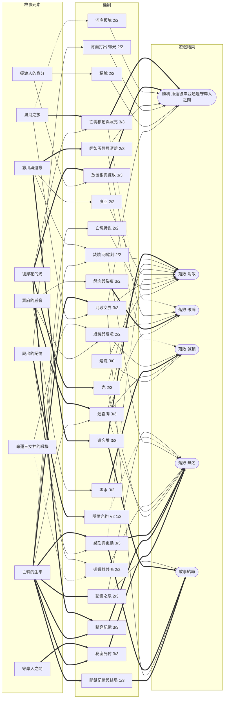

# 《彼岸花渡》V2 設計提案

- **依據**：規則書 V3.2（`docs/rules/zh-TW/Rulebook.md`）、TPE01 試玩（2026-11-02）觀察紀錄、11/3–11/4 的設計討論
- **狀態**：提案，已併入 11/4 第二輪決策。規則書與卡牌都還沒有改動。V2 規則已加進模擬器（可開關，預設仍是 V3.2），結果見 §5 與 `simulator/reports/v2_simulation.zh-TW.md`。
- **討論頁面**：[彼岸花渡 機制與故事關聯圖](https://claude.ai/artifact/Dp2oKUWCFwzDtcdt1gEZhq)

## 1. 這一版要解決什麼

TPE01 的核心回饋是「故事和玩法完全無關」。V3.2 的關聯分析也印證這點：故事層（信物、銘刻、關鍵記憶、結局）和勝負是兩條平行的軌道，中間只靠「共鳴 → 銘刻 → 頁面獎勵」一條細線相連，而那些獎勵本身沒有故事內容。

V2 的方向，是把憶念之書變成**渡河的必要條件**：

> 彼岸花的光引導亡魂前進；擺渡人用這道光照亮亡魂的記憶；被照亮的記憶，決定亡魂能不能在守岸人面前說出自己是誰，也決定前方的河會變成什麼樣子。

同時遵守兩個原則：**機制要一致，不加特例**；**每張牌、每塊板塊都要有自己的特色，不和其他牌重複**。

## 2. 決策總表

| # | 項目 | 決定 | 狀態 |
|---|---|---|---|
| 1 | 反派 | 不加入，這是合作遊戲 | 已決定 |
| 2 | 憶念之書 | 接進勝負 | 已決定 |
| 3 | 獲勝條件 | 秘密託付卡（方案三）＋河段交界依記憶改變下一段河（方案五） | 已決定 |
| 4 | 託付門檻 | 4 人完成 3 張、3 人 2 張、2 人 2 張、1 人 1 張 | 已決定，待模擬 |
| 5 | 託付卡內容 | 和亡魂的故事直接相關，不只是牌的種類或數量 | 已決定 |
| 6 | 託付卡重抽 | 每位玩家整局一次，可以棄掉託付卡重抽 1 張 | 已決定 |
| 7 | 點亮記憶 | 一次點亮一段，花 2 點光；只有點亮的記憶才算進託付 | 已決定 |
| 8 | 銘刻時朗讀 | 必要 | 已決定 |
| 9 | 更換已銘刻的記憶 | 可以；被取代的進遺忘堆；**已點亮的記憶與關鍵記憶不能被替換** | 已決定 |
| 10 | 頁面獎勵、章節祝福 | 先全部拿掉，新版本模擬後再測章節祝福 | 已決定 |
| 11 | 信物 | 移除 | 已決定 |
| 12 | 河段 | **4/4/5**，彼岸改為第 14 格（11/4 由 3/4/5 改定） | 已決定 |
| 13 | 後退 | 通用規則：亡魂永遠不會回到前一個河段 | 已決定 |
| 14 | 奮力駛過 | 先移除；模擬勝率過低再考慮 | 已決定，待模擬 |
| 15 | 隱憶之約 | 可以說絲線、欄位和記憶文字；不能說牌名、效果、共鳴；不能說託付。記憶文字留在牌上 | 已決定 |
| 16 | 河段交界 | 依絲線多數（內容）＋依段數（數量）改變下一河段 | 已決定，數值待模擬 |
| 17 | 交界時替換哪塊板塊 | 下一河段離亡魂最近、還沒翻開的第一塊，左岸優先 | 已決定 |
| 18 | 焚燒 | 成本不改；被選中的牌一律可以銘刻 | 已決定 |
| 19 | 背面打出 | 沒有合法位置時改為獲得 1 點光 | 已決定 |
| 20 | 守魂者 | 改為「駐足」 | 已決定 |
| 21 | 破霧者 | 改為「看穿迷霧」 | 已決定 |
| 22 | 新稱號 | 換牌效果，命名為「收割者」 | 已決定 |
| 23 | 暗潮回湧 | 保留；在河段第一格退不了時改為遺忘 1 張 | 已決定 |
| 24 | 迷霧牌 | 增加更有難度的迷霧，包含影響故事的（例如不能點亮記憶） | 已決定，待模擬 |
| 25 | 新板塊、新迷霧 | 每種都測，但每張都要有特色、不重複 | 已決定，待模擬 |
| 26 | 不復記憶 | 從 3 張減到 2 張，補 1 張新的忘卻牌 | 已決定 |
| 27 | 燈籠 | 重調，並減為三個難度 | 已決定，數值待模擬 |
| 28 | 最後火光的孩子 | 不調整 | 已決定 |
| 29 | 規則書排版與用字 | 機制定案後最後處理 | 已決定 |
| 30 | 點亮之前頁面的記憶 | 可以 | 已決定 |
| 31 | 交界替換的板塊 | 面朝上放入 | 已決定 |
| 32 | 託付卡文字 | 由 Claude 起草（§3.2），待你修改 | 草稿 |

## 3. V2 規則提案

### 3.1 獲勝與落敗

**勝利**：亡魂抵達彼岸（第 13 格），並通過**守岸人之問**：所有人亮出託付卡，已完成的張數達到門檻。

| 人數 | 託付卡 | 需要完成 |
|---|---|---|
| 1 人 | 1 | 1 |
| 2 人 | 2 | 2 |
| 3 人 | 3 | 2 |
| 4 人 | 4 | 3 |

**落敗**：原本的消散、破碎、滅頂，加上第四種：

- **無名**：抵達彼岸，但託付完成數未達門檻。亡魂答不出自己是誰，飲下了忘川之水。

故事依據：附錄 A 寫憶念之書是「古老的墓文囑咐亡者莫飲忘川，而要去尋找的記憶之泉」。這來自奧菲斯教的金箔墓文：亡者要向守衛說出自己是誰，才能喝記憶之泉的水。

### 3.2 託付卡

**基本規則**

- 開局每位擺渡人抽 1 張，**秘密**持有。託付卡的內容不能說出、不能討論，也不能暗示。
- **重抽**：每位玩家整局一次，可以在自己的回合、回應之前，把託付卡面朝下移出遊戲，重抽 1 張。
- **完成**：書上有一段符合條件的記憶，而且已經點亮。每段點亮的記憶只能完成 1 張託付。

**託付卡要和故事直接相關**

每位具名亡魂有自己的**託付牌組**（建議每位 8 張）。卡面上半部是一句**亡魂託付給擺渡人的話**，下半部是判定條件。條件只用遊戲裡已經有的三種資訊組合：**頁面**（我曾是誰／我做過什麼／我所懷抱的）、**絲線**（執念／釋懷）、**欄位**（地點／人物／事蹟／感受），或「**她的專屬記憶**」（該亡魂的 8 張專屬記憶牌）。

草稿共 40 張，每位具名亡魂 8 張，無名渡河 8 張。文字是我的草稿，條件已放進模擬器（`simulator/netherbloom/cards.py` 的 `COMMISSIONS`）。

**最後火光的孩子**

| # | 託付的話 | 條件 |
|---|---|---|
| 1 | 「幫我記得那一夜有多冷。」 | 第一頁有一段點亮的執念記憶 |
| 2 | 「我想記得火光裡看見的人。」 | 一段點亮的釋懷人物 |
| 3 | 「告訴我，我是在哪裡睡著的。」 | 第一頁有一段點亮的地點 |
| 4 | 「我點亮的那些小小火光，照見了什麼？」 | 一段點亮的「她的專屬記憶」 |
| 5 | 「那扇結霜的窗後面，是誰的家？」 | 一段點亮的釋懷地點 |
| 6 | 「我想知道，我曾經多麼餓。」 | 一段點亮的執念感受 |
| 7 | 「我做過的事裡，有沒有一件是溫暖的？」 | 第二頁有一段點亮的釋懷記憶 |
| 8 | 「最後，我懷抱著什麼離開？」 | 第三頁有一段點亮的感受 |

**花環少女**

| # | 託付的話 | 條件 |
|---|---|---|
| 1 | 「告訴我，我把花送給了誰。」 | 一段點亮的人物 |
| 2 | 「我曾經唱過的那首歌，還在嗎？」 | 第三頁有一段點亮的感受 |
| 3 | 「那棵垂柳下的溪水，是在哪裡？」 | 一段點亮的釋懷地點 |
| 4 | 「我為什麼會恨他？」 | 一段點亮的執念人物 |
| 5 | 「我編過的花，你還記得幾朵？」 | 一段點亮的「她的專屬記憶」 |
| 6 | 「父親教我認識的那些草藥。」 | 第一頁有一段點亮的釋懷記憶 |
| 7 | 「我做過最傻的一件事。」 | 一段點亮的執念事蹟 |
| 8 | 「我想帶著一點平靜離開。」 | 第三頁有一段點亮的釋懷記憶 |

**渡船上的國王**

| # | 託付的話 | 條件 |
|---|---|---|
| 1 | 「我最後一場戰役在哪裡？」 | 第二頁有一段點亮的地點 |
| 2 | 「我原諒他們了嗎？」 | 一段點亮的釋懷事蹟 |
| 3 | 「那頂王冠有多重？」 | 一段點亮的執念感受 |
| 4 | 「告訴我，誰曾經真心待我。」 | 一段點亮的釋懷人物 |
| 5 | 「我借來的那把劍……」 | 一段點亮的「他的專屬記憶」 |
| 6 | 「我守住過什麼？」 | 一段點亮的執念事蹟 |
| 7 | 「我年輕時是什麼樣的人？」 | 第一頁有一段點亮的記憶 |
| 8 | 「最後，我放下了嗎？」 | 第三頁有一段點亮的釋懷記憶 |

**留在冥府的新娘**

| # | 託付的話 | 條件 |
|---|---|---|
| 1 | 「讓我記住他的臉。」 | 一段點亮的人物 |
| 2 | 「讓我放手。」 | 第三頁有一段點亮的釋懷記憶 |
| 3 | 「我們在哪裡成婚？」 | 一段點亮的釋懷地點 |
| 4 | 「那一道窄窄的階梯。」 | 一段點亮的執念地點 |
| 5 | 「我氣他嗎？」 | 一段點亮的執念感受 |
| 6 | 「他的手最後的溫度。」 | 一段點亮的「她的專屬記憶」 |
| 7 | 「我跟著他走過的那條路。」 | 第二頁有一段點亮的執念記憶 |
| 8 | 「在婚禮之前，我是誰？」 | 第一頁有一段點亮的記憶 |

**無名渡河**

| # | 託付的話 | 條件 |
|---|---|---|
| 1 | 「他曾經愛過誰？」 | 一段點亮的人物 |
| 2 | 「他最後放不下的是什麼？」 | 第三頁有一段點亮的執念記憶 |
| 3 | 「他從哪裡來？」 | 第一頁有一段點亮的地點 |
| 4 | 「他做過什麼讓自己驕傲的事？」 | 一段點亮的釋懷事蹟 |
| 5 | 「他害怕什麼？」 | 一段點亮的執念感受 |
| 6 | 「他在哪裡找到過平靜？」 | 一段點亮的釋懷地點 |
| 7 | 「他後悔過嗎？」 | 第二頁有一段點亮的執念記憶 |
| 8 | 「他帶著什麼渡河？」 | 第三頁有一段點亮的釋懷記憶 |

- **無名渡河**：沒有故事，託付卡改成問句。
- **設計守則**：指定頁面的條件只能在該河段完成（失去的就失去了），所以同一張卡不要同時指定頁面、絲線和欄位三者；每副牌組要混合寬條件與窄條件，並用模擬器算每張的自然完成率。
- **不指定單一一張牌**：不要寫成「點亮『被擁抱』」，否則它被遺忘就無解，也會讓關鍵記憶的「遺忘」結局消失。

**為什麼不需要「放手」**：重抽就是出口。重抽在 2 人（2/2）和單人（1/1）時特別重要，因為沒有容錯空間。

### 3.3 憶念之書：銘刻、朗讀、點亮、更換

**可以銘刻的時機**（三條路，規則一致）：

1. 共鳴的牌（不變）。
2. 焚燒時被選來執行兩次的牌（見 3.7）。
3. 在記憶之泉放置根時（見 3.8）。

銘刻條件不變：牌上的欄位要對應亡魂**目前所在河段**的那一頁，忘卻牌不能銘刻，關鍵記憶只要正面打出就可以銘刻。

**朗讀**：銘刻時，立即朗讀那張牌上的記憶。

**點亮**：在你的回應之前，支付 2 點光，點亮書上**一段**已銘刻的記憶（將它從橫放轉正），不佔行動。新銘刻的記憶都是未點亮的。

- 只有點亮的記憶算進託付。
- 點亮的記憶**不能被替換**，也不會被「記憶剝落」等效果拿走。
- 也可以點亮之前河段頁面上的記憶。書頁已經寫定，但光仍然能照亮它。

**更換**：如果那個欄位已經有一段**未點亮**的記憶，新的記憶可以取代它，原本那張進遺忘堆。只能更換當前頁面；已點亮的記憶與關鍵記憶不能被取代。

**光的預算**：V3.2 模擬中每局約獲得 13–16 點光，10–14 點花在召喚和喚回，剩 3–6 點。完成 3 張託付需要 6 點光，會和喚回、召喚直接競爭。這正好回應「光後期沒用」，但也可能太緊，要模擬確認。

**移除**：頁面獎勵、章節祝福、花環少女的「3 段就有章節祝福」。

**結局**：結束時的朗讀保留，改成把每一頁串成完整的一句話來回顧。關鍵記憶的三種結局判定不變。

### 3.4 河流：3/4/5 與「失去的就失去了」

- **河段（11/4 定案為 4/4/5）**：第一河段第 1–4 格、第二河段第 4 格之後的第 5–8 格、第三河段第 9–13 格，彼岸是第 14 格。版圖比 V3.2 多兩格。
- 為什麼是 4/4/5：4 人時第三河段約 0.9 輪（V3.2 只有 0.5 輪），每個人在最後一段都能出手；第一河段保留 4 格，開局不急。代價是比 3/4/5 難（見 §5 的版面比較）。
- **通用後退規則**：亡魂永遠不會回到前一個河段。任何讓亡魂後退的效果，最多退到本河段的第一格。
  - 暗潮回湧：已在本河段第一格時，改為遺忘牌庫頂的 1 張。
  - 新娘的「被拉回一格」：在本河段第一格時不觸發，照常遺忘，特色規則留到之後再用。
  - 被拉回不算「離開」一格：不獲得光，也不清空原本那一格。
- **後方格子照樣清空**：根／花指示物只有 24 個；「每朵花只提供一次光」靠這條規則成立；故事上，花在亡魂走過後凋謝。

模擬參考（V3.2 其他規則不變，4 人，每格 300 局）：

| 河段 | 孩子・溫和 | 國王・標準 | 新娘・標準 | 第三河段玩家回合 |
|---|---|---|---|---|
| 4/4/3（V3.2） | 83% | 50% | 38% | 約 2 |
| 3/4/5 | 70% | 31% | 28% | 約 3.3–3.5 |

### 3.5 河段交界：這一頁的記憶，塑造下一段河

亡魂進入新河段的第一格時，依序執行兩條規則。第三頁沒有「下一段」，它的結果由守岸人之問承接。

**一、依內容：看上一頁已銘刻記憶的絲線多數**

| 上一頁 | 下一河段的板塊 | 下一河段的迷霧 | 故事 |
|---|---|---|---|
| 執念較多 | 1 塊石地換成沃土 | 洗入 1 張「怨念」 | 放不下的事讓根扎得更深，也讓怨念跟著你 |
| 釋懷較多 | 1 塊沃土換成花田 | 洗入 1 張「寒風」 | 放下讓花開得更快，也帶走一些東西 |
| 一樣多 | 1 塊板塊換成記憶之泉 | 不變 | 兩種心情都在，記憶浮了上來 |

結果是「不同」，不是「更好或更壞」。

**二、依數量：看上一頁已銘刻的段數**

| 段數 | 效果 | 故事 |
|---|---|---|
| 0 段 | 洗入 1 張「暗潮回湧」和 1 張凶霧 | 想不起來的過去，把亡魂往回拖 |
| 1 段 | 洗入 1 張凶霧 | 記憶模糊，冥府更近 |
| 2 段 | 不變 | |
| 3 段以上 | 1 塊板塊換成記憶之泉 | 記得越多，越容易想起更多 |

（數值暫定。凶霧從燈籠規定的數量之外另外抽。）

**替換哪一塊**：只替換**還沒翻開**的板塊。從下一河段中離亡魂最近的那一格開始找，第一塊還沒翻開的板塊就是要換的那塊；同一格左岸優先。要換第二塊時，再往後找下一塊。找不到符合種類的板塊（例如沒有未翻開的石地）就不換。

替換的板塊從盒中的備用板塊拿。新板塊**面朝上**放入，等於提前讓玩家看見那一格，也讓「記住什麼」的結果看得到。

### 3.6 隱憶之約 V2

- **可以說**：自己握有的絲線、牌上的欄位、牌上的記憶文字。
- **不能說**：牌名、效果、共鳴；不能展示手牌；不能說出或暗示自己的託付卡。
- **故事改寫**：第 1 節「亡魂的記憶不屬於你們，不能說出口」改為「記憶只有被說出來，才能被記住；但它的力量屬於亡魂，不屬於你們」。
- **記憶文字留在牌上**。接受的風險：每張牌的記憶文字是獨一的，老玩家聽到文字就能認出牌和效果。效果仍不能說，所以老玩家無法指揮別人；如果重複遊玩的團體覺得變簡單，就用燈籠調整。

### 3.7 出牌

- **焚燒**：成本不變（兩張牌、一起翻開、效果執行兩次）。被選來執行兩次的那張，**一律可以銘刻**（忘卻牌除外；欄位要對應當前頁面；可以更換未點亮的記憶）。另一張遺忘，另一位玩家抽 1 張。所以焚燒時若銘刻，只遺忘 1 張。
  - 單人：被焚燒的牌可以銘刻，牌庫頂那張照樣遺忘。
  - 故事：為了記住一件事，放下另一件。
- **背面打出**：放置 1 個根；若沒有合法位置，改為獲得 1 點光。故事：未說出的記憶化為微光。這解決了 TPE01 的「空轉回合」：前方被怨念、墳墓、石地擋住時，背面打出原本什麼都做不到。
- **奮力駛過**：移除，破浪標記也一起移除。
  - 注意：下一格兩岸都是怨念時，整理清不掉（根網不能穿過怨念），只能靠驅散、沖走的牌。V3.2 的模擬中，單純移除奮力駛過會讓勝率掉 5–11 個百分點。新的忘卻牌「無光之渡」（見 3.12）提供一條出路。如果 V2 模擬勝率仍過低，備案是「亡魂自己衝過去：移除兩個怨念，承受 1 道裂痕」。

### 3.8 河岸板塊

設計原則：每種板塊都是**翻開時立刻發生 1 個效果**（寒霜例外），用不同的「動詞」，彼此不重複。

| 板塊 | 效果 | 動詞 | 狀態 |
|---|---|---|---|
| 沃土 | 放置根 | 扎根 | V3.2 |
| 石地 | 只有「即使在石地上也可以」或織根者才能放根 | 阻擋 | V3.2 |
| 墳墓 | 不放根，改放 1 個怨念 | 怨念 | V3.2 |
| 記憶之泉 | 放置根，並可以不必共鳴，把 1 張手牌銘刻到當前頁面 | 銘刻 | 取代記憶之地 |
| 花田 | 放置根，並立即綻放 | 綻放 | 新 |
| 寒霜 | 放置根；這個河岸的花不會被凋零或黑水翻回根面 | 守護（持續） | 新 |
| 餘燼 | 放置根，並獲得 1 點光 | 光 | 新 |
| 迴聲之岩 | 放置根，並可以把迴響移到任一條絲線 | 共鳴 | 新 |

- **記憶之泉**：故事上就是憶念之書所指的「記憶之泉」。五位亡魂的規則都一樣，無名渡河「記憶之地 +2 光」的例外也隨之消失。
- **暫定分配**（4/4/5 共 24 塊，V3.2 為 20 塊；另備替換用的花田、沃土、記憶之泉各 2 塊）：
  - 第一河段（6 塊）：沃土 4、石地 1、記憶之泉 1
  - 第二河段（8 塊）：沃土 3、石地 1、記憶之泉 1、墳墓 1、花田 1、寒霜 1
  - 第三河段（10 塊）：沃土 4、石地 2、記憶之泉 1、墳墓 1、餘燼 1、迴聲之岩 1（墳墓 1 或 2 塊待定，見 §6）
- **要注意的重疊**：餘燼的「+1 光」和背面打出的後備光、「舊誓」牌都是光的來源。點亮記憶要 2 點光，光的來源多一點是合理的，但要模擬確認不會變得太寬鬆。

### 3.9 迷霧牌

V3.2 的迷霧牌已經涵蓋黑水、怨念、凋零、霧氣重返、遺忘、迴響斷絕、失去光、打結。TPE01 的玩家希望**多一點有難度的迷霧**，讓遊戲更刺激。新牌只加入現在沒有的壓力類型，並分成「一般」和「凶霧」兩級。

**一般迷霧（新）**

| 迷霧牌 | 效果 | 壓力類型 | 河段 |
|---|---|---|---|
| 暗潮回湧 | 亡魂退回前一格（不退過河段邊界）；退不了時，遺忘牌庫頂的 1 張 | 退後 | 二、三 |
| 記憶剝落 | 當前頁面最新銘刻、**未點亮**的記憶移到遺忘堆；沒有就沒事 | 書（失去記憶） | 二、三 |
| 熄燈 | 直到下一次迷霧前，不能點亮記憶 | 書（點亮的時機） | 二、三 |
| 沉默之霧 | 直到下一次迷霧前，所有人不能說出任何關於手牌的事 | 溝通 | 二 |
| 崩岸 | 亡魂前方最近的 1 個根被沖走，放回供應區 | 根網 | 一、二 |

**凶霧（新，較兇）**

| 迷霧牌 | 效果 | 壓力類型 |
|---|---|---|
| 河水漫過書頁 | 當前頁面所有未點亮的記憶移到遺忘堆 | 書（強） |
| 守岸人的凝視 | 下一次河段交界時，數量規則視為少 1 段（在第三河段：託付門檻 +1，上限為託付卡張數） | 交界／終點 |
| 濃霧蔽眼 | 直到下一次迷霧前，所有稱號失效 | 稱號 |
| 寒夜 | 直到你的下一個回合結束前，所有人手牌上限 −1 | 手牌 |
| 遠方雷聲 | 這張先放一旁。下一次迷霧翻 2 張並全部執行 | 預告 |
| 黑水回流 | 從盒中拿 1 個已移除的黑水放回供應區 | 資源 |

**需要處理的現有重複**：

- 「刺骨寒風」（第三河段）和凶霧「深寒」的效果完全相同（遺忘牌庫頂的 2 張）。建議把深寒換成上表的新凶霧。
- 「記憶剝落」和「河水漫過書頁」是同一個動詞的強弱兩級，和現有的凋零／大凋零、怨念／雙生怨念相同。如果你的「不重複」原則也包含強度遞增，就二選一。

**模擬參考**：第三河段只翻 2–3 張迷霧，所以**單張新迷霧幾乎不改變難度**（暗潮回湧的測試結果在誤差範圍內）。要讓遊戲更刺激，有三種方式可以搭配：提高凶霧在牌庫中的比例（由燈籠決定）、讓河段交界的數量規則加入凶霧（見 3.5），以及第三河段在困難燈籠下每回合翻 2 張迷霧。

### 3.10 稱號

稱號從 4 個變成 5 個。絲線分布：執念 2、釋懷 1、忘卻 2。

| 稱號（絲線） | 效果 | 狀態 |
|---|---|---|
| 織根者（執念） | 不變：根可以長在石地上；每回合第一個根效果多放 1 個根 | V3.2 |
| 守魂者（執念） | **駐足**：每輪一次，亡魂行動時，你可以讓亡魂留在原格，不遺忘任何牌 | 改 |
| 引花人（釋懷） | 不變：你的每個回合結束時，免費使 1 個根綻放 | V3.2 |
| 破霧者（忘卻） | **看穿迷霧**：每輪一次，在迷霧步驟之前，查看當前河段迷霧牌庫頂的 1 張，可以放到牌庫底 | 改 |
| 收割者（忘卻） | **新**：見下 | 新 |

**守魂者・駐足**：在 V2 裡停留有了價值。只能銘刻到當前河段的頁面；光要在離開一格時才獲得，多停一回合就能先讓兩岸都開花；也能避免走進有怨念的格子。代價很自然：迷霧照樣每回合翻開。故事上，是守魂者讓亡魂在一個地方多停一下，把它記住。

**破霧者・看穿迷霧**：迷霧牌不是記憶，不受隱憶之約限制，持有者可以告訴大家下一張是什麼，全隊一起準備。「每輪一次」用和守魂者一樣的橫放記號。

**收割者（Reaper）**：

> **收割者**（忘卻）：在你的回合、你的回應之前，查看記憶牌庫頂的 2 張牌，可以用其中 0、1 或 2 張替換你的手牌。換下的牌與沒拿的牌，以任意順序放回牌庫頂或牌庫底。

- **故事**：在忘川兩岸收割記憶，把要的留下，把不要的交還給河。
- **名稱提醒**：TPE01 玩家提過「加入 Reaper 反派」，你已決定不加反派。「收割者」作為擺渡人的一個角色沒有問題，只是要注意圖像與文案別讓人聯想成敵人。如果想避開，「拾穗者」（收割後撿拾留下的麥穗）也很貼近這個效果。
- **要注意的強度**：
  1. 放回牌庫頂的牌，你在回合結束抽牌時會抽回來，所以實際上等於從 5 張裡挑。
  2. 它能控制牌庫頂，所以能決定「遺忘牌庫頂」的效果（寒風、徘徊、認命、單人焚燒）會遺忘哪一張。故事上很好（選擇讓河水帶走什麼），但很強，要模擬。
  3. 很適合秘密託付：持有者可以替自己的託付找牌，而不必說出來。
- **召喚成本**：要棄 1 張忘卻牌。不復記憶減為 2 張、補 1 張新忘卻牌後，基本牌庫仍是 8 張忘卻牌。

### 3.11 亡魂

| 亡魂 | V2 調整 |
|---|---|
| 最後火光的孩子 | 不調整。她讓「破碎」幾乎不會發生（約 30% 的局有任何裂痕，其他亡魂約 70%），這是刻意的第一局保護。 |
| 花環少女 | 原特色規則（3 段就有章節祝福）隨章節祝福一起失效，新規則見下。 |
| 渡船上的國王 | 不變。 |
| 留在冥府的新娘 | 「被拉回一格」遵守通用後退規則。 |
| 無名渡河 | 記憶之地的例外取消（現在所有亡魂都是記憶之泉）。少了的光要補，例如起始 2 點光。託付卡改為問句。 |

**花環少女的新特色規則（建議）**：

> **送花**：每個河段一次，一位玩家可以把 1 張手牌面朝下交給另一位玩家。

- **故事**：她為每一個愛的人編了一朵花，一朵一朵送了出去。
- **機制**：這是遊戲中唯一能「移動手牌」的方式。送的人可以說出那張牌的記憶文字，但不能說效果。收的人可能正需要它來完成自己的秘密託付，但送的人並不知道，這正好和秘密託付形成張力。
- **關鍵記憶**不變：「我唯一留給自己的那朵花」。

### 3.12 記憶牌庫

- **不復記憶**從 3 張減到 2 張，補 1 張新的忘卻牌，基本牌庫維持 32 張。
- **新忘卻牌（建議）**：

  > **無光之渡**（忘卻）：亡魂立即前進一格，即使該格未照亮，或兩岸都有怨念（有黑水的格子不行）。若進入未照亮的格子，不獲得光。
  > **共鳴**：獲得 1 點光。

  - **故事**：忘記了恐懼，就能走過黑暗。
  - **機制**：它不和任何現有的牌重複。「引路」只能走向已照亮的格子；它可以走進黑暗，也可以穿過雙怨念。奮力駛過移除後，它是唯一主動穿過雙怨念的方法，代價是被遺忘。
- **守夜（建議修改）**：原效果（查看迷霧牌庫頂 3 張、重排）和破霧者的「看穿迷霧」重疊。建議改為：

  > **守夜**（執念）：點亮 1 段記憶，只需支付 1 點光。
  > **共鳴**：放置 1 個根。

  - **故事**：守著燈，徹夜不讓記憶熄滅。也是「熄燈」迷霧之外，唯一和點亮的時機有關的牌。
- **移除牌**變成：不復記憶 ×2、退潮、沖刷，加上亡魂專屬的 1–2 張；另有無光之渡可以穿過雙怨念。

### 3.13 燈籠：三個難度

V3.2 有溫和、標準、困難、英雄四個難度。V2 減為三個：

| 燈籠 | 用途 | 調整方向（數值待模擬） |
|---|---|---|
| ◆◇◇ 溫和 | 第一局、學習遊戲 | 黑水供應較多、消散門檻較高、不加凶霧 |
| ◆◆◇ 標準 | 一般遊戲，有經驗的隊伍約贏一半 | 加入少量凶霧 |
| ◆◆◆ 困難 | 想要更刺激 | 凶霧較多；第三河段每回合翻 2 張迷霧 |

燈籠可以調整的參數：黑水供應、消散門檻、每河段凶霧數、第三河段翻牌數。託付門檻**不**跟燈籠變動，維持依人數的固定值，避免規則多一層。

### 3.14 移除的機制

| 移除 | 原因 | 連帶 |
|---|---|---|
| 頁面獎勵 | 「填滿幾格就給獎勵」只是檢查表，和記憶內容無關 | 書頁的獎勵方框、§9 表格 |
| 章節祝福 | 同上；V3.2 中每局只觸發 0.1–0.2 次 | 花環少女特色規則；新版本模擬後再做 A/B 測試 |
| 信物 | 勝負 0 分 | 36 張信物牌、準備步驟 9、記憶之地 |
| 奮力駛過、破浪標記 | 規則重、每局只用 0.2–0.26 次 | 4 個破浪標記、遞增代價；待模擬 |
| 英雄燈籠 | 減為三個難度 | 燈籠表 |

## 4. 機制與故事關聯圖 V2

評分：**勝負**（0 = 不影響；1 = 間接；2 = 改變局勢；3 = 直接構成勝敗）／**故事**（0 = 沒有故事意義；1 = 只有名稱；2 = 行為符合故事；3 = 玩法本身在講故事）。

連線：粗線 `==>` 強（3），實線 `-->` 中（2），虛線 `-.->` 弱（1）。

V2 圖中把墳墓併入「河岸板塊」，把正面打出併入「銘刻與更換」和「隱憶之約」（記憶文字可以說出後，正面打出的故事意義就在這兩處）。

### V1（V3.2）與 V2 的評分比較

| 機制 | V1 勝負／故事 | V2 勝負／故事 | 變化的原因 |
|---|---|---|---|
| 銘刻（與更換） | 1 / 3 | **3 / 3** | 點亮後算進託付，直接決定能不能贏 |
| 點亮記憶 | — | **3 / 3** | 新：光照亮記憶 |
| 秘密託付 | — | **3 / 3** | 新：亡魂託付給擺渡人的話 |
| 河段交界 | — | **3 / 3** | 新：記憶的內容與數量改變前方的河，數量不足會加入凶霧 |
| 記憶之泉（原記憶之地與信物） | 0 / 2 | **2 / 3** | 從「找到不影響遊戲的信物」變成「銘刻的第三條路」 |
| 光 | 1 / 2 | **2 / 3** | 點亮記憶是主要用途 |
| 迷霧牌 | 3 / 2 | **3 / 3** | 記憶剝落、熄燈、河水漫過書頁直接威脅書 |
| 焚燒 | 2 / 0 | **2 / 2** | 為了記住一件事，放下另一件 |
| 背面打出 | 2 / 0 | **2 / 2** | 未說出的記憶化為微光，也不再空轉 |
| 隱憶之約 | 1 / 3 | 1 / 3 | 故事從最後 5 分鐘搬到整局 |
| 稱號 | 2 / 1 | **2 / 2** | 駐足、看穿迷霧、收割者都有故事動作 |
| 關鍵記憶與結局 | 0 / 3 | 1 / 3 | 銘刻後鎖住，也可能是託付的對象 |
| 頁面獎勵與章節祝福 | 2 / 0 | 移除 | 檢查表式的獎勵 |
| 信物 | （含在記憶之地） | 移除 | |
| 奮力駛過 | 1 / 1 | 移除 | 待模擬 |
| 燈籠 | 3 / 0 | 3 / 0 | 唯一仍然沒有故事意義的機制 |

### 象限的變化

| 象限 | V1 | V2 |
|---|---|---|
| 雙強核心（勝負 ≥2、故事 ≥2） | 11 個 | 21 個 |
| 故事孤島（故事 ≥2、勝負 ≤1） | 5 個：記憶之地與信物、隱憶之約、光、銘刻、關鍵記憶 | 2 個：隱憶之約、關鍵記憶 |
| 純機械（勝負 ≥2、故事 ≤1） | 7 個：墳墓、正面打出、背面打出、焚燒、稱號、頁面獎勵、燈籠 | 1 個：燈籠 |
| 雙弱 | 2 個：河岸地形、奮力駛過 | 0 個 |

V2 最大的結構變化：故事層不再是平行軌道。**光 → 點亮 → 託付 → 守岸人之問**和**記憶 → 河段交界 → 下一段河**，成為兩條從故事直達勝負的路；新的迷霧牌又從冥府那一側直接威脅書。遺忘堆仍是最強的橋：它同時連到消散、結局，現在也連到更換記憶、焚燒和記憶剝落的代價。

## 5. 模擬結果（摘要）

完整報告：`simulator/reports/v2_simulation.zh-TW.md`。條件：4 人，每格 200–300 局，勝率 %。

**逐項加入的影響**（孩子・溫和／花環少女・國王・新娘・無名渡河・標準，V3.2 燈籠數值）：

| 階段 | 孩子 | 花環少女 | 國王 | 新娘 | 無名渡河 |
|---|---|---|---|---|---|
| V3.2 | 83 | 51 | 50 | 38 | 65 |
| 拿掉頁面獎勵與章節祝福 | 72 | 35 | 35 | 29 | 55 |
| ＋3/4/5、移除奮力駛過 | 55 | 17 | 24 | 15 | 36 |
| ＋點亮（2 光）＋託付（4 人需 3 張） | 10 | 3 | 2 | 3 | 9 |
| 全部 V2 規則 | 21 | 8 | 11 | 9 | 7 |

- **最大的單一因素是點亮＋託付**，勝率掉 25–45 個百分點。點亮每局吃掉約 7 點光，喚回從每局 1.3 次降到 0.3–1 次。
- **最有幫助的是焚燒可銘刻＋背面打出的後備光**，勝率回升 5–20 個百分點。
- **只放寬燈籠救不回來**：消散門檻提到 14、黑水 7、不加凶霧，標準燈籠的勝率也只有 15–28%。
- **V2 板塊組成偏難**：第三河段 2 塊墳墓太多；無名渡河少了記憶之地的光，起始 2 點光補不回來。

**建議的調整**（全 V2，消散門檻 14，4 人）：託付 4 人需 2 張、點亮 1 點光、亡魂自己衝過雙怨念（承受 1 道裂痕）。

| 人數 | 孩子 | 花環少女 | 國王 | 新娘 | 無名渡河 |
|---|---|---|---|---|---|
| 4 人（門檻 14） | 71 | 47 | 54 | 45 | 51 |
| 3 人（門檻 13） | 69 | 48 | 47 | 42 | 46 |
| 2 人（門檻 13） | 48 | 32 | 29 | 38 | 37 |
| 1 人（門檻 13） | 71 | 58 | 58 | 56 | 61 |

2 人需完成 2/2 張、沒有容錯，「無名」落敗佔 10–22%，建議 2 人改為完成 1 張。

**4/4/5 的補充測試（11/4，建議組合、消散門檻 14，每格 200 局）**：

| 情境 | 孩子 | 花環少女 | 國王 | 新娘 | 無名渡河 |
|---|---|---|---|---|---|
| 4 人，第三河段墳墓 1 塊 | 83 | 62 | 60 | 54 | 58 |
| 4 人，第三河段墳墓 2 塊 | 67 | 43 | 46 | 38 | 46 |
| 2 人，託付需 2 張、可重抽 | 67 | 40 | 42 | 50 | 42 |
| 2 人，託付需 2 張、不能重抽 | 66 | 40 | 38 | 49 | 40 |
| 2 人，託付需 1 張、可重抽 | 84 | 62 | 58 | 66 | 61 |

- 墳墓 2 塊讓 4 人標準燈籠掉到 38–46%，大約等於升半級燈籠；破碎落敗從 9% 增加到 15%。
- 2 人時重抽幾乎沒有幫助。「無名」落敗中約 84% 是書上根本沒有符合託付的記憶，而不是光不夠點亮；重抽來的新託付一樣需要對的記憶，而 2 人每人只有約 2 輪可以銘刻。

**模擬器的限制**：AI 只知道自己的託付，不會用記憶文字溝通，所以託付完成率可能被低估；花環少女的「送花」沒有模擬；守魂者的「駐足」、收割者用的是簡單的 AI 規則。

## 6. 仍待你決定的項目

**模擬帶出的決策**（建議在下一輪模擬前定案）：

1. **託付門檻**：維持 4 人 3、3 人 2、2 人 2、1 人 1，還是改為 4 人 2、3 人 2、2 人 1、1 人 1？（模擬建議後者）
2. **點亮成本**：維持 2 點光，還是改為 1 點？（模擬建議 1 點；2 點會把喚回和召喚擠掉）
3. **奮力駛過**：完全移除時勝率會多掉一些；要不要改成「亡魂自己衝過雙怨念，承受 1 道裂痕」？（不需要玩家行動，也不需要破浪標記）
4. **燈籠數值（暫定）**：溫和為消散門檻 15、黑水 6、無凶霧；標準為 14、黑水 5、每河段 2 張凶霧；困難為 12、黑水 4、每河段 3 張凶霧，第三河段每回合翻 2 張迷霧。困難還沒模擬。
5. **板塊**：第三河段的墳墓從 2 塊改回 1 塊？無名渡河的補償提高到 3 點光？
6. **託付卡草稿**（§3.2）：文字與條件是否要修改？

**其他仍待決定**：

7. 強度遞增算不算重複：記憶剝落和河水漫過書頁要二選一，還是都保留？
8. 新稱號名稱：「收割者」或「拾穗者」？
9. 花環少女的新規則「送花」可以嗎？
10. 新牌「無光之渡」和修改後的「守夜」可以嗎？
11. 桌面區域：光池、牌庫與棄牌框、持續效果列（現在要多放熄燈、沉默之霧、濃霧蔽眼這類持續效果），以及守住防線的擺放方式。
12. 下一場試玩用哪個亡魂和燈籠？
13. 延後的規則書項目：第一局快速規則、回合結束的流程圖、補上 TPE01 的 5 次介入紀錄。
14. 章節祝福 A/B 測試：等第 1–5 項定案後再做。
