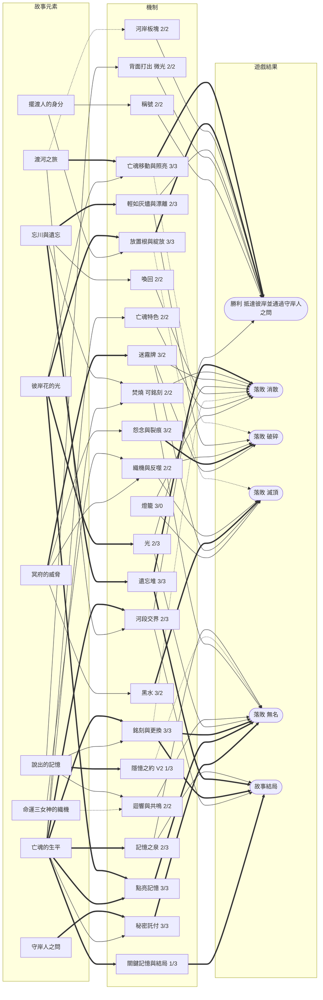

# 《彼岸花渡》V2 設計提案

- **依據**：規則書 V3.2（`docs/rules/zh-TW/Rulebook.md`）、TPE01 試玩（2026-11-02）觀察紀錄、11/3–11/4 的設計討論
- **狀態**：提案。規則書、卡牌與模擬器都還沒有改動。數字標「暫定」的，要等模擬後才能定。
- **討論頁面**：[彼岸花渡 機制與故事關聯圖](https://claude.ai/artifact/Dp2oKUWCFwzDtcdt1gEZhq)

## 1. 這一版要解決什麼

TPE01 的核心回饋是「故事和玩法完全無關」。V3.2 的關聯分析也印證這點：故事層（信物、銘刻、關鍵記憶、結局）和勝負是兩條平行的軌道，只靠「共鳴 → 銘刻 → 頁面獎勵」一條細線相連，而那些獎勵本身沒有故事內容。

V2 的方向是把憶念之書變成**渡河的必要條件**：

> 彼岸花的光引導亡魂前進；擺渡人用這道光照亮亡魂的記憶；被照亮的記憶，決定亡魂能不能在守岸人面前說出自己是誰，也決定前方的河會變成什麼樣子。

同時遵守你訂下的兩個原則：**機制要一致，不加特例**；**每張牌、每塊板塊都要有自己的特色，不和其他牌重複**。

## 2. 決策總表

| # | 項目 | 決定 | 狀態 |
|---|---|---|---|
| 1 | 反派 | 不加入，這是合作遊戲 | 已決定 |
| 2 | 憶念之書 | 接進勝負 | 已決定 |
| 3 | 獲勝條件 | 秘密託付卡（方案三）＋河段交界依記憶改變下一段河（方案五） | 已決定 |
| 4 | 託付門檻 | 4 人完成 3 張、3 人 2 張、2 人 2 張、1 人 1 張 | 已決定，待模擬 |
| 5 | 點亮記憶 | 只有點亮的記憶才算進託付；點亮花 2 點光 | 已決定，**範圍待定**（見 §8-1） |
| 6 | 銘刻時朗讀 | 必要 | 已決定 |
| 7 | 更換已銘刻的記憶 | 可以；被取代的進遺忘堆；關鍵記憶鎖住 | 已決定 |
| 8 | 頁面獎勵、章節祝福 | 先全部拿掉，新版本模擬後再測章節祝福 | 已決定 |
| 9 | 信物 | 移除 | 已決定 |
| 10 | 河段 | 3/4/5，彼岸改為第 13 格 | 已決定 |
| 11 | 後退 | 通用規則：亡魂永遠不會回到前一個河段 | 已決定 |
| 12 | 奮力駛過 | 先移除；模擬勝率過低再考慮 | 已決定，待模擬 |
| 13 | 隱憶之約 | 可以說絲線、欄位和記憶文字；不能說牌名、效果、共鳴；不能說託付 | 已決定 |
| 14 | 方案五主軸 | 記憶內容，看絲線多數 | 已決定 |
| 15 | 焚燒 | 成本不改；被選中的牌一律可以銘刻 | 已決定 |
| 16 | 背面打出 | 沒有合法位置時改為獲得 1 點光 | 已決定 |
| 17 | 守魂者 | 改為「駐足」 | 已決定 |
| 18 | 破霧者 | 改為「看穿迷霧」 | 已決定 |
| 19 | 新稱號 | 你指定的換牌效果，本文命名為「撈憶人」 | 已決定，待確認名稱 |
| 20 | 暗潮回湧 | 保留；在河段第一格退不了時改為遺忘 1 張 | 已決定 |
| 21 | 新板塊、新迷霧 | 每種都測，但每張都要有特色、不重複 | 已決定，待模擬 |
| 22 | 不復記憶 | 從 3 張減到 2 張 | 已決定 |
| 23 | 規則書排版與用字 | 機制定案後最後處理 | 已決定 |

## 3. V2 規則提案

### 3.1 獲勝與落敗

**勝利**：亡魂抵達彼岸（第 13 格），並通過**守岸人之問**：亮出所有託付卡，已完成的張數達到門檻。

| 人數 | 託付卡 | 需要完成 |
|---|---|---|
| 1 人 | 1 | 1 |
| 2 人 | 2 | 2 |
| 3 人 | 3 | 2 |
| 4 人 | 4 | 3 |

**落敗**：原本的消散、破碎、滅頂，加上第四種：

- **無名**：抵達彼岸，但託付完成數未達門檻。亡魂答不出自己是誰，飲下了忘川之水。

故事依據：附錄 A 寫憶念之書是「古老的墓文囑咐亡者莫飲忘川，而要去尋找的記憶之泉」。這來自奧菲斯教的金箔墓文：亡者要向守衛說出自己是誰，才能喝記憶之泉的水。

### 3.2 託付卡

- 開局每位擺渡人抽 1 張，**秘密**持有。託付卡的內容不能說出、不能討論，也不能暗示。
- 每張託付卡指定「**絲線＋欄位**」，例如「一段釋懷的人物」。不指定頁面，任何一頁都可以完成。
- **完成**：書上有一段符合的記憶，而且已經點亮。每段點亮的記憶只能完成 1 張託付。
- 託付牌組只有執念與釋懷兩種絲線（忘卻牌不能銘刻），共 2 × 4 = 8 種組合，各 1 張；發牌不會重複。
- 基本牌庫每種組合有 2–4 張牌（執念地點 4 張、釋懷地點 2 張，其餘各 3 張），再加上亡魂專屬牌。所以一張牌被遺忘，不會讓託付變成不可能。

**待確認**：

- 2 人要完成 2/2、單人要完成 1/1，沒有容錯空間。要不要保留「放手」這個出口？（例如支付 3 點光或遺忘 1 張牌，棄掉自己的託付並算完成；結局時讀出「這一段，她選擇了放下」。）建議保留，避免卡死。
- 「不能暗示」很難界定。秘密託付加上隱憶之約，會變成類似《花火》的溝通謎題。這正是想要的合作張力，但要在試玩時確認玩家是否覺得太難。

### 3.3 憶念之書：銘刻、朗讀、點亮、更換

**可以銘刻的時機**（三條路，規則一致）：

1. 共鳴的牌（不變）。
2. 焚燒時被選來執行兩次的牌（見 3.6）。
3. 在記憶之泉放置根時（見 3.8）。

銘刻條件不變：牌上的欄位要對應亡魂**目前所在河段**的那一頁，忘卻牌不能銘刻，關鍵記憶只要正面打出就可以銘刻。

**朗讀**：銘刻時，立即朗讀那張牌上的記憶。

**更換**：如果那個欄位已經有記憶，新的記憶可以取代它，原本那張進遺忘堆。只能更換當前頁面；關鍵記憶一旦銘刻就鎖住，不能被取代。

**點亮**：支付 2 點光點亮記憶，在你的回應之前進行，不佔行動。新銘刻的記憶是未點亮的，橫放在欄位裡。

- 只有點亮的記憶算進託付。
- 點亮的記憶不能被「記憶剝落」拿走，也不能被更換。
- 點亮的範圍（一段，還是一整頁）待定，見 §8-1。

**移除**：頁面獎勵、章節祝福、花環少女的「3 段就有章節祝福」。

**結局**：結束時的朗讀保留，改成把每一頁串成完整的一句話來回顧。關鍵記憶的三種結局判定不變。

### 3.4 河流：3/4/5 與「失去的就失去了」

- **河段**：第一河段第 1–3 格、第二河段第 4–7 格、第三河段第 8–12 格，彼岸是第 13 格。版圖要多一格。
- **通用後退規則**：亡魂永遠不會回到前一個河段。任何讓亡魂後退的效果，最多退到本河段的第一格。
  - 暗潮回湧：已在本河段第一格時，改為遺忘牌庫頂的 1 張。
  - 新娘的「被拉回一格」：在本河段第一格時不觸發，照常遺忘，特色規則留到之後再用。
  - 被拉回不算「離開」一格：不獲得光，也不清空原本那一格。
- **後方格子照樣清空**：根／花指示物只有 24 個；「每朵花只提供一次光」靠這條規則成立；故事上，花在亡魂走過後凋謝。

模擬參考（V3.2 其他規則不變，4 人，每格 300 局）：

| 河段 | 孩子・溫和 | 國王・標準 | 新娘・標準 | 第三河段玩家回合 |
|---|---|---|---|---|
| 4/4/3（V3.2） | 83% | 50% | 38% | 約 2 |
| 3/4/5 | 70% | 31% | 28% | 約 3.3–3.5 |

3/4/5 讓勝率下降 10–19 個百分點，大約等於升一級燈籠，所以燈籠表要重調。

### 3.5 河段交界（方案五）：這一頁的記憶，塑造下一段河

亡魂進入新河段的第一格時，看上一頁**已銘刻記憶的絲線多數**，依下表改變下一河段。結果是「不同」，不是「更好或更壞」。

| 上一頁 | 下一河段的板塊 | 下一河段的迷霧 | 故事 |
|---|---|---|---|
| 執念較多 | 1 塊未翻開的石地換成沃土 | 洗入 1 張「怨念」 | 放不下的事讓根扎得更深，也讓怨念跟著你 |
| 釋懷較多 | 1 塊未翻開的沃土換成花田 | 洗入 1 張「寒風」 | 放下讓花開得更快，也帶走一些東西 |
| 一樣多 | 1 塊未翻開的板塊換成記憶之泉 | 不變 | 兩種心情都在，記憶浮了上來 |
| 沒有記憶 | 不變 | 洗入 1 張「暗潮回湧」 | 想不起來的過去把亡魂往回拖 |

（數值暫定。第三頁沒有「下一段」，它的結果由守岸人之問承接。）

實作：迷霧牌庫在進入河段前都沒用到，交界時洗入即可。板塊已經放在版圖上，所以只能替換**還沒翻開**的那幾塊；換哪一塊建議隨機。

**待定**：要不要再加一條依「數量」的規則（原第 8 項 C），見 §8-3。

### 3.6 隱憶之約 V2

- **可以說**：自己握有的絲線、牌上的欄位、牌上的記憶文字。
- **不能說**：牌名、效果、共鳴；不能展示手牌；不能說出或暗示自己的託付卡。
- **故事改寫**：第 1 節「亡魂的記憶不屬於你們，不能說出口」改為「記憶只有被說出來，才能被記住；但它的力量屬於亡魂，不屬於你們」。
- **風險**：每張牌的記憶文字都是獨一的，老玩家聽到文字就能認出牌和效果。解法見 §8-4。

### 3.7 出牌

- **焚燒**：成本不變（兩張牌、一起翻開、效果執行兩次）。被選來執行兩次的那張，**一律可以銘刻**（忘卻牌除外；欄位要對應當前頁面，可以更換）；另一張遺忘，另一位玩家抽 1 張。所以焚燒時若銘刻，只遺忘 1 張。
  - 單人：被焚燒的牌可以銘刻，牌庫頂那張照樣遺忘。
  - 故事：為了記住一件事，放下另一件。
- **背面打出**：放置 1 個根；若沒有合法位置，改為獲得 1 點光。故事：未說出的記憶化為微光。這解決了 TPE01 出現的「空轉回合」：前方被怨念、墳墓、石地擋住時，背面打出什麼都做不到。
- **奮力駛過**：移除，破浪標記也一起移除。
  - 注意：下一格兩岸都是怨念時，整理清不掉（根網不能穿過怨念），只能靠驅散、沖走的牌，而不復記憶又減到 2 張。V3.2 的模擬中，單純移除奮力駛過會讓勝率掉 5–11 個百分點。如果 V2 模擬勝率過低，備案是「亡魂自己衝過去：移除兩個怨念，承受 1 道裂痕」（V3.2 模擬中勝率與現行相同）。

### 3.8 河岸板塊

設計原則：每種板塊都是**翻開時立刻發生 1 個效果**（寒霜例外），效果用圖示印在板塊上，各自用不同的「動詞」，彼此不重複。

| 板塊 | 效果 | 動詞 | 狀態 |
|---|---|---|---|
| 沃土 | 放置根 | 扎根 | V3.2 |
| 石地 | 只有「即使在石地上也可以」或織根者才能放根 | 阻擋 | V3.2 |
| 墳墓 | 不放根，改放 1 個怨念 | 怨念 | V3.2 |
| 記憶之泉 | 放置根，並可以不必共鳴，把 1 張手牌銘刻到當前頁面 | 銘刻 | 取代記憶之地 |
| 花田 | 放置根，並立即綻放 | 綻放 | 新 |
| 寒霜 | 放置根；這個河岸的花不會被凋零或黑水翻回根面 | 守護（持續） | 新 |
| 餘燼 | 放置根，並獲得 1 點光 | 光 | 新 |
| 迴聲之岩 | 放置根，並可以把迴響移到任一條絲線 | 共鳴 | 新 |

- **記憶之泉**：故事上就是憶念之書所指的「記憶之泉」。五位亡魂的規則都一樣，無名渡河「記憶之地 +2 光」的例外也隨之消失。
- **暫定分配**（3/4/5 共 22 塊，V3.2 為 20 塊）：
  - 第一河段（4 塊）：沃土 2、石地 1、記憶之泉 1
  - 第二河段（8 塊）：沃土 3、石地 1、記憶之泉 1、墳墓 1、花田 1、寒霜 1
  - 第三河段（10 塊）：沃土 3、石地 2、記憶之泉 1、墳墓 2、餘燼 1、迴聲之岩 1
- **要注意的重疊**：餘燼的「+1 光」和背面打出的後備光、「舊誓」牌都是光的來源。來源一多，光就不稀缺了。

### 3.9 迷霧牌

V3.2 的迷霧牌已經涵蓋黑水、怨念、凋零、霧氣重返、遺忘、迴響斷絕、失去光、打結。新牌只加入現在沒有的壓力類型：

| 迷霧牌 | 效果 | 壓力類型 | 河段 |
|---|---|---|---|
| 暗潮回湧 | 亡魂退回前一格（不退過河段邊界）；退不了時，遺忘牌庫頂的 1 張 | 退後 | 二、三 |
| 記憶剝落 | 當前頁面最新銘刻、**未點亮**的記憶移到遺忘堆；沒有就沒事 | 書的進度 | 二、三 |
| 沉默之霧 | 直到下一次迷霧前，所有人不能說出任何關於手牌的事 | 溝通 | 二 |
| 遠方雷聲 | 這張先放一旁。下一次迷霧翻 2 張並全部執行 | 預告 | 三 |
| 黑水回流 | 從盒中拿 1 個已移除的黑水放回供應區 | 資源 | 凶霧 |

**V3.2 現有的重複**：「刺骨寒風」（第三河段）和凶霧「深寒」的效果完全相同（遺忘牌庫頂的 2 張）。建議把深寒換成「黑水回流」或「遠方雷聲」。凋零／大凋零／凋零風暴、怨念／雙生怨念／怨念成群屬於同一動詞的強度遞增，是否算「重複」由你判斷。

**模擬參考**：第三河段只翻 2–3 張迷霧，所以**單張新迷霧牌幾乎不改變難度**（暗潮回湧的測試結果在誤差範圍內）。新迷霧牌的價值在於故事感和變化，難度要靠河段長度、燈籠或「每回合翻幾張」來調。

### 3.10 稱號

稱號從 4 個變成 5 個。絲線分布：執念 2、釋懷 1、忘卻 2。

| 稱號（絲線） | 效果 | 狀態 |
|---|---|---|
| 織根者（執念） | 不變：根可以長在石地上；每回合第一個根效果多放 1 個根 | V3.2 |
| 守魂者（執念） | **駐足**：每輪一次，亡魂行動時，你可以讓亡魂留在原格，不遺忘任何牌 | 改 |
| 引花人（釋懷） | 不變：你的每個回合結束時，免費使 1 個根綻放 | V3.2 |
| 破霧者（忘卻） | **看穿迷霧**：每輪一次，在迷霧步驟之前，查看當前河段迷霧牌庫頂的 1 張，可以放到牌庫底 | 改 |
| 撈憶人（忘卻） | **新**：見下 | 新 |

**守魂者・駐足**：在 V2 裡停留有了價值。只能銘刻到當前河段的頁面；光要在離開一格時才獲得，多停一回合就能先讓兩岸都開花；也能避免走進有怨念的格子。代價很自然：迷霧照樣每回合翻開。故事上，是守魂者讓亡魂在一個地方多停一下，把它記住。

**破霧者・看穿迷霧**：迷霧牌不是記憶，不受隱憶之約限制，持有者可以告訴大家下一張是什麼，全隊一起準備。「每輪一次」用和守魂者一樣的橫放記號。「守夜」牌（查看迷霧牌庫頂 3 張、重排）和它重疊，建議修改守夜，見 §8-6。

**撈憶人（新稱號）**：

> **撈憶人**（忘卻）：在你的回合、你的回應之前，查看記憶牌庫頂的 2 張牌，可以用其中 0、1 或 2 張替換你的手牌。換下的牌與沒拿的牌，以任意順序放回牌庫頂或牌庫底。

- **故事**：在忘川裡撈起沉下去的記憶，把不要的放回河裡。放在忘卻絲線，是因為它處理的是「流走的記憶」。
- **要注意的強度**：
  1. 放回牌庫頂的牌，你在回合結束抽牌時會抽回來，所以實際上等於從 5 張裡挑。
  2. 它能控制牌庫頂，所以能決定「遺忘牌庫頂」的效果（寒風、徘徊、認命、焚燒的單人規則）會遺忘哪一張。這在故事上很好（選擇讓河水帶走什麼），但很強，要模擬。
  3. 也很適合秘密託付：持有者可以替自己的託付找牌。
- **召喚成本**：要棄 1 張忘卻牌。不復記憶減到 2 張後，基本牌庫只剩 7 張忘卻牌，忘卻的兩個稱號都會比較難召喚，見 §8-5。

### 3.11 亡魂

| 亡魂 | V2 調整 |
|---|---|
| 最後火光的孩子 | 規則不變。注意：她讓「破碎」幾乎不會發生（約 30% 的局有任何裂痕，其他亡魂約 70%），守住防線、修補等牌在第一局會顯得沒用。建議第一局是否仍推薦她，見 §8-7。 |
| 花環少女 | 原特色規則（3 段就有章節祝福）隨章節祝福一起失效，新規則見下。 |
| 渡船上的國王 | 不變。 |
| 留在冥府的新娘 | 「被拉回一格」遵守通用後退規則。 |
| 無名渡河 | 記憶之地的例外取消（現在所有亡魂都是記憶之泉）。少了的光要補，例如起始 2 點光。書頁留白，由玩家自己寫。 |

**花環少女的新特色規則（建議）**：

> **送花**：每個河段一次，一位玩家可以把 1 張手牌面朝下交給另一位玩家。

- **故事**：她為每一個愛的人編了一朵花，一朵一朵送了出去。
- **機制**：這是遊戲中唯一能「移動手牌」的方式。送的人可以說出那張牌的記憶文字，但不能說效果。收的人可能正需要它來完成自己的秘密託付，但送的人並不知道，這正好和秘密託付形成張力。
- **關鍵記憶**不變：「我唯一留給自己的那朵花」。

### 3.12 記憶牌庫

- 不復記憶從 3 張減到 2 張。基本牌庫變成 31 張，或補 1 張新的忘卻牌，見 §8-5。
- 移除牌剩 4 張：不復記憶 ×2、退潮、沖刷，加上亡魂專屬的 1–2 張。
- 和「奮力駛過移除」疊在一起，兩岸都是怨念時的出路會變少，要在模擬裡特別看「卡在雙怨念」的次數。

### 3.13 移除的機制

| 移除 | 原因 | 連帶 |
|---|---|---|
| 頁面獎勵 | 「填滿幾格就給獎勵」只是檢查表，和記憶內容無關 | 書頁的獎勵方框、§9 表格 |
| 章節祝福 | 同上；V3.2 中每局只觸發 0.1–0.2 次 | 花環少女特色規則；新版本模擬後再做 A/B 測試 |
| 信物 | 勝負 0 分；保留的唯一理由只剩託付 | 36 張信物牌、準備步驟 9、記憶之地 |
| 奮力駛過、破浪標記 | 規則重、每局只用 0.2–0.26 次 | 4 個破浪標記、遞增代價；待模擬 |

## 4. 機制與故事關聯圖 V2

評分：**勝負**（0 = 不影響；1 = 間接；2 = 改變局勢；3 = 直接構成勝敗）／**故事**（0 = 沒有故事意義；1 = 只有名稱；2 = 行為符合故事；3 = 玩法本身在講故事）。

連線：粗線 `==>` 強（3），實線 `-->` 中（2），虛線 `-.->` 弱（1）。

V2 圖中把墳墓併入「河岸板塊」，把正面打出併入「銘刻與更換」和「隱憶之約」（記憶文字可以說出後，正面打出的故事意義就在這兩處）。

### V1（V3.2）與 V2 的評分比較

| 機制 | V1 勝負／故事 | V2 勝負／故事 | 變化的原因 |
|---|---|---|---|
| 銘刻（與更換） | 1 / 3 | **3 / 3** | 點亮後算進託付，直接決定能不能贏 |
| 點亮記憶 | — | **3 / 3** | 新：光照亮記憶 |
| 秘密託付 | — | **3 / 3** | 新：守岸人之問 |
| 河段交界（方案五） | — | **2 / 3** | 新：記憶內容改變前方的河 |
| 記憶之泉（原記憶之地與信物） | 0 / 2 | **2 / 3** | 從「找到不影響遊戲的信物」變成「銘刻的第三條路」 |
| 光 | 1 / 2 | **2 / 3** | 多了點亮記憶這個主要用途 |
| 焚燒 | 2 / 0 | **2 / 2** | 為了記住一件事，放下另一件 |
| 背面打出 | 2 / 0 | **2 / 2** | 未說出的記憶化為微光，也不再空轉 |
| 隱憶之約 | 1 / 3 | 1 / 3 | 故事從最後 5 分鐘搬到整局 |
| 稱號 | 2 / 1 | **2 / 2** | 駐足、看穿迷霧、撈憶人都有故事動作 |
| 關鍵記憶與結局 | 0 / 3 | 1 / 3 | 銘刻後鎖住，也算進託付 |
| 頁面獎勵與章節祝福 | 2 / 0 | 移除 | 檢查表式的獎勵 |
| 信物 | （含在記憶之地） | 移除 | |
| 奮力駛過 | 1 / 1 | 移除 | 待模擬 |
| 燈籠 | 3 / 0 | 3 / 0 | 唯一仍然沒有故事意義的機制 |

### 象限的變化

| 象限 | V1 | V2 |
|---|---|---|
| 雙強核心（勝負 ≥2、故事 ≥2） | 11 個 | 21 個 |
| 故事孤島（故事 ≥2、勝負 ≤1） | 5 個：記憶之地與信物、隱憶之約、光、銘刻、關鍵記憶 | 2 個：隱憶之約、關鍵記憶 |
| 純機械（勝負 ≥2、故事 ≤1） | 7 個：墳墓、正面打出、背面打出、焚燒、稱號、頁面獎勵、燈籠 | 1 個：燈籠 |
| 雙弱 | 2 個：河岸地形、奮力駛過 | 0 個（奮力駛過移除；河岸板塊有了新種類） |

V2 最大的結構變化：故事層不再是平行軌道。**光 → 點亮 → 託付 → 守岸人之問**和**記憶內容 → 河段交界 → 下一段河**，成為兩條從故事直達勝負的路。遺忘堆仍是最強的橋：它同時連到消散、結局，現在也連到更換記憶和焚燒的代價。

## 5. 對你問題的回答

**點亮 2 點光，是一次點亮一整頁，還是一段記憶？**
建議**一整頁**：「支付 2 點光，點亮當前頁面目前所有已銘刻的記憶；之後再銘刻到這一頁的記憶，要再點亮一次。」理由：

- **光的預算**：V3.2 模擬中每局約獲得 13–16 點光，其中 10–14 點花在召喚和喚回，剩 3–6 點。如果每段 2 點，完成 3 張託付就要 6 點，會把喚回和召喚擠掉一大半；每頁 2 點的話，三頁最多約 6–8 點，而且多半不必三頁都點。
- **時機抉擇**：早點亮能保護記憶（不被記憶剝落、不能被更換），晚點亮則一次照亮更多段。玩家會自然討論「現在點還是等一下」。
- **和更換規則一致**：點亮就是「這一頁定了」。

**第 8 項 C 是基於數量而非內容嗎？**
是。C 是「亡魂離開河段時，那一頁少於 2 段，每缺 1 段遺忘 1 張」，只看段數。它和方案五（看內容）處理的是不同的東西：方案五讓「記住什麼」有意義，C 讓「記住多少」有意義。V2 已經有託付門檻來處理「記住多少」，所以 C 可能變成雙重懲罰。是否保留見 §8-3。

**看填的欄位會不會太難？**
會。看欄位的話，玩家要同時記住 4 個欄位 × 3 頁的狀態，又要配合秘密託付。看絲線多數只要數執念和釋懷，一眼就看得出來。V2 採用絲線多數。

## 6. 模擬計畫（等你決定再做）

只在模擬器加入可開關的選項，不改規則書。

1. **基準**：V3.2，拿掉頁面獎勵和章節祝福（已有數據：孩子・溫和 70%、國王・標準 34%、新娘・標準 28%）。
2. **逐項加入**，每加一項記一次勝率：3/4/5 → 移除奮力駛過 → 不復記憶 3 張減為 2 張 → 點亮＋託付 → 方案五 → 焚燒可銘刻 → 背面打出的後備光 → 新稱號 → 新板塊 → 新迷霧。
3. **特別觀察**：託付完成率（各人數）、卡在雙怨念的次數、光的收支、各稱號的召喚率、記憶之泉與花田的使用率。
4. **燈籠重調**：讓標準燈籠回到「有經驗的隊伍約贏一半」。
5. **章節祝福 A/B 測試**：在新版本上加回一種章節祝福，比較差異。

模擬器的限制：AI 不會主動「選擇駐足」、不會為了方案五挑絲線、也不會處理秘密託付的溝通限制。這幾項要加簡單的 AI 規則，或靠試玩觀察。

## 7. 仍待你決定的項目

1. **點亮的範圍**：一段一次，還是一整頁一次？（建議一整頁，見 §5）
2. **託付的出口**：要不要保留「放手」（3 點光或遺忘 1 張）？2 人和單人沒有容錯空間。（建議保留）
3. **數量規則**：第 8 項 C（少於 2 段就遺忘）要保留、拿掉，還是改成方案五的輔助規則（「沒有記憶」那一列）？（建議拿掉 C，只留方案五表格的「沒有記憶」那一列）
4. **記憶文字的洩漏**：既然記憶文字可以說，要不要把記憶文字從牌上搬到書上（每頁每欄印執念版和釋懷版各一句，銘刻時依牌的絲線朗讀）？這樣也能讓每位亡魂的記憶都是她自己的。（建議搬到書上）
5. **忘卻牌的數量**：不復記憶減為 2 張後，基本牌庫要變成 31 張，還是補 1 張新的忘卻牌？忘卻牌變少，破霧者和撈憶人都較難召喚。要不要改變召喚成本（例如棄任意 1 張）？
6. **守夜**：和破霧者重疊，要改成什麼效果？
7. **第一局推薦的亡魂**：孩子讓破碎幾乎不會發生，要不要改推薦其他亡魂，或調整她的規則？
8. **新稱號的名稱**：「撈憶人」可以嗎？
9. **花環少女的新規則**：「送花」可以嗎？
10. **無名渡河的補償**：起始 2 點光可以嗎？
11. **迷霧的重複**：深寒要換成什麼？強度遞增的牌算不算重複？
12. **桌面區域**（第 9 項）：光池、牌庫與棄牌框、持續效果列，以及守住防線的擺放方式。
13. **下一場試玩**：用哪個亡魂和燈籠？
14. **延後的規則書項目**：第一局快速規則、回合結束的流程圖、補上 TPE01 的 5 次介入紀錄。
