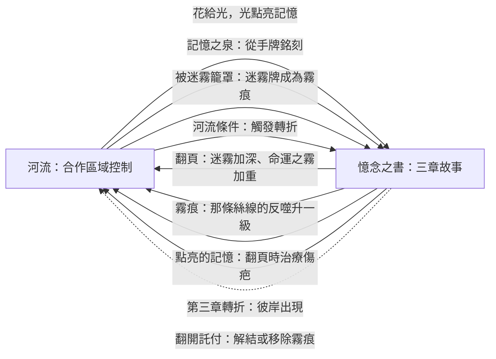
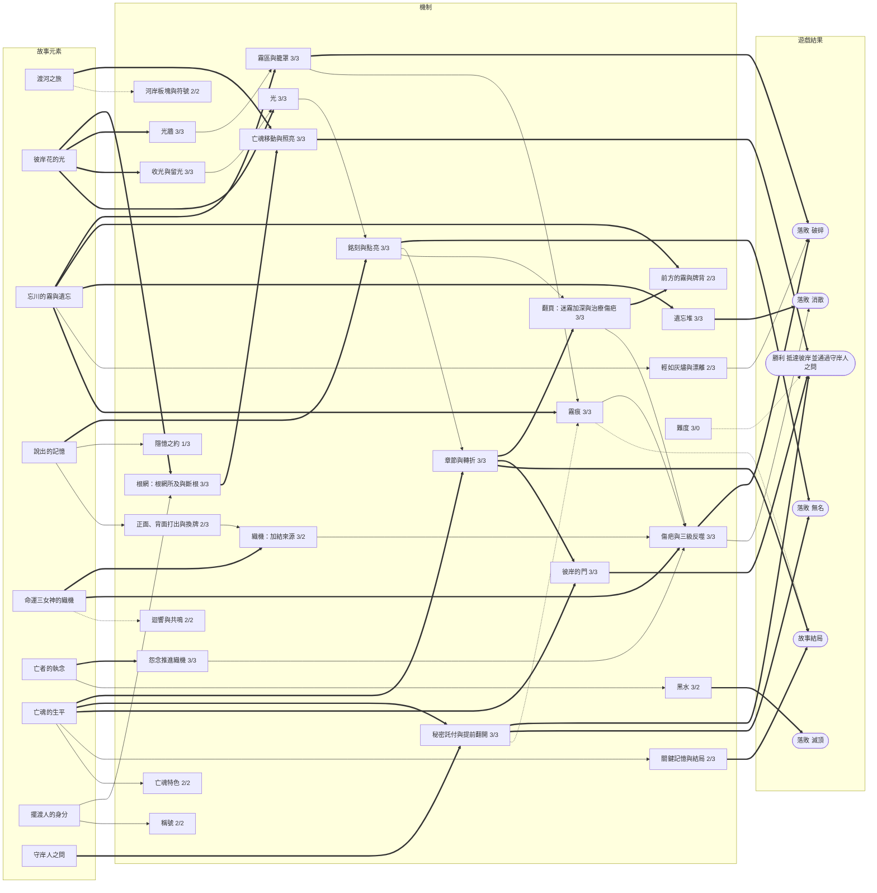

# 《彼岸花渡》V5 提案（修訂版）：兩個盤面，故事推動難度

- **依據**：
  - 規則 V4.0（`docs/rules/zh-TW/V4.0/Rulebook.md`）
  - TPE02 盲測回饋與《詭鎮奇談：卡牌版》機制研究（`docs/design/TPE02-arkham-study.zh-TW.md`）
  - 11/5–11/6 的留言討論
  - V5 模擬報告（`simulator/reports/v5_simulation.zh-TW.md`）
- **狀態**：修訂草案。
  - 這一版採用模擬報告 §9 的建議，取消河段，改成**故事章節**。
  - 新的數值都還沒模擬。標為「待模擬」的項目見 §11。
- **各亡魂的故事書**：見 `docs/design/V5-storybooks.zh-TW.md`，內容包括書頁、命運之霧、結局。
- **一句話**：玩家同時玩兩個遊戲：
  - 在**河流**上合作搶佔河岸。
  - 在**憶念之書**裡寫亡魂的故事。

  河上發生的事改寫故事；故事每翻一章，河就變得更兇。

## 0. 這一版改了什麼

### 0.1 取消河段，改成故事章節

V5 初版的難度跟著**位置**前進：亡魂走到第二、第三河段，迷霧、板塊、命運之霧才跟著變。故事只是跟在後面的記錄。

修訂版把順序倒過來：**難度跟著故事前進。**

- 河流是一條連續的河（第 0–14 格），沒有河段，也沒有交界。
- 憶念之書有三章。每一章都以一張**命運之霧**作為**轉折**收尾，轉折發生後就翻頁。
- 翻頁時，迷霧換成更深的一副，命運之霧也更重。
- 什麼時候翻頁，取決於河上與書上的局面：轉折的條件一半看河流，一半看書。玩家可以提早推進故事，也可以拖延，但都要付出代價（§5）。
- 彼岸只在第三章的轉折之後才會出現：故事沒寫完，亡魂就到不了彼岸。

### 0.2 依模擬報告修正的數值與規則

| 報告建議 | 修訂版的做法 | 段落 |
|---|---|---|
| 1. 迷霧的怨念放在前方第 1 格 | 採用。怨念不移動，放遠了會變成永久路障 | §4.3 |
| 2. 霧只在亡魂沒有前進時推進 | 採用：「她停下來，霧就追上她」 | §3.2、§4.4 |
| 3. 減少織機的加結來源 | 迷霧牌不再加結；怨念只看亡魂所在格；門檻 +2（6／7） | §6 |
| — 結跨河段造成死亡螺旋 | 翻頁時清空結（同 V4.0）；點亮的記憶改為治療傷疤 | §5.4 |
| 4. 根網特性「跨越」永遠不會觸發 | 改為「一樣多時」；整條規則列為可選 | §5.4 |
| 5. 命運之霧補規則 | 每章固定一個轉折；第三章的轉折是抵達彼岸的前提；「清明」只看被迷霧籠罩的霧痕 | §5.2、§8 |
| 6. 單人需要補償 | 單人換牌（從牌庫頂）；單人的織機門檻再 +1 | §3.1、§6 |
| 7. 難度改調裂痕 | 難度改調籠罩的裂痕與霧勢；消散門檻與黑水固定 | §9 |
| 待定 9：花環少女 | 新特色規則「散花」 | 故事書 |
| 待定 1：翻開託付的獎勵 | 解開 2 個結，或移除本頁 1 個霧痕 | §7.3 |

## 1. 為什麼要改

TPE02 的兩個核心回饋：

1. **故事和勝負沒有連結。**V4.0 的託付卡已經把書接上勝負，但故事只在最後檢查，遊戲過程中仍然感覺不到。
2. **看不到後果，無法提前規劃。**壓力只來自隨機翻開的迷霧；玩家唯一會主動計算的，是黑水還有幾步。

V5 的對策：

- **讓威脅像黑水一樣看得到、算得出來。**
  - 霧從身後吞掉河岸。
  - 怨念推進織機。
  - 織機的反噬會累加。
- **讓故事決定局面。**
  - 書上的章節決定迷霧有多深、命運之霧有多重。
  - 被霧籠罩的時刻寫進書裡，改變反噬。
  - 三個轉折決定結局。
- **不加新配件**，只改印現有的卡牌、板塊、織機板與書頁。

## 2. 設計核心：兩個盤面

| 盤面 | 玩家在做什麼 | 對手 |
|---|---|---|
| **河流** | 用根和花佔住河岸、照亮前路，讓亡魂前進；在身後留下光牆擋霧，驅散擋路的怨念。 | **霧**在亡魂停下時從身後吞掉河岸；**怨念**推進織機；**黑水**擋路。 |
| **憶念之書** | 銘刻並點亮記憶，完成秘密託付，選擇在哪一刻讓故事轉折。 | 霧痕；命運之霧把故事推向更深的章節。 |

**篩選原則**：每一條規則都要至少接到一條箭頭上。只影響其中一個盤面的規則，優先拿掉。

## 2.5 資訊放在哪裡：用最少的指示物

原則：**能印的就印在卡上或板上，會變動的數字用軌道加一個標記**，不用一堆小指示物。

| 資訊 | 放在哪裡 | 配件 |
|---|---|---|
| **章節** | 憶念之書翻到哪一頁，就是哪一章。 | 無 |
| **轉折** | 章節旁的 2 張命運之霧，條件面朝上。 | 每位亡魂 12 張 |
| **迷霧的深度** | 迷霧槽裡是哪一副：淺霧（第一章）、濃霧（第二章）、深霧（第三章）。看牌背顏色就知道。 | 無 |
| **霧勢** | 印在迷霧牌的牌面與牌背。 | 無 |
| **前方的霧／下下一張** | 槽裡面朝上的那張，以及牌庫頂的牌背。 | 無 |
| **霧在哪裡** | 被翻回霧面的河岸板塊本身。 | 無（用現有板塊） |
| **光（資源）** | 渡帳上的**光軌**（0–12），一個標記。 | 1 個標記 |
| **根、花、凋零** | 根／花雙面指示物。凋零就是把花翻回根面。 | 同 V4.0 |
| **織機的結** | 每條絲線一條軌道、一個標記。 | 3 個標記 |
| **傷疤** | 每條絲線旁一條短軌（0–2），一個標記；門檻與反噬等級直接印在軌上。 | 3 個標記 |
| **霧痕** | 迷霧牌本身，放進書頁的霧痕欄。 | 無 |
| **怨念、黑水** | 同 V4.0。 | 同 V4.0 |
| **根網特性**（可選） | 印在書頁底部；翻頁時看上一頁，口頭確認。 | 無 |

**河流圖板**：一條連續的河，此岸（0）、第 1–13 格、彼岸（14）。V4.0 的三塊河段圖板可以照舊拼接，但上面不再印河段名稱與交界標記；迷霧槽只有一個。

## 3. 一回合

### 3.1 你的回合

1. **引發共鳴之前**（免費）：召喚稱號、重抽託付、收割者。
2. **引發共鳴**：打出 1 張牌（正面、背面、換牌），或**喚回**。只有這個行動打出的牌能共鳴。
3. **製造迴響**：打出 1 張牌（正面、背面、換牌；兩個行動合計每回合最多換牌一次），或**喚回**。這張牌不會共鳴，但正面打出時會把迴響移到它的絲線，為下一位玩家鋪路。
4. **點亮與託付**（免費，在兩個行動之後）：
   - **點亮記憶**：每段 1 光，數量不限。可以點亮任何一頁，包括這回合剛銘刻的記憶。
   - **翻開已完成的託付**（§7.3）。

**喚回**（佔用一個行動，每回合最多一次）：支付 3 光，從遺忘堆選 1 張執念或釋懷牌，**銘刻**到當前頁面對應的空欄位，朗讀它的記憶。這段記憶未點亮。
- 忘卻牌不能喚回。
- 被遺忘的關鍵記憶也可以這樣找回來。

**換牌**（取代焚燒）：用你的 1 張手牌和另一位玩家交換 1 張，並立即**正面打出**換來的牌，照正面打出的規則執行。
- 兩張牌不需要同一條絲線。
- 對方決定給你哪一張。你可以照隱憶之約描述你需要什麼，但不能說效果。
- **單人**：把 1 張手牌放到記憶牌庫底，翻開牌庫頂的 1 張並立即正面打出。

**背面打出**：放 1 個根，並在那張牌的絲線**加 1 個結**。無處放根時改得 1 光，仍要加結。

**自由行動：奮力駛過**。在你的回合中隨時可以使用，每位玩家整局一次。
- 時機：下一格兩岸都有怨念，而且沒有黑水。
- 效果：亡魂移到下一格，並承受 1 道裂痕。

### 3.2 回合結束（每位玩家的回合後，依序）

1. **引花人**。
2. **亡魂行動**（V4.0 流程圖），另有兩處修改：
   - **離開一格**時二選一：
     - **收光**：每朵花得 1 光，花凋零成根。
     - **留光**：不得光，花留下。兩岸都是花的格子就是**光牆**。
   - **彼岸的門**：第三章的轉折發生之前，第 13 格的下一格視為未照亮。所以亡魂會停在第 13 格徘徊（§5.3）。
3. **怨念推進織機**：亡魂所在格的每個怨念，依它所在的河岸加 1 個結：
   - 左岸→執念
   - 右岸→釋懷
   - 霧面河岸上（霧中的怨念）→忘卻
4. **迷霧**：執行面朝上的「前方的霧」：
   1. **執行牌上的效果**。
   2. **霧推進**：只在亡魂**這回合沒有前進**時（徘徊、駐足、被認命或被拉回）推進。從亡魂身後最近、還沒被籠罩的河岸開始，把 N 個河岸翻回霧面（N＝霧勢，左岸優先）。遇到光牆時，剩下的每 1 點霧勢讓光牆的 1 朵花凋零。
   3. **檢查籠罩**（§4.4）。
   4. 把迷霧牌庫頂的牌翻開，成為新的前方的霧。
5. **翻頁**：如果這回合發生了轉折，現在翻到下一章（§5.4）。
6. **整理**（同 V4.0）。
7. **抽牌**。
8. 單人：幽靈行動，再整理一次。
9. 傳船槳。

**轉折**（§5.2）不在固定步驟：條件一達成就立即翻開執行，到這回合的「翻頁」步驟才換章。

## 4. 河流：合作區域控制

### 4.1 根網

V4.0 的放根、綻放、連接規則不變，再加上：

- **根網就是射程**：驅散、排乾、綻放等效果的目標，要**緊鄰一個與亡魂相連的根或花**，不再用「最近的」。
- **斷根**：只有與亡魂所在格相連的根才能綻放。
- **光牆**：同一格兩岸都是花，霧不能越過。
  - 光牆會被霧消耗：霧推進碰到光牆時，剩下的每 1 點霧勢讓光牆的 1 朵花凋零成根。
  - 兩朵都凋零後光牆就破了，下一次霧推進會把那兩岸翻回霧面。
  - 一道光牆最多擋 2 點霧勢。它是用光換時間，不是永久的牆。
- ~~花徑~~：拿掉（待定項目 4）。亡魂已經能靠輕如灰燼加速，不需要第二條加速規則。

### 4.2 河岸板塊：一條河、一個板塊池

- 沒有河段後，板塊池合成一個：沃土 11、石地 6、記憶之泉 3、花田 3、寒霜 2、餘燼 2、迴聲之岩 1，共 28 塊。V4.0 的三個池合起來就是這些。
- **準備**：
  1. 從板塊池面朝下抽 6 塊，放在第 2–4 格。這一區沒有墳墓，讓開局安全。
  2. 把墳墓（依設定表 2 或 3 塊）和板塊池再抽出的板塊一起洗勻，補滿第 5–13 格的 18 個河岸。
  3. 第 1 格沒有板塊，視為沃土。
- **霧面印符號**：

| 符號 | 可能的板塊 | 適合誰 |
|---|---|---|
| 魂火 | 墳墓、記憶之泉 | 手上有想銘刻的牌、周圍沒有怨念時才值得賭 |
| 岩紋 | 石地、寒霜 | 有織根者或石地牌時是好地 |
| 土紋 | 沃土、花田、餘燼、迴聲之岩 | 安全的預設路線 |

河流圖板印出各符號的總數，讓機率算得出來。例如第 2–4 格沒有墳墓，所以那裡的魂火一定是記憶之泉。

- V4.0 交界時的「換板塊」規則拿掉。它原本讓書影響河流，現在改由翻頁時加深迷霧來做。

### 4.3 怨念：不移動，推進織機

- **出現**：
  - 墳墓翻開時。
  - 執念反噬時。
  - 迷霧牌或命運之霧放置時：一律放在**亡魂前方第 1 格**，左岸優先（模擬建議 1）。
- **不移動**，留在原地直到被移除。
- **推進織機**：只計算亡魂**所在格**的怨念（§3.2 第 3 步），依河岸推進不同絲線。所以先驅散哪一個，取決於哪條絲線快滿了。
- 怨念傷害、雙怨念擋路、奮力駛過照 V4.0。

### 4.4 霧：她停下來，霧就追上她

- **霧從此岸開始**：遊戲開始時，霧線在第 0 格之後。
  - 沒有河段之後，霧不再每段重來。它從頭追到尾。
  - 但霧只在亡魂停下時推進，所以一直前進的亡魂可以把霧甩在後面。
- **霧區**：被翻回霧面的河岸。
  - 根、花：拔除，放回供應區。
  - 怨念：留下，成為**霧中的怨念**。它照常推進織機（忘卻），但根網伸不進霧裡，所以不能被驅散。
  - 黑水：在河道上，不受影響。
- **奪回**：在霧面河岸放根，照常翻開板塊。
- **籠罩的判定**：
  - **霧已逼近**：亡魂所在格有一岸是霧面。這是警告，那一格不能再成為光牆。
  - **被迷霧籠罩**：亡魂所在格兩岸都是霧面。亡魂承受 1 道裂痕（難度可調，§9），剛執行的迷霧牌放進書裡成為**霧痕**（§7.2）。

### 4.5 黑水

同 V4.0。V4.0「亡魂永遠不會回到前一個河段」改為「亡魂永遠不會退回第 1 格之前」。

## 5. 章節：故事推動難度

### 5.1 三章

每位亡魂的書有三章，各章有自己的標題（見故事書）。每一章：

| 章節 | 迷霧 | 命運之霧的力量 | 故事的位置 |
|---|---|---|---|
| **第一章** | 淺霧 | 只影響一個盤面 | 她是誰、她怎麼死的 |
| **第二章** | 濃霧 | 河流與書各一個效果：一個給予、一個奪走 | 她生前最重的那件事 |
| **第三章** | 深霧 | 同第二章，但更重 | 她要帶走什麼、放下什麼 |

- **故事**：她越接近生前最痛的地方，忘川的霧越深。
- **策略**：推進故事才能抵達彼岸，但每翻一章，河就更兇。要在哪一刻讓故事轉折，是整桌要商量的節奏決策。

### 5.2 轉折：每章一張命運之霧

- 每位亡魂 12 張命運之霧，每章 4 張：2 張**河流條件**、2 張**書上條件**。
- **開始一章時**：從該章的河流條件與書上條件中各隨機抽 1 張，**條件面朝上**放在書旁。
  - 條件面：標題、一句預兆、觸發條件、分岔的絲線。
  - 事件面：故事與效果，觸發時才翻開。
- **轉折**：兩張中**先達成條件的那一張**立即翻開執行，放進本頁的**轉折欄**。另一張棄掉，不會再觸發。同時達成時，由當前玩家選一張。
- 所以每一章**剛好一個轉折**，整局三個。
- 兩張的分岔通常是不同的絲線：玩家可以看著條件，**選擇讓故事走向哪一邊**。
  - 例如想走釋懷，就去點亮書上條件要的那一欄。
  - 想避開執念的那張，就別讓亡魂在這一章徘徊。

### 5.3 命運不會被跳過

- **彼岸的門**：第三章的轉折發生之前，亡魂不能進入彼岸，最多停在第 13 格。
- **在門前徘徊**：亡魂在第 13 格徘徊時，如果本章的轉折還沒發生，立即**強制觸發**：玩家從兩張中選一張執行。
  - 拖延故事的隊伍，最後會在彼岸前連續遇上轉折、迅速翻進深霧。
  - 這取代了 V5 初版「離開河段時強制觸發」和「第三河段補觸發」兩條規則。
- **故事**：她站在彼岸前，往事追了上來。

### 5.4 翻頁

轉折發生的那個回合，在回合結束的「翻頁」步驟依序執行：

1. **治療傷疤**：剛結束的那一頁，每有 2 段點亮的記憶，移除 1 道傷疤（任選絲線）。想起來，傷才會癒合。
2. **清空織機的結**（同 V4.0）。傷疤保留。
3. **加深迷霧**：把迷霧槽裡剩下的牌庫換成下一章的那一副，洗勻。
   - 已經翻開的前方的霧不換。
   - 新牌庫頂的牌背自然露出。
4. **根網特性**（可選）：看剛結束那一頁的點亮記憶：
   - 執念較多：**根深**。霧翻回霧面時，根留在原地。
   - 釋懷較多：**花開蔓延**。每回合第一次綻放時，可以讓一個相鄰的根也綻放。
   - 一樣多（至少 1 段）：**跨越**。根網可以跳過一個空格相連。
   - 沒有點亮記憶：沒有特性。

   模擬中這條規則的影響是 0，試玩覺得麻煩就拿掉。
5. **準備下一章的轉折**：抽 2 張命運之霧（§5.2）。
6. **朗讀新一章的開頭句**：每章開頭印三句，依上一章轉折的絲線朗讀其中一句（見故事書）。

第三章沒有下一頁：第三章的轉折只做「治療傷疤」，然後彼岸出現。

### 5.5 章節長度（待模擬）

目標：每章約 5–6 回合，整局 16–18 回合。

- 太快時：書上條件改要求 2 段點亮。
- 太慢時：每章的河流條件改用更常見的事件（例如「本章第一次徘徊」）。

## 6. 命運織機：看得到的時鐘

### 6.1 加結的來源（減少為四種）

| 來源 | 加在哪條絲線 |
|---|---|
| 正面打出（包括換牌） | 那張牌的絲線 |
| 背面打出 | 那張牌的絲線 |
| 怨念 | 亡魂所在格的怨念，依河岸：左岸執念、右岸釋懷、霧面河岸忘卻 |
| 命運之霧 | 卡上寫的絲線 |

- **迷霧牌不再加結**（模擬建議 3）。牌背仍印絲線，用來決定霧痕的絲線（§7.2）。
- **門檻**：2–3 人 6 結打滿；4 人 7 結；單人 8 結（V4.0 的 4／5 加 2，單人再加 1）。
- 目標：每局反噬 2–3 次，傷疤 1–2 道。待模擬。

### 6.2 傷疤：反噬會累加

絲線打滿、執行反噬後，把 1 個結移到該絲線下方的**傷疤軌**，其餘移除。每有 1 道傷疤：

- 這條絲線少 1 個結就打滿。
- 反噬升一級。
- 上限 2 道。傷疤跨章節保留，只有翻頁時點亮的記憶能治療它（§5.4）。

### 6.3 三級反噬

| 絲線 | 第一級 | 第二級 | 第三級 |
|---|---|---|---|
| 執念 | 亡魂所在格放 1 個怨念 | 亡魂所在格與前方第 1 格各放 1 個怨念 | 同第二級，再加 1 道裂痕 |
| 釋懷 | 認命：下一次亡魂行動不動，遺忘 1 張 | 認命，並遺忘 2 張 | 認命，遺忘 2 張，霧推進 2 |
| 忘卻 | 下一格放 1 個黑水 | 下一格與前方第 3 格各放 1 個黑水 | 同第二級，再遺忘 1 張 |

- **霧痕**：書上當前頁每有 1 個某條絲線的霧痕，那條絲線的下一次反噬升一級（最多第三級），執行後效果結束。
- 執念第二級從「前方第 3 格」改為「前方第 1 格」，和迷霧的怨念一致。

### 6.4 讓玩家看得到

桌上隨時看得到：

- 三條絲線的結數、門檻、傷疤。
- 下一級反噬，以及霧痕讓它升到哪一級。
- 前方的霧的完整內容，以及牌庫頂牌背的絲線與霧勢。
- 這一章的兩張轉折：條件、預兆、分岔的絲線。

## 7. 憶念之書：故事線

### 7.1 書頁

每一頁是一章：

> 開頭句 → 地點、人物、事蹟、感受（四段記憶）→ 霧痕（最多 2 個）→ **轉折**

- 四個記憶欄仍是地點、人物、事蹟、感受，託付的判斷方式不變。
- 銘刻只能寫到當前章節那一頁。
- 點亮每段 1 光。只有點亮的記憶算進託付；點亮的記憶永遠不會被抹滅。
- 指定頁面的託付，只能在那一章完成。
- 朗讀時依序讀：開頭句、四段記憶、霧痕的故事句，最後是轉折。

### 7.2 霧痕

- **來源**：只有被迷霧籠罩（§4.4）。命運之霧不再算霧痕，改放進轉折欄。
- **故事句**：每張迷霧牌下方印一句，只在放進書裡時朗讀。
- **效果**：那條絲線（看迷霧牌背）的下一次反噬升一級（§6.3）。
- 每頁 2 個霧痕欄。第三個霧痕蓋在一段**未點亮**的記憶上；沒有未點亮的記憶時，改為亡魂承受 1 道裂痕。
- 霧痕會影響隱藏結局「清明」（§8）。

### 7.3 秘密託付（可提前翻開）

- 託付卡仍然秘密，完成前不能說、不能暗示。
- **提前翻開**：書上一出現符合的點亮記憶，就可以在自己回合的「點亮與託付」步驟翻開，朗讀亡魂的那句話，再選一項：
  - 解開織機上 2 個結（任選絲線）；或
  - 移除本頁 1 個霧痕（放回迷霧棄牌堆）。
- 那段記憶之後不能再完成別的託付。
- 守岸人之問不變，已翻開的託付直接算完成。

## 8. 結局

抵達彼岸並通過守岸人之問後，看三件事：

1. **三個轉折的絲線**：
   - 兩個以上相同 → 那條絲線的結局（**執念**、**釋懷**、**忘卻**）。
   - 三個都不同 → **交織**結局。
2. **關鍵記憶在哪裡**：銘刻在書上、被遺忘、未曾說出。每位亡魂各印三句結尾，接在結局後面朗讀。
3. **隱藏結局**：每位亡魂一個，條件寫在它的結局牌背面。條件都符合時，改讀隱藏結局。

- 霧痕不再決定結局（V5 初版的「依霧痕組成」），所以結局不會因為命運之霧的數量而偏向某一種。
- 轉折是玩家可以選的，所以結局也是：整桌可以一起決定要讓她帶著什麼渡河。
- 「清明」不再是獨立的結局，改成多數隱藏結局都有的條件：「**書上沒有霧痕**」。霧痕可以用翻開託付移除，所以這是有路可走的目標，不再只看運氣。
- 落敗時不讀結局，只朗讀書上已有的部分。

各亡魂的結局文字與隱藏結局條件，見故事書。

## 9. 難度：調裂痕，不調消散

模擬顯示 V5 的落敗幾乎都是**破碎**（40%），消散與滅頂很少。所以難度改調和裂痕有關的數值：

| 難度 | 被迷霧籠罩 | 霧勢 | 起始結 | 消散門檻／黑水 |
|---|---|---|---|---|
| ◆◇◇ 溫和 | 不加裂痕（仍留下霧痕） | 照牌面 | 0 | 16／6 |
| ◆◆◇ 標準 | 1 道裂痕 | 照牌面 | 0 | 16／6 |
| ◆◆◆ 困難 | 1 道裂痕 | 霧推進時 +1 | 每條絲線 1 結 | 16／6 |

- 設定表的墳墓數（2 或 3）與要完成的託付張數照 V4.0。
- **故事難度**是另一個軸：在同一個難度裡，越晚翻頁越輕鬆，但越接近彼岸，強制轉折就越密集（§5.3）。
- 凶霧拿掉。原本凶霧負責的「後段更難」，改由迷霧的深度與命運之霧的力量負責。

## 10. 故事

### 10.1 兩條故事線

| 故事線 | 寫在哪裡 | 怎麼推進 | 玩家感受到的 |
|---|---|---|---|
| **想起來** | 點亮的記憶、翻開的託付 | 花給光，光點亮記憶 | 她想起一件事，傷就癒合一點 |
| **被命運推著走** | 轉折、霧痕 | 河上或書上達成條件 | 她的故事轉向，河也變得更兇 |

兩條線寫在同一本書裡。抵達彼岸時，從第一章朗讀到第三章，就是這一局的故事。

### 10.2 每個元素的故事意義

| 元素 | 故事 |
|---|---|
| 彼岸花與光 | 亡魂唯一能追隨的光；收光就是把光拿走 |
| 光牆 | 擺渡人留在身後、不讓遺忘追上的光 |
| 霧 | 忘川的遺忘本身；她一停下，就從身後吞掉走過的路 |
| 怨念 | 生前未了的執念，走到它身邊才被它拉住 |
| 命運織機 | 三女神記錄的執念、釋懷與遺忘；傷疤是越纏越緊的結 |
| 章節 | 她一生的三個段落；越接近最痛的那一段，霧越深 |
| 轉折 | 她生前故事裡逃不掉的那一刻，但怎麼走過它，由你們決定 |
| 霧痕 | 她在霧中失去自己的那一刻 |
| 彼岸的門 | 故事沒說完，就到不了彼岸 |
| 託付 | 她最想被記住的一句話 |
| 守岸人之問 | 能不能說出自己是誰 |

## 11. 待定與待模擬

1. **章節長度**（§5.5）：每章 5–6 回合的目標是否達成？轉折條件要多容易？
2. **織機門檻 6／7／8**：反噬是否回到每局 2–3 次？
3. **霧只在停下時推進**：配合霧從此岸一路追到尾，籠罩率是否合理（目標：30–40% 的局至少一次）？
4. **命運之霧的效果強度**：故事書中每張卡的數值都是初稿。
5. **難度三檔**的勝率差距（目標：溫和 60%、標準 50%、困難 35–40%）。
6. **單人**：換牌從牌庫頂、門檻 8，能否把單人勝率拉到 45% 以上？
7. **根網特性**：保留還是拿掉？
8. **配件數量**：根／花雙面指示物是否足夠。
9. TPE02 提到的「同床異夢」，指的是哪一款遊戲、哪一個機制？

## 12. 和 V4.0 相比

| 項目 | V4.0 | V5 修訂版 |
|---|---|---|
| 河流 | 三個河段，交界時換板塊、加迷霧 | 一條連續的河；一個板塊池 |
| 難度如何前進 | 跟著位置（河段） | 跟著故事（章節） |
| 迷霧 | 依河段分三副，翻開就執行 | 依章節分淺霧、濃霧、深霧；下一張面朝上、下下一張看得到牌背 |
| 霧 | 只是迷霧牌 | 亡魂停下時從後方吞掉河岸，追上就籠罩 |
| 怨念 | 迷霧隨機放置 | 放在前方第 1 格，不移動，依所在河岸推進不同絲線 |
| 織機 | 打滿就固定反噬，交界時清空 | 四種加結來源，門檻 6／7／8；傷疤與三級反噬；翻頁時清空 |
| 背面打出 | 免費放根 | 加 1 個結 |
| 焚燒 | 兩人各出 1 張同絲線的牌 | 換牌 |
| 喚回 | 3 光把遺忘的牌移回棄牌堆 | 3 光把遺忘的牌銘刻回書上 |
| 奮力駛過 | 佔用一個行動 | 自由行動 |
| 離開一格 | 收光並清空 | 收光或留光（光牆） |
| 根網 | 效果指定「最近的」 | 根網所及、斷根、光牆 |
| 憶念之書 | 四欄記憶，交界時影響下一河段 | 三章；每章以轉折收尾；翻頁加深迷霧、治療傷疤 |
| 亡魂專屬事件 | 無 | 每章一個轉折（命運之霧），玩家可以選走向 |
| 託付 | 最後才檢查 | 可提前翻開：解結或移除霧痕 |
| 結局 | 關鍵記憶位置＋遺忘張數 | 三個轉折的絲線＋關鍵記憶位置＋隱藏結局 |
| 難度 | 燈籠調消散門檻、黑水、凶霧 | 難度調籠罩裂痕、霧勢、起始結 |

## 13. 機制與故事關聯圖 V5（修訂）

評分與 V2 圖相同：
- **勝負**：0 不影響、1 間接、2 改變局勢、3 直接構成勝敗。
- **故事**：0 沒有故事意義、1 只有名稱、2 行為符合故事、3 玩法本身在講故事。
- 連線：粗線 `==>` 強，實線 `-->` 中，虛線 `-.->` 弱。

### 和 V5 初版圖的差別

| 機制 | V5 初版 | 修訂版 | 改變 |
|---|---|---|---|
| 河段交界 | 交界解結與根網特性 2/3 | 翻頁：迷霧加深與治療傷疤 3/3 | 書直接決定河的難度 |
| 命運之霧 | 3/3，每河段至少一張 | 章節與轉折 3/3 | 每章剛好一個；玩家可以選走向；決定結局 |
| 新增 | — | 彼岸的門 3/3 | 故事沒寫完就不能贏，把書接上勝負 |
| 迷霧的深度 | 看點亮記憶數 | 看章節 | 規則更簡單，「記得越多越危險」改為「故事越深越危險」 |
| 霧痕 | 籠罩與命運之霧都算 | 只有籠罩 | 霧痕回到「被霧吞沒」的意思；可以被託付移除 |

**最強的環**：
- 章節：書上的轉折 → 翻頁 → 迷霧加深 → 河更兇 → 河上的條件又推動下一個轉折。
- 彼岸花的光：光 → 點亮記憶 → 翻頁時治療傷疤；留光 → 光牆擋霧。

**最弱的環**：
- 隱憶之約（1/3）：仍然只是交談規則。
- 難度（3/0）：沒有故事理由。

## 14. 下一步

1. 在模擬器實作章節：
   - 轉折條件
   - 彼岸的門
   - 翻頁換迷霧
   - 治療傷疤
   - 迷霧不加結、門檻 6／7／8
   - 霧從此岸一路追
2. 用故事書的 60 張命運之霧取代通用效果，量各章長度、轉折走向與結局分佈。
3. 校準難度三檔與單人。
4. 寫 V5 規則書草稿與故事書的印刷版，準備 TPE03。
