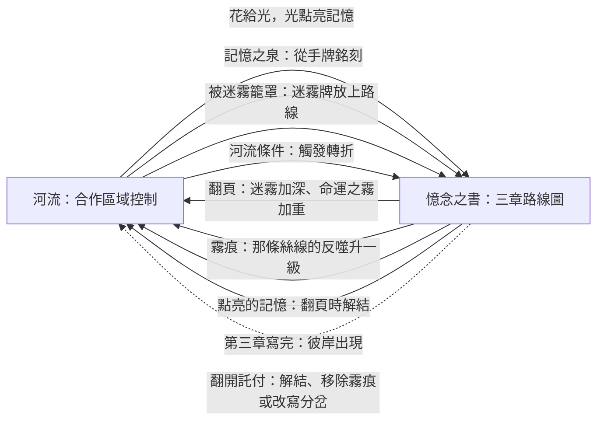
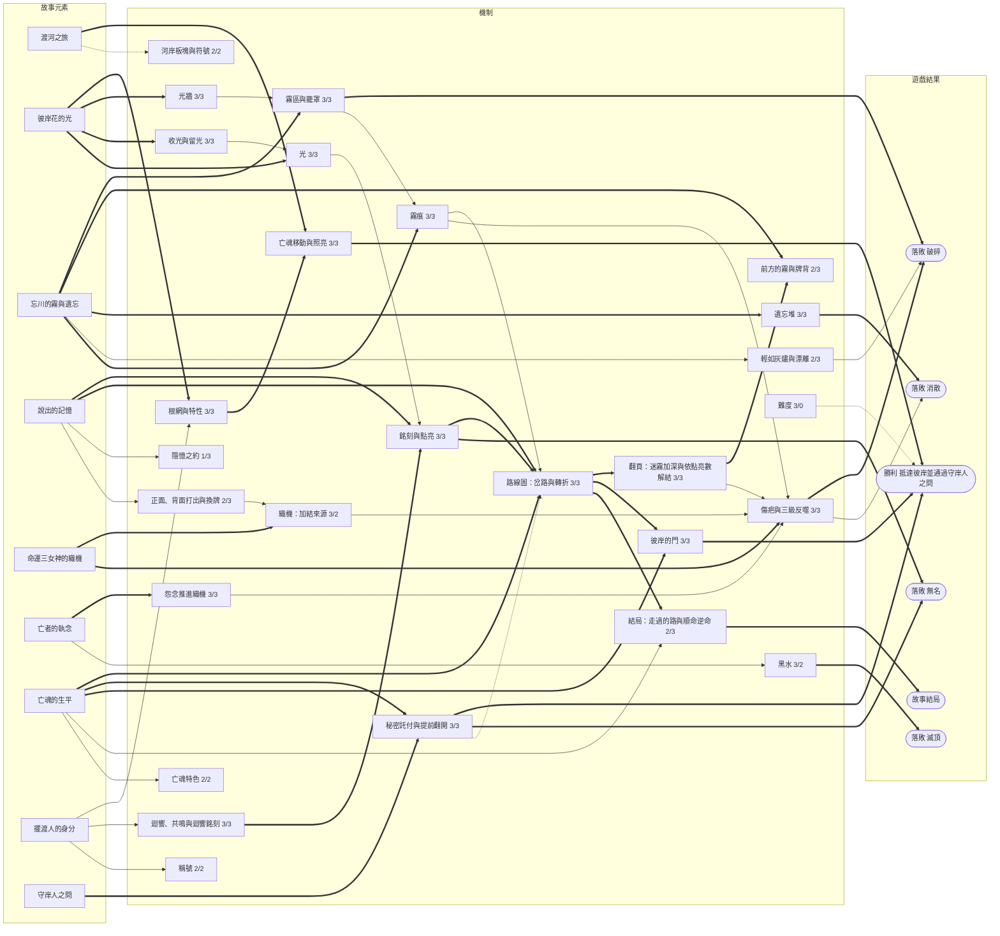

# 《彼岸花渡》V5 提案（修訂版）：兩個盤面，故事推動難度

- **依據**：
  - 規則 V4.0（`docs/rules/zh-TW/V4.0/Rulebook.md`）
  - TPE02 盲測回饋與《詭鎮奇談：卡牌版》機制研究（`docs/design/TPE02-arkham-study.zh-TW.md`）
  - 11/5–11/6 的留言討論，包括 11/6 對修訂版的 23 則留言
  - V5 模擬報告（`simulator/reports/v5_simulation.zh-TW.md`）
  - 章節版模擬報告（`simulator/reports/v5_chapters_simulation.zh-TW.md`）
- **各亡魂的故事書**：見 `docs/design/V5-storybooks.zh-TW.md`，內容包括路線圖、命運之霧、結局。
- **狀態**：修訂草案。
  - 數值已用章節版模擬校準：標準難度勝率約 41–45%（看織機門檻，§6.1），被迷霧籠罩的局約 43–48%。
  - 標為「待決定」的項目見 §11。
- **一句話**：玩家同時玩兩個遊戲：
  - 在**河流**上合作搶佔河岸。
  - 在**憶念之書**裡寫亡魂的故事。

  河上發生的事改寫故事；故事每翻一章，河就變得更兇。

## 0. 這一版改了什麼

### 0.1 難度跟著故事前進

V5 初版的難度跟著**位置**前進：亡魂走到第二、第三河段，迷霧、板塊、命運之霧才跟著變。

修訂版把順序倒過來：**難度跟著故事前進。**

- 河流仍分三個河段（日光蘭之路、哀悼之野、忘川之岸），名稱和板塊池都保留，方便準備。但河段交界不再有任何效果。
- 憶念之書有三章。每一頁是一張**路線圖**：記憶格與迷霧格用箭頭相連，中間有岔路與轉折（見故事書）。
- 路線走到這一頁的出口時翻頁：迷霧換成更深的一副，命運之霧也更重。
- 彼岸只在第三章寫完之後才會出現：故事沒說完，亡魂就到不了彼岸。

### 0.2 依兩份模擬報告與 11/6 留言修正的地方

| 來源 | 修正 | 段落 |
|---|---|---|
| 模擬建議 1 | 迷霧的怨念放在前方第 1 格 | §4.3 |
| 模擬建議 2 | 霧只在亡魂沒有前進時推進 | §3.2 |
| 模擬建議 3 | 迷霧牌不再加結；怨念只看亡魂所在格 | §6.1 |
| 章節版模擬 | 新規則「**迴響銘刻**」：章節的速度由銘刻決定，原本太慢 | §3.1 |
| 章節版模擬 | 標準難度**霧勢 +1**；被籠罩只留霧痕，不加裂痕（困難才加） | §9 |
| 章節版模擬 | 轉折的分岔在**回合結束時**決定，讓玩家能先點亮關口 | §5.2 |
| 11/6 留言 | 保留河段名稱與板塊池；保留備用板塊，給事件替換用 | §4.2 |
| 11/6 留言 | 寫清楚正面打出、喚回的落點、背面打出、奮力駛過、霧推進的方向、黑水 | §3、§4 |
| 11/6–11/7 留言 | 消散門檻：標準 12（溫和 14） | §9 |
| 11/6 留言 | 根網特性保留根深與花開蔓延，拿掉跨越 | §5.4 |
| 11/6 留言 | 翻開託付多一個選項：改寫分岔 | §7.3 |
| 11/7 決定 | **忘川的拉力**：遺忘堆達到 3／5／7 張時，分岔走忘卻；河水帶走 2 張遺忘的牌，永遠移出遊戲 | §5.2 |
| 11/7 決定 | 手牌：單人 6 張、2 人 4 張；織機門檻單人 +3 | §6.1、§11 |
| 11/6 留言 | 拿掉「同床異夢」 | — |

## 1. 為什麼要改

TPE02 的兩個核心回饋：

1. **故事和勝負沒有連結。**V4.0 的託付卡已經把書接上勝負，但故事只在最後檢查，遊戲過程中仍然感覺不到。
2. **看不到後果，無法提前規劃。**壓力只來自隨機翻開的迷霧；玩家唯一會主動計算的，是黑水還有幾步。

V5 的對策：

- **讓威脅像黑水一樣看得到、算得出來。**
  - 霧從身後吞掉河岸。
  - 怨念推進織機。
  - 織機的反噬會累加。
- **讓故事決定局面。**
  - 書上的章節決定迷霧有多深、命運之霧有多重。
  - 玩家寫進書裡的記憶決定故事走哪條路。
  - 三章走過的路決定結局。
- **不加新配件**，只改印現有的卡牌、板塊、織機板與書頁。

## 2. 設計核心：兩個盤面

| 盤面 | 玩家在做什麼 | 對手 |
|---|---|---|
| **河流** | 用根和花佔住河岸、照亮前路；在身後留下光牆擋霧，驅散擋路的怨念。 | **霧**在亡魂停下時從身後吞掉河岸；**怨念**推進織機；**黑水**擋路。 |
| **憶念之書** | 沿著路線銘刻並點亮記憶，在岔路選故事的走向，完成秘密託付。 | 命運之霧把故事推向更深的章節；霧痕吞掉路上的記憶。 |

**篩選原則**：每一條規則都要至少接到一條箭頭上。只影響其中一個盤面的規則，優先拿掉。

## 2.5 資訊放在哪裡：用最少的指示物

| 資訊 | 放在哪裡 | 配件 |
|---|---|---|
| **章節與路線** | 憶念之書翻到的那一頁，以及頁上已填的格子。 | 無 |
| **轉折** | 書旁的 2 張命運之霧，條件面朝上。 | 每位亡魂 12 張 |
| **迷霧的深度** | 迷霧槽裡是哪一副：淺霧（第一章）、濃霧（第二章）、深霧（第三章）。 | 無 |
| **霧勢** | 印在迷霧牌的牌面與牌背。 | 無 |
| **前方的霧／下下一張** | 槽裡面朝上的那張，以及牌庫頂的牌背。 | 無 |
| **霧在哪裡** | 被翻回霧面的河岸板塊本身。 | 無 |
| **光** | 渡帳上的光軌（0–12），一個標記。 | 1 個標記 |
| **根、花、凋零** | 根／花雙面指示物。 | 同 V4.0 |
| **織機的結** | 每條絲線一條軌道、一個標記。 | 3 個標記 |
| **傷疤** | 每條絲線旁一條短軌（0–2），一個標記。 | 3 個標記 |
| **霧痕** | 迷霧牌本身，放在路線上的迷霧格。 | 無 |
| **怨念、黑水** | 同 V4.0。 | 同 V4.0 |
| **根網特性** | 印在書頁底部；翻頁時看上一頁，口頭確認。 | 無 |

## 3. 一回合

### 3.1 你的回合

1. **引發共鳴之前**（免費）：召喚稱號、重抽託付、收割者。
2. **引發共鳴**：打出 1 張牌（正面、背面、換牌），或**喚回**。
3. **製造迴響**：打出 1 張牌（正面、背面、換牌；兩個行動合計每回合最多換牌一次），或**喚回**。
4. **點亮與託付**（免費，在兩個行動之後）：
   - **點亮記憶**：每段 1 光，數量不限。可以點亮任何一頁，包括這回合剛銘刻的記憶。
   - **翻開已完成的託付**（§7.3）。

**正面打出**（11/6 留言：寫清楚）：

1. 執行卡牌效果。
2. 在這張牌的絲線加 1 個結。
3. 看這張牌打出之前，迴響在哪條絲線：
   - **共鳴**：這是「引發共鳴」行動，而且迴響在同一條絲線上，就另外執行共鳴效果。
   - **迴響銘刻**（新，章節版模擬）：不論哪個行動，只要迴響在同一條絲線上，就可以把這張牌**銘刻**到當前路線上欄位相符的空記憶格（§7.1），並朗讀它的記憶。
4. 把迴響移到這張牌的絲線。
5. 沒有銘刻的話，執念、釋懷牌放進棄牌堆，忘卻牌放進遺忘堆。

換牌換來的牌也照這幾步執行。

**迴響銘刻的範圍**（11/7 留言確認；規則書要寫清楚，並附例子）：
- 適用：兩個行動中任何一張正面打出的牌，包括換牌換來的牌。判斷的是這張牌打出之前，迴響在不在它的絲線上。
- 在「引發共鳴」行動，同絲線的牌本來就會共鳴、也能銘刻，所以迴響銘刻實際上是讓「製造迴響」那張也能寫進書裡。
- 不適用：背面打出、喚回（喚回本身就是銘刻）、奮力駛過。
- 打出後移動迴響這一點，從 V3.2、V4.0 到 V5 都沒有變。
- 例子：迴響在釋懷時，引發共鳴打出一張執念牌（不共鳴，迴響移到執念），製造迴響再打出一張執念牌：這張可以銘刻，但沒有共鳴效果。

**為什麼加迴響銘刻**：
- 章節的速度由銘刻決定。原規則只有共鳴的牌能銘刻，每局只銘刻約 7 段，第一章要 9–10 回合。
- 加上迴響銘刻後，第一章縮短到約 7.5 回合，勝率 +10 個百分點。
- 規則成本很小：迴響本來就在場上，判斷方式和共鳴一樣。
- 共鳴仍然只屬於「引發共鳴」行動，所以兩個行動的差別還在。
- 故事上：上一位擺渡人留下的迴響，讓下一段記憶更容易被說出來。

**背面打出**：放 1 個根，並在那張牌的絲線加 1 個結。無處放根時改得 1 光，仍要加結。

**喚回**（佔用一個行動，每回合最多一次）：
- 支付 3 光，從遺忘堆選 1 張執念或釋懷牌。
- 把它銘刻到**當前路線上、欄位相符的空記憶格**（11/6 留言），朗讀它的記憶。這段記憶未點亮。
- 不能寫進還沒走到的格子、關閉的岔路，或之前的章節。
- 忘卻牌不能喚回。被遺忘的關鍵記憶也可以這樣找回來。

**換牌**（取代焚燒）：
- 用你的 1 張手牌和另一位玩家交換 1 張，並立即**正面打出**換來的牌。
- 兩張牌不需要同一條絲線。對方決定給你哪一張；你可以照隱憶之約描述你需要什麼。
- **單人**：把 1 張手牌放到記憶牌庫底，翻開牌庫頂的 1 張並立即正面打出。

**自由行動：奮力駛過**（11/6 留言）：
- 不佔用「引發共鳴」或「製造迴響」，用完你仍然有兩個行動。
- 時機：下一格兩岸都有怨念，而且沒有黑水。
- 效果：亡魂移到下一格，並承受 1 道裂痕。
- 次數：每位玩家整局一次。
- 它不移動迴響。

### 3.2 回合結束（每位玩家的回合後，依序）

1. **引花人**。
2. **亡魂行動**（V4.0 流程圖），另有兩處修改：
   - **離開一格**時二選一：
     - **收光**：每朵花得 1 光，花凋零成根。
     - **留光**：不得光，花留下。兩岸都是花的格子就是**光牆**。
   - **彼岸的門**：第三章寫完之前，第 13 格的下一格視為未照亮（§5.3）。
3. **怨念推進織機**：亡魂所在格的每個怨念，依它所在的河岸加 1 個結：
   - 左岸→執念
   - 右岸→釋懷
   - 霧面河岸上（霧中的怨念）→忘卻
4. **迷霧**：執行面朝上的「前方的霧」：
   1. **執行牌上的效果**。
   2. **霧推進**：只在亡魂**這回合沒有前進**時（徘徊、駐足、被認命或被拉回）推進。
      - 推進的格數是霧勢加上難度的加值（§9）。
      - **從霧線開始**：也就是離亡魂最遠、還沒被籠罩的河岸（11/6 留言），一格一格往亡魂的方向翻回霧面，左岸優先。
      - 遇到光牆時，剩下的每 1 點霧勢讓光牆的 1 朵花凋零。
   3. **檢查籠罩**（§4.4）。
   4. 把迷霧牌庫頂的牌翻開，成為新的前方的霧。
5. **分岔與翻頁**（§5.2、§5.4）：
   - 路線停在轉折前、而且命運之霧已經觸發時，現在決定走哪一條路。
   - 路線走到出口時，現在翻頁。
6. **整理**（同 V4.0）。
7. **抽牌**。
8. 單人：幽靈行動，再整理一次。
9. 傳船槳。

## 4. 河流：合作區域控制

### 4.1 根網

V4.0 的放根、綻放、連接規則不變，再加上：

- **根網就是射程**：驅散、排乾、綻放等效果的目標，要緊鄰一個與亡魂相連的根或花。
- **斷根**：只有與亡魂所在格相連的根才能綻放。
- **光牆**：同一格兩岸都是花，霧不能越過。
  - 光牆會被霧消耗：霧推進碰到光牆時，剩下的每 1 點霧勢讓光牆的 1 朵花凋零成根。兩朵都凋零後，光牆就破了。
  - 11/6 留言問到「每個河岸各自算」：模擬中勝率 +3，但籠罩率從 45% 降到 34%，因為單朵花也開始擋霧。這和「籠罩率 40–50%」的目標相反，所以維持兩岸都是花才算光牆。
  - 11/7 也模擬了「有花的河岸霧不能覆蓋、花不受損」：開局第 1 格留下光牆，兩條霧線就永遠被擋住，籠罩率降到 0%。**11/7 決定：維持兩岸都是花才是光牆，霧碰到光牆時每 1 點霧勢讓 1 朵花凋零。**

### 4.2 河岸板塊與河段

- **河段保留**（11/6 留言）：第一河段・日光蘭之路（第 1–4 格）、第二河段・哀悼之野（第 5–8 格）、第三河段・忘川之岸（第 9–13 格）。
  - 用途：準備時分池擺放板塊，也保留名稱的意境。
  - 河段交界不再有任何效果：不清空織機、不換板塊、霧也不重來。
- **板塊池**同 V4.0，每個河段各自抽：8 抽 6、9 抽 7、11 抽滿。板塊比河岸多，每局都有沒用到的板塊，所以仍然有隨機性。
- **備用板塊**保留（花田 2、沃土 2、記憶之泉 2），給命運之霧或迷霧牌替換板塊用。
- **霧面印符號**（魂火、岩紋、土紋），河段圖板印出各符號的組成。

### 4.3 怨念：不移動，推進織機

- **出現**：
  - 墳墓翻開時。
  - 執念反噬時。
  - 迷霧牌或命運之霧放置時，一律放在**亡魂前方第 1 格**，左岸優先。
- **不移動**，留在原地直到被移除。
- **推進織機**：只計算亡魂所在格的怨念（§3.2 第 3 步）。
- 怨念傷害、雙怨念擋路、奮力駛過照 V4.0。

### 4.4 霧：她停下來，霧就追上她

- **霧從此岸開始**：遊戲開始時，霧線在第 0 格之後，一路追到彼岸，不在河段交界重來。
- **霧區**：被翻回霧面的河岸。
  - 根、花：拔除。
  - 怨念：留下，成為霧中的怨念，照常推進織機（忘卻），但不能被驅散。
  - 黑水：在河道上，不受影響。
- **奪回**：在霧面河岸放根，照常翻開板塊。
- **籠罩的判定**：
  - **霧已逼近**：亡魂所在格有一岸是霧面。這是警告，也是一些命運之霧的條件。
  - **被迷霧籠罩**：亡魂所在格兩岸都是霧面。剛執行的迷霧牌放上路線，成為**霧痕**（§7.2）。標準難度不加裂痕，困難難度加 1 道（§9）。

### 4.5 黑水

同 V4.0（11/6 留言）：

- **放置**：黑水只放在亡魂前方的格子；放下時該格的花凋零成根（寒霜上的除外）。
- **效果**：亡魂不能進入有黑水的格子。
- **移除**：整理時，兩岸都有根或花的黑水格會被移除；寫著「排乾」的效果也可以。
- **滅頂**：必須放黑水，但供應區已經沒有時，你們落敗。
- **霧**：霧不影響黑水，因為黑水在河道上。

V4.0「亡魂永遠不會回到前一個河段」改為「亡魂永遠不會退回第 1 格之前，也不會退進霧裡」。

## 5. 章節：故事推動難度

### 5.1 三章

| 章節 | 迷霧 | 命運之霧的力量 | 故事的位置 |
|---|---|---|---|
| **第一章** | 淺霧 | 只影響一個盤面 | 她是誰、她怎麼死的 |
| **第二章** | 濃霧 | 河流與書各一個效果：一個給予、一個奪走 | 她生前最重的那件事 |
| **第三章** | 深霧 | 同第二章，但更重 | 她要帶走什麼、放下什麼 |

每一頁的路線圖、岔路、轉折與結局，見故事書。

### 5.2 轉折：每章一張命運之霧

- 每位亡魂 12 張命運之霧，每章 4 張：2 張**河流條件**、2 張**書上條件**。條件一章比一章難。
- **開始一章時**：從該章的河流條件與書上條件中各隨機抽 1 張，條件面朝上放在書旁。
- **轉折**：兩張中**先達成條件的那一張**立即翻開執行，放到路線上的 ◆。另一張棄掉。同時達成時，由當前玩家選一張。
- **分岔**：路線走到 ◆、而且命運之霧已經在上面時，在**那一回合結束時**決定走哪一條路：
  - 預設走命運之霧的絲線。
  - 關口有點亮的記憶、而且絲線不同時，可以改走那段記憶的絲線。
  - 在回合結束才決定，是為了讓玩家在同一回合的「點亮與託付」先點亮關口。模擬中，原本在寫進關口的那一刻就分岔，逆命只有 3%。
- **忘川的拉力**（11/7 決定）：分岔時，如果遺忘堆已經達到本章的門檻，她走忘卻的路，不看命運之霧，關口點亮的記憶也拉不回來。
  - 門檻：第一章 3 張、第二章 5 張、第三章 7 張（印在每章書頁的 ◆ 旁）。
  - 這次分岔算順命，不算違抗。
  - **河水帶走 2 張**：拉力發生時，從遺忘堆移除 2 張牌，**永遠移出遊戲**（放回盒中，不回棄牌堆，不會再回到記憶牌庫）。**關鍵記憶永遠不會被帶走**：它最接近亡魂的本質。
  - 故事上：她忘得太多，連清楚記得的事也拉不住她；河水帶走的，就永遠沒有了。
  - 為什麼要帶走：只看遺忘堆的話，第一章被拉走之後，第二章 74% 會再被拉走，結局幾乎在第一章就決定了。帶走 2 張之後降到 41%（沒被拉過的局是 22%），玩家還有機會走回別條路。
  - 模擬（標準難度，每種設定 2,000 局；報告 §6.8）：四種結局差不多平均（忘卻 30%、執念 25%、交織 24%、釋懷 22%；原本忘卻只有 7%）。勝率約 42%，消散的敗局從 16% 降到 9%，逆命約 48%。平均每局帶走約 1.4 張。

### 5.3 命運不會被跳過

- **彼岸的門**：第三章寫完之前，亡魂不能進入彼岸，最多停在第 13 格。
- **在門前徘徊**：
  - 本章的轉折還沒發生：立即強制轉折，玩家從兩張中選一張。
  - 已經轉折：本章直接結束，路線上的空格留白，立即翻頁。
- 模擬中，40% 的局至少發生一次。故事進度大約落後亡魂的位置一個章節，所以強制轉折常常成為彼岸前的高潮。
- **故事提示**（11/7 留言）：河流圖板的第 5 格印「故事應該寫到第二章」，第 9 格印「故事應該寫到第三章」。
  - 亡魂越過提示格、書還落後時，整桌就知道要先推進故事，避免在門前被強制轉折。
  - 只是提示，沒有規則效果。
- **第三章的轉折提前**（11/7 留言）：花環、國王、無名的第三章改成「關口 → ◆ → 岔路」，和孩子一樣。新娘的第三章本來就是轉折在最前。

### 5.4 翻頁

路線走到出口的那個回合，在回合結束的「分岔與翻頁」步驟依序執行：

1. **依點亮數解結**（11/7 決定）：看剛結束那一頁點亮了幾段記憶，解開對應數量的結，由玩家自由選擇解哪條絲線：

   | 本頁點亮 | 0 段 | 1 段 | 2 段 | 3 段 |
   |---|---|---|---|---|
   | 解開的結 | 0 | 3 | 6 | 9 |

   - 解不完的結帶進下一章。
   - 傷疤不治療，一直保留。
   - 模擬（AI 每章優先點亮，消散門檻 12）：勝率約 36%，比「清空所有結」低約 4 個百分點，每局反噬 1.8 次。換來的是「點亮越多、解越多、自己選解哪條」的決策，以及結會跨章節累積的壓力。
   - 其他試過的寫法與數據，見章節模擬報告 §6.3–§6.5。
2. **加深迷霧**：把迷霧槽裡剩下的牌庫換成下一章的那一副，洗勻。已經翻開的前方的霧不換。
3. **根網特性**（11/6 留言：保留）：看剛結束那一頁的點亮記憶：
   - 執念較多：**根深**。霧翻回霧面時，根留在原地。
   - 釋懷較多：**花開蔓延**。每回合第一次綻放時，可以讓一個相鄰的根也綻放。
   - 一樣多，或沒有點亮記憶：沒有特性（拿掉「跨越」）。
4. **準備下一章的轉折**：抽 2 張命運之霧。
5. **朗讀新一章的入口句**：依上一章實際走的路。

第三章沒有下一頁：第三章寫完時，彼岸直接出現。

## 6. 命運織機：看得到的時鐘

### 6.1 加結的來源

| 來源 | 加在哪條絲線 |
|---|---|
| 正面打出（包括換牌） | 那張牌的絲線 |
| 背面打出 | 那張牌的絲線 |
| 怨念 | 亡魂所在格的怨念，依河岸：左岸執念、右岸釋懷、霧面河岸忘卻 |
| 命運之霧 | 卡上寫的絲線 |

- 迷霧牌不加結；牌背的絲線決定霧痕的絲線（§7.2）。
- **門檻**（11/7 調整人數平衡）：2–4 人 6 結打滿；單人 9 結。原本 4 人 7 結、單人 8 結。
- 模擬中每局反噬約 2 次，符合「每局 2–3 次」的目標（11/6 留言）。門檻 +3 時勝率高 2 個百分點，但反噬只剩 1.5 次。

### 6.2 傷疤：反噬會累加

絲線打滿、執行反噬後，把 1 個結移到該絲線下方的**傷疤軌**，其餘移除。

| 這條絲線的傷疤 | 打滿的門檻 | 打滿時執行 |
|---|---|---|
| 0 道 | 6 | 第一級反噬 |
| 1 道 | 5 | 第二級反噬 |
| 2 道（上限） | 4 | 第三級反噬 |

（以 2–3 人為例。）傷疤一旦留下就不會消失（11/7 決定：翻頁不治療傷疤）。

### 6.3 三級反噬

| 絲線 | 第一級 | 第二級 | 第三級 |
|---|---|---|---|
| 執念 | 亡魂所在格放 1 個怨念 | 亡魂所在格與前方第 1 格各放 1 個怨念 | 同第二級，再加 1 道裂痕 |
| 釋懷 | 認命：下一次亡魂行動不動，遺忘 1 張 | 認命，並遺忘 2 張 | 認命，遺忘 2 張，霧推進 2 |
| 忘卻 | 下一格放 1 個黑水 | 下一格與前方第 3 格各放 1 個黑水 | 同第二級，再遺忘 1 張 |

**霧痕**：書上當前頁每有 1 個某條絲線的霧痕，那條絲線的下一次反噬升一級（最多第三級）。

### 6.4 讓玩家看得到

桌上隨時看得到：

- 三條絲線的結數、門檻、傷疤。
- 下一級反噬，以及霧痕讓它升到哪一級。
- 前方的霧的完整內容，以及牌庫頂牌背的絲線與霧勢。
- 這一章的兩張轉折：條件、預兆、分岔的絲線。
- 書上的路線：下一個記憶格要什麼欄位、岔路有哪些選擇。

## 7. 憶念之書：故事線

### 7.1 書頁是路線圖

規則的細節見故事書 §0。摘要：

- **記憶格**印欄位與一句亡魂自己說的話；**迷霧格**印一句旁白。
- **◇ 岔路**：後面每條路的欄位不同，第一段寫進去的記憶決定走哪條路。
- **◆ 轉折**：命運之霧決定；點亮的關口記憶可以改路。
- **銘刻**只能寫進當前路線上、欄位相符的空記憶格。
- **每章的長度**（11/7 決定）：第一章每條路線 2 個記憶格（岔路後一格、轉折後一格），第二、三章各 3 格（新娘第三章 2 格），整局 7–8 格。章節由此「前短後長」：模擬約 5.4／6.5／6.3 回合。
- 點亮每段 1 光。只有點亮的記憶算進託付；點亮的記憶永遠不會被抹滅。
- 指定頁面的託付，只能在那一章完成。

### 7.2 霧痕

- **來源**：被迷霧籠罩。
- **放在哪裡**：當前路線上第一個空的迷霧格。沒有空的迷霧格時，蓋住下一個空的記憶格，那一格被霧吞沒。都沒有時，蓋住一段未點亮的記憶，再沒有就承受 1 道裂痕。
- **故事句**：每張迷霧牌下方印一句，放上路線時朗讀。
- **效果**：那條絲線（看迷霧牌背）的下一次反噬升一級。

### 7.3 秘密託付（可提前翻開）

- 託付卡仍然秘密，完成前不能說、不能暗示。
- **提前翻開**：書上一出現符合的點亮記憶，就可以在自己回合的「點亮與託付」步驟翻開，朗讀亡魂的那句話，再選一項：
  - 解開織機上 2 個結（任選絲線）；
  - 移除路線上 1 張霧痕；
  - **改寫分岔**（11/6 決定）：本章的轉折，可以改走任一條絲線。
- 那段記憶之後不能再完成別的託付。
- 守岸人之問不變，已翻開的託付直接算完成。

## 8. 結局

抵達彼岸並通過守岸人之問後，依序朗讀（見故事書 §0.7）：

1. **結局**：看三章實際走的路。兩章以上同一條絲線，讀那條絲線的結局；三章都不同，讀交織結局。
2. **順命或逆命**：實際走的路和 ◆ 上命運之霧的絲線不同，就算違抗了一次命運。從未違抗讀順命，違抗 1 次以上讀逆命（11/7 決定）。
3. **關鍵記憶的結尾**：銘刻在書上、被遺忘、未曾說出。
4. **隱藏結局**：每位亡魂一個，條件全部符合時改讀它。11/7 調整了兩位的條件：
   - 新娘：整局沒有因為徘徊而遺忘任何一張牌（原本是「從未徘徊」）。
   - 無名：再加上「三章中至少有一章違抗了命運」。

落敗時不讀結局，只朗讀書上已有的部分。

## 9. 難度：調霧與裂痕

模擬顯示 V5 的落敗主要是**破碎**。11/7 把三種難度調到約 60／50／40%（容許 ±5%），只動難度表上的數字；並把織機收緊，讓反噬更有壓迫感（報告 §6.11）。

| 難度 | 霧推進時霧勢 | 被迷霧籠罩 | 起始結 | 織機門檻（2–4 人／單人） | 破碎 | 黑水 | 消散門檻 | 模擬勝率 | 每局反噬 |
|---|---|---|---|---|---|---|---|---|---|
| ◆◇◇ 溫和 | +0 | 只留霧痕 | 0 | 7／10 | 5 道裂痕 | 7 | 14 | 59% | 2.3 |
| ◆◆◇ 標準 | +1 | 只留霧痕 | 0 | 7／10 | 4 道裂痕 | 6 | 12 | 52% | 1.8 |
| ◆◆◆ 困難 | +1 | 留霧痕，並加 1 道裂痕 | 每條絲線 1 結 | 7／10 | 3 道裂痕 | 6 | 12 | 42% | 1.7 |

- **改了什麼**（和前一版相比）：消散門檻回到 14／12／12，保留輕如灰燼 6、漂離 9 的節奏；破碎改成 5／4／3 道裂痕；織機門檻三種難度都是 7 結（單人 10 結），比前一版緊 1–2 結，每局反噬從約 1.3–1.8 次升到 1.7–2.3 次。
- **更正**：更早的版本寫的「黑水 5 個」與「織機 2–4 人 6 結、單人 9 結」與模擬不符。模擬一直用黑水 6 個、織機 7 結（單人 10 結）；上表的數字都以模擬為準。
- 單人／2 人／3 人／4 人：溫和 51／61／63／63%、標準 43／52／55／56%、困難 35／43／42／47%（單人手牌 6、2 人手牌 4，見 §11 第 5 點）。
- 每副迷霧加 2 張凶霧；墳墓與要完成的託付照標準設定表（三種難度相同）。

## 10. 故事

### 10.1 兩條故事線

| 故事線 | 寫在哪裡 | 怎麼推進 | 玩家感受到的 |
|---|---|---|---|
| **想起來** | 點亮的記憶、翻開的託付 | 花給光，光點亮記憶；寫什麼記憶就走哪條路 | 她想起一件事，纏住她的結就鬆一點，故事也轉向她想走的方向 |
| **被命運推著走** | 轉折、霧痕 | 河上或書上達成條件 | 她的故事轉向，河也變得更兇 |

### 10.2 每個元素的故事意義

| 元素 | 故事 |
|---|---|
| 彼岸花與光 | 亡魂唯一能追隨的光；收光就是把光拿走 |
| 光牆 | 擺渡人留在身後、不讓遺忘追上的光 |
| 霧 | 忘川的遺忘本身；她一停下，就從身後吞掉走過的路 |
| 怨念 | 生前未了的執念，走到它身邊才被它拉住 |
| 命運織機 | 三女神記錄的執念、釋懷與遺忘；傷疤是越纏越緊的結 |
| 迴響 | 上一位擺渡人留下的聲音，讓下一段記憶更容易被說出來 |
| 章節與路線 | 她一生的三個段落；寫下的記憶決定她走哪條路 |
| 轉折 | 她生前故事裡逃不掉的那一刻；她清楚記得的事，可以讓她不照命運走 |
| 霧痕 | 她在霧中失去自己的那一刻 |
| 彼岸的門 | 故事沒說完，就到不了彼岸 |
| 託付 | 她最想被記住的一句話 |
| 守岸人之問 | 能不能說出自己是誰 |

## 11. 11/7 的決定與仍待決定

模擬：標準難度、消散 12、翻頁依點亮數解 3／6／9，每種設定 2,000 局（報告 §6.7）。

1. **彼岸的門：第一章維持 2 格。**改回 3 格不會減少強制轉折（25% → 29%），第一章反而回到 7.1 回合。再加「轉折洗掉空格」，第一章 6.2 回合、強制 24%，但勝率 −2。所以不改。
2. **忘卻結局（決定）**：
   - 每章那張忘卻的命運之霧改成「本章第一次徘徊」（最常發生的河流條件；原本用這個條件的牌換成那張忘卻牌的舊條件）。忘卻結局從 1–3% 升到約 7%。
   - 再加上**忘川的拉力**（§5.2，門檻 3／5／7，河水帶走 2 張遺忘的牌、永遠移出遊戲，關鍵記憶除外）。忘卻結局升到約 30%，四種結局差不多平均。
3. **逆命門檻（決定）**：違抗 1 次以上讀逆命。逆命約 56%。
4. **隱藏結局（決定）**：新娘改為「整局沒有因為徘徊而遺忘任何一張」，約 17%；無名加上「至少一章逆命」，約 33%。仍偏低的：國王 0–2%、孩子 3–4%。
5. **人數平衡（決定）**：
   - 織機門檻：單人 9 結、4 人 6 結。效果小：單人 19% → 21%，4 人 48% → 46%。
   - **單人手牌 5 張**（原本 4 張）：單人 21% → 34%，和 2 人（33%）相當。
   - **再調手牌（11/7 第三輪難度之後）**：單人 6 張、2 人 4 張，其他不變。標準難度：單人 39% → 43%，2 人 43% → 52%（3 人 55%、4 人 56%）。2 人追平 3–4 人；單人縮小約三分之一的差距（報告 §6.12）。
6. **難度（11/7 重新調整）**：消散 14／12／12、破碎 5／4／3、織機 7 結；溫和 59%、標準 52%、困難 42%（§9，含手牌調整）。
7. **配件數量**：根／花指示物 24 個夠用。河上同時最多 24 個（只有少數局到達），平均 14 個，95% 的局不超過 20 個。

## 12. 和 V4.0 相比

| 項目 | V4.0 | V5 修訂版 |
|---|---|---|
| 河流 | 三個河段，交界時換板塊、加迷霧 | 河段只用於準備與名稱；交界沒有效果 |
| 難度如何前進 | 跟著位置（河段） | 跟著故事（章節） |
| 迷霧 | 依河段分三副，翻開就執行 | 依章節分淺霧、濃霧、深霧；下一張面朝上，下下一張看得到牌背 |
| 霧 | 只是迷霧牌 | 亡魂停下時從此岸一路往前吞掉河岸，追上就籠罩 |
| 怨念 | 迷霧隨機放置 | 放在前方第 1 格，不移動，依所在河岸推進不同絲線 |
| 織機 | 打滿就固定反噬，交界時清空 | 四種加結來源，門檻 6／7／8；傷疤與三級反噬；翻頁時依點亮數解 3／6／9 結 |
| 銘刻 | 共鳴的牌 | 共鳴，或迴響與這張牌同絲線（任一行動）；只能寫進路線上的格子 |
| 背面打出 | 免費放根 | 加 1 個結 |
| 焚燒 | 兩人各出 1 張同絲線的牌 | 換牌 |
| 喚回 | 3 光把遺忘的牌移回棄牌堆 | 3 光把遺忘的牌銘刻回路線上 |
| 奮力駛過 | 佔用一個行動 | 自由行動 |
| 單人手牌 | 4 張 | 5 張 |
| 離開一格 | 收光並清空 | 收光或留光（光牆） |
| 根網 | 效果指定「最近的」 | 根網所及、斷根、光牆、根網特性 |
| 憶念之書 | 四欄記憶 | 三章路線圖，岔路與轉折 |
| 亡魂專屬事件 | 無 | 每章一個轉折（命運之霧） |
| 託付 | 最後才檢查 | 可提前翻開：解結、移除霧痕或改寫分岔 |
| 結局 | 關鍵記憶位置＋遺忘張數 | 走過的路＋順命／逆命＋關鍵記憶＋隱藏結局 |
| 難度 | 燈籠調消散門檻、黑水、凶霧 | 難度調霧勢、籠罩裂痕、起始結 |

## 13. 機制與故事關聯圖 V5（修訂）

評分與 V2 圖相同：
- **勝負**：0 不影響、1 間接、2 改變局勢、3 直接構成勝敗。
- **故事**：0 沒有故事意義、1 只有名稱、2 行為符合故事、3 玩法本身在講故事。
- 連線：粗線 `==>` 強，實線 `-->` 中，虛線 `-.->` 弱。

**最強的環**：
- 寫下的記憶 → 路線 → 結局：玩家用寫哪一種記憶來選故事的走向。
- 章節：轉折 → 翻頁 → 迷霧加深 → 河更兇 → 河上的條件推動下一個轉折。
- 迴響：上一位玩家的迴響讓下一位更容易銘刻，故事和合作綁在一起。

**最弱的環**：
- 隱憶之約（1/3）：仍然只是交談規則。
- 難度（3/0）：沒有故事理由。

## 14. 下一步

1. 決定 §11 的待決定項目，再模擬一次。
2. 寫 V5 規則書草稿與故事書的印刷版（書頁路線圖的版面）。規則書要用例子寫清楚：迴響銘刻的範圍、轉折在回合結束時分岔、霧從霧線往亡魂推進。
3. 準備 TPE03：重點觀察玩家是否會為了故事走向而選擇寫哪一種記憶，以及章節節奏的體感。
