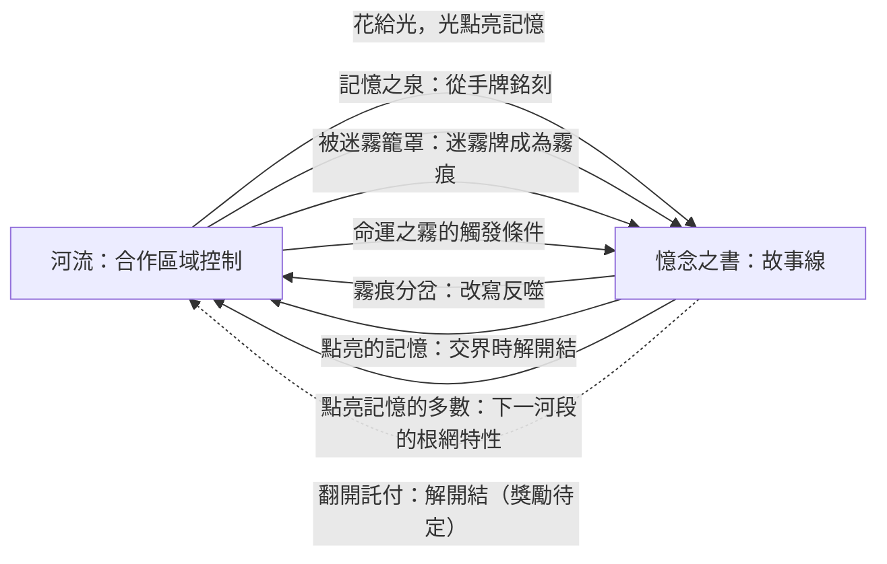
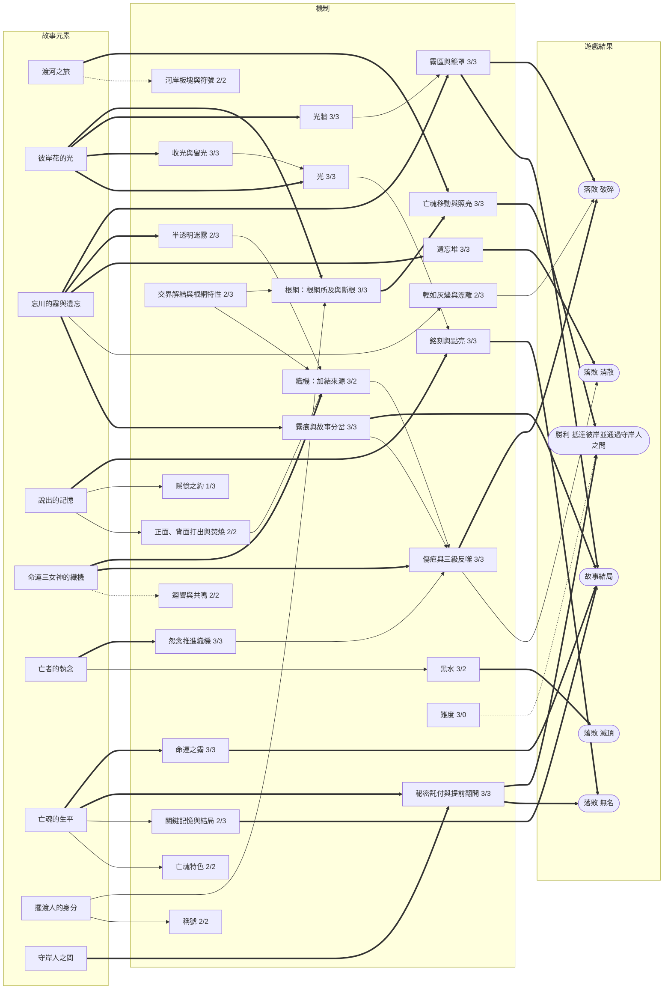

# 《彼岸花渡》V5 提案：兩個盤面，互相推動

- **依據**：規則 V4.0（`docs/rules/zh-TW/V4.0/Rulebook.md`）、TPE02 盲測回饋、《詭鎮奇談：卡牌版》機制研究與 11/5–11/6 的留言討論（`docs/design/TPE02-arkham-study.zh-TW.md` 與討論頁面）。
- **狀態**：草案。整合所有已同意的提案，數值都還沒有模擬。標為「待定」的項目見 §9。
- **一句話**：玩家同時玩兩個遊戲：在**河流**上合作搶佔河岸，在**憶念之書**裡寫亡魂的故事；河上發生的事改寫故事，故事又改變河上的規則。

## 1. 為什麼要改

TPE02 的兩個核心回饋：

1. **故事和勝負沒有連結。**V4.0 已經用託付卡把書接上勝負，但故事只在最後檢查，遊戲過程中仍然感覺不到。
2. **看不到後果，無法提前規劃。**壓力只來自隨機翻開的迷霧；玩家唯一會主動計算的，是黑水還有幾步。

V5 的對策：

- **讓威脅像黑水一樣看得到、算得出來。**霧在河岸上推進，怨念推進織機，織機的反噬會累加。
- **讓故事在過程中改變局面。**點亮的記憶解開織機的結；被霧籠罩的事件寫進書裡，決定接下來的故事分岔和反噬。
- **不加新配件**，只改印現有的卡牌、板塊、織機板與書頁。

## 2. 設計核心：兩個盤面

| 盤面 | 玩家在做什麼 | 對手 |
|---|---|---|
| **河流** | 用根和花佔住河岸、照亮前路；在後方留下光牆擋霧，在前方用根網驅散怨念，讓亡魂逃出去。 | **霧**從後方翻起河岸板塊；**怨念**在前方推進織機；**黑水**擋路。 |
| **憶念之書** | 銘刻並點亮記憶，完成秘密託付。 | 霧痕與命運之霧把故事推向壞的分岔。 |

**篩選原則**：每一條規則都要至少接到一條箭頭上。只影響其中一個盤面的規則，優先拿掉。

## 3. 一回合

### 3.1 你的回合（同 V4.0，行動改名）

1. **引發共鳴之前**（免費）：召喚稱號、重抽託付、收割者、送花。
2. **引發共鳴**（原「回應」，11/6 改名）：打出 1 張牌（正面、背面、焚燒）、喚回或奮力駛過。只有這個行動能共鳴，名稱直接說明它的作用（TPE02 P-15：玩家分不清回應與掌舵）。
3. **製造迴響**（原「掌舵」，11/6 改名）：打出 1 張牌或奮力駛過。這個行動不會共鳴，但正面打出的牌會把迴響移到它的絲線，為下一位玩家的「引發共鳴」鋪路。
4. **點亮與託付**（免費，11/6 移到兩個行動之後）：
   - **點亮記憶**：每段 1 光，數量不限，只要光池裡的光夠。可以點亮任何一頁、包括這回合剛銘刻的記憶。
   - **翻開已完成的託付**（§5.5）。

   移到行動之後的理由：這回合剛銘刻的記憶可以立刻點亮，在回合結束的迷霧與霧痕之前鎖住它；而且你已經知道這回合花了多少光、還剩多少，才決定要點亮幾段。

**背面打出**改為：放 1 個根，並在那張牌的絲線**加 1 個結**（TPE02 P-16：背面打出也要有代價）。無處放根時得 1 光，仍要加結。

### 3.2 回合結束（每位玩家的回合後，依序）

1. **引花人**。
2. **亡魂行動**（V4.0 流程圖）。亡魂離開一格時，那一格不再清空，改為二選一：
   - **收光**：每朵花得 1 光，花凋零成根。
   - **留光**：不得光，花留下。兩岸都是花的格子就是**光牆**。
3. **怨念推進織機**：亡魂所在格與前方兩格內的每個怨念，在**執念**加 1 個結。
4. **迷霧**：執行牌庫頂的迷霧牌：
   1. 執行效果。
   2. 在牌上的絲線加 1 個結。
   3. **霧推進**：從亡魂身後最近、還沒被籠罩的河岸開始，把 N 個河岸翻回霧面（N＝霧勢，左岸優先），光牆擋住霧。
   4. **檢查籠罩**（見 §4.4）。
5. **整理**（同 V4.0）。
6. **抽牌**。
7. 單人：幽靈行動，再整理一次。
8. 傳船槳。

**命運之霧**（§5.4）不在固定步驟，條件一達成就立即觸發。

## 4. 河流：合作區域控制

### 4.1 根網

V4.0 的放根、綻放、連接規則不變，再加三條：

- **根網就是射程**（已採用）：驅散、排乾、綻放等效果的目標，要**緊鄰一個與亡魂相連的根或花**。不再用「最近的」。
- **斷根**：只有與亡魂所在格相連的根才能綻放。霧翻掉一個河岸或黑水落在關鍵格時，後面的根可能變成孤島。
- **結構**：
  - **光牆**：同一格兩岸都是花，霧不能越過。
  - **花徑**：同側連續 3 格都是花，亡魂前進到花徑上時可以多走 1 格（待定，見 §9）。

### 4.2 河岸板塊

- 板塊池與 V4.0 相同。
- **霧面印符號**，提示大概是哪一類：

| 符號 | 可能的板塊 | 適合誰 |
|---|---|---|
| 魂火 | 墳墓、記憶之泉 | 手上有想銘刻的牌、周圍沒有怨念時才值得賭 |
| 岩紋 | 石地、寒霜 | 有織根者或石地牌時是好地 |
| 土紋 | 沃土、花田、餘燼、迴聲之岩 | 安全的預設路線 |

河段圖板印出各符號的組成，讓機率算得出來。例如第一河段沒有墳墓，所以魂火一定是記憶之泉。

### 4.3 怨念：不移動，推進織機

- **出現**：墳墓翻開時、執念反噬時、少數迷霧牌（一律放在亡魂前方第 3 格，左岸優先）。
- **不移動**，留在原地直到被移除。
- **推進織機**：見回合結束第 3 步。遠處的怨念暫時沉睡，亡魂靠近才開始作用。執念反噬又會放出怨念，所以會形成螺旋，但只計算前方兩格內的怨念，螺旋有上限，而且看得到它正在形成。
- 怨念傷害、雙怨念擋路、奮力駛過照 V4.0。

### 4.4 霧：從後方翻起河岸

- **霧區**：被翻回霧面的河岸就是被霧籠罩的河岸。
  - 根、花：拔除，放回供應區。
  - 怨念：留下，成為**霧中的怨念**，照常推進織機，但根網伸不進霧裡，所以**不能被驅散**。困難難度：霧中的怨念每回合加 2 個結。
  - 板塊：翻回霧面的就是那塊板塊本身。
  - 黑水：在河道上，不受影響。
- **奪回**：在霧面河岸放根，照常翻開板塊。
- **籠罩的判定**：
  - **霧已逼近**：亡魂所在格一岸是霧面。這是警告，她的格子不能再成為光牆。
  - **被迷霧籠罩**：亡魂所在格兩岸都是霧面。亡魂承受 1 道裂痕，剛執行的迷霧牌放進書裡成為**霧痕**（§5.3）。
- **每個河段重新開始**：亡魂進入新河段時，霧線從該河段第一格之前開始。

### 4.5 黑水

同 V4.0。

## 5. 憶念之書：故事線

### 5.1 書頁

每一頁是一條**事件串成的故事線**：

> 記憶 → 記憶 → **霧痕** → 記憶 → 記憶 → **霧痕**

四個記憶欄仍然是地點、人物、事蹟、感受，託付的判斷方式不變。朗讀時依序讀下去，霧痕就是故事的轉折。

### 5.2 銘刻與點亮（同 V4.0）

- 三種銘刻方式：共鳴、焚燒選中的牌、記憶之泉。銘刻時朗讀。
- 點亮每段 1 光。只有點亮的記憶算進託付。
- **點亮的記憶永遠不會被抹滅**：任何效果都不能拿走或蓋住它。

### 5.3 霧痕與故事分岔

- **來源**：被迷霧籠罩時，或命運之霧觸發時。
- **故事句**：每張迷霧牌下方印一句故事句，只在放進書裡時朗讀。
- **分岔**：書頁上為每條絲線各印一句分岔。放進來的霧痕是哪條絲線，就走哪一條：
  - 那條絲線的反噬改成書頁上寫的那一句（§6.3）。
  - 下一頁的開頭句也跟著改。
  - 例如新娘第二頁：執念「*你緊抓著他的手不放。*」、釋懷「*你幾乎就要回頭了。*」、忘卻「*你想不起他的名字。*」
- 每頁 2 個霧痕欄。第三個霧痕蓋在一段**未點亮**的記憶上；沒有未點亮的記憶時，改為亡魂承受 1 道裂痕。
- **結局**：抵達彼岸時，除了 V4.0 的關鍵記憶與遺忘張數，再看書上霧痕的絲線組成，決定讀哪一張結局。

### 5.4 命運之霧

亡魂故事裡逃不掉的轉折。

- 每位亡魂約 9 張雙面卡，每個河段 3 張（數量待測）。
- 亡魂進入一個河段時，隨機抽出 2 張，**條件面朝上**放在河段圖板旁。
  - 條件面寫標題、一句預兆和觸發條件。
  - 事件面寫完整的故事與效果，觸發時才翻開。
- **觸發**：條件一達成就立即翻開執行，兩張都達成就兩張都觸發。條件連到河流或書上的局面，例如第一次徘徊、某條絲線反噬、被迷霧籠罩、某個欄位被點亮。
- **至少一張**：離開河段時如果兩張都沒觸發，由玩家選 1 張在進入下一河段時觸發，另一張棄掉。
- 觸發的命運之霧一定放進霧痕欄，走它指定的分岔。

例子（文字與數值待定）：

| 亡魂・河段 | 名稱 | 條件 | 事件 | 分岔 |
|---|---|---|---|---|
| 新娘・二 | 冥王的條件 | 本河段第一次徘徊 | 本河段剩下的時間，亡魂每次徘徊都承受 1 道裂痕 | 釋懷 |
| 新娘・二 | 他手中的燈 | 本頁人物欄有點亮的記憶 | 亡魂立即前進一格，釋懷加 2 個結 | 執念 |
| 國王・三 | 湖中之手 | 執念反噬時 | 一位玩家交出稱號，執念的傷疤全部移除 | 執念 |

### 5.5 秘密託付（可提前翻開）

- 託付卡仍然秘密，完成前不能說、不能暗示。
- **提前翻開**：書上一出現符合的點亮記憶，可以在自己回合的「點亮與託付」步驟翻開：朗讀亡魂的那句話，解開織機上 2 個結（任選絲線）。那段記憶之後不能再完成別的託付。
- 什麼時候翻本身就是決策：早翻早拿獎勵，也提早讓別人知道你不再需要哪些記憶。
- 守岸人之問不變，已翻開的託付直接算完成。

### 5.6 書給河流的回饋

- **交界解結**：亡魂進入新河段時，上一頁每有 1 段點亮的記憶，就從它的絲線解開 1 個結；其餘的結帶進下一河段。
- **根網特性**：上一頁點亮的記憶以哪條絲線為多，下一河段的根網就有一種特性：
  - 執念「**根深**」：霧翻回霧面時，根留在原地。
  - 釋懷「**花開蔓延**」：每回合第一次綻放時，可以讓一個相鄰的根也綻放。
  - 忘卻「**跨越**」：根網可以跳過一個空格相連。
- 三個限制，避免變複雜：
  - 一次只有一種特性；一樣多或沒有點亮記憶時，就沒有特性。
  - 每種特性只放寬一條既有規則。
  - 特性印在織機板上，用一個結蓋住生效的那一句。
- 試玩發現太複雜時，根網特性是第一個拿掉的。

## 6. 命運織機：看得到的時鐘

### 6.1 加結的來源

| 來源 | 加在哪條絲線 |
|---|---|
| 正面打出、焚燒 | 那張牌的絲線（同 V4.0） |
| 背面打出 | 那張牌的絲線 |
| 迷霧牌 | 牌背印的絲線 |
| 怨念 | 執念（亡魂所在格與前方兩格內，每個 1 結） |

2–3 人時 4 結打滿，單人與 4 人時 5 結。

### 6.2 傷疤：反噬會累加

絲線打滿、執行反噬後，把 1 個結移到該絲線下方的**傷疤軌**，其餘移除。每有 1 道傷疤：

- 這條絲線少 1 個結就打滿（5 → 4 → 3）。
- 反噬升一級。
- 傷疤跨河段保留。

### 6.3 三級反噬

| 絲線 | 第一級 | 第二級 | 第三級 |
|---|---|---|---|
| 執念 | 亡魂所在格放 1 個怨念 | 前方第 3 格兩岸各放 1 個怨念 | 同第二級，再加 1 道裂痕 |
| 釋懷 | 認命：下一次亡魂行動不動，遺忘 1 張 | 認命，並遺忘 2 張 | 認命，遺忘 2 張，霧推進 2 |
| 忘卻 | 下一格放 1 個黑水 | 下一格與前方第 3 格各放 1 個黑水 | 同第二級，再遺忘 1 張 |

（數值待模擬。）霧痕會把某條絲線的反噬改寫成書頁上的那一句。

### 6.4 讓玩家看得到

桌上隨時看得到：

- 三條絲線的結數、門檻、傷疤。
- 下一級反噬，以及被霧痕改寫的那一句。
- 下一張迷霧牌背的絲線。

所以玩家可以提前防禦：避開那條絲線的牌、移開迴響、清掉推進執念的怨念，或先在反噬會打到的地方種花。

## 7. 迷霧：半透明

- **牌背**印絲線符號與霧勢（0、1、2）。牌庫頂那張的牌背本來就朝上，所以大家永遠看得到下一個霧會推哪條絲線、有多兇，但看不到效果。
- **規則書附錄照常列出每一張迷霧牌**；神秘感來自洗牌後的順序，不是隱藏規則。河段圖板不另外印清單。
- **頻率**：每位玩家回合翻一張（同 V4.0）。效果改輕；大事件交給反噬、霧痕與命運之霧。
- **破霧者**：「看穿迷霧」，每輪一次偷看下一張的牌面，可以放到牌庫底。
- 拿掉放怨念的「怨念逼近」「怨念成群」，以及凶霧中的「守岸人的凝視」「遠方雷聲」「黑水回流」。

## 8. 故事

### 8.1 兩條故事線

| 故事線 | 寫在哪裡 | 怎麼推進 | 玩家感受到的 |
|---|---|---|---|
| **想起來** | 點亮的記憶、翻開的託付 | 花給光，光點亮記憶 | 她想起一件事，纏住她的結就鬆一點 |
| **被霧吞沒** | 霧痕、命運之霧 | 亡魂停下來，霧追上她 | 她的故事往壞的方向轉折，河也變得更兇 |

兩條線寫在同一本書裡。抵達彼岸時，從第一頁朗讀到最後一頁：亡魂記住了什麼、在哪裡差點失去自己，就是這一局的故事。

### 8.2 每個元素的故事意義

| 元素 | 故事 |
|---|---|
| 彼岸花與光 | 亡魂唯一能追隨的光；收光就是把光拿走 |
| 光牆 | 擺渡人留在身後、不讓遺忘追上的光 |
| 霧 | 忘川的遺忘本身，從身後吞掉走過的路 |
| 怨念 | 生前未了的執念，越靠近越被它拉住 |
| 命運織機 | 三女神記錄的執念、釋懷與遺忘；傷疤是越纏越緊的結 |
| 霧痕 | 她在霧中失去的那一刻 |
| 命運之霧 | 她生前故事裡逃不掉的轉折 |
| 託付 | 她最想被記住的一句話 |
| 守岸人之問 | 能不能說出自己是誰 |

## 9. 待定

1. **翻開託付的獎勵**：只解開 2 個結，還是也可以移除傷疤或霧痕？
2. **怨念推進的絲線**：固定推進執念，還是依所在河岸推進不同絲線？
3. **命運之霧**：每位亡魂 9 張（每河段 3 抽 2）可以嗎？觸發條件要偏向河流局面、書上局面，還是各一半？
4. **花徑**：要不要保留？它讓亡魂多走一格，可能讓遊戲太快。
5. **第 1 格**沒有板塊：要印霧面，還是視為不會被籠罩？
6. **配件數量**：根／花指示物（24）和結（15）可能不夠，要模擬後確認。
7. **難度**（TPE02 建議「燈籠」改叫「難度」）：消散門檻、黑水數、起始結數、霧中怨念的強度。
8. TPE02 提到要借鏡「同床異夢」，指的是哪一款遊戲、哪一個機制？

## 10. 和 V4.0 相比

| 項目 | V4.0 | V5 提案 |
|---|---|---|
| 迷霧 | 翻開就執行，看不到下一張 | 牌背印絲線與霧勢；執行後加結、霧推進 |
| 霧 | 只是迷霧牌 | 從後方翻起河岸板塊，追上就籠罩亡魂 |
| 怨念 | 迷霧隨機放置 | 條件觸發，不移動，推進執念 |
| 織機 | 打滿就固定反噬，交界時清空 | 多種加結來源；傷疤累加；三級反噬；交界時用點亮的記憶解結 |
| 背面打出 | 免費放根 | 加 1 個結 |
| 離開一格 | 收光並清空 | 收光（花凋零）或留光（築光牆） |
| 根網 | 效果指定「最近的」 | 根網所及；斷根；光牆 |
| 河岸板塊 | 霧面全一樣 | 霧面印三種符號 |
| 憶念之書 | 四欄記憶 | 記憶與霧痕串成的故事線，霧痕決定分岔 |
| 亡魂專屬事件 | 無 | 命運之霧，條件觸發，每河段至少一張 |
| 託付 | 最後才檢查 | 可提前翻開，解開織機的結 |
| 河段交界 | 依絲線多數換板塊、依段數加迷霧 | 點亮的記憶解結；點亮記憶的多數給根網特性 |
| 凶霧 | 依燈籠加入 | 移除部分；難度改用起始結數等調整 |

## 11. 機制與故事關聯圖 V5

評分與 V2 圖相同：**勝負**（0 不影響、1 間接、2 改變局勢、3 直接構成勝敗）／**故事**（0 沒有故事意義、1 只有名稱、2 行為符合故事、3 玩法本身在講故事）。連線：粗線 `==>` 強，實線 `-->` 中，虛線 `-.->` 弱。

### 和 V2（V4.0）圖的差別

| 機制 | V4.0 | V5 | 改變 |
|---|---|---|---|
| 迷霧牌 | 3/3，但純隨機 | 半透明迷霧 2/3 ＋ 霧區 3/3 | 威脅從「翻到什麼算什麼」變成看得到的霧線 |
| 怨念與裂痕 | 3/2 | 怨念推進織機 3/3 | 有了故事理由（執念），也有可計算的後果 |
| 織機與反噬 | 2/2 | 加結來源 3/2 ＋ 傷疤與三級反噬 3/3 | 從固定反噬變成會累加、會被故事改寫的時鐘 |
| 背面打出 | 2/2 | 併入「正面、背面打出與焚燒」2/2 | 有代價（加結） |
| 光 | 2/3 | 3/3 | 收光與留光：光同時是記憶的鑰匙和擋霧的牆 |
| 河段交界 | 3/3 | 交界解結與根網特性 2/3 | 換板塊改成書直接改變根網玩法 |
| 關鍵記憶與結局 | 1/3 | 2/3 | 霧痕參與決定結局 |
| 新增 | — | 光牆、收光與留光、霧痕、命運之霧、提前翻開託付 | 每一項都接在兩個盤面之間 |

**最強的環**：

- 彼岸花的光：光 → 點亮記憶，留光 → 光牆擋霧。
- 忘川的霧：霧區 → 籠罩 → 霧痕 → 改寫反噬與結局。

**最弱的環**：

- 隱憶之約（1/3）：仍然只是交談規則。
- 難度（3/0）：沒有故事理由。可以考慮把難度說成「這條河今晚有多冷」，但不是必要。

## 12. 下一步

1. 在模擬器實作 V5 的核心：織機加結來源、傷疤、霧區與籠罩、怨念推進、收光與留光。先用暫定數值，找出標準難度約 50% 的設定。
2. 加入霧痕分岔、命運之霧、提前翻開託付，看故事線是否每局都會發生 2–4 次轉折。
3. 量「玩家能預見的壞事比例」：被執行的壞事中，有多少在前一回合已經看得到。
4. 決定 §9 的待定項目後，寫 V5 規則書草稿，準備 TPE03。
