# 《彼岸花渡》V5 故事書：五位亡魂的三章

- **搭配**：`docs/design/V5-proposal.zh-TW.md`（修訂版）§5 章節、轉折、彼岸的門。
- **狀態**：給你檢查的第三稿。
  - 每章至少兩個分岔，有些由命運之霧決定，有些由寫進去的記憶種類決定。
  - 每位亡魂的路線形狀都不一樣。
  - 交織結局加回來了。結局看實際走的路，再加一句順命或逆命（看命運之霧）。
  - 提案裡和書頁有關的段落，等你看過這份之後再一起改。

## 0. 書頁怎麼運作

### 0.1 一頁就是一章：一張路線圖

書頁上印著一張路線圖：格子用箭頭相連，從入口走到出口。

| 符號 | 名稱 | 放什麼 | 印了什麼 |
|---|---|---|---|
| ▭ | **記憶格** | 銘刻的記憶牌 | 欄位（地點、人物、事蹟、感受），和一句亡魂自己說的話，空白處由記憶牌的文字填入 |
| ▭ | **關口** | 銘刻的記憶牌 | 同記憶格。它是轉折前的最後一個記憶格，可以改變轉折的方向（§0.3） |
| ⬡ | **迷霧格** | 被迷霧籠罩時的迷霧牌（霧痕） | 一句旁白：她在這裡失去了什麼 |
| ◇ | **岔路** | 不放東西 | 一個問題，例如「第一朵花，要給誰？」；後面的格子欄位都不同 |
| ◆ | **轉折** | 命運之霧 | 三條箭頭：執念、釋懷、忘卻 |
| ⬭ | **入口／出口** | — | 一句旁白。入口依上一章轉折的絲線，三句選一句讀 |

**兩種聲音**：
- 記憶格是亡魂用「我」說的話，因為記憶是她說出來的。
- 入口、出口、迷霧格和命運之霧是用「她」寫的旁白。

朗讀時兩種聲音交錯，像一位說書人在聽她回憶。

### 0.2 岔路 ◇：寫什麼，就走哪條路

- 岔路後面的每條路，第一格的欄位都不同（例如一條是人物，一條是感受）。
- 走到岔路後，**第一段寫進其中一格的記憶，決定走哪條路**；其他的路關閉，留白。
- 所以玩家是用「寫哪一種記憶」來選路：
  - 想讓她追著人求，就寫一段人物。
  - 想讓她躲起來，就寫一段感受。
- 手上沒有合適的記憶時，路就停在岔路前，直到有人寫下去。

### 0.3 轉折 ◆：命運之霧，加上她清楚記得的事

- 命運之霧的條件達成時，立即翻開執行，放到 ◆ 上（提案 §5.2）。
- **開章時就看得到條件**：從本章的河流條件與書上條件各抽 1 張，條件面朝上放在書旁。玩家可以主動去完成，不必等命運來找她。
  - 書上條件都做得到：點亮記憶、銘刻或點亮關口、翻開一張託付。
  - 河流條件有些也可以選：例如故意徘徊一次、留下一道光牆。
  - 路線還沒走到 ◆ 也可以觸發，牌先放在 ◆ 上等著。
  - 路線走到 ◆ 時，命運之霧還沒觸發，路就停在 ◆ 前，直到觸發。
- 路線走到 ◆、而且命運之霧已經在上面時，**在那一回合結束時**決定走哪一條（所以同一回合可以先點亮關口的記憶）：

| 關口的狀態 | 走哪一條路 |
|---|---|
| 空著，或記憶未點亮 | 走命運之霧的絲線 |
| 有**點亮**的記憶，絲線和命運之霧不同 | 二選一：命運之霧的絲線，或關口那段記憶的絲線 |
| 有點亮的記憶，絲線相同 | 走那條絲線 |

- 忘卻牌不能銘刻，所以關口只能把路改成執念或釋懷；忘卻只能由命運之霧帶來。
- 新娘第三章的轉折**沒有關口**：只看命運之霧。
- 命運之霧留在 ◆ 上。實際走的路和它的絲線不同時，就算她**違抗了一次命運**（§0.7）。

### 0.4 銘刻：沿著路線往下寫

- 只能寫進**當前路線上、欄位相符的空記憶格**。
- 不能跳到還沒走到的格子、關閉的路，或之前的章節。
- 路線上同一段有兩格以上可以寫時，順序不限。
- 更換規則同 V4.0：未點亮的記憶可以被新的記憶取代，被取代的那張遺忘。
- **份量**：
  - 每條路線第一章經過 2 個記憶格，第二、三章各 3 格（新娘第三章 2 格），整局 7–8 格。第一章短，讓故事很快進入正題；越後面的章節越長。
  - 模擬中每局平均銘刻 8.7 段，所以大約剛好寫滿。

### 0.5 迷霧格：霧痕放在路上

- 被迷霧籠罩時，迷霧牌放進**路線前方第一個空的迷霧格**。
  - 前方是還沒選的岔路時，由玩家選一條路放，這也就決定了那條路。
- 前方沒有空的迷霧格時，改為**蓋住前方第一個空的記憶格**：那一格被霧吞沒，算已填滿，朗讀時讀迷霧牌的故事句。
  - 也沒有空的記憶格時，改蓋一段未點亮的記憶。
  - 都沒有時，亡魂承受 1 道裂痕。
- 效果同提案：那條絲線（看迷霧牌背）的下一次反噬升一級。
- 翻開託付時可以移除一張霧痕（提案 §7.3）。被蓋住的記憶格會恢復成空格。

### 0.6 一章什麼時候結束

- **路線走到出口時**（出口前的最後一個記憶格被填滿，或被霧蓋住），那一回合結束時翻頁。
- **彼岸的門**（提案 §5.3）：亡魂在第 13 格徘徊時：
  - 本章的轉折還沒發生：強制轉折（從兩張命運之霧中選一張）。
  - 已經轉折：本章直接結束，路線上剩下的空格留白。
- 這取代了提案 §5.4「轉折發生的那一回合就翻頁」。

### 0.7 結局：她選了什麼，命運要她怎樣

結局分三段朗讀：

1. **結局**：看三章實際走的路（轉折後走的是哪條絲線）。
   - 兩章以上同一條絲線：讀那條絲線的結局（**執念**、**釋懷**、**忘卻**）。
   - 三章都不同：讀**交織**結局。她每一章都做了不一樣的選擇。
2. **順命或逆命**：比對每章 ◆ 上的命運之霧和實際走的路。
   - 從未違抗：讀「順命」那一句。
   - 違抗 1 次以上：讀「逆命」那一句（11/7 決定）。
   - 命運之霧一直留在 ◆ 上，翻開書就數得出來。
3. **關鍵記憶的結尾**：銘刻在書上、被遺忘、未曾說出，三選一。

**為什麼這樣分**：
- 「她選了什麼」和「命運要她怎樣」都會被讀出來。兩者的落差本身就是情緒：違抗命運之後才放手，和一路順著命運走到放手，是兩種不同的放手。
- 結局跟著實際走的路，所以玩家對結局的控制更大：用關口點亮的記憶，可以把路改走。

其他規則：
- 每位亡魂有一個**隱藏結局**，條件印在結局牌背面；全部符合時改讀它。
- 四個結局的機率：如果每章的絲線差不多平均，每種絲線結局約 26%、交織約 22%。
  - 每章的兩張命運之霧是公開的，關口又可以改路，所以玩家可以把結局推向想要的那一個。
- 新娘第三章沒有關口，所以她最多只能違抗兩次。

### 0.8 朗讀

- 每次翻頁時，朗讀剛寫完的那一章：入口 → 路線上的每一格 → 出口。
- 抵達彼岸時，從頭朗讀整本書，最後讀結局。
- **空的記憶格**：讀作「……但這一段，已經被河水帶走了。」
- **迷霧格**：只在有迷霧牌時才讀，先讀格子上的旁白，再讀迷霧牌的故事句。
- **關閉的路**：不讀。

### 0.9 每位亡魂的路線形狀

| 亡魂 | 第一章 | 第二章 | 第三章 | 形狀的意思 |
|---|---|---|---|---|
| 最後火光的孩子 | ◇ → ◆ | ◇ → ◇ → ◆ | ◆ → ◇ | 每一根火光都是一個岔路 |
| 花環少女 | ◇（三叉）→ ◆ | ◆ → ◇ | ◆ → ◇ | 每一個純分岔都是「這朵花給誰」 |
| 渡船上的國王 | ◆ → ◇（三條線各有自己的岔路） | 兩個起點 → ◇ → ◆ | ◆ → ◇ | 兩條戰線 |
| 留在冥府的新娘 | ◇ → ◆ | ◇ → ◆ → ◇ | ◆（沒有關口）→ ◇ | 一道窄梯 |
| 無名渡河 | ◇ → ◆ | ◆ → ◇ | ◆ → ◇ | 最簡單的版型，給熟悉規則用 |

（◇ 岔路，◆ 轉折）

### 0.10 三條絲線，對每位亡魂的意思

| 亡魂 | 執念 | 釋懷 | 忘卻 |
|---|---|---|---|
| 最後火光的孩子 | 不肯讓火光熄滅，想留住看見的東西 | 不再等人停下，跟著光走 | 寒冷與飢餓先被忘掉；對她來說，這也是一種慈悲 |
| 花環少女 | 等那個不肯回頭的人，唱給不肯聽的人 | 把花送出去，最後一朵留給自己 | 歌只剩調子，花不記得是給誰的 |
| 渡船上的國王 | 死守王座、防線與那柄劍 | 原諒，把劍還給湖 | 忘了自己曾經是王；對他來說，這也是解脫 |
| 留在冥府的新娘 | 記住他的臉，等他 | 先放開手 | 想不起他是誰 |
| 無名渡河 | 決定「這就是我」 | 讓空白的地方空著 | 讓名字隨河水流走 |

忘卻不只是壞結局。對孩子和國王來說，忘掉寒冷、忘掉王冠，也是一種解脫。

### 0.11 命運之霧

- **組成**：每章 4 張，2 張河流條件、2 張書上條件；每章至少有 3 種絲線。
- **條件一章比一章難**（11/6 留言）：
  - 第一章：一個常見的事件。
  - 第二章：較少見的事件，或需要 2 段點亮。
  - 第三章：書上條件多半要同時符合兩件事。
  - 彼岸的門保證第三章的轉折一定會發生，所以條件變難不會讓遊戲卡住。
- **書上條件**不指定欄位，只看「關口」「本頁有 N 段點亮」「翻開託付」「她的專屬記憶在本頁被點亮」「遺忘堆達到 N 張」，因為每條路線的欄位不同。
- **份量**：

| 章節 | 效果 | 份量（初稿） |
|---|---|---|
| 第一章 | 一個效果，只影響河流或書 | 2 光、2 結、1 個怨念、1 段記憶 |
| 第二章 | 河流一個、書一個；一個給予、一個奪走 | 給予約 3、奪走約 2 |
| 第三章 | 同第二章，兩邊都更重 | 給予約 4、奪走約 3 |

- **倒退**（11/6 留言）：少數命運之霧會讓亡魂退回 1 格，但不能退進霧裡。
  - 花環少女〈折斷的柳枝〉
  - 國王〈藏起來的劍〉
  - 新娘〈墜落〉

---

## 1. 最後火光的孩子

一年中最寒冷的那一夜，一個小小的孩子獨自蜷在門口，手裡握著一把要賣的小火光，一個也沒賣出去。為了取暖，她把它們一一點亮。每一朵火焰裡，她都看見了些什麼：一座暖爐、一桌盛宴；最後，是那個唯一曾經抱過她的人，前來帶她回家。

- **特色規則**：起始擁有 3 點光。整局遊戲中，第一道裂痕會被忽略。永遠不會漂離。（同 V4.0）
- **關鍵記憶**：*她離去前總是抱著我的那個人（釋懷・人物）*
- **路線**：**每一根火光都是一個岔路。**第二章連續兩個純分岔：火光裡先出現什麼、再出現什麼，由你們寫進去的記憶決定。轉折在章末才來。

### 1.1 故事弧線

| 章 | 標題 | 情緒核心 | 路線 | 這一章發生什麼 |
|---|---|---|---|---|
| 一 | **最冷的那一夜** | 沒有人看見她 | ◇ → ◆ | 她站在街角賣火光，人們從她身邊走過。她要追著人求，還是躲進牆角？ |
| 二 | **火光裡的東西** | 她看見了想要的一切 | ◇ → ◇ → ◆ | 每劃亮一根火光，就看見一樣溫暖的東西。火光一熄，它們就不見。 |
| 三 | **來帶我回家的人** | 被抱起來 | ◆ → ◇ | 最後一根火光裡，站著唯一曾經抱過她的人。 |

### 1.2 第一章・最冷的那一夜（淺霧）

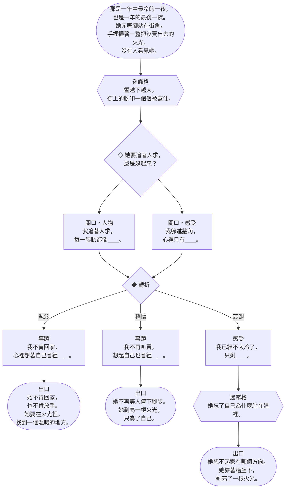

| 格子 | 欄位 | 文字 |
|---|---|---|
| 入口 | — | *那是一年中最冷的一夜，也是一年的最後一夜。她赤著腳站在街角，手裡握著一整把沒賣出去的火光。沒有人看見她。* |
| 迷霧格 | — | *雪越下越大，街上的腳印一個個被蓋住。* |
| ◇ 岔路 | 人物／感受 | **她要追著人求，還是躲起來？** |
| 關口 | 人物 | 「我追著人求，每一張臉都像＿＿。」 |
| 關口 | 感受 | 「我躲進牆角，心裡只有＿＿。」 |
| ◆ 轉折 | — | 執念→下一格；釋懷→下一格；忘卻→下一格 |
| 記憶格 | 事蹟 | 「我不肯回家，心裡想著自己曾經＿＿。」 |
| 記憶格 | 事蹟 | 「我不再叫賣，想起自己也曾經＿＿。」 |
| 記憶格 | 感受 | 「我已經不太冷了，只剩＿＿。」 |
| 迷霧格 | — | *她忘了自己為什麼站在這裡。* |
| 出口 | — | *她不肯回家，也不肯放手。她要在火光裡，找到一個溫暖的地方。* |
| 出口 | — | *她不再等人停下腳步。她劃亮一根火光，只為了自己。* |
| 出口 | — | *她想不起家在哪個方向。她靠著牆坐下，劃亮了一根火光。* |

**命運之霧**

| 條件 | 名稱 | 預兆 | 觸發條件 | 事件 | 絲線 |
|---|---|---|---|---|---|
| 河 | 沒有人停下腳步 | *人們從她身邊匆匆走過。* | 怨念進入亡魂所在格 | *她把火光舉得更高，還是沒有人看她一眼。* 執念加 2 結。 | 執念 |
| 河 | 被搶走的鞋 | *一個男孩笑著跑過。* | 本章第一次徘徊 | *她的另一隻鞋被搶走了。男孩說，等他有了孩子，可以拿來當搖籃。* 本頁一段未點亮的記憶被遺忘。 | 忘卻 |
| 書 | 第一根火光 | *她的手指凍得發紫。* | 本頁有 1 段點亮的記憶 | *火光亮起，她彷彿坐在一座大鐵爐前。* 得 2 光。 | 釋懷 |
| 書 | 不敢回家 | *家裡和街上一樣冷。* | 關口被銘刻 | *一根也沒賣出去，父親會打她。她決定不回家。* 放 2 個根。 | 執念 |

### 1.3 第二章・火光裡的東西（濃霧）

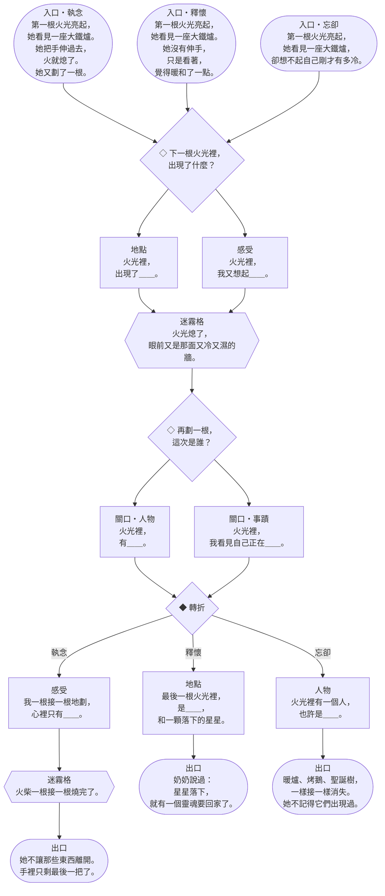

| 格子 | 欄位 | 文字 |
|---|---|---|
| 入口（上一章轉折是執念） | — | *第一根火光亮起，她看見一座大鐵爐。她把手伸過去，火就熄了。她又劃了一根。* |
| 入口（上一章轉折是釋懷） | — | *第一根火光亮起，她看見一座大鐵爐。她沒有伸手，只是看著，覺得暖和了一點。* |
| 入口（上一章轉折是忘卻） | — | *第一根火光亮起，她看見一座大鐵爐，卻想不起自己剛才有多冷。* |
| ◇ 岔路 | 地點／感受 | **下一根火光裡，出現了什麼？** |
| 記憶格 | 地點 | 「火光裡，出現了＿＿。」 |
| 記憶格 | 感受 | 「火光裡，我又想起＿＿。」 |
| 迷霧格 | — | *火光熄了，眼前又是那面又冷又濕的牆。* |
| ◇ 岔路 | 人物／事蹟 | **再劃一根，這次是誰？** |
| 關口 | 人物 | 「火光裡，有＿＿。」 |
| 關口 | 事蹟 | 「火光裡，我看見自己正在＿＿。」 |
| ◆ 轉折 | — | 執念→下一格；釋懷→下一格；忘卻→下一格 |
| 記憶格 | 感受 | 「我一根接一根地劃，心裡只有＿＿。」 |
| 迷霧格 | — | *火柴一根接一根燒完了。* |
| 記憶格 | 地點 | 「最後一根火光裡，是＿＿，和一顆落下的星星。」 |
| 記憶格 | 人物 | 「火光裡有一個人，也許是＿＿。」 |
| 出口 | — | *她不讓那些東西離開。手裡只剩最後一把了。* |
| 出口 | — | *奶奶說過：星星落下，就有一個靈魂要回家了。* |
| 出口 | — | *暖爐、烤鵝、聖誕樹，一樣接一樣消失。她不記得它們出現過。* |

**命運之霧**

| 條件 | 名稱 | 預兆 | 觸發條件 | 事件 | 絲線 |
|---|---|---|---|---|---|
| 河 | 烤鵝走下桌子 | *窗裡的桌上，擺著一隻烤鵝。* | 任一反噬 | *烤鵝背上插著刀叉，搖搖擺擺朝她走來，然後火光熄了。* 河：亡魂前進 1 格。 書：本頁一段未點亮的記憶被遺忘。 | 執念 |
| 河 | 火光熄滅 | *風從巷口灌進來。* | 本章第一次徘徊 | *火光熄了，眼前只剩一面又冷又厚的牆。* 河：前方 2 朵花凋零。 書：免費喚回 1 次。 | 忘卻 |
| 書 | 聖誕樹 | *玻璃門後，有一棵掛滿蠟燭的樹。* | 本頁有 2 段點亮的記憶 | *她伸手去摸，千百支蠟燭升上了天空。* 河：在亡魂所在格的兩岸各綻放 1 個根。 書：遺忘 1 張。 | 執念 |
| 書 | 流星 | *一顆星劃過天空。* | 翻開一張託付 | *她想起奶奶說過的話，不再害怕火光熄滅。* 河：忘卻加 2 結。 書：免費點亮 1 段。 | 釋懷 |

### 1.4 第三章・來帶我回家的人（深霧）

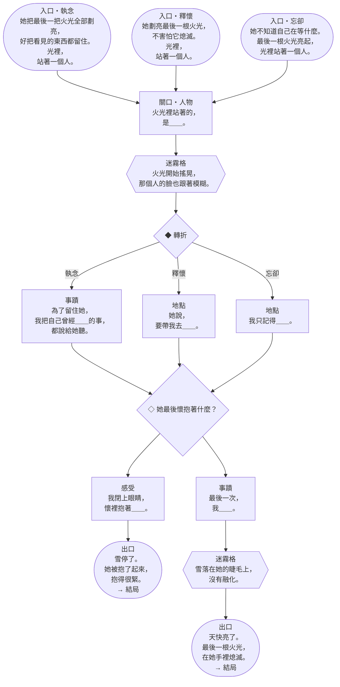

| 格子 | 欄位 | 文字 |
|---|---|---|
| 入口（上一章轉折是執念） | — | *她把最後一把火光全部劃亮，好把看見的東西都留住。光裡，站著一個人。* |
| 入口（上一章轉折是釋懷） | — | *她劃亮最後一根火光，不害怕它熄滅。光裡，站著一個人。* |
| 入口（上一章轉折是忘卻） | — | *她不知道自己在等什麼。最後一根火光亮起，光裡站著一個人。* |
| 關口 | 人物 | 「火光裡站著的，是＿＿。」 |
| 迷霧格 | — | *火光開始搖晃，那個人的臉也跟著模糊。* |
| ◆ 轉折 | — | 執念→下一格；釋懷→下一格；忘卻→下一格 |
| 記憶格 | 事蹟 | 「為了留住她，我把自己曾經＿＿的事，都說給她聽。」 |
| 記憶格 | 地點 | 「她說，要帶我去＿＿。」 |
| 記憶格 | 地點 | 「我只記得＿＿。」 |
| ◇ 岔路 | 感受／事蹟 | **她最後懷抱著什麼？** |
| 記憶格 | 感受 | 「我閉上眼睛，懷裡抱著＿＿。」 |
| 記憶格 | 事蹟 | 「最後一次，我＿＿。」 |
| 迷霧格 | — | *雪落在她的睫毛上，沒有融化。* |
| 出口 | — | *雪停了。她被抱了起來，抱得很緊。* |
| 出口 | — | *天快亮了。最後一根火光，在她手裡熄滅。* |

**命運之霧**

| 條件 | 名稱 | 預兆 | 觸發條件 | 事件 | 絲線 |
|---|---|---|---|---|---|
| 河 | 整把火光 | *只剩最後一把了。* | 亡魂承受裂痕 | *她把剩下的火光全部劃亮，好把奶奶留住。* 河：得 4 光，霧推進 2。 書：關鍵記憶若在任一玩家手上，那位玩家可以立即把它銘刻到本頁的人物格（如果還空著）。 | 執念 |
| 河 | 天亮了 | *天邊開始發白。* | 本章第一次徘徊 | *新年的早晨，人們在牆角發現了她，手裡握著一把燒過的火柴。* 河：修補 1 道裂痕。 書：遺忘 2 張。 | 忘卻 |
| 書 | 奶奶 | *火光裡站著一個人。* | 關口被點亮，而且本章已翻開一張託付 | *「奶奶！帶我走吧！」* 河：亡魂前進 1 格，然後可以再前進 1 格（都要照亮）。 書：本頁一段未點亮的記憶被遺忘。 | 釋懷 |
| 書 | 再也不冷了 | *她的手不再發抖。* | 本頁有 1 段點亮的記憶，而且遺忘堆達到 6 張 | *奶奶把她抱了起來。她的手腳一點一點暖了。* 河：移除 1 道傷疤。 書：遺忘 2 張。 | 忘卻 |

### 1.5 結局

| 三章實際走的路 | 結局 | 文字 |
|---|---|---|
| 兩章以上走執念 | 最後一根火光 | *她到了彼岸，手裡還握著一根沒點的火光。守岸人遞來河水，她搖搖頭：「我要留著，等她來。」她坐在彼岸的石階上，每當有人渡河，就把那根火光舉高一點。* |
| 兩章以上走釋懷 | 回家 | *她鬆開手，剩下的火光一根一根落進河裡，像一串小小的星星。彼岸沒有門口，也沒有雪。她不用再賣任何東西了。* |
| 兩章以上走忘卻 | 溫暖的地方 | *她喝下河水。寒冷先離開，接著是飢餓，然後是那條街的名字。最後她只記得：有一個地方很溫暖，而她終於到了那裡。* |
| 三章都不同 | 火光裡的每一樣東西 | *暖爐、烤鵝、聖誕樹、奶奶：她把它們一一說給守岸人聽，說到後面就忘了前面的。守岸人沒有催她。* |

**順命或逆命**（接在結局後面）：

- **順命**（從未違抗命運）：*她走的，是那一夜替她鋪好的路。*
- **逆命**（違抗命運 1 次以上）：*命運一次又一次要火光熄滅，她一次又一次把它劃亮。*

**關鍵記憶的結尾**：

- **銘刻在書上**：*她說出了奶奶的名字，守岸人點了點頭。*
- **被遺忘**：*她想不起是誰抱過她，只記得那雙手很暖。*
- **未曾說出**：*她始終沒有說出那個人是誰，好像怕一說出口，火光就會熄滅。*

**隱藏結局〈新年的早晨〉**

- **條件**（全部符合）：
  - 關鍵記憶已點亮，而且銘刻在第三章的人物格。
  - 書上沒有霧痕。
  - 亡魂整局沒有承受裂痕（被特色規則忽略的那一道不算）。
- **文字**：*人們在早晨發現她時，她在微笑。他們說她只是想取暖。沒有人知道她看見了多麼美麗的東西，也沒有人知道，她是和奶奶一起，走進新年的光裡的。*

---

## 2. 花環少女

一位年輕女子，為她所愛的每一個人都編了一朵花。後來父親死了，那個許諾要娶她的男人變得冷酷，她便將花一朵一朵送了出去，然後仍輕聲唱著歌，滑入了溪水之中。她為自己留下了一朵花，卻從沒有人知道是哪一朵。

- **特色規則**：**散花**（新，取代「送花」）：亡魂離開一格時，那一格只要有 1 朵花，就可以留成光牆；只有一朵花的光牆只擋 1 點霧勢。故事：她一路走，一路把花送出去。理由：舊的「送花」和換牌重疊；散花是她自己的河流玩法，單人也有作用。
- **關鍵記憶**：*我唯一留給自己的那朵花（釋懷・感受）*
- **路線**：**每一個純分岔都是「這朵花給誰」。**第一章是三叉的扇形岔路：第一朵花可以給人、放在一個地方、或留給一種心情。第二章先轉折、再決定剩下的花怎麼辦。

### 2.1 故事弧線

| 章 | 標題 | 情緒核心 | 路線 | 這一章發生什麼 |
|---|---|---|---|---|
| 一 | **每個人一朵花** | 她愛著每一個人 | ◇（三叉）→ ◆ | 春天，她為愛的每一個人編一朵花，把最好看的那朵留給許諾要娶她的人。 |
| 二 | **裝作不認識我的人** | 失去父親，被他否認 | ◆ → ◇ | 父親匆匆下葬。那個人從她面前走過，說他從沒對她許過什麼。 |
| 三 | **溪上的垂柳** | 她留給自己的那一朵 | ◆ → ◇ | 她帶著最後的花走到溪邊。 |

### 2.2 第一章・每個人一朵花（淺霧）

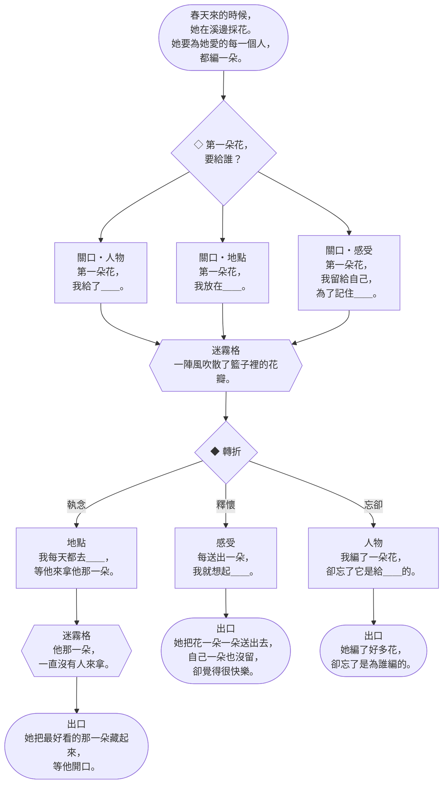

| 格子 | 欄位 | 文字 |
|---|---|---|
| 入口 | — | *春天來的時候，她在溪邊採花。她要為她愛的每一個人，都編一朵。* |
| ◇ 岔路 | 人物／地點／感受 | **第一朵花，要給誰？** |
| 關口 | 人物 | 「第一朵花，我給了＿＿。」 |
| 關口 | 地點 | 「第一朵花，我放在＿＿。」 |
| 關口 | 感受 | 「第一朵花，我留給自己，為了記住＿＿。」 |
| 迷霧格 | — | *一陣風吹散了籃子裡的花瓣。* |
| ◆ 轉折 | — | 執念→下一格；釋懷→下一格；忘卻→下一格 |
| 記憶格 | 地點 | 「我每天都去＿＿，等他來拿他那一朵。」 |
| 迷霧格 | — | *他那一朵，一直沒有人來拿。* |
| 記憶格 | 感受 | 「每送出一朵，我就想起＿＿。」 |
| 記憶格 | 人物 | 「我編了一朵花，卻忘了它是給＿＿的。」 |
| 出口 | — | *她把最好看的那一朵藏起來，等他開口。* |
| 出口 | — | *她把花一朵一朵送出去，自己一朵也沒留，卻覺得很快樂。* |
| 出口 | — | *她編了好多花，卻忘了是為誰編的。* |

**命運之霧**

| 條件 | 名稱 | 預兆 | 觸發條件 | 事件 | 絲線 |
|---|---|---|---|---|---|
| 河 | 迷迭香 | *這是給記憶的花。* | 留下一道光牆 | *她把迷迭香別在父親的衣襟上：「請記得我。」* 解開 2 結。 | 釋懷 |
| 河 | 被踩碎的花 | *路上有人匆匆走過。* | 怨念進入亡魂所在格 | *她編好的花掉在地上，被一雙靴子踩碎了。* 前方 2 朵花凋零。 | 執念 |
| 書 | 草藥的名字 | *父親的聲音很慢、很溫和。* | 本頁有 1 段點亮的記憶 | *芸香、茴香、耬斗菜。父親一樣一樣教她，她一樣一樣記住。* 免費點亮 1 段。 | 執念 |
| 書 | 沒有名字的花 | *她手裡有一朵花，不記得是為誰編的。* | 本章第一次徘徊 | *那朵花的顏色，一天比一天淡。* 遺忘 1 張。 | 忘卻 |

### 2.3 第二章・裝作不認識我的人（濃霧）

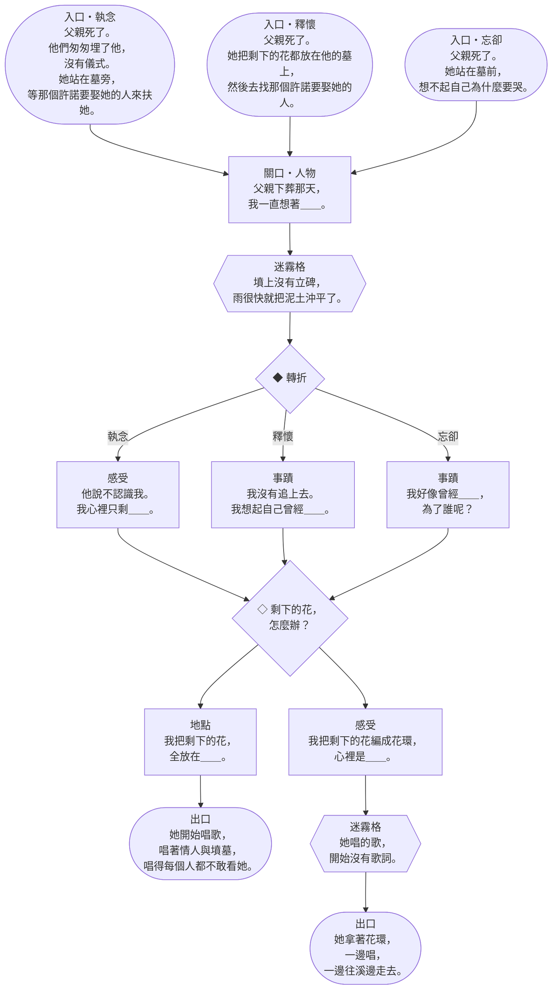

| 格子 | 欄位 | 文字 |
|---|---|---|
| 入口（上一章轉折是執念） | — | *父親死了。他們匆匆埋了他，沒有儀式。她站在墓旁，等那個許諾要娶她的人來扶她。* |
| 入口（上一章轉折是釋懷） | — | *父親死了。她把剩下的花都放在他的墓上，然後去找那個許諾要娶她的人。* |
| 入口（上一章轉折是忘卻） | — | *父親死了。她站在墓前，想不起自己為什麼要哭。* |
| 關口 | 人物 | 「父親下葬那天，我一直想著＿＿。」 |
| 迷霧格 | — | *墳上沒有立碑，雨很快就把泥土沖平了。* |
| ◆ 轉折 | — | 執念→下一格；釋懷→下一格；忘卻→下一格 |
| 記憶格 | 感受 | 「他說不認識我。我心裡只剩＿＿。」 |
| 記憶格 | 事蹟 | 「我沒有追上去。我想起自己曾經＿＿。」 |
| 記憶格 | 事蹟 | 「我好像曾經＿＿，為了誰呢？」 |
| ◇ 岔路 | 地點／感受 | **剩下的花，怎麼辦？** |
| 記憶格 | 地點 | 「我把剩下的花，全放在＿＿。」 |
| 記憶格 | 感受 | 「我把剩下的花編成花環，心裡是＿＿。」 |
| 迷霧格 | — | *她唱的歌，開始沒有歌詞。* |
| 出口 | — | *她開始唱歌，唱著情人與墳墓，唱得每個人都不敢看她。* |
| 出口 | — | *她拿著花環，一邊唱，一邊往溪邊走去。* |

**命運之霧**

| 條件 | 名稱 | 預兆 | 觸發條件 | 事件 | 絲線 |
|---|---|---|---|---|---|
| 河 | 父親的墳 | *墳上沒有立碑。* | 墳墓被翻開 | *他們匆匆埋了他，沒有儀式，也沒有花。她把自己的花全放了上去。* 河：驅散 1 個怨念。 書：遺忘 2 張。 | 執念 |
| 河 | 他說不認識我 | *他從她面前走過。* | 本章第一次徘徊 | *「我從沒對妳許過什麼。」他說完就轉身走了。* 河：解開執念所有的結（不反噬）。 書：本頁一段未點亮的記憶被遺忘。 | 忘卻 |
| 書 | 一首停不下來的歌 | *她開始哼歌。* | 關口被點亮 | *她唱著情人與墳墓，唱得每個人都不敢看她。* 河：得 3 光。 書：遺忘 1 張。 | 執念 |
| 書 | 分花 | *她手裡的花還有很多。* | 翻開一張託付 | *「這是給你的茴香，這是給你的耬斗菜。這是芸香，也給我留一點。」* 河：釋懷加 2 結。 書：任一位玩家從手牌銘刻 1 張。 | 釋懷 |

### 2.4 第三章・溪上的垂柳（深霧）

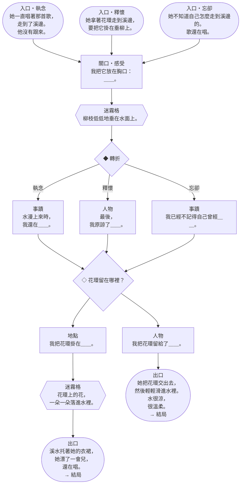

| 格子 | 欄位 | 文字 |
|---|---|---|
| 入口（上一章轉折是執念） | — | *她一直唱著那首歌，走到了溪邊。他沒有跟來。* |
| 入口（上一章轉折是釋懷） | — | *她拿著花環走到溪邊，要把它掛在垂柳上。* |
| 入口（上一章轉折是忘卻） | — | *她不知道自己怎麼走到溪邊的。歌還在唱。* |
| 關口 | 感受 | 「我把它放在胸口：＿＿。」 |
| 迷霧格 | — | *柳枝低低地垂在水面上。* |
| ◆ 轉折 | — | 執念→下一格；釋懷→下一格；忘卻→下一格 |
| 記憶格 | 事蹟 | 「水漫上來時，我還在＿＿。」 |
| 記憶格 | 人物 | 「最後，我原諒了＿＿。」 |
| 記憶格 | 事蹟 | 「我已經不記得自己曾經＿＿。」 |
| ◇ 岔路 | 地點／人物 | **花環留在哪裡？** |
| 記憶格 | 地點 | 「我把花環掛在＿＿。」 |
| 迷霧格 | — | *花環上的花，一朵一朵落進水裡。* |
| 記憶格 | 人物 | 「我把花環留給了＿＿。」 |
| 出口 | — | *溪水托著她的衣裙，她漂了一會兒，還在唱。* |
| 出口 | — | *她把花環交出去，然後輕輕滑進水裡。水很涼，很溫柔。* |

**命運之霧**

| 條件 | 名稱 | 預兆 | 觸發條件 | 事件 | 絲線 |
|---|---|---|---|---|---|
| 河 | 溪水漫過裙擺 | *她的裙子在水面鋪開。* | 本章第一次徘徊 | *她的衣裙在水上張開，托著她漂了一會兒。* 河：亡魂前進 1 格（下一格沒有照亮也可以，但不能有黑水）。 書：遺忘 2 張。 | 忘卻 |
| 河 | 折斷的柳枝 | *垂柳斜倚在溪上。* | 任一反噬 | *她爬上垂柳，要把花環掛上去，柳枝斷了。* 河：亡魂退回 1 格（不能退進霧裡），下一格放 1 個黑水。 書：免費喚回 1 次。 | 執念 |
| 書 | 最後的花環 | *她把剩下的花編在一起。* | 本頁有 1 段點亮的記憶，而且翻開一張託付 | *她把花環掛上柳枝，每一朵都有一個名字。* 河：移除 1 道傷疤，綻放 2 個根。 書：本頁一段未點亮的記憶被遺忘。 | 釋懷 |
| 書 | 留給自己的那朵 | *她手裡還剩一朵。* | 她的專屬記憶在本頁被點亮，而且關口已點亮 | *她始終不肯說是哪一朵。* 河：霧推進 2。 書：免費點亮 2 段。 | 執念 |

### 2.5 結局

| 三章實際走的路 | 結局 | 文字 |
|---|---|---|
| 兩章以上走執念 | 沒唱完的歌 | *她在彼岸還唱著那首歌。每個渡河的人都聽得到，卻沒有人聽得懂最後一句。她在等一個人來問她：那朵花是給誰的？* |
| 兩章以上走釋懷 | 花環 | *她把最後一朵花放進守岸人的杯子裡，花在河水上漂了一圈，沉了下去。她說：「這一朵，是給我自己的。」然後她喝下了河水。* |
| 兩章以上走忘卻 | 溪水 | *她不記得那個男人，也不記得父親的墳。她只記得溪水很涼、柳枝很低，而她一直在唱。* |
| 三章都不同 | 每個人一朵花 | *她把書上的記憶一段一段說出來，每說一段，就像送出一朵花。說完時，她手裡空了。* |

**順命或逆命**（接在結局後面）：

- **順命**（從未違抗命運）：*每一朵花，她都送到了命運指給她的地方。*
- **逆命**（違抗命運 1 次以上）：*命運替每一朵花選好了去處，她卻把花送給了別人。*

**關鍵記憶的結尾**：

- **銘刻在書上**：*那一朵花，終於有人知道是哪一朵。*
- **被遺忘**：*她找遍了手心，想不起自己留下的是哪一朵。*
- **未曾說出**：*她把那朵花藏在胸口，帶著它渡過了河，沒有讓任何人看見。*

**隱藏結局〈雛菊〉**

- **條件**（全部符合）：
  - 關鍵記憶已點亮，而且銘刻在第三章的關口。
  - 書上沒有霧痕。
  - 第三章走釋懷的路。
- **文字**：*她本來要把雛菊也送人，最後卻留下了它。它是她編的第一朵花，也是最後一朵。守岸人接過杯子，沒有讓她喝：「帶著它走吧。」*

---

## 3. 渡船上的國王

一位年邁的國王，贏下了每一場戰役，唯獨輸了最後一場。他最親近的摯友愛上了他的王后，他的同袍從此分崩離析，而他倒在一片親手造就的戰場上。彌留之際，他被安放在一艘黑色的渡船上。他借來的那柄寶劍，從未歸還給它所來自的那片湖水，因此他始終無法安息。

- **特色規則**：稱號花費 2 點光。造成裂痕的玩家會失去自己的稱號。（同 V4.0）
- **關鍵記憶**：*從湖中伸出、贈我寶劍的那隻手（釋懷・人物）*
- **路線**：**兩條戰線。**第一章一開場就轉折（戰敗已成定局），之後才選擇怎麼收拾殘局。第二章的頁面有兩個起點：上一章走執念的話，他死守王座；否則他回到空蕩的城堡。兩條線在「他怎麼得知真相」的岔路會合。

### 3.1 故事弧線

| 章 | 標題 | 情緒核心 | 路線 | 這一章發生什麼 |
|---|---|---|---|---|
| 一 | **最後一支軍隊** | 他輸了 | ◆ → ◇（三條線各有自己的岔路） | 贏了一輩子的王，輸掉最後一場仗。 |
| 二 | **王后與摯友** | 他被最愛的人背叛 | 兩個起點 → ◇ → ◆ | 他最信任的朋友愛上了他的王后。 |
| 三 | **湖中之手** | 還回借來的東西 | ◆ → ◇ | 他倒在最後的戰場上，手裡還握著那柄從湖中借來的劍。 |

### 3.2 第一章・最後一支軍隊（淺霧）

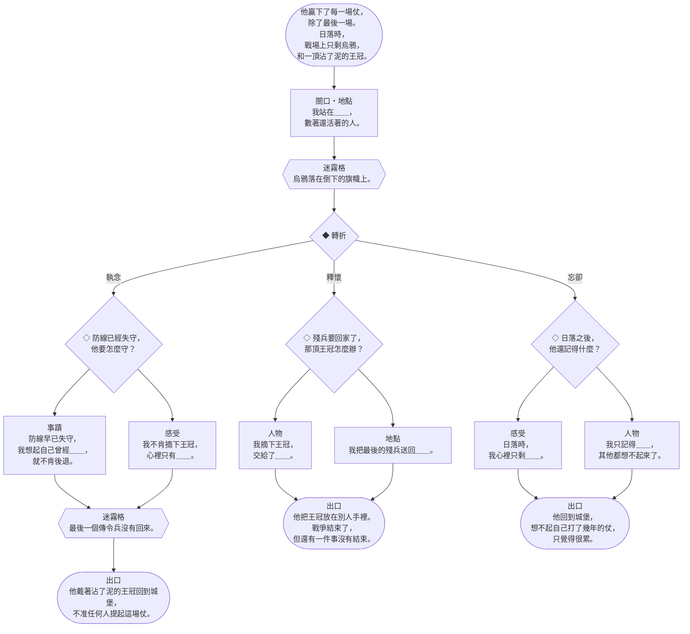

| 格子 | 欄位 | 文字 |
|---|---|---|
| 入口 | — | *他贏下了每一場仗，除了最後一場。日落時，戰場上只剩烏鴉，和一頂沾了泥的王冠。* |
| 關口 | 地點 | 「我站在＿＿，數著還活著的人。」 |
| 迷霧格 | — | *烏鴉落在倒下的旗幟上。* |
| ◆ 轉折 | — | 執念→下一格；釋懷→下一格；忘卻→下一格 |
| ◇ 岔路 | 事蹟／感受 | **防線已經失守，他要怎麼守？** |
| 記憶格 | 事蹟 | 「防線早已失守，我想起自己曾經＿＿，就不肯後退。」 |
| 記憶格 | 感受 | 「我不肯摘下王冠，心裡只有＿＿。」 |
| 迷霧格 | — | *最後一個傳令兵沒有回來。* |
| ◇ 岔路 | 人物／地點 | **殘兵要回家了，那頂王冠怎麼辦？** |
| 記憶格 | 人物 | 「我摘下王冠，交給了＿＿。」 |
| 記憶格 | 地點 | 「我把最後的殘兵送回＿＿。」 |
| ◇ 岔路 | 感受／人物 | **日落之後，他還記得什麼？** |
| 記憶格 | 感受 | 「日落時，我心裡只剩＿＿。」 |
| 記憶格 | 人物 | 「我只記得＿＿，其他都想不起來了。」 |
| 出口 | — | *他戴著沾了泥的王冠回到城堡，不准任何人提起這場仗。* |
| 出口 | — | *他把王冠放在別人手裡。戰爭結束了，但還有一件事沒有結束。* |
| 出口 | — | *他回到城堡，想不起自己打了幾年的仗，只覺得很累。* |

**命運之霧**

| 條件 | 名稱 | 預兆 | 觸發條件 | 事件 | 絲線 |
|---|---|---|---|---|---|
| 河 | 烏鴉 | *戰場上空盤旋著黑鳥。* | 本章第一次徘徊 | *他站在屍堆之間，數著還活著的人，數到一半就停了。* 前方第 1 格放 1 個怨念。 | 忘卻 |
| 河 | 守住防線 | *盾牌一面接一面倒下。* | 怨念進入亡魂所在格 | *防線早已失守，他還站在那裡，不讓任何人看見他後退。* 修補 1 道裂痕。 | 執念 |
| 書 | 沉重的王冠 | *王冠一年比一年重。* | 關口被點亮 | *他摘下王冠放在膝上，第一次覺得頭很輕。* 解開 2 結。 | 釋懷 |
| 書 | 最後的命令 | *傳令兵在等他開口。* | 翻開一張託付 | *「不准撤退。」那是他最後一道命令，也是最後一道被服從的命令。* 執念加 2 結。 | 執念 |

### 3.3 第二章・王后與摯友（濃霧）

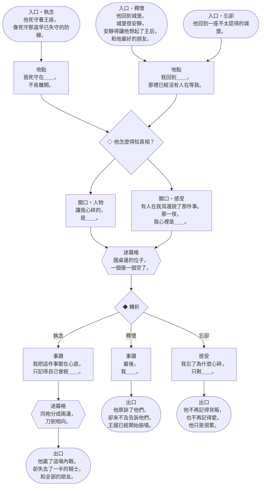

| 格子 | 欄位 | 文字 |
|---|---|---|
| 入口（上一章轉折是執念）（從「我死守在＿＿，不肯離開。」開始） | — | *他死守著王座，像死守那道早已失守的防線。* |
| 入口（上一章轉折是釋懷）（從「我回到＿＿，那裡已經沒有人在等我。」開始） | — | *他回到城堡。城堡很安靜，安靜得讓他想起了王后，和他最好的朋友。* |
| 入口（上一章轉折是忘卻）（從「我回到＿＿，那裡已經沒有人在等我。」開始） | — | *他回到一座不太認得的城堡。* |
| 記憶格 | 地點 | 「我死守在＿＿，不肯離開。」 |
| 記憶格 | 地點 | 「我回到＿＿，那裡已經沒有人在等我。」 |
| ◇ 岔路 | 人物／感受 | **他怎麼得知真相？** |
| 關口 | 人物 | 「讓我心碎的，是＿＿。」 |
| 關口 | 感受 | 「有人在我耳邊說了那件事。那一夜，我心裡是＿＿。」 |
| 迷霧格 | — | *圓桌邊的位子，一個接一個空了。* |
| ◆ 轉折 | — | 執念→下一格；釋懷→下一格；忘卻→下一格 |
| 記憶格 | 事蹟 | 「我把這件事壓在心底，只記得自己曾經＿＿。」 |
| 迷霧格 | — | *同袍分成兩邊，刀劍相向。* |
| 記憶格 | 事蹟 | 「最後，我＿＿。」 |
| 記憶格 | 感受 | 「我忘了為什麼心碎，只剩＿＿。」 |
| 出口 | — | *他贏了這場內戰，卻失去了一半的騎士，和全部的朋友。* |
| 出口 | — | *他原諒了他們，卻來不及告訴他們。王國已經開始崩塌。* |
| 出口 | — | *他不再記得背叛，也不再記得愛。他只是很累。* |

**命運之霧**

| 條件 | 名稱 | 預兆 | 觸發條件 | 事件 | 絲線 |
|---|---|---|---|---|---|
| 河 | 圓桌的裂縫 | *桌邊的位子一個個空了。* | 任一反噬 | *同袍分成兩邊，有人站在他身後，有人站在摯友身後。* 河：前方第 1 格放 1 個怨念。 書：免費喚回 1 次。 | 執念 |
| 河 | 燒掉的信 | *壁爐裡有一封沒寄出的信。* | 本章第一次徘徊 | *他寫了一封原諒的信，又把它燒了。* 河：解開 3 結。 書：本頁一段未點亮的記憶被遺忘。 | 忘卻 |
| 書 | 誠實的朋友 | *他的朋友不敢看他。* | 關口被點亮 | *他終於承認：朋友愛她，比他愛得更誠實。* 河：一位玩家失去稱號。 書：免費點亮 1 段。 | 釋懷 |
| 書 | 王后的戒指 | *她把戒指留在了枕邊。* | 本頁有 2 段點亮的記憶 | *他把戒指收進懷裡，沒有去追她。* 河：亡魂前進 1 格。 書：遺忘 2 張。 | 執念 |

### 3.4 第三章・湖中之手（深霧）

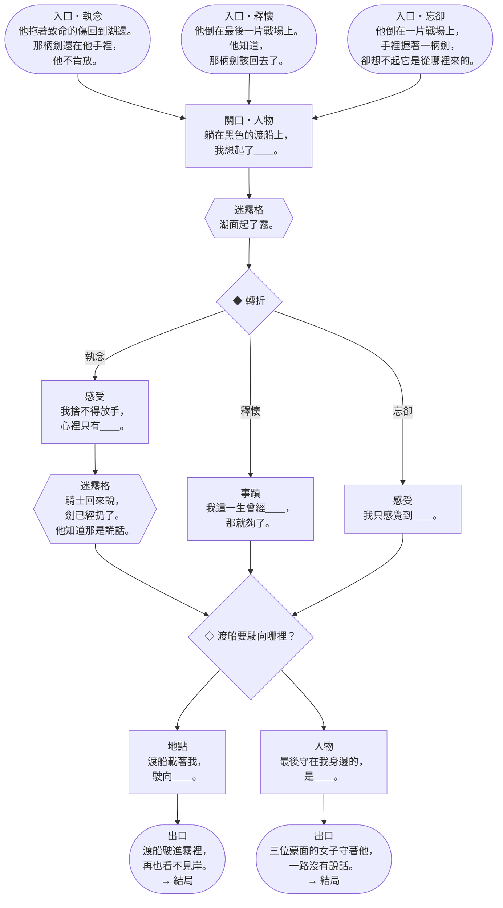

| 格子 | 欄位 | 文字 |
|---|---|---|
| 入口（上一章轉折是執念） | — | *他拖著致命的傷回到湖邊。那柄劍還在他手裡，他不肯放。* |
| 入口（上一章轉折是釋懷） | — | *他倒在最後一片戰場上。他知道，那柄劍該回去了。* |
| 入口（上一章轉折是忘卻） | — | *他倒在一片戰場上，手裡握著一柄劍，卻想不起它是從哪裡來的。* |
| 關口 | 人物 | 「躺在黑色的渡船上，我想起了＿＿。」 |
| 迷霧格 | — | *湖面起了霧。* |
| ◆ 轉折 | — | 執念→下一格；釋懷→下一格；忘卻→下一格 |
| 記憶格 | 感受 | 「我捨不得放手，心裡只有＿＿。」 |
| 迷霧格 | — | *騎士回來說，劍已經扔了。他知道那是謊話。* |
| 記憶格 | 事蹟 | 「我這一生曾經＿＿，那就夠了。」 |
| 記憶格 | 感受 | 「我只感覺到＿＿。」 |
| ◇ 岔路 | 地點／人物 | **渡船要駛向哪裡？** |
| 記憶格 | 地點 | 「渡船載著我，駛向＿＿。」 |
| 記憶格 | 人物 | 「最後守在我身邊的，是＿＿。」 |
| 出口 | — | *渡船駛進霧裡，再也看不見岸。* |
| 出口 | — | *三位蒙面的女子守著他，一路沒有說話。* |

**命運之霧**

| 條件 | 名稱 | 預兆 | 觸發條件 | 事件 | 絲線 |
|---|---|---|---|---|---|
| 河 | 黑色的渡船 | *一艘黑船靠了岸。* | 本章第一次徘徊 | *三位蒙面的女子把他抬上船。他閉上眼睛，不再數傷口。* 河：修補 1 道裂痕。 書：遺忘 2 張。 | 忘卻 |
| 河 | 藏起來的劍 | *騎士回來了，劍還在他手上。* | 本章第二次徘徊 | *騎士捨不得那柄劍，兩次騙他說已經扔了。* 河：亡魂退回 1 格（不能退進霧裡）。 書：免費喚回 1 次。 | 執念 |
| 書 | 湖中之手 | *湖面平靜得像一面鏡子。* | 關口被點亮，而且翻開一張託付 | *他終於說出那隻手的樣子。* 河：移除 1 道傷疤，亡魂前進 1 格。 書：本頁一段未點亮的記憶被遺忘。 | 釋懷 |
| 書 | 將來的王 | *有人說，他沒有死。* | 翻開一張託付，而且遺忘堆達到 6 張 | *他們在他的墓碑上刻著：曾經的王，將來的王。* 河：執念加 3 結。 書：免費點亮 2 段。 | 執念 |

### 3.5 結局

| 三章實際走的路 | 結局 | 文字 |
|---|---|---|
| 兩章以上走執念 | 將來的王 | *他不肯喝下河水：「我的國家還需要我。」守岸人讓他在彼岸睡下，說等那一天來了，會叫醒他。* |
| 兩章以上走釋懷 | 劍歸湖中 | *他終於說出：我原諒你們。沒有人聽見，但湖水聽見了。他放下王冠，像放下一塊很重的石頭，然後喝下了河水。* |
| 兩章以上走忘卻 | 一個騎士 | *守岸人問他是誰，他想了很久，說：「一個騎士。」他想不起自己曾經是王，也想不起輸掉了什麼。這讓他輕鬆了許多。* |
| 三章都不同 | 圓桌 | *他把每一段記憶擺在桌上，像當年讓騎士們圍成一圈：沒有首座，也沒有末座。他坐下來，和自己的一生說了很久的話。* |

**順命或逆命**（接在結局後面）：

- **順命**（從未違抗命運）：*他像一名老兵那樣，服從了命運的每一道命令。*
- **逆命**（違抗命運 1 次以上）：*他違抗了命運，就像他當年違抗每一個說他會輸的人。*

**關鍵記憶的結尾**：

- **銘刻在書上**：*他記得那隻手，所以記得自己欠了什麼，也記得已經還清了。*
- **被遺忘**：*他手上空空的，想不起曾經握過什麼。*
- **未曾說出**：*他始終沒說出劍是從哪裡來的。那隻手，至今仍在湖底等著。*

**隱藏結局〈蘋果之島〉**

- **條件**（全部符合）：
  - 關鍵記憶已點亮，而且銘刻在第三章的關口。
  - 書上沒有霧痕。
  - 整局沒有任何玩家因裂痕失去稱號。
- **文字**：*渡船沒有停在彼岸，而是繼續往西，駛向一座長滿蘋果樹的島。三位女子說，他的傷會在那裡癒合。也許有一天，他會回來。*

---

## 4. 留在冥府的新娘

她死在自己的婚禮當天。她的丈夫走進黑暗深處，想把她帶回人間，卻有一個條件：在抵達光明之前，絕不能回頭。距離地面只剩一步時，他轉過了頭。從那以後，她便一直佇立在陰影裡，思量著該記住他的臉，還是放手讓它遠去。

- **特色規則**：起始擁有 1 點光。她第一次將在黑暗中徘徊時，不會遺忘，而是被拉回一格。（同 V4.0；被拉回也算「這回合沒有前進」，所以霧會推進：她被拉回黑暗。）
- **關鍵記憶**：*他回頭看我那一瞬間的臉（釋懷・人物）*
- **路線**：**一道窄梯。**第二章是唯一有三個分岔的一章：轉折夾在兩個純分岔中間，像一階一階往上走。第三章一開頭就轉折，而且**沒有關口**：他回頭的那一瞬間，誰的記憶都改變不了。第三章因此只有 2 個記憶格。

### 4.1 故事弧線

| 章 | 標題 | 情緒核心 | 路線 | 這一章發生什麼 |
|---|---|---|---|---|
| 一 | **正午的婚禮** | 最幸福的一天，也是最後一天 | ◇ → ◆ | 她在正午成婚，在花叢裡倒下。 |
| 二 | **向上的窄梯** | 差一點就得救 | ◇ → ◆ → ◇ | 他用歌聲找到她。冥王答應放她走，條件是他絕不能回頭。 |
| 三 | **回頭的那一瞬間** | 記住他的臉，還是放手 | ◆（沒有關口）→ ◇ | 只差一步，他轉過了頭。 |

### 4.2 第一章・正午的婚禮（淺霧）

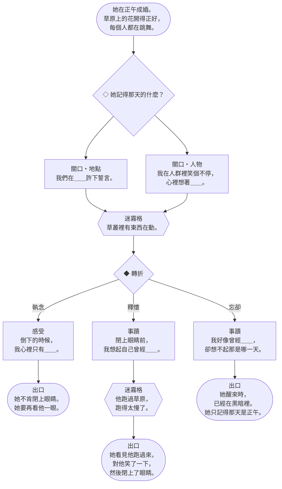

| 格子 | 欄位 | 文字 |
|---|---|---|
| 入口 | — | *她在正午成婚。草原上的花開得正好，每個人都在跳舞。* |
| ◇ 岔路 | 地點／人物 | **她記得那天的什麼？** |
| 關口 | 地點 | 「我們在＿＿許下誓言。」 |
| 關口 | 人物 | 「我在人群裡笑個不停，心裡想著＿＿。」 |
| 迷霧格 | — | *草叢裡有東西在動。* |
| ◆ 轉折 | — | 執念→下一格；釋懷→下一格；忘卻→下一格 |
| 記憶格 | 感受 | 「倒下的時候，我心裡只有＿＿。」 |
| 記憶格 | 事蹟 | 「閉上眼睛前，我想起自己曾經＿＿。」 |
| 迷霧格 | — | *他跑過草原，跑得太慢了。* |
| 記憶格 | 事蹟 | 「我好像曾經＿＿，卻想不起那是哪一天。」 |
| 出口 | — | *她不肯閉上眼睛。她要再看他一眼。* |
| 出口 | — | *她看見他跑過來，對他笑了一下，然後閉上了眼睛。* |
| 出口 | — | *她醒來時，已經在黑暗裡。她只記得那天是正午。* |

**命運之霧**

| 條件 | 名稱 | 預兆 | 觸發條件 | 事件 | 絲線 |
|---|---|---|---|---|---|
| 河 | 草裡的蛇 | *草原上有東西在動。* | 本章第一次徘徊 | *她跑過草地，赤腳踩上了一條蛇。* 遺忘 1 張。 | 忘卻 |
| 河 | 沒跳完的舞 | *樂聲還沒停。* | 怨念進入亡魂所在格 | *賓客還在跳舞，她已經躺在花叢裡，手裡牽著一段緞帶。* 釋懷加 2 結。 | 釋懷 |
| 書 | 正午的誓言 | *陽光照在兩個人的手上。* | 本頁有 1 段點亮的記憶 | *「無論妳在哪裡，我都會找到妳。」他說。* 得 2 光。 | 執念 |
| 書 | 最後一眼 | *他的臉離她越來越遠。* | 關口被銘刻 | *她最後看見的，是他跑過草原的樣子。* 解開 2 結。 | 釋懷 |

### 4.3 第二章・向上的窄梯（濃霧）

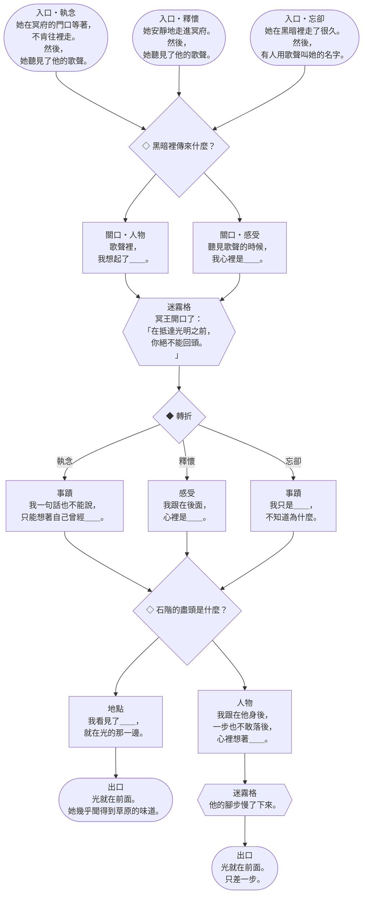

| 格子 | 欄位 | 文字 |
|---|---|---|
| 入口（上一章轉折是執念） | — | *她在冥府的門口等著，不肯往裡走。然後，她聽見了他的歌聲。* |
| 入口（上一章轉折是釋懷） | — | *她安靜地走進冥府。然後，她聽見了他的歌聲。* |
| 入口（上一章轉折是忘卻） | — | *她在黑暗裡走了很久。然後，有人用歌聲叫她的名字。* |
| ◇ 岔路 | 人物／感受 | **黑暗裡傳來什麼？** |
| 關口 | 人物 | 「歌聲裡，我想起了＿＿。」 |
| 關口 | 感受 | 「聽見歌聲的時候，我心裡是＿＿。」 |
| 迷霧格 | — | *冥王開口了：「在抵達光明之前，你絕不能回頭。」* |
| ◆ 轉折 | — | 執念→下一格；釋懷→下一格；忘卻→下一格 |
| 記憶格 | 事蹟 | 「我一句話也不能說，只能想著自己曾經＿＿。」 |
| 記憶格 | 感受 | 「我跟在後面，心裡是＿＿。」 |
| 記憶格 | 事蹟 | 「我只是＿＿，不知道為什麼。」 |
| ◇ 岔路 | 地點／人物 | **石階的盡頭是什麼？** |
| 記憶格 | 地點 | 「我看見了＿＿，就在光的那一邊。」 |
| 記憶格 | 人物 | 「我跟在他身後，一步也不敢落後，心裡想著＿＿。」 |
| 迷霧格 | — | *他的腳步慢了下來。* |
| 出口 | — | *光就在前面。她幾乎聞得到草原的味道。* |
| 出口 | — | *光就在前面。只差一步。* |

**命運之霧**

| 條件 | 名稱 | 預兆 | 觸發條件 | 事件 | 絲線 |
|---|---|---|---|---|---|
| 河 | 他的歌聲 | *黑暗深處傳來琴聲。* | 留下一道光牆 | *他的歌讓冥河停了下來，讓亡者忘了哭泣。* 河：亡魂前進 1 格。 書：遺忘 1 張。 | 執念 |
| 河 | 冥王的條件 | *王座上的人開口了。* | 本章第一次徘徊 | *「她可以跟你走。但你要記住：絕不能回頭。」* 河：霧推進 1。 書：免費點亮 1 段。 | 釋懷 |
| 書 | 窄梯 | *一道看不見盡頭的石階。* | 關口被點亮 | *她跟著他的腳步聲一階一階往上走，一句話也不能說。* 河：放 2 個根。 書：本頁一段未點亮的記憶被遺忘。 | 忘卻 |
| 書 | 差點得救的憤怒 | *她的手握成了拳頭。* | 她的專屬記憶在本頁被點亮 | *她恨那道窄梯，恨那個條件，最恨的是：她差一點就相信了。* 河：執念加 2 結。 書：任一位玩家從手牌銘刻 1 張。 | 執念 |

### 4.4 第三章・回頭的那一瞬間（深霧）

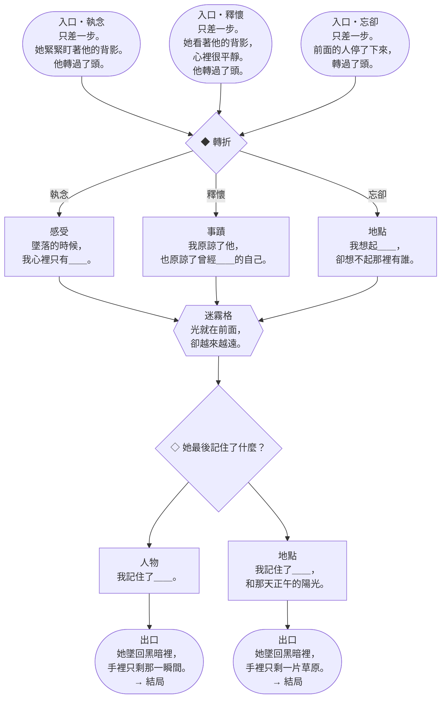

| 格子 | 欄位 | 文字 |
|---|---|---|
| 入口（上一章轉折是執念） | — | *只差一步。她緊緊盯著他的背影。他轉過了頭。* |
| 入口（上一章轉折是釋懷） | — | *只差一步。她看著他的背影，心裡很平靜。他轉過了頭。* |
| 入口（上一章轉折是忘卻） | — | *只差一步。前面的人停了下來，轉過了頭。* |
| ◆ 轉折 | — | 執念→下一格；釋懷→下一格；忘卻→下一格 |
| 記憶格 | 感受 | 「墜落的時候，我心裡只有＿＿。」 |
| 記憶格 | 事蹟 | 「我原諒了他，也原諒了曾經＿＿的自己。」 |
| 記憶格 | 地點 | 「我想起＿＿，卻想不起那裡有誰。」 |
| 迷霧格 | — | *光就在前面，卻越來越遠。* |
| ◇ 岔路 | 人物／地點 | **她最後記住了什麼？** |
| 記憶格 | 人物 | 「我記住了＿＿。」 |
| 記憶格 | 地點 | 「我記住了＿＿，和那天正午的陽光。」 |
| 出口 | — | *她墜回黑暗裡，手裡只剩那一瞬間。* |
| 出口 | — | *她墜回黑暗裡，手裡只剩一片草原。* |

**命運之霧**

| 條件 | 名稱 | 預兆 | 觸發條件 | 事件 | 絲線 |
|---|---|---|---|---|---|
| 河 | 墜落 | *她腳下的石階不見了。* | 本章第一次徘徊 | *她往下墜，墜進霧裡，手裡什麼也抓不住。* 河：亡魂退回 1 格（不能退進霧裡），霧推進 1。 書：關鍵記憶若在任一玩家手上，那位玩家可以立即把它銘刻到本頁的人物格（如果還空著）。 | 忘卻 |
| 河 | 第二次死去 | *她的身影開始變淡。* | 霧已逼近 | *她又死了一次。這一次，她沒有哭。* 河：修補 1 道裂痕。 書：遺忘 2 張。 | 釋懷 |
| 書 | 他的臉 | *她還記得那張臉嗎？* | 翻開一張託付，而且前兩頁共有 3 段點亮的記憶 | *她把那張臉記得清清楚楚：驚慌、後悔，還有一點點高興，因為他終於看見她了。* 河：移除 1 道傷疤，亡魂前進 1 格。 書：本頁一段未點亮的記憶被遺忘。 | 執念 |
| 書 | 鬆開的手 | *他掌心的溫度還在。* | 遺忘堆達到 6 張，而且前兩頁共有 4 段點亮的記憶 | *她感覺到他的手鬆開了。* 河：解開 3 結。 書：遺忘 1 張。 | 釋懷 |

### 4.5 結局

| 三章實際走的路 | 結局 | 文字 |
|---|---|---|
| 兩章以上走執念 | 他的臉 | *她在彼岸轉過身，望著來時的方向。她要記住他的臉，等他下次來的時候，她要第一個認出他。* |
| 兩章以上走釋懷 | 放手 | *她把那張臉還給了河水。「去吧。」她說，不知道是對他，還是對自己。然後她喝下了守岸人的杯子。* |
| 兩章以上走忘卻 | 陌生人 | *守岸人問她，有沒有誰在等她。她想了想，搖搖頭。很久以後，一個抱著琴的人渡了河，她從他身邊走過，沒有停下。* |
| 三章都不同 | 最後一階 | *她站在彼岸，像站在那道窄梯的最後一階：一邊是光，一邊是他。這一次，沒有人要求她不准回頭。* |

**順命或逆命**（接在結局後面）：

- **順命**（從未違抗命運）：*她走的，是命運替她鋪好的路。*
- **逆命**（違抗命運 1 次以上）：*命運要她往東，她偏偏往西，一次又一次。*

**關鍵記憶的結尾**：

- **銘刻在書上**：*她記得他回頭的那一瞬間，也終於明白了那一瞬間的意思。*
- **被遺忘**：*她記得有人回過頭，卻想不起那張臉。*
- **未曾說出**：*她始終沒有說出他回頭時的表情，那是她留給自己的。*

**隱藏結局〈沒有回頭〉**

- **條件**（全部符合）：
  - 整局沒有因為徘徊而遺忘任何一張牌（第一次因徘徊而遺忘時，把亡魂牌上下顛倒作為提醒）。
  - 關鍵記憶已點亮。
- **文字**：*這一次，換她走在前面。她一步也沒有停，一次也沒有回頭，一直走到了光裡。他在後面跟著，她知道。*
- **注意**：彼岸的門要求第三章的轉折先發生，否則亡魂會在第 13 格徘徊。所以這個結局需要在抵達第 13 格前寫完整本書，是全遊戲最難的結局。

---

## 5. 無名渡河

一個無名的亡魂。你們不會得知它的故事，而是要親手寫下它。

- **特色規則**：起始擁有 2 點光。使用 8 張迴響牌，沒有關鍵記憶。
- **路線**：**最簡單的版型，給熟悉規則用。**三章都是「一個純分岔、一個轉折」，句子沿用 V4.0 的書頁句型。

### 5.1 故事弧線

| 章 | 標題 | 情緒核心 | 路線 | 這一章發生什麼 |
|---|---|---|---|---|
| 一 | **我曾是誰** | 它從哪裡來 | ◇ → ◆ | 沿用 V4.0 的書頁句型。 |
| 二 | **我做過什麼** | 它做過的事 | ◆ → ◇ | — |
| 三 | **我所懷抱的** | 它要帶走什麼 | ◆ → ◇ | — |

### 5.2 第一章・我曾是誰（淺霧）

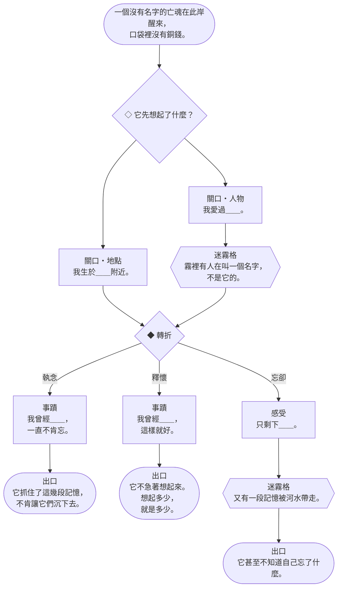

| 格子 | 欄位 | 文字 |
|---|---|---|
| 入口 | — | *一個沒有名字的亡魂在此岸醒來，口袋裡沒有銅錢。* |
| ◇ 岔路 | 地點／人物 | **它先想起了什麼？** |
| 關口 | 地點 | 「我生於＿＿附近。」 |
| 關口 | 人物 | 「我愛過＿＿。」 |
| 迷霧格 | — | *霧裡有人在叫一個名字，不是它的。* |
| ◆ 轉折 | — | 執念→下一格；釋懷→下一格；忘卻→下一格 |
| 記憶格 | 事蹟 | 「我曾經＿＿，一直不肯忘。」 |
| 記憶格 | 事蹟 | 「我曾經＿＿，這樣就好。」 |
| 記憶格 | 感受 | 「只剩下＿＿。」 |
| 迷霧格 | — | *又有一段記憶被河水帶走。* |
| 出口 | — | *它抓住了這幾段記憶，不肯讓它們沉下去。* |
| 出口 | — | *它不急著想起來。想起多少，就是多少。* |
| 出口 | — | *它甚至不知道自己忘了什麼。* |

**命運之霧**

| 條件 | 名稱 | 預兆 | 觸發條件 | 事件 | 絲線 |
|---|---|---|---|---|---|
| 河 | 不肯收錢的擺渡人 | *一艘船從它身邊滑過。* | 霧已逼近 | *老擺渡人看了它一眼，搖搖頭。* 執念加 2 結。 | 執念 |
| 河 | 消失的腳印 | *身後很安靜。* | 本章第一次徘徊 | *它回頭看，身後的腳印一個一個不見了。* 遺忘 1 張。 | 忘卻 |
| 書 | 窗邊的燈 | *很遠的地方有一點光。* | 本頁有 1 段點亮的記憶 | *有一盞燈還沒熄，好像在等誰回家。* 得 2 光。 | 釋懷 |
| 書 | 愛過的人 | *它好像在找一個人。* | 關口被點亮 | *它想起自己愛過一個人，卻想不起那張臉。* 放 2 個根。 | 執念 |

### 5.3 第二章・我做過什麼（濃霧）

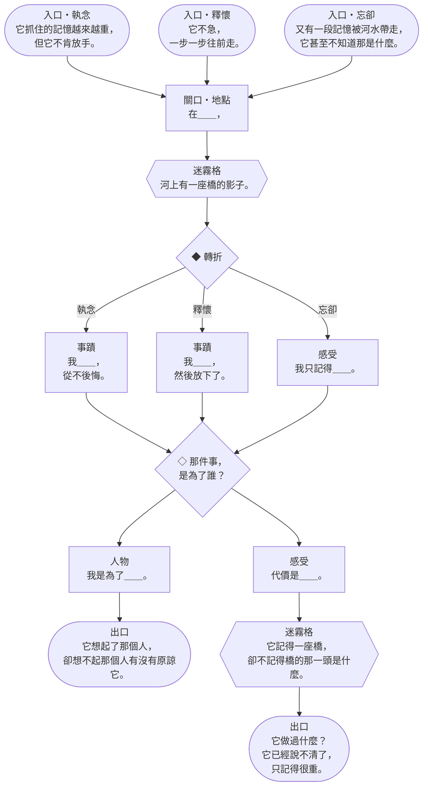

| 格子 | 欄位 | 文字 |
|---|---|---|
| 入口（上一章轉折是執念） | — | *它抓住的記憶越來越重，但它不肯放手。* |
| 入口（上一章轉折是釋懷） | — | *它不急，一步一步往前走。* |
| 入口（上一章轉折是忘卻） | — | *又有一段記憶被河水帶走，它甚至不知道那是什麼。* |
| 關口 | 地點 | 「在＿＿，」 |
| 迷霧格 | — | *河上有一座橋的影子。* |
| ◆ 轉折 | — | 執念→下一格；釋懷→下一格；忘卻→下一格 |
| 記憶格 | 事蹟 | 「我＿＿，從不後悔。」 |
| 記憶格 | 事蹟 | 「我＿＿，然後放下了。」 |
| 記憶格 | 感受 | 「我只記得＿＿。」 |
| ◇ 岔路 | 人物／感受 | **那件事，是為了誰？** |
| 記憶格 | 人物 | 「我是為了＿＿。」 |
| 記憶格 | 感受 | 「代價是＿＿。」 |
| 迷霧格 | — | *它記得一座橋，卻不記得橋的那一頭是什麼。* |
| 出口 | — | *它想起了那個人，卻想不起那個人有沒有原諒它。* |
| 出口 | — | *它做過什麼？它已經說不清了，只記得很重。* |

**命運之霧**

| 條件 | 名稱 | 預兆 | 觸發條件 | 事件 | 絲線 |
|---|---|---|---|---|---|
| 河 | 每天走過的橋 | *河上有一座橋的影子。* | 本章第一次徘徊 | *它記得一座橋，卻不記得橋的那一頭是什麼。* 河：亡魂前進 1 格。 書：本頁一段未點亮的記憶被遺忘。 | 忘卻 |
| 河 | 挑水 | *肩膀上有扁擔的痕跡。* | 留下一道光牆 | *它替一個人挑過水，從沒等到一聲謝謝。* 河：解開 2 結。 書：遺忘 1 張。 | 釋懷 |
| 書 | 雪中的栗子 | *空氣裡有烤栗子的香味。* | 關口被點亮 | *一位老婦人把熱栗子塞進它手裡。* 河：忘卻加 2 結。 書：免費點亮 1 段。 | 釋懷 |
| 書 | 欠下的債 | *它覺得自己少了什麼。* | 翻開一張託付 | *它想起欠了某人一樣東西，還沒還。* 河：執念加 2 結。 書：免費喚回 1 次。 | 執念 |

### 5.4 第三章・我所懷抱的（深霧）

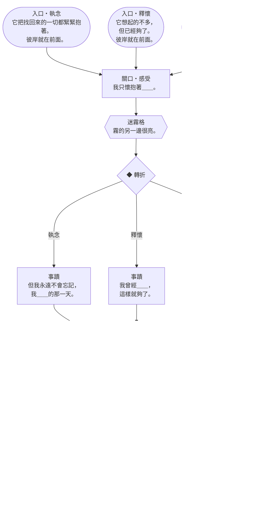

| 格子 | 欄位 | 文字 |
|---|---|---|
| 入口（上一章轉折是執念） | — | *它把找回來的一切都緊緊抱著。彼岸就在前面。* |
| 入口（上一章轉折是釋懷） | — | *它想起的不多，但已經夠了。彼岸就在前面。* |
| 入口（上一章轉折是忘卻） | — | *它已經分不清哪些是自己的，哪些是別人的。彼岸就在前面。* |
| 關口 | 感受 | 「我只懷抱著＿＿。」 |
| 迷霧格 | — | *霧的另一邊很亮。* |
| ◆ 轉折 | — | 執念→下一格；釋懷→下一格；忘卻→下一格 |
| 記憶格 | 事蹟 | 「但我永遠不會忘記，我＿＿的那一天。」 |
| 記憶格 | 事蹟 | 「我曾經＿＿，這樣就夠了。」 |
| 記憶格 | 地點 | 「連＿＿也漸漸淡了。」 |
| 迷霧格 | — | *它讀著書上的字，像在讀別人的故事。* |
| ◇ 岔路 | 地點／人物 | **它要離開什麼？** |
| 記憶格 | 地點 | 「如今我離去，離開＿＿。」 |
| 記憶格 | 人物 | 「如今我離去，原諒＿＿。」 |
| 出口 | — | *它把書闔上，往光裡走去。* |
| 出口 | — | *它回頭看了一眼，然後往光裡走去。* |

**命運之霧**

| 條件 | 名稱 | 預兆 | 觸發條件 | 事件 | 絲線 |
|---|---|---|---|---|---|
| 河 | 彼岸的燈火 | *霧的另一邊很亮。* | 亡魂承受裂痕 | *彼岸有光，比它記得的任何一盞燈都亮。* 河：修補 1 道裂痕，霧推進 2。 書：遺忘 1 張。 | 釋懷 |
| 河 | 一個名字 | *有人在叫。* | 本章第一次徘徊 | *有人叫了一個名字，它不確定是不是自己的。* 河：下一格放 1 個黑水。 書：免費喚回 1 次。 | 忘卻 |
| 書 | 寫下的一生 | *書上的字開始變得熟悉。* | 關口被點亮，而且翻開一張託付 | *它讀著書上的字，然後認出了自己。* 河：移除 1 道傷疤，亡魂前進 1 格。 書：本頁一段未點亮的記憶被遺忘。 | 執念 |
| 書 | 空白的一頁 | *有一欄始終空著。* | 翻開一張託付，而且遺忘堆達到 6 張 | *它決定讓那一欄空著。* 河：解開 3 結。 書：遺忘 2 張。 | 釋懷 |

### 5.5 結局

| 三章實際走的路 | 結局 | 文字 |
|---|---|---|
| 兩章以上走執念 | 這就是我 | *守岸人問它是誰。它把書上的每一段都念了一遍：「這些，就是我。」它不肯少念任何一個字。* |
| 兩章以上走釋懷 | 夠了 | *它想起的不多，但它覺得夠了。它把書闔上，交給守岸人，喝下了河水。* |
| 兩章以上走忘卻 | 河水 | *它把書上的字念到一半，就忘了開頭。守岸人沒有等它念完。河水很溫柔。* |
| 三章都不同 | 別人的故事 | *它念著書上的記憶，有些像自己的，有些像別人的。也許每一個亡魂，都是這樣拼起來的。* |

**順命或逆命**（接在結局後面）：

- **順命**（從未違抗命運）：*它順著河水，走完了別人替它寫好的路。*
- **逆命**（違抗命運 1 次以上）：*它把命運寫好的句子劃掉，改成了自己的。*

**隱藏結局〈名字〉**

- **條件**（全部符合）：
  - 三章路線上的記憶格全部填滿，而且都已點亮。
  - 書上沒有霧痕。
  - 三章中至少有一章違抗了命運。
- **文字**：*守岸人問它是誰。它翻開書，一字一句讀完，然後說出一個名字。那是它自己寫下的。*

---

## 6. 請你檢查的地方

1. **岔路的規則**（§0.2）：第一段寫進去的記憶決定路。手上沒有那種欄位的記憶時，路會停住。
2. **轉折可以提早觸發、牌先放著等**（§0.3），路走到 ◆ 時命運之霧還沒觸發的話，路也會停在 ◆ 前。
3. **結局兩者兼得**（§0.7）：結局看實際走的路，順命或逆命看命運之霧。請看看每位亡魂的順命、逆命兩句是否合適。
4. **章節託付的欄位**：
   - 「第一頁的地點」（孩子、無名）、「第二頁的地點」（國王）、「第三頁的感受」（花環）在每條路線上都做得到。
   - 孩子的「第三頁有一段點亮的感受」只在第三章岔路選感受時做得到。
5. **新娘第三章只有 2 個記憶格**，而且轉折沒有關口。這是刻意的：那一瞬間誰都改變不了。
6. **記憶格的句子**（11/7 修改）：基本牌是所有亡魂共用的，所以同一句會填進各種記憶。句子已改成空格只放在中性位置（想起、記得、心裡只有、曾經），不替空格決定情緒、性別或關係；卡牌文字不變。所有組合（673 句）見 `V5-memory-combos.zh-TW.md`。

