# Netherbloom — Rulebook

- [1. The story and the goal](#1-the-story-and-the-goal)
- [2. Setting up](#2-setting-up)
- [3. Your turn](#3-your-turn)
- [4. The end of the turn](#4-the-end-of-the-turn)
- [5. The river, Roots and Blooms](#5-the-river-roots-and-blooms)
- [6. The Loom of the Fates and Backlash](#6-the-loom-of-the-fates-and-backlash)
- [7. Black Water, Shades and Fractures](#7-black-water-shades-and-fractures)
- [8. Light and Mantles](#8-light-and-mantles)
- [9. The Book of Remembrance and the ending](#9-the-book-of-remembrance-and-the-ending)
- [10. The Souls and the Lantern](#10-the-souls-and-the-lantern)
- [11. Solo play and the Ghost](#11-solo-play-and-the-ghost)
- [Appendix A. Components and symbols](#appendix-a-components-and-symbols)
- [Appendix B. Card terms](#appendix-b-card-terms)
- [Appendix C. Mist cards](#appendix-c-mist-cards)
- [Appendix D. Card reference](#appendix-d-card-reference)

## 1. The story and the goal

*Whoever drinks from the River Lethe forgets.*

Below the world of the living runs a black river. The dead must cross it to reach the **Far Shore**, where a veiled **Keeper** waits with one cup of river water. Drink it, and the weight of a whole life slips away.

An old ferryman carries the dead across, but only those who were buried with a coin for the fare. The others, the **coinless dead**, wake alone on the **near shore** and wander the bank. Fog fills them, and they begin to forget: first the small things, then the faces, then their own names. A soul that forgets everything simply fades into the mist.

You are the **Ferrymen**: servants of the underworld, neither living nor dead. The coinless the old ferryman will not carry are given to you. You have no boat. You have something stranger. Along the banks of Lethe grows the **Netherbloom**, a crimson flower of long, curling petals, blooming on a bare stalk with no leaves, because *flower and leaf never meet*. Its glow is the only light in the fog that a lost soul can follow. Where you plant Netherblooms, a soul can walk in the river toward the Far Shore.

One more thing: a soul's memories are not yours to tell. The Ferrymen may speak with one another on the water, but never of the memories they carry: only of the river, and of which threads of a life they hold in their hands.

### The goal

Netherbloom is a co-operative game for 1 to 4 players and lasts about 15 turns. One soul starts on the near shore (space 0). All players win or lose together.

**You win** when the soul token reaches the Far Shore (space 12). The soul only moves onto spaces with a Bloom, so you place Roots ahead of it and turn them into Blooms. Along the way, some cards can be inscribed in the Book of Remembrance (section 9); the Book does not decide whether you win, but it decides how the story ends.

**You lose** at once if any of these happens:

- **Faded**: the forgotten pile reaches the Lantern's limit (section 10).
- **Shattered**: the soul has 3 Fractures.
- **Deluge**: you must place a Black Water token but none is left in the supply.

Forgetting cards helps and hurts. Many strong cards put cards on the forgotten pile, and with 6 or more forgotten cards the soul moves faster (section 4). But each forgotten card brings you closer to Faded.

### The Veiled Memories

Talk as much as you like: plans, the board, the Loom, the Book and what each of you means to do next. But the memories stay veiled. Never show your hand, and never say a card's name, its effect, its Resonance or the memory written on it. You may say which threads you hold ("I have two Obsession and one Oblivion").

The **Echo** still matters: a card played on its thread as your Answer Resonates (section 3). When the game ends, the veil lifts, and one player reads the Book aloud.

## 2. Setting up

The picture shows the table set up for the Child of the Last Flame. Its numbers match the steps below. Appendix A shows every component.

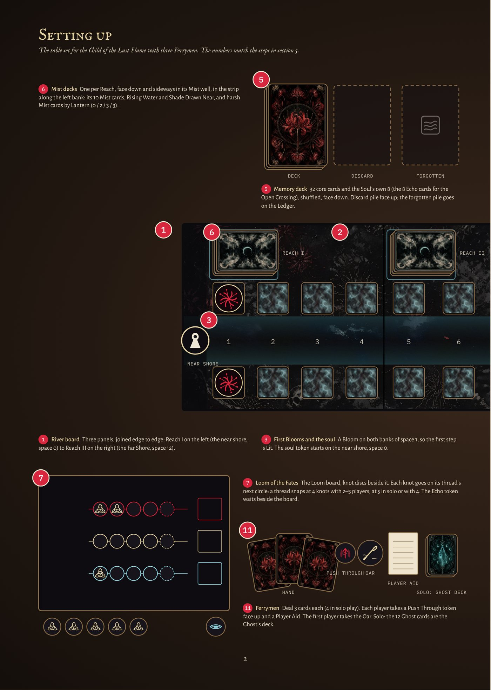

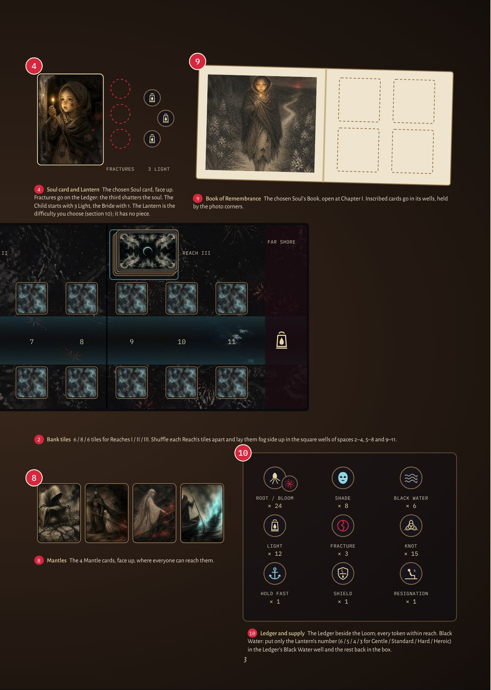

1.  **The river board.** Join the three panels in order: Reach I on the left (with the near shore) and Reach III on the right (ending at the Far Shore). Each panel has a square well on each bank for a bank tile and, in the strip along the left bank, its Reach's Mist deck well; the river runs on unbroken from panel to panel.
2.  **Bank tiles.** Sort the bank tiles by the Reach number on their fog side: 6, 8, 6 tiles for Reaches I, II and III. Shuffle each Reach's tiles separately and place them fog side up in the square wells of spaces 2–4, 5–8 and 9–11. Do not look at the other side.
3.  **The first Blooms and the soul.** Space 1 has no bank tiles: put a disc Bloom side up on both of its banks. Put the soul token on the near shore (space 0).
4.  **The Soul and the Lantern.** Choose a Soul and a Lantern (section 10). Put the Soul card face up next to the board. The Child of the Last Flame starts with **3 Light** and the Bride Who Stayed Below with **1 Light**; every other Soul starts with 0.
5.  **The Memory deck.** Shuffle the 32 core Memory cards with the Soul's 8-card pack (the 8 Echo cards for the Open Crossing) and put the deck face down. Leave room next to it for the **discard pile** (face up).
6.  **The Mist decks.** Build one deck for each Reach: its 10 basic Mist cards, plus one *Rising Water* and one *Shade Drawn Near*, plus the Lantern's number of harsh Mist cards chosen at random (none at Gentle). Shuffle each deck and lay it face down and sideways in its Reach's Mist well, in the strip along the left bank.
7.  **The Loom of the Fates.** Put the Loom board out with its three threads, Obsession, Acceptance and Oblivion, and put the knots next to it. A thread is full at 4 knots with 2–3 players, and at 5 in solo play or with 4 players. Keep the Echo token next to the Loom: it goes onto a thread when the first card is played face up or Burned.
8.  **The Mantles.** Put the four Mantle cards face up where everyone can reach them.
9.  **The Book of Remembrance.** Open the chosen Soul's Book at page I, with the photo corners ready.
10. **The Ledger and the supply.** Put the Ledger board next to the Loom: forgotten cards go on its numbered track, Fractures on its Fracture wells. Put only the Lantern's number of Black Water tokens (6, 5, 4, 3 for Gentle, Standard, Hard, Heroic) in its Black Water well and the rest back in the box. Put the Root/Bloom discs, Shades, Light, Fractures, knots and the Hold Fast token, Shield token and Resignation token within reach.
11. **The Ferrymen.** Deal each player a hand: 4 cards in solo play, 3 with 2–4 players. Each player takes a Push Through token, face up. The first player takes the Oar. In solo play, shuffle the 12 Ghost cards into a face-down Ghost deck next to you.

From now on the Veiled Memories apply (section 1), and the first player takes the first turn.

## 3. Your turn

> **You lose at once if:**
>
> - **Faded**: the forgotten pile reaches your Lantern's ✕ on the Ledger.
> - **Shattered**: the soul takes its 3rd Fracture (the last Fracture well on the Ledger).
> - **Deluge**: you must place Black Water and the Ledger's Black Water well is empty.
>
> **You win** when the soul reaches the Far Shore (space 12).

Players take turns clockwise, starting with the first player, who holds the Oar. On your turn:

1.  **Summon a Mantle** (optional, before your first action; section 8).
2.  **The Answer** (your first action): play a card (face up, face down or Burn), Recall or Push Through.
3.  **The Steer** (your second action): play a card or Push Through. You may Burn only once per turn.
4.  **End of turn**: carry out the end-of-turn steps (section 4).

Hand size is 4 in solo play and 3 with 2–4 players.

### Playing a card

Play a card from your hand in one of three ways:

- **Face up**: do the card's effect, add one knot to its thread on the Loom, and move the Echo to that thread. Then put an Obsession or Acceptance card on the discard pile and an Oblivion card on the forgotten pile.
- **Face down**: place 1 Root (section 5). Ignore the card's printed effect. No knot is added and the Echo does not move. Then put the card face up on the discard pile.
- **Burn** (at most once per turn): choose another player who also holds a card of that card's thread. You each put one card of that thread face down on the table, then flip both. Choose one of the two cards: do its effect **twice**, add one knot to its thread, and move the Echo to that thread. Then forget both cards, and the other player draws 1 card at once. If no other player holds a card of the same thread, you cannot Burn. *Solo:* Burn one card from your hand: do its effect twice, add one knot, move the Echo, then forget the card and the top card of the deck.

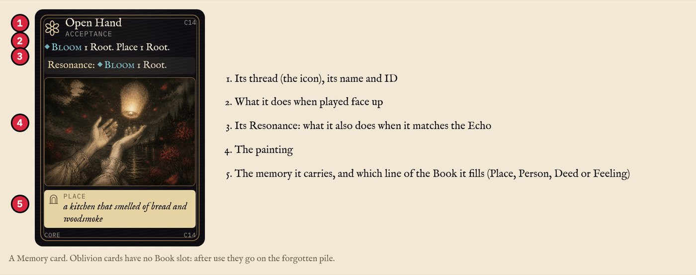

### Recall and Push Through

**Recall** (Answer only): spend **3 Light** and choose any card in the forgotten pile; put it on the discard pile, so it can be drawn again later. A forgotten Key Memory can be Recalled.

**Push Through** (each player only **once per game**): only when Shades are on **both** banks of the next space and that space has no Black Water. Return both Shades to the supply, move the soul onto that space (gain its Light as usual, section 8) and flip your Push Through token face down. The soul then takes **1 Fracture**, plus 1 more for each Push Through token that was already face down, and you forget the top card of the deck. So the first Push Through costs 1 Fracture, the second 2 and the third 3 (which means Shattered). Your turn continues as usual.

### The Echo and Resonance

The **Echo** token sits on the thread of the last card played face up or Burned, by any player (or the Ghost). It does not move for a card played face down, a Recall or a Push Through.

If your **Answer** is a card played face up or Burned on the Echo's thread, the card **Resonates**: also do its Resonance effect. On some Oblivion cards the Resonance replaces the normal effect ("Instead"). A Resonating card may be inscribed in the Book of Remembrance (section 9).

Your Steer never Resonates. If your Answer is a Recall or a Push Through, you cannot Resonate this turn. For a Burn, the card that Resonates is the one whose effect you double.

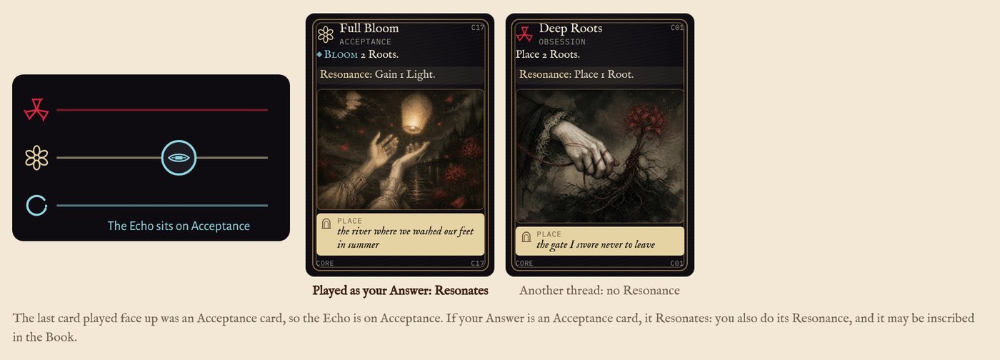

### Forgetting and the two piles

**Forget** a card: put it face up on the next number of the Ledger's forgotten track, overlapping the card before it. The number above the newest card is how many cards are forgotten. **Forget the top card of the deck**: put the top card of the Memory deck on the forgotten track without playing it. If a card leaves the forgotten pile (Recall, a Chapter Blessing), slide the later cards back.

The **discard pile** (next to the deck) and the **forgotten pile** (on the Ledger) are both face up, and anyone may look through them. Keep them apart: discarded cards come back when the deck runs out, forgotten cards do not. If the Memory deck is empty when you need to draw or forget, shuffle the discard pile into a new deck first.

## 4. The end of the turn

The end-of-turn steps happen after **every player's turn**, not once per round. Do them in this order:

1.  **Bloom-Bringer.** If the active player holds the Bloom-Bringer, they may flip one Root on the soul's space or ahead of it to its Bloom side, for free.
2.  **Soul Step.** Check these in order and do the first that applies:
    1.  **Is the Resignation token next to the soul?** The soul does not move. Forget the top card of the deck (nothing can prevent this), then remove the token. Go to *e*.
    2.  **Is the next space Lit and free of Black Water?** Move the soul onto it. Gain 1 Light for each Bloom on the space the soul moved off, then return all discs and Shades on that space to the supply. If the soul has moved onto the first space of a new Reach, remove all knots from the Loom (the Echo stays on its thread).
    3.  **Extra move.** If 9 or more cards are forgotten (**Adrift**), the soul moves one more space. If that space is Lit and free of Black Water, it simply moves there. If not, it moves there anyway and takes 1 Fracture, unless the Spirit Warden is unused: then turn the Warden sideways, and the soul does not take the extra move. Otherwise, if 6 or more cards are forgotten (**Light as Ash**), the soul moves one more space, but only if that space is Lit and free of Black Water. Each extra move also gives Light for the space the soul moves off.
    4.  **The soul cannot move: it Lingers** (it stays where it is). Check these in order and apply the first that fits: the Hold Fast token is next to the soul, so nothing is forgotten; the Spirit Warden is unused, so turn it sideways and nothing is forgotten; the soul's own space is Lit, so nothing is forgotten; the Bride, once per game, moves back one space instead (section 10). Otherwise, **forget the top card of the deck**.
    5.  **Shade damage.** If there is a Shade on either bank of the soul's space (one or two), the soul takes **1 Fracture**. This happens whether the soul moved or Lingered.
3.  **Mist.** Flip the top card of the Mist deck of the Reach the soul is in now and carry out its instructions in order. "Ahead of the soul" is counted from the soul's space: 1 space ahead is the next space. Then put the card face up on that Reach's Mist discard pile. If the deck is empty, first shuffle that Reach's 10 basic Mist cards (only) into a new deck. Appendix C lists every Mist card.
4.  **Cleanup.**
    - For each space with Black Water and a disc (Root or Bloom) on **both** banks: remove the Black Water token from the game (put it in the box).
    - For each Shade with a Bloom on the same bank of the space directly before it **and** the space directly after it: return the Shade to the supply.
5.  **Draw** back up to your hand size.
6.  **Solo: the Ghost** (section 11). Then do Cleanup again.
7.  **Pass the Oar** to the player on your left. In solo play it comes back to you after the Ghost.

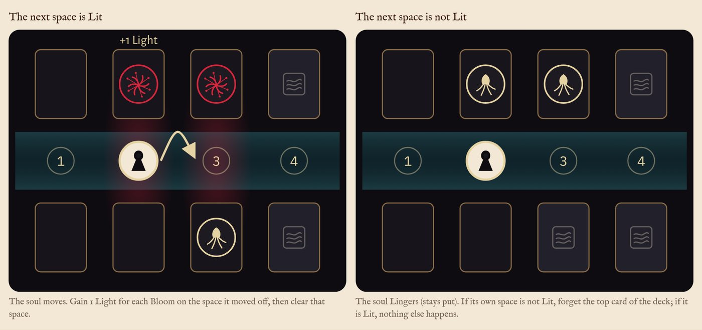

### At the start of the next turn

- Remove the Hold Fast token if it is out.
- If you hold the Spirit Warden, straighten it at the start of your own turn.
- A Shield token that has not cancelled a Fracture is removed at the end of its owner's next turn.

### Effects that happen immediately

A thread that becomes full causes its **Backlash** at once (section 6). A page reward and a Chapter Blessing happen at once, as soon as the inscription that earns them is made (section 9). A Memory Site gives its keepsake (and, in the Open Crossing, its Light) when its bank tile is flipped. The game ends the moment the soul reaches the Far Shore (you win), the forgotten pile reaches the Lantern's limit (Faded), the soul takes its third Fracture (Shattered), or a Black Water token must be placed with none left in the supply (Deluge). A Fracture cancelled by a Shield token or by the Child's rule is not taken.

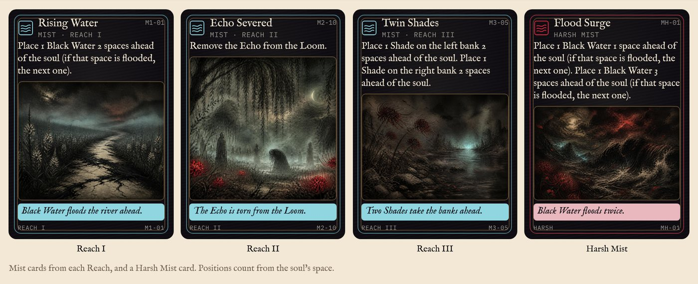

## 5. The river, Roots and Blooms

The river has 13 spaces: the near shore (0), spaces 1 to 11, and the Far Shore (12). Each space from 1 to 11 has a **left** and a **right bank**, and each bank holds at most one disc or token. Banks are named as you face downstream toward the Far Shore. "Ahead of the soul" means the spaces with a higher number than the soul's space; "the next space" is the space directly ahead.

The river has three Reaches: **Reach I, the Asphodel Road** (spaces 1–4), **Reach II, the Fields of Mourning** (5–8) and **Reach III, the Banks of Lethe** (9–11). Each Reach has its own Mist deck and its own page in the Book of Remembrance.

### Roots, Blooms and the network

A **Root** is a disc Root side up; a **Bloom** is the same disc Bloom side up. A space is **Lit** when at least one of its banks has a Bloom. The soul only moves onto Lit spaces.

**Placing a Root.** Put a disc Root side up on an empty bank (no disc, no Shade) on the soul's space or ahead of it. The bank must **touch the network**, meaning at least one of these is true:

- it is on the soul's space or the next space, or
- the other bank of the same space has a disc, or
- the same bank (left or right) of the space directly before or after it has a disc.

**Blooming a Root.** Flip a Root on the soul's space or ahead of it to its Bloom side. **Withering a Bloom.** Flip a Bloom back to its Root side; the space may stop being Lit.

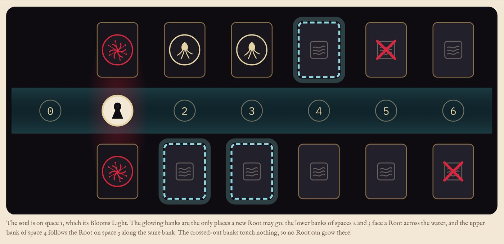

### Bank tiles

When you place a Root on a bank that is still covered by fog, flip its bank tile face up. The card stays on the bank, and its type decides what happens:

- **Fertile**: place the Root.
- **Stony**: place the Root only if the card's effect says "even on Stony ground" or you hold the Root-Weaver. Otherwise no Root is placed, and that Root is lost.
- **Memory Site**: place the Root and take a keepsake. In the Open Crossing, also gain 2 Light.
- **Grave**: no Root is placed. Put a Shade on this bank.

A bank with no bank tile (both banks of space 1, or a bank whose Grave tile was removed) counts as Fertile. A face-up bank tile follows the same rules: Roots can be placed on Fertile and Memory Site banks, on Stony banks only as described above, and never on a Grave. Reach I has 3 Fertile, 1 Stony and 2 Memory Site tiles; Reach II has 3 Fertile, 2 Stony, 2 Memory Site and 1 Grave; Reach III has 2 Fertile, 1 Stony, 2 Memory Site and 1 Grave.

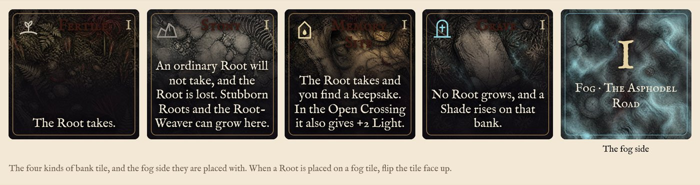

## 6. The Loom of the Fates and Backlash

The Loom has three threads: Obsession, Acceptance and Oblivion. Each card played face up or Burned adds one knot to its thread. A thread is full at 4 knots with 2–3 players, and at 5 in solo play or with 4 players.

When a thread becomes full, remove all its knots and resolve its **Backlash**:

- **Obsession, Grasping**: place a Shade on the soul's space: on the left bank if it is free, otherwise on the right bank. If both banks already have a Shade (or the soul is on the near shore), place it on the left bank of the next space instead (or the right bank if the left is taken).
- **Acceptance, Resignation**: put the Resignation token next to the soul. In the next Soul Step the soul does not move and you forget the top card of the deck; then remove the token.
- **Oblivion, the Tide Rises**: place a Black Water token on the next space (section 7).

When the soul moves onto the first space of a new Reach, remove all knots from all three threads. The Echo stays where it is.

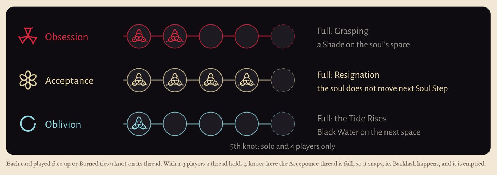

## 7. Black Water, Shades and Fractures

**Placing Black Water.** Put a Black Water token on the space named. If that space already has Black Water, use the first space after it without Black Water; if there is none ahead, use the nearest space between it and the soul. Black Water is never placed on the soul's own space. Flip every Bloom on that space to its Root side. The soul cannot move onto a space with Black Water. Black Water is always taken from the Ledger's Black Water well. If you must place Black Water and the well is empty, you lose (Deluge).

**Removing Black Water.** In Cleanup, if both banks of a space with Black Water have a disc, remove the Black Water token from the game. Cards that say "drain" remove Black Water the same way. Removed Black Water goes in the box and never returns to the well.

**Placing a Shade.** Put the Shade on the bank named. If that bank already has a Shade, use the other bank of the same space; if both are taken, continue with the next space ahead. A disc on that bank is returned to the supply. No Root can be placed on a bank with a Shade. Shades on both banks of the next space stop the soul unless a player Pushes Through (section 3).

**Removing Shades.** In Cleanup, return a Shade to the supply if the same bank of the space directly before it and the space directly after it both have a Bloom. Cards that say "banish" or "wash away" also return Shades to the supply. The bank tile under a removed Shade stays as it was.

**Fractures** come from Shade damage, Push Through, Adrift and the harsh Mist card *Dark Wind*. Put each one on the next Fracture well of the Ledger; a mended Fracture comes off the highest well. At 3 Fractures you lose (Shattered). The card *Hold the Line* gives the Shield token: it cancels the next Fracture, then is removed; if unused, it is removed at the end of its owner's next turn.

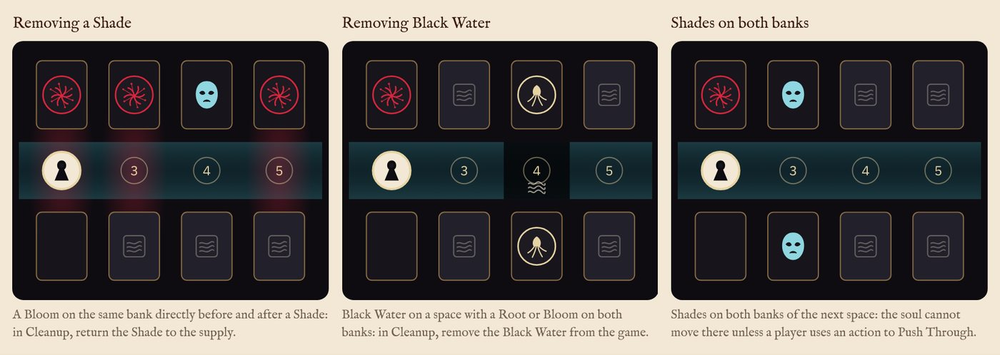

## 8. Light and Mantles

**Gaining Light.** Light is one shared pool. Each time the soul moves off a space, gain 1 Light for each Bloom on that space (2 Light if both banks have a Bloom); the space is then cleared, so each Bloom gives Light only once. This happens whenever the soul moves: in the Soul Step, in extra moves, by a card that moves the soul, or by a Push Through. Light stays in the pool until it is spent or lost to the harsh Mist card *Dark Wind*. The Open Crossing also gains 2 Light for each Memory Site flipped.

**Spending Light.** Recall a forgotten card as your Answer (3 Light, section 3), or summon a Mantle.

**Summoning a Mantle** (before your Answer): pay 3 Light (2 with the King on the Barge) and discard one card from your hand with the same thread as the Mantle. Take the Mantle card. With 2–4 players, each player holds at most one Mantle and keeps it for the rest of the game. In solo play see section 11.

- **The Root-Weaver** (Obsession): Your Roots may grow on Stony ground. Your first Root effect each turn places 1 extra Root.
- **The Spirit Warden** (Obsession): Once per round, stop the soul from Lingering or from drifting Adrift.
- **The Bloom-Bringer** (Acceptance): At the end of each of your turns, Bloom 1 Root for free.
- **The Fog-Breaker** (Oblivion): Your first Oblivion card each turn is discarded instead of forgotten.

**Spirit Warden.** "Once per round" means once between the start of the holder's turn and the start of their next turn; it also works on other players' turns. When it is used, turn the card sideways; straighten it at the start of the holder's turn. When it stops a Linger, the soul stays where it is but no card is forgotten. When it stops Adrift (only when the extra space is not Lit or has Black Water), the soul does not take the extra move and takes no Fracture.

**Bloom-Bringer.** Its power is used only in end-of-turn step 1 of the holder's own turn.

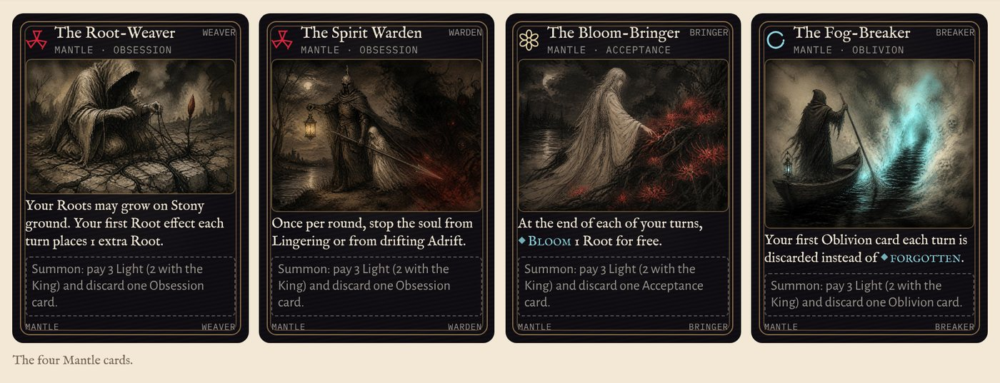

## 9. The Book of Remembrance and the ending

The Book has one page per Reach: page I, *Who I Was* (Reach I); page II, *What I Did* (Reach II); page III, *What I Carry* (Reach III). Each page has four slots, **Place**, **Person**, **Deed** and **Feeling**, which complete a sentence about the soul's life.

**Inscribing.** When a card Resonates, you may inscribe it if the slot shown on the card is still empty on the page of the Reach the soul is in. A **Key Memory** may be inscribed whenever it is played face up, Resonating or not. To inscribe, put the card in its slot with photo corners instead of discarding it; it stays there for the rest of the game. Oblivion cards and Burned cards cannot be inscribed.

**Page rewards.** Each page pays a small reward for each pair of neighbouring slots: **Place + Person**, **Person + Deed** and **Deed + Feeling**. When an inscription fills the second slot of a pair, do that pair's reward at once. One card can complete two pairs (a Person inscribed next to a Place and a Deed): do both. Each reward happens once per page; tick its box in the Book. The rewards are printed on each page:

| Page                   | Place + Person                                        | Person + Deed                  | Deed + Feeling                                            |
|------------------------|-------------------------------------------------------|--------------------------------|-----------------------------------------------------------|
| **I · Who I Was**      | Place 1 Root.                                         | Bloom 1 Root.                  | Gain 2 Light.                                             |
| **II · What I Did**    | Banish the nearest Shade.                             | Drain the nearest Black Water. | Untie 1 knot on the fullest thread (if tied, you choose). |
| **III · What I Carry** | Return the newest forgotten card to the discard pile. | Mend 1 Fracture.               | The soul steps forward now, if the next space is Lit.     |

**Chapter Blessing.** When all 4 slots of a page are filled (3 for the Garland Girl), the page also gives one Chapter Blessing at once (only once per page). The Blessing is not chosen. Check these in order and do the first one that is possible:

1.  If the soul has at least one Fracture: remove 1 Fracture (from the highest well).
2.  Otherwise, if any space has Black Water: remove the Black Water token closest ahead of the soul from the game.
3.  Otherwise, if the forgotten pile has any cards: move the newest forgotten card to the discard pile.
4.  Otherwise nothing happens.

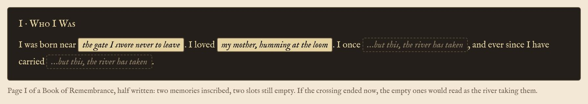

### The ending

When the game ends, the veil lifts. Check where the soul's **Key Memory** card is:

- **Inscribed in the Book**: the soul crosses remembering what mattered most.
- **In the forgotten pile**: the soul crosses without it, lighter and emptier.
- **Anywhere else** (deck, a hand or the discard pile): it was never spoken, and the soul crosses with it unsaid.

Then read the Book aloud, page by page, even after a loss. Empty slots are read as "…but this, the river has taken".

## 10. The Souls and the Lantern

*Four souls the old ferryman would not carry, and one with no name at all.*

Each named Soul adds its own 8-card pack of memories, including one **Key Memory**, and one special rule. The Open Crossing adds the 8 Echo cards instead.

### Child of the Last Flame

A small child alone in a doorway on the coldest night of the year, with a handful of little lights to sell and none sold. To keep warm she lights them one by one, and in each flame she sees something: a warm stove, a feast, and at last the one person who ever held her, coming to take her home.

**Special rule:** Starts with 3 Light. The first Fracture in each Reach is ignored. Never drifts Adrift. She can forget 1 more card before she Fades. No harsh Mist. Turn her Soul card sideways when a Fracture is ignored, and straighten it when the soul moves onto the first space of a new Reach. **Key Memory:** *the one who used to hold me before she was gone*.

### The Garland Girl

A young woman who wove a flower for everyone she loved. Her father died, the man who promised to marry her turned cruel, and she gave her flowers away one by one and slipped into a brook still singing. She kept one flower for herself, and no one ever learned which.

**Special rule:** Each page gives its Chapter Blessing at only 3 inscribed memories. **Key Memory:** *the one flower I kept for myself*.

### The King on the Barge

An old king who won every battle but the last. His closest friend loved his queen, his fellowship broke apart, and he fell on a field of his own making. Dying, he was laid on a black barge. The sword he was lent was never returned to the water it came from, and so he cannot rest.

**Special rule:** Mantles cost 2 Light. A Fracture strips the Mantle of the player who caused it. The active player loses their Mantle when the soul takes a Fracture during their turn (including its end-of-turn steps); put the Mantle back with the others, and it can be summoned again. **Key Memory:** *the hand that rose from the lake to give me a sword*.

### The Bride Who Stayed Below

She died on her wedding day. Her husband came down into the dark to bring her back, on one condition: he must not look back until they reached the light. One step from the surface, he turned. She has stood in the shadows ever since, deciding whether to remember his face or let it go.

**Special rule:** Starts with 1 Light. The first time she would Linger in the dark, she is pulled one space back instead of forgetting. This happens only when her own space is not Lit and nothing else stops the Linger. Turn her Soul card sideways once it has been used. **Key Memory:** *his face, the instant he turned to look at me*.

### Open Crossing

A nameless soul. You do not learn its story; you write it.

**Special rule:** Memory Sites give +2 Light. There is no Key Memory; the Book is the soul's whole story.

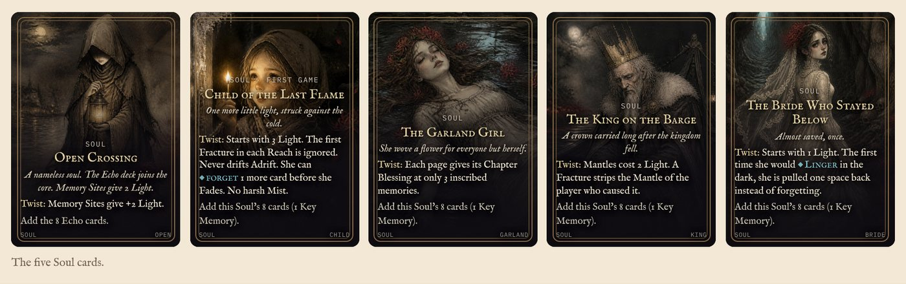

### The Lantern

The Lantern sets the difficulty. **Standard** is the normal game: an experienced group should win about half its games. Use **Gentle** for learning, and **Hard** or **Heroic** for more challenge.

| Lantern       | Black Water supply | Faded at     | Harsh Mist per Reach |
|---------------|--------------------|--------------|----------------------|
| ◆◇◇◇ Gentle   | 6                  | 11 forgotten | 0                    |
| ◆◆◇◇ Standard | 5                  | 10 forgotten | 2                    |
| ◆◆◆◇ Hard     | 4                  | 9 forgotten  | 3                    |
| ◆◆◆◆ Heroic   | 3                  | 8 forgotten  | 3                    |

> **Your first game:** we suggest **Child of the Last Flame** at the Gentle Lantern. Its rules forgive more mistakes while you learn the river, the Loom and the Book.

## 11. Solo play and the Ghost

In solo play you hold 4 cards and each Loom thread is full at 5 knots.

**The Ghost.** After each of your turns (end-of-turn step 6), flip the top card of the Ghost deck and do its action, using the same placement rules as a player (section 5). Then add a knot to its thread (a full thread causes a Backlash) and move the Echo there, so your next Answer can Resonate with it. When the Ghost deck is empty, shuffle all Ghost cards into a new deck.

**Replacing a Mantle.** You may summon a new Mantle while you hold one. Flip the old Mantle face down: it can never be summoned again. Each Mantle can be summoned only once, and you may summon at most **3** times per game.

| Ghost card | ×   | Action                                            |
|------------|-----|---------------------------------------------------|
| Obsession  | 3   | Roots on the furthest open bank                   |
| Obsession  | 2   | Roots on the nearest open bank                    |
| Acceptance | 2   | Blooms the nearest Root                           |
| Acceptance | 2   | Blooms the furthest Root                          |
| Oblivion   | 2   | Banishes the nearest Shade, or drains Black Water |
| Oblivion   | 1   | Does nothing                                      |

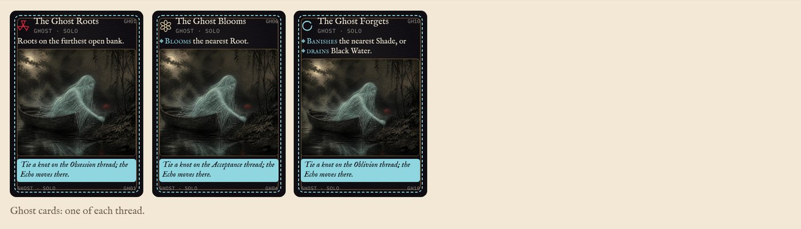

## Appendix A. Components and symbols

Each component, what it represents in the story, and what it does in the game.

| Component               | In the story                                                                          | In the game                                                                                                     |
|-------------------------|---------------------------------------------------------------------------------------|-----------------------------------------------------------------------------------------------------------------|
| **Soul token**          | A coinless dead person, waking on the near shore with a whole life still inside them. | Moves from space 0 to space 12, only onto Lit spaces without Black Water.                                       |
| **The Far Shore**       | Where the veiled Keeper waits with the cup of forgetting.                             | Space 12. When the soul reaches it, you win.                                                                    |
| **Bank tile, fog side** | The mist that hides the bank.                                                         | Covers a bank until a Root is placed there (section 5).                                                         |
| **Fertile**             | Soft riverbank earth.                                                                 | A Root is placed.                                                                                               |
| **Stony**               | Hard, grey stone where little can grow.                                               | A Root is placed only by a card that allows Stony ground or the Root-Weaver.                                    |
| **Memory Site**         | A place the soul once knew, surfacing through the fog.                                | A Root is placed; take a keepsake (Open Crossing: also 2 Light).                                                |
| **Grave**               | Something unfinished is buried here.                                                  | No Root; a Shade is placed instead.                                                                             |
| **Root (disc)**         | A Netherbloom seed, planted in the dark.                                              | Extends the network. Does not light a space.                                                                    |
| **Bloom (disc)**        | An open Netherbloom, glowing crimson.                                                 | Makes its space Lit.                                                                                            |
| **Light**               | The glow of the flowers the soul has passed.                                          | Shared pool; spent on Mantles and Recall.                                                                       |
| **Obsession thread**    | Clinging, grudges, things the soul cannot let go.                                     | Mostly Root cards. Backlash: Grasping.                                                                          |
| **Acceptance thread**   | Tenderness, forgiveness, peace.                                                       | Mostly Bloom and Mend cards. Backlash: Resignation.                                                             |
| **Oblivion thread**     | Deliberate forgetting.                                                                | Strong cards; forgotten after use. Backlash: the Tide Rises.                                                    |
| **Knot**                | The Fates' weaving of the soul's last journey.                                        | Marks how full a thread is on the Loom.                                                                         |
| **Echo token**          | The shuttle of the Loom, carrying each thread to the next hand.                       | Shows the thread a card must match to Resonate.                                                                 |
| **Shade**               | A restless shade of the soul's unfinished resentment.                                 | Blocks a bank; damages the soul beside it.                                                                      |
| **Black Water**         | The river rising to swallow the path.                                                 | The soul cannot enter its space.                                                                                |
| **Fracture**            | A crack in the soul's sense of self.                                                  | Goes on the Ledger's Fracture wells. Third one: Shattered.                                                      |
| **Oar**                 | The ferry's oar, passed hand to hand.                                                 | Shows whose turn it is.                                                                                         |
| **Push Through token**  | A Ferryman's one hard shove.                                                          | One per player; flipped face down when used.                                                                    |
| **Hold Fast token**     | An anchor let down beside the soul.                                                   | If the soul Lingers, nothing is forgotten.                                                                      |
| **Shield token**        | A Ferryman between the soul and harm.                                                 | Cancels the next Fracture.                                                                                      |
| **Resignation token**   | The soul, sitting down among the reeds.                                               | The soul does not move in the next Soul Step.                                                                   |
| **Book of Remembrance** | The spring of Memory the dead were told to seek instead of Lethe.                     | Three pages of four slots each (section 9).                                                                     |
| **Key Memory**          | The memory that matters most to this soul.                                            | Decides the ending (section 9).                                                                                 |
| **The Ledger**          | The river's account of what the soul is losing.                                       | Holds the forgotten pile on a numbered track, the Fractures and the Black Water supply: the three ways to lose. |
| **Memory cards**        | The soul's memories.                                                                  | Your hand; each has an effect, a thread and usually a Book slot.                                                |
| **Mist cards**          | The underworld itself: rising water, cold wind, returning fog.                        | One deck per Reach; one is flipped each turn (Appendix C).                                                      |
| **Mantle cards**        | Roles a Ferryman can take up on the river.                                            | Lasting powers bought with Light (section 8).                                                                   |
| **Soul cards**          | The five souls you can carry.                                                         | Each has a special rule (section 10).                                                                           |
| **Ghost cards (solo)**  | A silent Ferryman who travels beside you.                                             | Played after each of your turns (section 11).                                                                   |

### What is in the box

| Component                                              | Count                                                                                         |
|--------------------------------------------------------|-----------------------------------------------------------------------------------------------|
| Memory cards                                           | 72: 32 core, 8 Echo cards (Open Crossing), 4 Soul packs of 8                                  |
| Mist cards                                             | 42: 10 basic for each Reach, 2 extra for each Reach (Rising Water, Shade Drawn Near), 6 harsh |
| Bank tiles                                             | 20: 6, 8, 6 for Reaches I, II, III                                                            |
| Soul cards / Mantle cards / Ghost cards                | 5 / 4 / 12                                                                                    |
| Boards                                                 | 3 river board panels, 1 Loom of the Fates, 1 Ledger                                           |
| Books of Remembrance                                   | 5, one for each Soul                                                                          |
| Root/Bloom discs                                       | 24                                                                                            |
| Shades / Black Water / Fractures                       | 8 / 6 / 3                                                                                     |
| Light / knots                                          | 12 / 15                                                                                       |
| Echo, Oar, soul (Ghost on the back)                    | 1 each                                                                                        |
| Push Through / Hold Fast / Shield / Resignation tokens | 4 / 1 / 1 / 1                                                                                 |

**Cards that track their own use.** Turn the Spirit Warden card sideways when it is used, and straighten it at the start of its holder's turn. Turn a Soul card sideways when its once-only rule has been used. In solo play, flip a Mantle you give up face down.

## Appendix B. Card terms

Words printed in this style on the cards are game terms. This table says exactly what to do.

| Words on the card                                                     | What you do                                                                                                                                                                                                                                                                                                   |
|-----------------------------------------------------------------------|---------------------------------------------------------------------------------------------------------------------------------------------------------------------------------------------------------------------------------------------------------------------------------------------------------------|
| Place N Roots                                                         | Put N discs Root side up, one at a time, each on an empty bank that touches the network (section 5). *Even on Stony ground*: Stony banks are allowed too.                                                                                                                                                     |
| Bloom N Roots                                                         | Flip N Roots on the soul's space or ahead of it to the Bloom side.                                                                                                                                                                                                                                            |
| Wither                                                                | Flip a Bloom to its Root side. The space may stop being Lit.                                                                                                                                                                                                                                                  |
| Lit                                                                   | A space with a Bloom on at least one bank. The soul moves only onto Lit spaces.                                                                                                                                                                                                                               |
| Mend N Fractures                                                      | Take N Fractures off the Ledger, from the highest well down, and return them to the supply.                                                                                                                                                                                                                   |
| Banish the nearest Shade                                              | Return the Shade closest to the soul (on its space or ahead) to the supply.                                                                                                                                                                                                                                   |
| Wash away the Shades beside the soul                                  | Return every Shade on the soul's space to the supply.                                                                                                                                                                                                                                                         |
| Drain the nearest Black Water                                         | Remove the Black Water token closest ahead of the soul and put it in the box. *Drain all Black Water in this Reach*: do this for every Black Water token in the soul's Reach.                                                                                                                                 |
| Remove 1 of your choice: the nearest Shade or the nearest Black Water | Do one of the two rows above: Banish the nearest Shade, or Drain the nearest Black Water.                                                                                                                                                                                                                     |
| Untie N knots on the fullest thread                                   | Remove N knots from the thread with the most knots. No Backlash. If threads are tied, you choose.                                                                                                                                                                                                             |
| Empty the fullest thread                                              | Remove every knot from the thread with the most knots. No Backlash. If threads are tied, you choose.                                                                                                                                                                                                          |
| Tie N knots                                                           | Add N knots to the thread named. If this fills it, resolve its Backlash.                                                                                                                                                                                                                                      |
| Backlash                                                              | What a full thread does (section 6). Resolve it, then remove that thread's knots.                                                                                                                                                                                                                             |
| Lift the fog across this Reach; Graves turn Fertile                   | Flip every fog-side-up bank tile in the soul's Reach face up without placing Roots. Remove every Grave tile flipped this way from the board: those banks count as Fertile. Tiles flipped this way cause no Shade, keepsake or Light.                                                                          |
| The soul steps forward now                                            | Move the soul to the next space now, if it is Lit and has no Black Water. Gain its Light as usual.                                                                                                                                                                                                            |
| The soul waits without forgetting this turn                           | Put the Hold Fast token next to the soul. If the soul Lingers this turn, no card is forgotten.                                                                                                                                                                                                                |
| Prevent the next Fracture                                             | Take the Shield token (section 7).                                                                                                                                                                                                                                                                            |
| Read the top 3 Mist cards                                             | Look at the top 3 cards of the current Reach's Mist deck and put them back on top in any order.                                                                                                                                                                                                               |
| Forget a card / forgotten                                             | Put the card face up on the next number of the Ledger's forgotten track.                                                                                                                                                                                                                                      |
| Forget the top card of the deck                                       | Put the top card of the Memory deck on the forgotten track without playing it.                                                                                                                                                                                                                                |
| Linger                                                                | The soul does not move in the Soul Step (section 4, step d).                                                                                                                                                                                                                                                  |
| Summon a Mantle                                                       | Before your Answer: pay 3 Light (2 with the King on the Barge) and discard 1 card from your hand of the Mantle's thread. Take the Mantle card.                                                                                                                                                                |
| Recall                                                                | As your Answer: pay 3 Light and move any card from the forgotten pile to the discard pile.                                                                                                                                                                                                                    |
| Burn                                                                  | Once per turn, with another player who holds the same thread: you each reveal a card of that thread and you choose one; do its effect twice, tie 1 knot and move the Echo there. Forget both cards; the other player draws 1. Solo: Burn one card, effect twice, then forget it and the top card of the deck. |
| Resonance / Resonates                                                 | Your Answer is played face up or Burned on the Echo's thread: also do the card's Resonance effect. *Instead*: do the Resonance effect in place of the normal one.                                                                                                                                             |
| Inscribe                                                              | Put a Resonating card in its slot on the current Reach's Book page instead of discarding it (section 9).                                                                                                                                                                                                      |
| Remove the Echo from the Loom (Mist)                                  | Take the Echo token off its thread. No card can Resonate until a card is played face up or Burned again.                                                                                                                                                                                                      |

## Appendix C. Mist cards

The instructions printed on each Mist card. Each Reach's deck also holds *Rising Water* and *Shade Drawn Near* and, at every Lantern except Gentle, harsh cards.

| Mist card            | Reach      | Instructions                                                                                                                                                                     |
|----------------------|------------|----------------------------------------------------------------------------------------------------------------------------------------------------------------------------------|
| **Rising Water**     | I, II, III | Place 1 Black Water 2 spaces ahead of the soul (if that space is flooded, the next one).                                                                                         |
| **Shade**            | I, II      | Place 1 Shade on the left bank 1 space ahead of the soul.                                                                                                                        |
| **Shade Drawn Near** | I, II, III | Place 1 Shade on the soul's space (left bank first; if both are taken, the left bank of the next space).                                                                         |
| **Withering**        | I, II, III | The 2 Blooms furthest ahead of the soul wither to Roots.                                                                                                                         |
| **Fog Returns**      | I, II      | Turn the 1 furthest revealed empty bank back to fog.                                                                                                                             |
| **Cold Wind**        | I, II, III | Forget the top 1 card of the deck.                                                                                                                                               |
| **The Mist Parts**   | I          | No effect.                                                                                                                                                                       |
| **Echo Severed**     | II, III    | Remove the Echo from the Loom.                                                                                                                                                   |
| **Undertow**         | III        | Place 1 Black Water 2 spaces ahead of the soul (if that space is flooded, the next one). The Bloom 1 space ahead of the soul withers to a Root.                                  |
| **Twin Shades**      | III        | Place 1 Shade on the left bank 2 spaces ahead of the soul. Place 1 Shade on the right bank 2 spaces ahead of the soul.                                                           |
| **Great Withering**  | III        | The 3 Blooms furthest ahead of the soul wither to Roots.                                                                                                                         |
| **Bitter Wind**      | III        | Forget the top 2 cards of the deck.                                                                                                                                              |
| **Flood Surge**      | Harsh      | Place 1 Black Water 1 space ahead of the soul (if that space is flooded, the next one). Place 1 Black Water 3 spaces ahead of the soul (if that space is flooded, the next one). |
| **Shade Host**       | Harsh      | Place 1 Shade on the left bank 1 space ahead of the soul. Place 1 Shade on the right bank 1 space ahead of the soul.                                                             |
| **Wither Storm**     | Harsh      | Every Bloom more than 2 spaces ahead of the soul withers to a Root.                                                                                                              |
| **Deep Cold**        | Harsh      | Forget the top 2 cards of the deck.                                                                                                                                              |
| **Karma Surge**      | Harsh      | Tie 1 knot on every thread.                                                                                                                                                      |
| **Dark Wind**        | Harsh      | Lose 2 Light; with less than 2 Light, suffer 1 Fracture instead.                                                                                                                 |

## Appendix D. Card reference

| Card                           | Face up                                                                | Resonance                                                      |
|--------------------------------|------------------------------------------------------------------------|----------------------------------------------------------------|
| **Deep Roots**                 | Place 2 Roots.                                                         | Place 1 Root.                                                  |
| **Echo card** Open Crossing    | Place 2 Roots.                                                         | Place 1 Root.                                                  |
| **Echo card** Open Crossing    | The soul waits without forgetting this turn.                           | Place 1 Root.                                                  |
| **Echo card** Open Crossing    | Read the top 3 Mist cards and put them back on top in any order.       | Place 1 Root.                                                  |
| **Hold Fast**                  | The soul waits without forgetting this turn.                           | Place 1 Root.                                                  |
| **Hold the Line**              | Prevent the next Fracture before your next turn.                       | Place 1 Root.                                                  |
| **Old Oath**                   | Gain 2 Light.                                                          | Gain 1 Light.                                                  |
| **Overreach**                  | Place 3 Roots. Tie 1 extra Obsession knot.                             | Bloom 1 Root.                                                  |
| **Stubborn Root**              | Place 1 Root, even on Stony ground.                                    | Place 1 Root, even on Stony ground.                            |
| **Vigil**                      | Read the top 3 Mist cards and put them back on top in any order.       | Place 1 Root.                                                  |
| **Echo card** Open Crossing    | Bloom 1 Root. Place 1 Root.                                            | Bloom 1 Root.                                                  |
| **Echo card** Open Crossing    | Bloom 2 Roots.                                                         | Gain 1 Light.                                                  |
| **Echo card** Open Crossing    | Mend 1 Fracture.                                                       | Bloom 1 Root.                                                  |
| **Full Bloom**                 | Bloom 2 Roots.                                                         | Gain 1 Light.                                                  |
| **Guide**                      | The soul steps forward now, if the next space is Lit.                  | Bloom 1 Root.                                                  |
| **Held** Key Memory            | Mend 1 Fracture.                                                       | Bloom 1 Root.                                                  |
| **His Face** Key Memory        | The soul steps forward now, if the next space is Lit.                  | Bloom 1 Root.                                                  |
| **Let Go**                     | Untie 2 knots on the fullest thread (if tied, you choose).             | Untie 1 knot on the fullest thread (if tied, you choose).      |
| **Mend**                       | Mend 1 Fracture.                                                       | Bloom 1 Root.                                                  |
| **One Flower Kept** Key Memory | Bloom 1 Root. Gain 1 Light.                                            | Bloom 1 Root.                                                  |
| **Open Hand**                  | Bloom 1 Root. Place 1 Root.                                            | Bloom 1 Root.                                                  |
| **Rekindle**                   | Bloom 1 Root. Gain 1 Light.                                            | Bloom 1 Root.                                                  |
| **The Lake's Gift** Key Memory | Bloom 1 Root. Place 1 Root.                                            | Bloom 1 Root.                                                  |
| **Blank Fog**                  | Lift the fog across this Reach; Graves turn Fertile.                   | Gain 2 Light.                                                  |
| **Echo card** Open Crossing    | Remove 1 of your choice: the nearest Shade or the nearest Black Water. | Instead: Remove the nearest Shade and the nearest Black Water. |
| **Echo card** Open Crossing    | Gain 3 Light.                                                          | Bloom 1 Root.                                                  |
| **Lethe's Gift**               | Gain 3 Light.                                                          | Bloom 1 Root.                                                  |
| **Low Tide**                   | Drain all Black Water in this Reach.                                   | Banish the nearest Shade.                                      |
| **Unmake**                     | Empty the fullest thread with no Backlash (if tied, you choose).       | Gain 1 Light.                                                  |
| **Unremember**                 | Remove 1 of your choice: the nearest Shade or the nearest Black Water. | Instead: Remove the nearest Shade and the nearest Black Water. |
| **Wash Away**                  | Wash away the Shades beside the soul.                                  | Gain 1 Light.                                                  |
