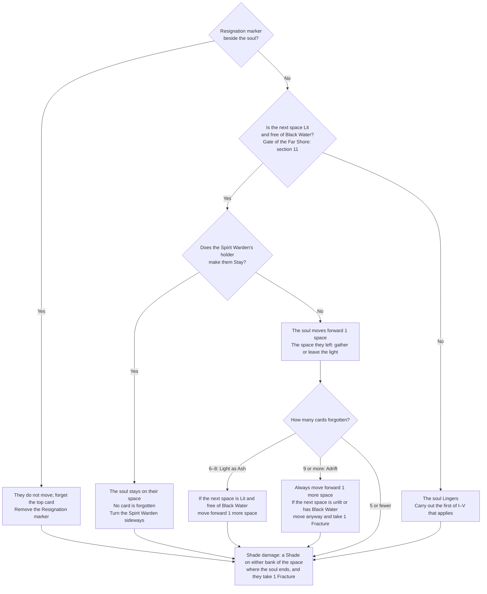

# Netherbloom — Rulebook V5

> This is the English edition of the V5 rulebook, translated from `docs/rules/zh-TW/V5/Rulebook.md`, which is the reference text.

- [1. The story and the goal](#1-the-story-and-the-goal)
- [2. Glossary](#2-glossary)
- [3. Setting up](#3-setting-up)
- [4. Your turn](#4-your-turn)
- [5. The end of the turn](#5-the-end-of-the-turn)
- [6. The river: Roots, Blooms and the fog](#6-the-river-roots-blooms-and-the-fog)
- [7. The Loom of the Fates and Backlash](#7-the-loom-of-the-fates-and-backlash)
- [8. Black Water, Shades and Fractures](#8-black-water-shades-and-fractures)
- [9. Light and Mantles](#9-light-and-mantles)
- [10. The Book of Remembrance: three chapters](#10-the-book-of-remembrance-three-chapters)
- [11. Turning points and turning the page](#11-turning-points-and-turning-the-page)
- [12. Commissions, the Far Shore and the ending](#12-commissions-the-far-shore-and-the-ending)
- [13. The five Souls](#13-the-five-souls)
- [14. Solo play and the Ghost](#14-solo-play-and-the-ghost)
- [Appendix A. Components](#appendix-a-components)
- [Appendix B. Text printed on the components](#appendix-b-text-printed-on-the-components)
- [Appendix C. Mist cards](#appendix-c-mist-cards)
- [Appendix D. Card reference](#appendix-d-card-reference)
- [Appendix E. Commission cards](#appendix-e-commission-cards)

## 1. The story and the goal

*Whoever drinks the water of Lethe will forget.*

*Through the world of the dead flows a black river named Lethe. Countless souls linger on its banks, some wandering, some slumped on the shore, and only those who cross Lethe can reach the Far Shore. At the edge of the Far Shore the Shore-Keeper stands waiting for the souls who arrive, holding a cup of Lethe's water. One sip, and the weight of a whole life slips quietly away.*

*An old man in a straw cape ferries the dead across Lethe, yet only a few souls can pay for this last journey with the copper coin laid under their tongue at burial. The rest, the dead without a coin, can only wander this shore alone, letting the mists of the underworld seep into them, and so they begin to forget: first the small things, then the faces of the people they knew, and at last their own names, until the soul itself fades away without a trace.*

*You are the Ferrymen, servants of the underworld, neither living nor dead. Spider lilies grow on both banks of Lethe, glowing with a sombre light: the only guide a soul lost in the fog can follow. Whenever the soul stops, the fog swallows the road behind them. And beyond guiding them, all you can do is piece together their life and write it into their own Book of Remembrance.*

### The goal

*Netherbloom* is a cooperative game for 1 to 4 players. You play on two boards at once, helping the soul reach the Far Shore and fulfil the memories entrusted to you:

- **The river board**: plant Roots and Blooms on the left and right banks to light the way ahead of the soul and hold back the fog behind them, and guide them from the Near Shore (space 0) to the Far Shore (space 14).
- **The Book of Remembrance**: across three chapters, play and inscribe Memory cards and light the soul's memories. The memories you light decide where the story finally goes.

**You win** when the soul reaches the Far Shore and you have fulfilled as many Commissions as the set-up table requires (section 3). The Far Shore only opens once the third chapter is written.

**You lose** at once if any of these happens:

| Defeat | When |
|---|---|
| **Faded** | The forgotten pile reaches the Faded limit. |
| **Shattered** | The soul's Fractures reach the Shattered limit. |
| **Deluge** | You must place Black Water, but none is left in the supply. |
| **Lost** | The soul reaches the Far Shore, but too few Commissions are fulfilled. |

The three limits depend on the difficulty; see the difficulty table in section 3.

### The Veiled Memories

You may talk freely about strategy, the river, the Loom, the Book of Remembrance, and the action each player will take next.

- **You may share**: which threads you hold, the slots on your cards (Place, Person, Deed, Feeling), and the memory text written on your cards.
- **You may not share**: a card's name, effect or Resonance; nor may you show your hand.
- **Commission cards are completely confidential**: until one is fulfilled and revealed, you may not say, discuss or hint at it.

## 2. Glossary

Every special term used on the cards, on the components and in this rulebook is explained below.

### Places on the river board

| Term | Meaning |
|---|---|
| **Soul**  | The soul marker, called the soul for short. |
| **Space** | A position on the river. There are 15: the Near Shore (space 0), spaces 1–13, and the Far Shore (space 14). |
| **Reach** | Spaces 1–4 are Reach 1, spaces 5–8 Reach 2, and spaces 9–13 Reach 3. Crossing the border of a Reach triggers no effect. |
| **Left bank, right bank** | The two banks of each space. Facing the Far Shore, the left bank is on your left. |
| **The soul's space** | The space where the soul marker stands. |
| **The next space** | The space directly ahead of the soul's space, also called **the 1st space ahead**. **The 2nd space ahead** is the one after it, and so on. |
| **Ahead of the soul** | Every space with a higher number than the soul's space. |
| **Nearest, furthest** | Counting only the soul's space and the spaces ahead of the soul, from the soul toward the Far Shore: the one closest to or furthest from the soul. When an effect resolves on both banks of one space, resolve the left bank first, then the right. The "nearest" Shade, Black Water or Root on a card only counts targets **within reach of the Root network**. |
| **Empty bank** | Whether its tile is fog side up or revealed, a bank with no Root, Bloom or Shade on it is an empty bank. |
| **Fog side** | A bank tile lying face down is fog side up. A bank whose tile is fog side up is called a bank swallowed by the fog. Space 1 has no tiles; when one of its banks is swallowed, place a fog marker there. |

### Tokens and actions on the river board

| Term | Meaning |
|---|---|
| **Root, Bloom**   | The same two-sided token: a Root on one side, a Bloom on the other. Each bank holds at most 1 token: a Root, a Bloom or a Shade. |
| **Lit** | A space is Lit if at least one of its banks has a Bloom. The soul only walks into Lit spaces, unless another effect says otherwise (such as Adrift). |
| **Place a Root** | Put 1 Root on an empty bank of the soul's space or a space ahead of the soul. That bank must connect to the Root network (section 6). |
| **Bloom** | Flip 1 Root to its Bloom side. |
| **Wither** | Flip 1 Bloom back to its Root side. If that leaves its space with no Bloom, the space is no longer Lit. |
| **Root network, within reach** | The Roots and Blooms that join one another, starting from the soul's space. A bank or space right next to the network is within reach of it. |
| **Cut-off Root** | A Root no longer joined to the network of the soul's space. A cut-off Root cannot Bloom. |
| **Wall of light** | A space with a Bloom on both banks. The fog cannot pass a wall of light. |
| **Gather the light, leave the light** | When the soul leaves a space, choose one. Gather: gain 1 Light for each Bloom on that space, and those Blooms wither. Leave: gain no Light; the Blooms stay. |
| **Shade**  | A black token placed on a bank. It never moves, but it pushes the knot markers on the Loom forward; if there is a Shade on the soul's space, the soul takes a Fracture. |
| **Shade in the fog** | A Shade whose bank has been swallowed by the fog. It pushes Oblivion forward and cannot be removed. |
| **Banish, wash away** | Return 1 Shade to the supply. Washing away also applies to returning a Root to the supply. |
| **Black Water**  | A marker placed on a space. The soul cannot enter a space with Black Water. |
| **Drain** | Remove 1 Black Water from the game: put it back in the box. |
| **The Mist advances N** | Flip N banks back to the fog side, in the fog's order (section 6). |
| **Reclaim** | Place a Root on a bank that is fog side up, turning its tile face up again. |
| **The fog is close** | One bank of the soul's space is fog side up. |
| **Engulfed by the Mist** | Both banks of the soul's space are fog side up. |
| **Fog marker**  | Space 1 has no bank tiles; when a bank of space 1 is swallowed by the fog, a fog marker stands in for the fog side. |

### What the soul does, and what happens to them

| Term | Meaning |
|---|---|
| **Move forward** | The soul moves to the next space. When a card says "the soul moves forward a space at once", they move at once. |
| **Linger** | In the Soul Step, the soul cannot move forward. When they Linger you usually forget the top Memory card of the Memory deck (section 5). |
| **Stay** | The Spirit Warden keeps the soul on their space, without forgetting any card. |
| **Resignation**  | While the Resignation marker is beside the soul, they do not move on their next Soul Step, and you forget the top card of the deck. |
| **Move back, be pulled back** | The soul goes back to the previous space. This does not count as leaving a space: no Light is gathered or left. |
| **Did not move forward this turn** | In this Soul Step the soul moved forward no spaces at all: Resignation, Stay, Linger or being pulled back. When this happens, the Mist advances. |
| **Light as Ash, Adrift** | With 6–8 cards forgotten the soul is Light as Ash; with 9 or more they are Adrift. After moving forward they take one more step (section 5). |
| **Fracture**  | A wound the soul takes, kept with the Fracture marker on the Fracture track of the Ledger. When Fractures reach the Shattered limit, you lose. |
| **Cancel a Fracture** | A Shield marker or the Child's special rule prevents one Fracture: it is not placed and does not count as taken. |
| **Hold Fast, Shield**   | Markers that cards give. Hold Fast: the soul forgets nothing the next time they Linger. Shield: cancels the next Fracture. |

### Cards, the deck and the piles

| Term | Meaning |
|---|---|
| **Memory card** | The cards in the players' hands. Each belongs to one thread, Obsession, Acceptance or Oblivion, and some also have a slot: Place, Person, Deed or Feeling. |
| **Deck** | The Memory deck, called the deck for short. |
| **Play face up, play face down** | The two ways to play a card (see the table of ways to play in section 4). |
| **Swap** | Exchange 1 card in hand with another player, and at once play the card you receive face up. |
| **Recall** | Pay 3 Light to inscribe 1 Obsession or Acceptance card from the forgotten pile back into the Book. The forgotten track goes back 1. |
| **Echo**  | The Echo marker on the Loom, resting on the thread of the last card played face up. |
| **Resonance** | An extra effect a card has when it is played face up as your first action and its thread matches the Echo. |
| **Echo inscription** | When you play an Obsession or Acceptance card face up and the Echo marker was already on its thread before you played it, you may inscribe it in an empty memory slot with a matching slot type on the current route. Either your first or your second action may make an Echo inscription (section 4-1). |
| **Inscribe** | Put 1 Obsession or Acceptance card into a memory slot of the Book of Remembrance instead of on the discard pile. |
| **Forget 1 card** | Put that Memory card face up on the forgotten pile on the Ledger, and move the forgotten marker on the forgotten track to the next number. When N cards leave the forgotten pile (Recall, the Pull of Lethe), move the forgotten marker back N. |
| **Forget the top card of the deck** | Put the top card of the Memory deck straight onto the forgotten pile and move the forgotten marker to the next number, without resolving any of its effects. |
| **Forgotten pile, discard pile** | Both face up; anyone may look through them. When the Memory deck runs out, only the discard pile is shuffled into a new deck. |
| **Forgotten marker, forgotten track**  | The forgotten track is printed on the Ledger; the forgotten marker on it shows how many cards are in the forgotten pile, so you need not count them. It moves up when a card is forgotten and back when one leaves; the players move it by hand. |
| **Key Memory** | One of each named Soul's own memory cards, the one that matters most to them. |
| **The Soul's own memories** | The chosen Soul's 8 memory cards. When the soul is "Open Crossing", it uses the 8 Echo cards instead. |

### The Loom, the Book and the ending

| Term | Meaning |
|---|---|
| **Thread** | Obsession, Acceptance or Oblivion. Cards, Shades, Mist and the story each belong to one of them. |
| **Knot, tie, untie**    | Progress on the Loom's knot track. Tie: move the knot marker forward 1. Untie: move the knot marker back 1. |
| **Threshold, full** | The threshold is the cell of the knot track where the Scar marker stands. When the knot marker reaches the Scar marker, the thread is full and Backlashes at once. |
| **Backlash** | The harmful effect a full thread causes, in three levels (see the Loom board). |
| **Scar**  | The mark a full thread leaves: the Scar marker moves one cell down the knot track. Each Scar lowers the threshold by 1 and raises the Backlash one level; Scars can never be removed. |
| **Mist scar** | The Mist card placed on the Book's route when the soul is Engulfed by the Mist is called a Mist scar. It raises the Backlash of its thread one level. |
| **Current route** | The stretch of the page from the entrance to the first memory slot not yet filled, branch not yet decided, or turning point. |
| **Lit, unlit** | A newly inscribed memory is unlit and lies sideways. Pay 1 Light to light it and turn it upright. Only lit memories can count for Commissions. |
| **Fate Mist** | Two cards each chapter, condition side up. The one whose condition is met first decides which thread the chapter's turning point leads to. |
| **Turning point, the fork** | The ◆ on the page. When the route reaches it, the story chooses a thread. |
| **Defy fate** | The path actually taken differs from the thread of the Fate Mist on the ◆. |
| **The Pull of Lethe** | The forgotten pile has reached the chapter's limit when the story forks: the story takes Oblivion, and the river carries off 2 cards from the forgotten pile (removed from the game, back in the box); the forgotten track goes back 2. |
| **Turn the page** | When the route reaches the exit, go on to the next chapter. |
| **The Gate of the Far Shore** | Until the third chapter is written, the Far Shore counts as unlit. |
| **Commission** | A condition card each player holds in secret. How many are fulfilled decides whether you win. |

### Other terms

| Term | Meaning |
|---|---|
| **Light**  | A shared resource, kept with the Light marker on the Light track of the Ledger, 12 at most. |
| **Mantle** | An ability card you hold once you summon it. There are 5. |
| **Mist ahead** | The face-up Mist card in front of the Mist well; everyone can read it. |
| **Fog** | The number printed on the face and back of a Mist card: how many banks must be swallowed when the Mist advances. |
| **Harsh Mist** | Stronger Mist cards; 2 are shuffled at random into each Mist deck. |
| **Difficulty** | Gentle, Standard or Hard (section 3). |
| **Oar**  | Marks the active player. The first player holds it at the start of the game; at the end of each turn it passes to the player on the left. |
| **Push Through, Push Through token**  | A free action each player may take once per game (section 4-5). The token lies blue side up until it is used, then is flipped over. |
| **Game** | One whole game: from setting up until you win or lose. |
| **Turn** | One player's turn: from before their first action until every step of the end of the turn is done (sections 4 and 5). The soul acts once every turn. "This turn" is the turn being played; "the active player" is the player holding the Oar and taking that turn. |
| **Round** | Each player takes 1 turn. "Once per round" on a Mantle means once between the start of its holder's own turn and the start of their next turn. In solo play a round is one turn. |

## 3. Setting up

### Choosing a Soul and a difficulty

First choose a Soul (section 13), then one of these difficulties.

| Difficulty | Fog when the Mist advances | When the soul is Engulfed by the Mist | Starting knots | Faded limit | Shattered limit | Black Water |
|---|---|---|---|---|---|---|
| ◆◇◇ Gentle | +0 | Mist scar only | 0 | 14 cards forgotten | 5 Fractures | 7 |
| ◆◆◇ Standard | +1 | Mist scar only | 0 | 12 cards forgotten | 4 Fractures | 6 |
| ◆◆◆ Hard | +1 | Mist scar, and the soul takes 1 Fracture | 1 on each thread | 12 cards forgotten | 3 Fractures | 6 |

**Set-up table**: by player count, how many Graves go in Reach 3, how many Commissions you must fulfil, and how many cards each player holds.

| | 1 player | 2 players | 3 players | 4 players |
|---|---|---|---|---|
| Graves in Reach 3 | 2 | 1 | 2 | 2 |
| Commissions to fulfil | 1 | 2 | 2 | 3 |
| Cards in each hand (and hand limit) | 6 | 4 | 3 | 3 |

**A first game for new players**: we suggest playing **the Child of the Last Flame** at Gentle.

### Set-up steps

1. **River boards**: join the 3 river boards in order: Reach 1 · the Asphodel Road (the Near Shore, space 0, and spaces 1–4), Reach 2 · the Fields of Mourning (spaces 5–8), Reach 3 · the Banks of Lethe (spaces 9–13, ending at the Far Shore, space 14). Space 5 is printed "The story should be at chapter 2", and space 9 "The story should be at chapter 3". These are only reminders; they have no rules effect.
2. **Bank tiles**: set up each of the three Reaches separately. Space 1 has no tiles.
    1. Take out the number of Graves each Reach needs and put them beside its tile pool: none for Reach 1, 1 for Reach 2, and for Reach 3 as the set-up table says.
    2. Shuffle each Reach's tile pool (Appendix A) face down, and draw as many as its banks need: 6 for Reach 1, 7 for Reach 2, and for Reach 3, 10 minus the Graves the set-up table gives.
    3. Shuffle each Reach's Graves and drawn tiles together face down, and lay them at random, fog side up, on that Reach's banks.
    4. Return the tiles not drawn to the box without looking at them.
    5. Put the spare tiles (2 Flower Field, 2 Fertile, 2 Memory Spring) face up to one side. Fate Mist and Mist cards use them to replace tiles.
3. **The first Blooms and the soul**: put 1 token, Bloom side up, on the left bank and on the right bank of space 1. Put the soul marker on the Near Shore (space 0). The fog begins after space 0; no bank has been swallowed by the fog yet.
4. **Soul card**: put the chosen Soul's card face up next to the board. Its special rule is in effect for the whole game.
5. **Memory deck**: shuffle the 32 basic memory cards together with the chosen Soul's 8 own memory cards, and put them face down in the deck frame of the Ledger. When the soul is "Open Crossing", use the 8 Echo cards instead.
6. **Mist decks**: the Mist cards form three decks (Appendix C): Pale Mist for chapter 1, Thick Mist for chapter 2, and Deep Mist for chapter 3.
    1. Add 1 "Rising Water" and 1 "Shade Drawn Near" to each deck, then add 2 harsh Mist cards at random. Return the other harsh Mist cards to the box.
    2. Shuffle the three decks separately and put them face down to one side.
    3. Put the Pale Mist deck in the Mist well, turn its top card over, and put it face up in front of the well: this is the **Mist ahead**. The back of the next card of the Pale Mist deck can also be seen: it shows a thread and a Fog number.
7. **Loom of the Fates**: set the Loom out beside the river board. Put 1 knot marker at 0 on the knot track of each of the three threads; at Hard, put it at 1 instead. Then put 1 Scar marker on the starting cell of the same knot track: 7 with 2–4 players, 10 solo. Put the Echo marker in the Loom's Silent box.
8. **Mantles**: lay the 5 Mantle cards face up in the Mantle row below the Loom.
9. **Book of Remembrance**: open the chosen Soul's book at chapter 1, then split this Soul's 12 Fate Mist cards into three groups by chapter, 4 for each chapter: 2 with river conditions and 2 with Book conditions. Draw 1 at random from chapter 1's river conditions and 1 from its Book conditions, and put them condition side up beside the Book; put the rest face down to one side. Put the ending cards face down to one side without looking at them. The soul "Open Crossing" has no ending cards.
10. **Ledger**: put Black Water markers in the Black Water supply as the difficulty says (7 for Gentle, 6 for Standard and Hard). Put the Light marker on the Light track at the chosen Soul's starting Light (section 13; 0 if none is given). Put the Fracture marker at 0 on the Fracture track. Put the Root/Bloom tokens, Shades, fog markers, and the Hold Fast, Shield and Resignation markers in the supply.
11. **Commission cards**: shuffle the chosen Soul's 8 Commission cards; each player secretly draws 1 and puts it face down in front of them, where they may look at it. Put the rest face down to one side for redraws.
12. **Ferrymen**: deal each player a hand as the set-up table says. Each player takes 1 Push Through token, blue side up. The first player takes the Oar. In solo play, also shuffle the 12 Ghost cards (section 14).

From this moment the Veiled Memories apply, and the first player takes the first turn.

### Example: setting up a first game for 2 players, the Child of the Last Flame, Gentle

- Set-up table (2 players): Reach 3 gets 1 Grave plus 9 tiles drawn from its pool of 11; you must fulfil 2 Commissions; each player holds 4 cards.
- Difficulty (Gentle): 7 Black Water in the supply; Shattered at 5 Fractures; Faded at 14 cards forgotten; the Fog when the Mist advances is +0; all knot markers start at 0.
- Soul (the Child of the Last Flame): the Light marker goes on 3.
- Chapter 1: from the Child's 2 river-condition and 2 Book-condition Fate Mist cards for chapter 1, draw 1 of each and put them beside the Book.

<svg viewBox="0 0 720 470" width="100%" style="max-width:720px" role="img" aria-label="The table laid out for two players"><g fill="none" stroke="currentColor" stroke-opacity=".55" stroke-width="1.5"><rect x="250" y="20" width="440" height="110" rx="8"/><rect x="20" y="20" width="210" height="110" rx="8"/><rect x="250" y="150" width="300" height="190" rx="8"/><rect x="570" y="150" width="120" height="190" rx="8"/><rect x="20" y="150" width="210" height="90" rx="8"/><rect x="20" y="250" width="210" height="90" rx="8"/><rect x="20" y="350" width="210" height="100" rx="8"/><rect x="250" y="390" width="200" height="60" rx="8"/><rect x="470" y="390" width="220" height="60" rx="8"/></g><g fill="currentColor" font-size="15" text-anchor="middle"><text x="470" y="62">Book of Remembrance (chapter 1)</text><text x="470" y="88" font-size="12" fill-opacity=".75">The route: memory slots, branches, turning point ◆, exits</text><text x="125" y="58">Fate Mist (conditions up)</text><text x="125" y="82" font-size="12" fill-opacity=".75">1 river condition · 1 Book condition</text><text x="125" y="104" font-size="12" fill-opacity=".75">Soul card · Commissions · endings</text><text x="400" y="190">The river (spaces 0–14)</text><text x="400" y="214" font-size="12" fill-opacity=".75">1 Bloom on each bank of space 1</text><text x="400" y="234" font-size="12" fill-opacity=".75">The soul on the Near Shore (space 0)</text><text x="400" y="254" font-size="12" fill-opacity=".75">Tiles fog side up; none on space 1</text><text x="630" y="230">Play area</text><text x="630" y="252" font-size="12" fill-opacity=".75">Cards being played</text><text x="125" y="186">Loom of the Fates</text><text x="125" y="208" font-size="12" fill-opacity=".75">Knots 0 · Scars 0 · Echo on Silent</text><text x="125" y="226" font-size="12" fill-opacity=".75">Threshold 7 (2 players)</text><text x="125" y="286">Ledger</text><text x="125" y="308" font-size="12" fill-opacity=".75">Light 3 · Black Water 7 · Fractures 0/5</text><text x="125" y="326" font-size="12" fill-opacity=".75">Deck · discard · forgotten track</text><text x="125" y="384">Mist and supply</text><text x="125" y="406" font-size="12" fill-opacity=".75">Pale Mist deck · Mist ahead</text><text x="125" y="424" font-size="12" fill-opacity=".75">Mantle row · tokens</text><text x="350" y="418">Ferryman 1</text><text x="350" y="438" font-size="12" fill-opacity=".75">4 cards · Commission · Push Through · Oar</text><text x="580" y="418">Ferryman 2</text><text x="580" y="438" font-size="12" fill-opacity=".75">4 cards · Commission · Push Through</text></g></svg>

## 4. Your turn

Starting with the first player, who holds the Oar, players take turns clockwise. On your turn, in order:

1. **Before your first action**, you may do any of these, none of them an action, in any order:
    - **Summon a Mantle**: pay Light and **discard 1 card from your hand of the Mantle's thread** (section 9).
    - **Redraw your Commission**, once per game: remove your Commission card from the game face down, and draw 1 new one.
    - If you hold the **Reaper**, use its ability.
2. **First action (may Resonate)**: play 1 card face up (section 4-1), play 1 card face down (section 4-2) or Swap 1 card (section 4-3); or Recall (section 4-4).
3. **Second action (never Resonates)**: play 1 card face up, play 1 card face down or Swap 1 card; or Recall.
4. **Light and Commissions**, both optional:
    - **Light memories**: for each 1 Light you pay, light 1 memory in the Book, as many per turn as you like (section 10).
    - **Reveal a fulfilled Commission** (section 12).
5. **The end of the turn** (section 5).

Across your two actions you may Swap at most once and Recall at most once per turn. You may use the free action **Push Through** at any time (section 4-5).

### Ways to play a card

| Play | Effect | Knot | Echo | Resonance | May be inscribed | Where to put the card |
|---|---|---|---|---|---|---|
| **Face up** | The card's effect | +1 on the card's thread | Moves to the card's thread (on the first or the second action alike) | Only the first action may Resonate, and only if the Echo marker was already on the card's thread | If the Echo was already on the card's thread; a Key Memory always may | Inscribed in the Book; otherwise Obsession and Acceptance to the discard pile, Oblivion to the forgotten pile |
| **Face down** | Place 1 Root; if there is nowhere to place it, gain 1 Light instead | +1 on the card's thread | Does not move | Never | No | Face up on the discard pile |
| **Swap** | Play the card you receive face up | As face up | As face up | As face up | As face up | As face up |
| **Recall** | Pay 3 Light to inscribe 1 Obsession or Acceptance card from the forgotten pile back into the Book | None | Does not move | Never | Always inscribed | In the Book, unlit |

### 4-1. Playing a card face up

In order:

1. Resolve the card's effect.
2. On the Loom, tie 1 knot on the knot track of the card's thread. If the thread becomes full, **Backlash at once first**, then go on to the next step (section 7).
3. Check which thread the Echo marker was on **before** you played this card. If it is the same as this card's thread:
    - and this is your first action, resolve the card's **Resonance**. A Resonance marked "instead" replaces the normal effect.
    - and this is your second action, you cannot resolve the card's Resonance.
    - Whichever action this is, you may **inscribe** the card in an empty memory slot with a matching slot type on the current route of the Book, and read its memory aloud. This is called an **Echo inscription**.
4. Move the Echo marker on the Loom to this card's thread.
5. If the card was not inscribed, put it on the discard pile if it is an Obsession or Acceptance card, and on the forgotten pile if it is an Oblivion card.

A card with a **Key Memory**, whenever it is played face up, may have its memory inscribed, whichever thread the Echo is on.

> **Example**: the Echo is on Acceptance. As your first action you play an Obsession card: the Echo is not on Obsession, so the card does not Resonate and cannot be Echo-inscribed; the Echo moves to Obsession. As your second action you play another Obsession card: the Echo is already on Obsession, so this one may be inscribed. It does not Resonate, because Resonance belongs only to the first action.

### 4-2. Playing a card face down

Ignore the effect printed on the card and place 1 Root instead (section 6). If there is no empty bank where a Root can be placed, gain 1 Light instead. Whether you placed a Root or gained Light, tie 1 knot on the card's thread. The Echo marker does not move; put the card face up on the discard pile.

### 4-3. Swap

Exchange 1 card from your hand with 1 card of another player you choose, and at once play the card you receive face up, following the steps above, including Resonance and Echo inscription.

- The two cards need not share a thread. The other player decides which card to give you; within the Veiled Memories you may describe what you need, for example "I need a memory of a Person".
- You may Swap at most once per turn.
- Swapping in solo play: put 1 card from your hand on the bottom of the Memory deck, turn over the top card of the deck and play it face up at once.

### 4-4. Recall

Recalling takes an action, at most once per turn. Pay 3 Light, choose 1 Obsession or Acceptance card from the forgotten pile, inscribe it in an empty memory slot with a matching slot type on the current route, and read its memory aloud. This memory is unlit.

- It may only go into an empty memory slot on the current route. Slots the route has not reached yet, closed branches and earlier chapters are not allowed; if there is no matching empty slot, you cannot Recall that card.
- Oblivion cards cannot be Recalled.
- A forgotten Key Memory can be brought back.
- Recalling does not move the Echo marker and ties no knot.
- The forgotten pile is 1 card smaller: move the forgotten marker back 1 on the forgotten track.

### 4-5. Push Through (free action)

- **When to use**: at any time, when **both** banks of the next space have a Shade and the next space has no Black Water.
- **Effect**: return both Shades to the supply and move the soul onto the next space. When the soul leaves their old space, choose to gather or leave the light as usual. Flip your Push Through token face down. Then the soul takes 1 Fracture.
- It takes no action and does not move the Echo marker. Each player may do it once per game.

## 5. The end of the turn

After every player's turn, carry out these steps in order:

1. **Bloombringer**: if the active player holds the Bloombringer, they may make 1 Root Bloom for free.
2. **Soul Step**: follow the steps below (section 5-1).
3. **Shades push the Loom**: for each Shade on the soul's space, tie 1 knot on the Loom: on Obsession for one on the left bank, on Acceptance for one on the right bank, and on Oblivion for a Shade in the fog.
4. **Mist**:
    1. Carry out the instructions on the Mist ahead.
    2. **The Mist advances**: only if the soul did not move forward this turn. The number of banks it advances is the Fog of this Mist card plus the difficulty's bonus (section 6).
    3. **Check for engulfing**: if both banks of the soul's space are fog side up, the soul is Engulfed by the Mist: the Mist card just carried out becomes a Mist scar (section 10). At Hard difficulty, the soul also takes 1 Fracture.
    4. Put the Mist card on the Mist discard pile unless it became a Mist scar. Turn over the top card of the Mist deck: it is the new Mist ahead. When the deck is empty, take this chapter's basic Mist cards (Pale, Thick or Deep Mist) from the Mist discard pile and shuffle them into a new Mist deck; the harsh Mist, Rising Water and Shade Drawn Near cards in the discard pile go back to the box and are not used again this chapter. Mist cards that became Mist scars stay in the Book.
5. **The fork and turning the page** (section 11):
    - If the route stops before the turning point and a Fate Mist card is already on the ◆: the story forks at once.
    - If the route has reached an exit: turn the page at once.
6. **Cleanup**: check the river space by space:
    - **Black Water**: on every space with Black Water and a Root or Bloom on **both** banks, remove the Black Water from the game and put it back in the box.
    - **Shades**: return to the supply every Shade not in the fog that has a Bloom on the same side both on the space directly ahead **and** on the space directly behind.
7. **Draw** back up to your hand size.
8. **Solo play**: the Ghost acts, then clean up once more (section 14).
9. Pass the Oar to the player on your left.

### 5-1. The Soul Step

1. **Resignation**: if the Resignation marker is beside the soul, they do not move; forget the top card of the deck and remove the Resignation marker. Go to step 5.
2. **Can the soul move forward?** If the next space is Lit and has no Black Water, the soul moves forward 1 space; a player holding the Spirit Warden (not necessarily the active player) may make them Stay. Until the third chapter of the Book is written, the Far Shore counts as unlit (section 11).
3. **Leaving a space**: every time the soul leaves a space, choose to gather or leave the light, including extra moves, card effects and Push Through. If you gather, the Blooms on that space wither to Roots; if you leave the light, the Blooms stay. Either way, no token is taken off that space: its Roots, its withered Roots and its Shades stay on their banks, and go on joining the Root network, holding back the fog or pushing the Loom.
4. **Extra move**: if the soul moved forward this turn, look at the number of cards in the forgotten pile:
    - 6–8, Light as Ash: if the next space is Lit and has no Black Water, move forward 1 more space.
    - 9 or more, Adrift: always move forward 1 more space. Even if the next space is unlit or has Black Water, they move anyway and take 1 Fracture. A player who holds the Spirit Warden and has not used it this round (not necessarily the active player) may stop this extra move: the soul does not move and takes no Fracture.
5. **Shade damage**: once the soul has finished all of this turn's moves (extra moves included), check the space where they ended: if either bank has a Shade, the soul takes 1 Fracture. Spaces passed on the way do not count. Check this whether they moved forward, Stayed, were Resigned or Lingered.

**Lingering**: when the soul cannot move forward, check from I in order and carry out only the first that applies:

- I. The Hold Fast marker is beside the soul: forget nothing.
- II. A player holds the Spirit Warden and has not used it this round (not necessarily the active player): turn the Spirit Warden sideways; forget nothing.
- III. The soul's space is Lit: forget nothing.
- IV. The soul is the Bride Who Stayed Below and has not used their special rule this game: they are pulled back one space and forget nothing (section 13).
- V. None of the above: forget the top card of the deck.

### 5-2. At the start of the next turn

- If the Hold Fast marker is out, remove it.
- The Spirit Warden and the Mistbreaker you hold turn upright at the start of your own turn.
- A Shield marker that has not cancelled a Fracture is removed at the end of its owner's next turn.

### 5-3. Effects that happen at once

- A thread that becomes full Backlashes at once; then go on with what you were doing.
- A Fate Mist card is revealed as soon as its condition is met (section 11).
- The game ends at once when: the soul reaches the Far Shore (go on to the Shore-Keeper's question); the forgotten pile reaches the Faded limit; Fractures reach the Shattered limit; you must place Black Water but the supply is empty.

## 6. The river: Roots, Blooms and the fog

### Roots, Blooms and the Root network

**Place a Root**: put 1 Root on an empty bank of the soul's space or of a space ahead of the soul. That bank must **connect to the Root network**, meeting at least one of these:

- It is on the soul's space or the next space.
- The other bank of the same space already has a Root or Bloom.
- The bank on the same side of the space directly ahead or directly behind has a Root or Bloom.

You cannot place a Root on a bank that has a Shade.

**Bloom**: flip 1 Root on the soul's space or a space ahead of the soul to its Bloom side. Only Roots joined to the network of the soul's space can Bloom; a cut-off Root cannot.

**Within reach of the network is the range**: the target of an effect such as banish, drain or Bloom must be right next to a Root or Bloom joined to the soul's space.

### Walls of light

A space with a Bloom on both banks is a wall of light: the fog cannot pass it.

- When the advancing Mist reaches a wall of light, each remaining point of Fog withers 1 of its Blooms to a Root. Once both have withered, the wall is broken, and the next point of Fog swallows banks as usual.
- A wall of light does not stop the soul, nor Shades or Black Water.

### The fog

*The fog is the forgetting of Lethe itself: whenever the soul stops, it swallows the road behind them.*

- **The fog's order**: at the start of the game the fog is behind space 0. When the Mist advances, it starts from **the bank furthest from the soul that the fog has not yet swallowed**, and moves bank by bank toward the soul; on the same space it swallows the left bank first, then the right. The fog follows all the way to the Far Shore; the borders of the Reaches do not affect it.
- **The Mist advances N**: in the order above, flip N banks back to the fog side:
    - On a bank with a tile, flip the tile back to its fog side. Space 1 has no tiles: put a fog marker there instead.
    - Return the Roots and Blooms on the bank to the supply.
    - A Shade on the bank stays, and becomes a Shade in the fog.
    - Black Water is in the channel and is not affected by the fog.
    - If it reaches a wall of light, see the wall of light rules above.
- **Reclaim**: place a Root on a bank that is fog side up, following the rules for placing a Root. Turn its tile over as usual and resolve it by its type. You cannot place a Root on a bank with a Shade in the fog.
- **The fog is close**: one bank of the soul's space is fog side up. This is a warning, and also the condition of some Fate Mist cards.
- **Engulfed by the Mist**: both banks of the soul's space are fog side up (see the Mist step in section 5).

### Moving back

An effect that moves the soul back never moves them back before space 1, nor into a space with both banks fog side up.

### Bank tiles

When you place a Root on a bank that is fog side up, first turn its tile over and resolve the text printed on it (Appendix B). A revealed tile stays where it is until the fog flips it back.

- The banks of space 1 have no tiles and count as Fertile.
- A tile that the fog flipped back and that is then reclaimed is resolved again by its type: a Grave places another Shade.
- The fog side is printed with symbols (soul-flame, rock-grain, earth-grain); each Reach's board shows what each symbol may hide.

## 7. The Loom of the Fates and Backlash

### Where knots come from

| Source | Thread |
|---|---|
| Playing face up, including a card received in a Swap | That card's thread |
| Playing face down | That card's thread |
| Shades (step 3 of the end of the turn) | Shades on the soul's space: left bank Obsession, right bank Acceptance, a Shade in the fog Oblivion |
| Fate Mist | The thread written on the card |
| Harsh Mist "Karma Surge" | 1 on each thread |

Mist cards themselves tie no knots; the thread on a Mist card's back only decides which thread its Mist scar belongs to.

### Thresholds and Scars

When a knot marker reaches the threshold, that thread is full. In order:

1. Carry out its Backlash at once. Its level is the thread's number of Scars, raised by any Mist scar.
2. Move the Scar marker one cell down the knot track: that is the new threshold. 2 Scars at most.
3. Put the knot marker back to 0.

Each thread has a single knot track (0–10). The Scar marker stands on it, and its cell is the threshold: it starts on 7 with 2–4 players and on 10 solo, and moves one cell down for each Scar. A thread is full when its knot marker reaches the Scar marker. Both sets of threshold cells are printed "Scar 0 / 1 / 2": 7 / 6 / 5 for 2–4 players in pale red, 10 / 9 / 8 for solo play in pale teal. They are the same at all three difficulties. Once a Scar is made, it never goes away.

| Scars on this thread | 2–4 players | Solo | When it becomes full |
|---|---|---|---|
| 0 | 7 | 10 | Level I Backlash |
| 1 | 6 | 9 | Level II Backlash |
| 2 | 5 | 8 | Level III Backlash |

### When a Backlash happens, and where things go

The three levels of Backlash are printed on the Loom (Appendix B). The rulebook only adds:

- **Timing**: a full thread Backlashes at once, and only then do you go on with what you were doing. For example, when playing a card face up: first resolve its effect, then tie the knot; if the thread is full, Backlash at once; only then check Resonance and inscription.
- **The Shade of a level I Obsession Backlash** goes on the soul's space, left bank first; if both banks have Shades, or the soul is on the Near Shore, it goes on the next space instead, again left bank first. If the bank where it goes has a Root or Bloom, return that to the supply first.
- **Raised by a Mist scar**: while the route of the current chapter holds a Mist scar of a thread, that thread's Backlash is one level higher, up to level III. However many Mist scars a thread has, it is raised only one level. A Mist scar counts as long as it stays in the Book; after turning the page, the new chapter is counted afresh.

### A clock you can see

The table always shows: the knots, threshold and Scars of all three threads; the level of the next Backlash, Mist scars included; the Mist ahead and the back of the next Mist card; and the conditions of this chapter's two Fate Mist cards. Say these out loud before each turn begins.

## 8. Black Water, Shades and Fractures

### Black Water

- **Placing it**: Black Water only goes ahead of the soul. If the space named already has Black Water, use the first space ahead of it without Black Water; if every space ahead is taken, use the empty space between the space named and the soul that is closest to the space named. After placing it, flip that space's Blooms back to Roots, except Blooms on Frost.
- The soul cannot enter a space with Black Water.
- If you must place Black Water but the supply is empty, you lose (Deluge).
- **Removing it**: in Cleanup, from a space with a Root or Bloom on both banks, or by an effect that says "drain". Removed Black Water goes back in the box.

### Shades

- **Where they come from**: a Grave being revealed, an Obsession Backlash, a Mist card or a Fate Mist card. A Shade from a Mist card or a Fate Mist card always goes on the 1st space ahead of the soul, left bank first, unless the card says otherwise.
- **Placing one**: put it on the bank named. If that bank already has a Shade, use the other bank of the same space; if both do, go one space further ahead. If the bank where it goes has a Root or Bloom, return that to the supply first.
- Shades never move; they stay until removed. While both banks of the next space have a Shade, the soul cannot move forward, unless someone Pushes Through or plays Lightless Crossing.
- **Removing them**: in Cleanup, when the same side of the spaces directly ahead and behind both have Blooms, or by an effect that says "banish" or "wash away". A Shade in the fog cannot be removed.

### Fractures

Fractures come from Shade damage, Push Through, being Adrift, Lightless Crossing walking into the dark, a level III Obsession Backlash, being Engulfed at Hard, and the harsh Mist "Dark Wind". When Fractures reach the Shattered limit, you lose (Shattered): 5 at Gentle, 4 at Standard, 3 at Hard. The card "Hold the Line" gives a Shield marker, which cancels the next Fracture.

## 9. Light and Mantles

### Light

Light is a shared resource, kept on the Light track of the Ledger, 12 at most.

**Gaining Light**: when the soul leaves a space and you gather the light, gain 1 Light for each Bloom on that space. Playing face down with nowhere to place a Root, Ember tiles, and some cards and Fate Mist also give Light.

**Spending Light**:

| Use | Cost | When |
|---|---|---|
| Light 1 memory | 1 | Light and Commissions, after your two actions |
| Summon a Mantle | Printed on the Mantle card: 3, or 2 in the King's game; and discard 1 card of the same thread from your hand | Before your first action |
| Recall | 3 | As an action |

### Mantles

The effects of the Mantles and when to use them are printed on the Mantle cards (Appendix B). The rulebook only adds:

- **Summoning**: before your first action, pay Light **and discard 1 card from your hand of this Mantle's thread**, and take 1 Mantle card from the Mantle row.
- In a 2–4 player game, each player holds at most 1 Mantle, and keeps it to the end of the game; the King's special rule is the exception. In solo play you may change Mantles (section 14).
- A Mantle marked "turn sideways after use" turns upright at the start of its holder's own turn.
- **Stay** is used when the soul is about to move forward. Once used, the soul did not move forward this turn, so the Mist advances.

## 10. The Book of Remembrance: three chapters

The Book of Remembrance has three chapters. Each page is a **route map**: boxes joined by arrows, leading from the entrance to an exit. Each Soul's routes and text are in the storybook.

### Symbols on the page

| Symbol | Name | What goes there | What is printed |
|---|---|---|---|
| ▭ | **Memory slot** | An inscribed memory card | A slot type (Place, Person, Deed, Feeling) and a sentence the soul speaks as "I"; the blank is filled with the memory card's text |
| ▭ | **Gate** | An inscribed memory card | As a memory slot. It is the last memory slot before the turning point, and can change where the turning point leads |
| ⬡ | **Mist box** | A Mist scar | A line of narration |
| ◇ | **Branch** | Nothing | A question; the first slot of each path after it has a different slot type |
| ◆ | **Turning point** | A Fate Mist card | Three arrows: Obsession, Acceptance, Oblivion; beside it, the chapter's limit for the Pull of Lethe |
| ⬭ | **Entrance, exit** | Nothing | A line of narration. An entrance has three lines; read the one for the thread the previous chapter took |

**Current route**: from the entrance, through filled memory slots, Mist boxes and decided branches and turning points, up to the first memory slot not yet filled, the first branch or turning point not yet decided, or the exit.

### Inscribing

Inscribing puts 1 Obsession or Acceptance card into a memory slot on the page instead of on the discard pile.

- It may only go into an empty memory slot with a matching slot type on the current route. Slots the route has not reached yet, closed paths and earlier chapters are not allowed.
- When two or more slots on the current route could take it, choose freely.
- Read it aloud as you inscribe it: the slot's sentence together with the memory card's text.
- A newly inscribed memory is unlit: tuck it under a photo corner at a slant, or lay it sideways.
- Oblivion cards can never be inscribed.
- **Replacing**: an unlit memory on the route may be replaced by a new memory with a matching slot type; the replaced card is forgotten. Lit memories and Key Memories cannot be replaced.

When you may inscribe: an Echo inscription when playing face up, a Key Memory played face up, a Recall, a Memory Spring, and effects written on cards or Fate Mist.

### Branch ◇: what you write decides the path

- When the route reaches a branch, it stops before the branch.
- The first memory written in any slot after the branch decides which path the story takes; the other paths close, stay blank and are not read.
- So you choose the direction of the story by "which kind of memory you write". If no one holds a suitable memory, the route waits before the branch until someone writes one. Swapping, the Reaper and Recall can all help you find the memory you need.

### Lighting

In the Light and Commissions step, for each 1 Light you pay, light 1 memory in the Book and turn it upright. Any page will do, including memories inscribed this turn.

- Only lit memories count for Commissions.
- A lit memory cannot be replaced, and is never taken by a Mist scar, "Memory Peels" or "River Over the Page".
- When you turn the page, how many memories are lit on the page just finished decides how many knots you may untie (section 11).

### Mist scars

When the soul is Engulfed by the Mist, the Mist card just carried out becomes a Mist scar.

- **Where it goes**: the first empty Mist box ahead on the current route. Read aloud the box's narration and the story line at the bottom of the Mist card.
    - If an undecided branch lies ahead, the current player chooses a path to put it on, which also decides that path.
    - If there is no empty Mist box ahead, it covers the first empty memory slot ahead instead: that slot has been swallowed by the fog, and counts as filled.
    - If there is no empty memory slot either, it covers an unlit memory, and that memory card is forgotten.
    - If there is none of these, the soul takes 1 Fracture.
- **Effect**: as long as this Mist scar is on the chapter's route, its thread's Backlash is one level higher (section 7). A Mist scar's thread is shown on the Mist card's back (Appendix C).
- Revealing a Commission can remove one Mist scar (section 12); a memory slot it covered becomes empty again.

## 11. Turning points and turning the page

### Fate Mist

Each Soul has 12 Fate Mist cards, 4 for each chapter: 2 with river conditions and 2 with Book conditions. The front of each shows a condition and an omen; the back shows an event, its effects, and the thread it points to.

- **Starting a chapter**: draw 1 at random from the chapter's river conditions and 1 from its Book conditions, and put them condition side up beside the Book. Everyone can see both conditions, and you may set out to meet them.
- **Triggering**: whichever of the two has its condition met first is revealed at once: read its event aloud and carry out its effects, then put it on the ◆ of the route. Put the other back in the box. If both are met at the same time, the current player chooses one.
    - It can trigger before the route reaches the ◆: the card waits on the ◆.
    - If the route reaches the ◆ before a Fate Mist has triggered, the route stops before the ◆ until one does.
    - "This chapter" in a condition counts from when the chapter's entrance was opened; "this page" means the chapter's page.

### The fork: fate, and what they clearly remember

When the route has reached the ◆ and a Fate Mist card is on it, decide which path the story takes in **step 5 of that turn's end**. So in the Light and Commissions step of the same turn you can still light the Gate first.

1. **The Pull of Lethe**: if the forgotten pile has already reached the chapter's limit (3 cards in chapter 1, 5 in chapter 2, 7 in chapter 3), they take the path of Oblivion. Then the Fate Mist does not matter, and a lit memory at the Gate cannot pull them back.
    - The river also carries off 2 cards from the forgotten pile, removed from the game for good: back in the box, never to the discard pile, never back into the Memory deck. You choose which 2. **A Key Memory is never carried off**: it is closest to who the soul is.
    - The forgotten pile is 2 cards smaller: slide the rest down, and the forgotten track goes back 2. The Faded limit and later chapters' Pull limits count from the new number.
    - This fork counts as following fate, not as defying it.
2. Otherwise, look at the Gate:

| The Gate | The path taken |
|---|---|
| Empty, or its memory is unlit | The Fate Mist's thread |
| A lit memory of a different thread from the Fate Mist | Choose: the Fate Mist's thread, or the thread of the memory at the Gate |
| A lit memory of the same thread | That thread |

- Oblivion cards cannot be inscribed, so the Gate can only turn the path to Obsession or Acceptance. Oblivion only comes from the Fate Mist or the Pull of Lethe.
- The Fate Mist stays on the ◆. If the path actually taken differs from its thread, they have defied fate once (section 12).
- When the soul is the Bride Who Stayed Below, the chapter 3 turning point has no Gate: only the Fate Mist and the Pull of Lethe count.

### The Gate of the Far Shore

- Until the third chapter is written, the soul cannot enter the Far Shore: the space after space 13 counts as unlit.
- **Lingering at the gate**: when the soul Lingers on space 13:
    - If this chapter's turning point has not happened yet: force it now; choose one of the two Fate Mist cards to reveal and carry out.
    - If the turning point has already happened: the chapter ends here; the empty slots left on the route stay blank, and you turn the page at the end of this turn.
- The reminders on spaces 5 and 9 of the river boards: when the soul passes a reminder space and the Book is behind, you should move the story on first.

### Turning the page

On the turn the route reaches an exit, that is, the turn the last memory slot before the exit is filled or covered by the fog, carry out in step 5 of the end of the turn, in order:

1. **Read the chapter aloud**: the entrance, every box on the route, and the exit.
2. **Untie knots by lit memories**: count the lit memories on the page just finished, and untie that many knots as shown, shared among any threads as you like. Knots you cannot untie carry into the next chapter; Scars are not healed.

    | Lit on this page | 0 | 1 | 2 | 3 |
    |---|---|---|---|---|
    | Knots untied | 0 | 3 | 6 | 9 |

3. **Deepen the Mist**: replace the deck left in the Mist well with the next chapter's deck, shuffled. The Mist ahead that is already face up stays.
4. **Root network trait**: look at the lit memories on the page just finished. The trait lasts the whole of the next chapter:
    - More Obsession: **Deep Roots**. When the fog flips a bank back, the Root stays where it is.
    - More Acceptance: **Spreading Bloom**. The first time you Bloom each turn, an adjacent Root may Bloom as well.
    - Equal, or no lit memories: no trait.
5. **Prepare the next turning point**: draw 1 of the next chapter's river conditions and 1 of its Book conditions, condition side up.
6. **Turn to the next chapter**, and read the entrance line for the thread the previous chapter actually took.

When **chapter 3** is written there is no next page: read chapter 3 aloud, and then the Far Shore appears; the space after space 13 is back to normal.

## 12. Commissions, the Far Shore and the ending

### Commission cards

The top half of each Commission card is a sentence the soul entrusts to you; the bottom half is its condition (Appendix E). A condition only looks at the page (chapter), the thread, the slot type, or "their own memories".

- A Commission is fulfilled when the Book has a lit memory that matches its condition. Each lit memory can fulfil only 1 Commission.
- A Commission that names a page can only be fulfilled in that chapter.
- **Revealing early**: once your Commission is fulfilled, you may reveal it in the Light and Commissions step of your own turn: read the soul's sentence aloud, then choose one:
    - untie 2 knots on the Loom, on any threads;
    - remove 1 Mist scar from the route;
    - **rewrite the fork**: this chapter's turning point may take any thread. If the path taken differs from the Fate Mist, it still counts as defying fate.
- That memory cannot fulfil another Commission afterward. Until you reveal it, the card stays secret.

### The Shore-Keeper's question

When the soul reaches the Far Shore (space 14), the game ends:

1. **The Shore-Keeper's question**: everyone shows their Commission cards; revealed Commissions count as fulfilled. If the number fulfilled meets the set-up table, you win; otherwise you lose (Lost).
2. **The Veiled Memories are lifted**: everyone may show their hands and say anything on their cards.
3. **Read the Book of Remembrance aloud**: from the entrance of chapter 1 to the exit of chapter 3. An empty memory slot is read as "...but this part has already been carried away by the river." A Mist box is read only if it holds a Mist scar. Closed paths are not read. Read the Book even if you lost.
4. **The ending**: read it only if you won.

### The ending

Read these in order. When the soul is "Open Crossing", read only the general lines for parts 1 and 2, given in the storybook.

1. **The ending**: look at the paths the three chapters actually took. If two or more chapters took the same thread, read that thread's ending: Obsession, Acceptance or Oblivion. If all three differ, read the Interwoven ending.
2. **Following or defying fate**: count the chapters where the Fate Mist on the ◆ differs from the path actually taken. If they never defied fate, read the line for following fate; if they defied it once or more, read the line for defying fate.
3. **The Key Memory's close**: one of three. The Key Memory is inscribed in the Book, in the forgotten pile, or elsewhere (never spoken). The Key Memory is never carried off by the river.
4. **Hidden ending**: each Soul has one, its conditions printed on the back of the ending card. If all its conditions are met, read it instead.

## 13. The five Souls

### The Child of the Last Flame

*On the coldest night of the year, a small child huddles alone in a doorway, holding a handful of little flames to sell; they have not sold a single one. To keep warm, they light them one by one. In every flame they see something: a warm stove, a feast; and at last, the only one who ever held them, coming to take them home.*

**Special rule**: "Starts with 3 Light. The first Fracture of the game is ignored. Never drifts Adrift."

- When the first Fracture has been ignored, turn the Soul card sideways as a reminder.
- Never drifts Adrift: with 9 or more cards forgotten, only Light as Ash applies.

**Key Memory**: *The one who always held me, before she left*, Acceptance · Person.

### The Garland Girl

*A young woman wove a flower for everyone they loved. Then their father died, and the man who had promised to marry them turned cold; so they gave their flowers away one by one, and then, still softly singing, slipped into the brook. They kept one flower for themselves, but no one ever knew which one.*

**Special rule: Scattered Flowers**. "When the soul leaves a space that has at least 1 Bloom, that space may stay as a wall of light; a wall of light with only one Bloom blocks only 1 Fog."

- When you leave the light, a space with only one Bloom also counts as a wall of light. When the fog reaches it, the first point of Fog withers that Bloom, and the wall is broken.

**Key Memory**: *The one flower I kept for myself*, Acceptance · Feeling.

### The King on the Barge

*An old king won every battle but the last. Their dearest friend fell in love with their queen, their brothers in arms fell apart, and they fell on a battlefield of their own making. As they lay dying, they were laid on a black barge. The sword they had borrowed was never returned to the lake it came from, and so they can find no rest.*

**Special rule**: "Mantles cost 2 Light. The player who causes a Fracture loses their Mantle."

- When the soul takes a Fracture during a player's turn, including that turn's end steps, that player loses their Mantle. The Mantle goes back to the Mantle row and can be summoned again later. A cancelled Fracture does not count.

**Key Memory**: *The hand that rose from the lake and gave me the sword*, Acceptance · Person.

### The Bride Who Stayed Below

*They died on their wedding day. Their husband walked into the depths of the dark to bring them back to the world of the living, on one condition: until they reached the light, he must never look back. One step from the surface, he turned his head. Ever since, they have stood in the shadows, wondering whether to remember his face or to let it go.*

**Special rule**: "Starts with 1 Light. The first time they would Linger in the dark, they do not forget; they are pulled one space back instead."

- It only triggers at item V of Lingering, that is, when a card would be forgotten, once per game. When it is used, turn the Soul card sideways.
- Being pulled back also counts as not moving forward this turn, so the Mist advances: they are pulled back into the dark.
- If the soul is on space 1, or both banks of the previous space are fog side up, they cannot be pulled back: forget as usual, and the special rule is saved for later.
- Their hidden ending requires that no card was forgotten to Lingering all game. The first time a card is forgotten to Lingering, turn the Soul card upside down as a reminder.

**Key Memory**: *His face in the instant he looked back at me*, Acceptance · Person.

### Open Crossing

*A nameless soul. You will not learn their story; you will write it yourselves.*

**Special rule**: "Starts with 2 Light." They use the 8 Echo cards, and have no Key Memory and no ending cards; their Commission cards are a set of questions, and the Book of Remembrance is their whole story.

## 14. Solo play and the Ghost

Solo play follows the normal rules, with only these differences:

- **Hand**: 6 cards.
- **Loom threshold**: 10 knots, −1 for each Scar: the Scar marker starts on 10 of the knot track.
- **Commissions**: you hold 1 Commission card, and must fulfil 1.
- **Swap**: put 1 card from your hand on the bottom of the Memory deck, turn over the top card of the deck and play it face up at once.
- **The Ghost**: after each of your turns (step 8 of the end of the turn), turn over the top card of the Ghost deck and carry it out, then tie 1 knot on its thread and move the Echo to that thread. Then clean up once more. When the Ghost deck runs out, shuffle it again. The Ghost cards' actions are printed on them (Appendix B).
- **Changing Mantles**: you may summon a new Mantle even if you already hold one; flip your old Mantle card face down, and it can never be summoned again. Each Mantle can be summoned only once per game, and you may summon at most 3 times in a game.

## Appendix A. Components

| Component | Number |
|---|---|
| Memory cards | 72: 32 basic, 8 Echo cards (for the soul "Open Crossing"), and 8 own memories for each of 4 Souls |
| Fate Mist | 60: 12 for each Soul; for each chapter, 2 river conditions and 2 Book conditions |
| Commission cards | 40: 8 for each Soul |
| Mist cards | Pale Mist 11, Thick Mist 15, Deep Mist 13, Rising Water 3, Shade Drawn Near 3, harsh Mist 11 |
| Bank tiles | 34: 28 in the tile pools (3 of them Graves), 6 spares (2 Flower Field, 2 Fertile, 2 Memory Spring) |
| Ending cards | For each named Soul, 1 each: Obsession, Acceptance, Oblivion, Interwoven, hidden ending |
| Soul cards, Mantle cards, Ghost cards | 5, 5, 12 |
| Boards | 3 river boards (4 / 4 / 5 spaces), 1 Loom of the Fates (three knot tracks 0–10, the Scar marker standing on each to mark its threshold; Backlash table), 1 Ledger (forgotten track 0–14, Fracture track, Black Water supply, Light track 0–12, deck and discard frames) |
| Book of Remembrance | 5 books, one for each Soul, each with three chapter route maps |
| Root/Bloom tokens (two-sided)   | 24 |
| Shade tokens , Black Water markers  | 8, 7 |
| Knot markers   , Scar markers , Light marker , Fracture marker , forgotten marker  | 3, 3, 1, 1, 1 |
| Fog markers  | 2 |
| Echo marker , Oar , soul marker (Ghost on the back)  | 1 each |
| Push Through tokens , Hold Fast marker , Shield marker , Resignation marker  | 4, 1, 1, 1 |

**Both sides of the markers are printed**: a Root/Bloom token reads "Root" on one side and "Bloom" on the other; a Push Through token reads "Push Through" on its front and "Used" on its back; the soul marker reads "Ghost" on its back. The Oar is shaped like an oar, so the active player can be seen at a glance. Light, Fractures, knots, Scars and the number of forgotten cards are all kept on tracks with markers, not with stacks of markers.

**Tile pools**: for each Reach, draw enough to fill its banks and return the rest to the box.

| Reach | Banks | Graves | Tile pool |
|---|---|---|---|
| 1 | 6 | 0 | Draw 6 of 8: Fertile 4, Stony 2, Memory Spring 1, Flower Field 1 |
| 2 | 8 | 1 | Draw 7 of 9: Fertile 3, Stony 2, Memory Spring 1, Flower Field 1, Frost 1, Ember 1 |
| 3 | 10 | 1 or 2 by the set-up table | Draw to fill from 11: Fertile 4, Stony 2, Memory Spring 1, Ember 1, Echo Rock 1, Flower Field 1, Frost 1 |

**Table layout**: the river boards go in the middle. The Book of Remembrance and the two Fate Mist cards go above the river; the Loom (with the Mantle row below it) and the Ledger on one side of the river; the Mist well and the supply on the other. In front of each player go their hand, Commission card (face down), Push Through token, Mantle and lasting cards. See the example figure in section 3.

## Appendix B. Text printed on the components

This text is printed on the components; it is listed here for reference. When to use it and where things go are in the main rules.

### Loom of the Fates: the three levels of Backlash

| Thread | Level I | Level II | Level III |
|---|---|---|---|
| **Obsession · Seizing** | Place 1 Shade on the soul's space | Place 1 Shade on each bank of the 1st space ahead | As level II, and the soul takes 1 Fracture |
| **Acceptance · Resignation** | Put the Resignation marker beside the soul: on the next Soul Step they do not move, and you forget the top card of the deck | Resignation, forgetting 2 cards from the top of the deck that time | Resignation, forgetting 3 cards from the top of the deck that time; and the Mist advances 2 now |
| **Oblivion · Rising Tide** | Place 1 Black Water on the next space | Place 1 Black Water on the next space and on the 3rd space ahead | As level II, and forget the top card of the deck |

### Mantle cards

| Mantle (thread) | Effect | When |
|---|---|---|
| **Rootweaver** (Obsession) | Your Roots can grow on Stony banks. The first "place a Root" effect each turn places 1 more Root. | Always |
| **Spirit Warden** (Obsession) | Stay: once per round, in the Soul Step, you may keep the soul on their space, forgetting no card. | Soul Step; turn sideways after use |
| **Bloombringer** (Acceptance) | At the end of each of your turns, you may make 1 Root Bloom for free. | Step 1 of the end of the turn |
| **Mistbreaker** (Oblivion) | See through the Mist: once per round, before the Mist step, look at the top card of the Mist deck; you may put it on the bottom. | Before the Mist step; turn sideways after use |
| **Reaper** (Oblivion) | Look at the top 2 cards of the Memory deck; you may swap 0, 1 or 2 of them for cards in your hand. Put the cards you swapped out and those you did not take back on the top or bottom of the deck, in any order. | Your turn, before your first action |

The summoning cost is printed on each Mantle card: 3 Light (2 in the King's game), and discard 1 card of the same thread from your hand.

### Bank tiles

| Tile | When revealed |
|---|---|
| **Fertile** | Place a Root. |
| **Stony** | A Root can only be placed by an effect that says "even on Stony" or by the Rootweaver; otherwise the Root goes back to the supply. |
| **Grave** | No Root: place 1 Shade on this bank instead. No Root can ever be placed here afterward. |
| **Memory Spring** | Place a Root, and you may inscribe 1 Obsession or Acceptance card from your hand in an empty memory slot with a matching slot type on the current route, without Resonance. |
| **Flower Field** | Place a Root; it Blooms at once. |
| **Frost** | Place a Root. Blooms on this bank are never withered or flipped back by Black Water; the fog swallows it as usual. |
| **Ember** | Place a Root and gain 1 Light. |
| **Echo Rock** | Place a Root; you may move the Echo to any thread. |

### Ghost cards (solo play)

| Ghost card | Number | Action |
|---|---|---|
| Obsession | 3 | Place a Root on the furthest empty bank ahead of the soul |
| Obsession | 2 | Place a Root on the nearest empty bank ahead of the soul |
| Acceptance | 2 | The nearest Root Blooms |
| Acceptance | 2 | The furthest Root Blooms |
| Oblivion | 2 | Banish the nearest Shade, or drain the nearest Black Water |
| Oblivion | 1 | No action |

When the Ghost places a Root, it follows the rules for placing a Root: the bank must connect to the Root network.

## Appendix C. Mist cards

The face and the back of every Mist card show its **thread** (which thread its Mist scar belongs to) and its **Fog** (how many banks the Mist advances). Everyone can see the back of the top card of the deck.

| Mist card | Pale | Thick | Deep | Thread | Fog | Instruction |
|---|---|---|---|---|---|---|
| Rising Water | 3 | 3 | 3 | Oblivion | 1 | Place 1 Black Water on the 2nd space ahead of the soul. |
| Shade | 2 | 2 | — | Obsession | 1 | Place 1 Shade on the 1st space ahead of the soul. |
| Shade Drawn Near | 2 | 2 | 2 | Obsession | 1 | Place 1 Shade on the soul's space, left bank first; if both banks have one, on the next space instead. |
| Withering | 1 | 2 | 1 | Acceptance | 1 | The 2 furthest Blooms ahead of the soul wither. |
| Fog Returns | 1 | 1 | — | Oblivion | 2 | Flip back to the fog side the furthest revealed tile ahead of the soul that has no token on it. |
| Cold Wind | 1 | 1 | 1 | Oblivion | 1 | Forget the top card of the deck. |
| The Mist Parts | 2 | — | — | Acceptance | 0 | No effect. |
| Collapsing Bank | 1 | 1 | — | Obsession | 1 | The nearest Root ahead of the soul is washed away, back to the supply. |
| Echo Severed | — | 1 | 1 | Acceptance | 1 | Put the Echo back in the Loom's Silent box. |
| Undertow Returns | — | 1 | 1 | Oblivion | 2 | The soul moves back to the previous space (section 6, "Moving back"); if they cannot move back, forget the top card of the deck. |
| Memory Peels | — | 1 | 1 | Acceptance | 1 | The most recently inscribed unlit memory on the current page goes to the forgotten pile. |
| Lights Out | — | 1 | 1 | Acceptance | 1 | Until the next Mist, no memory can be lit. |
| Mist of Silence | — | 1 | — | Acceptance | 1 | Until the next Mist, no one may say anything about their hand. |
| Undertow | — | — | 1 | Oblivion | 1 | Place 1 Black Water on the 2nd space ahead of the soul; the Blooms on the 1st space ahead wither. |
| Twin Shades | — | — | 1 | Obsession | 1 | Place 1 Shade on the left bank and 1 on the right bank of the 2nd space ahead of the soul. |
| Great Withering | — | — | 1 | Acceptance | 1 | The 3 furthest Blooms ahead of the soul wither. |
| Bitter Wind | — | — | 1 | Oblivion | 1 | Forget the top 2 cards of the deck. |
| **Cards** | **13** | **17** | **15** | | | Including the 1 Rising Water and 1 Shade Drawn Near added at set-up; plus 2 harsh Mist cards. |

**Harsh Mist**: 2 are added at random to each deck; the rest go back in the box.

| Harsh Mist | Thread | Fog | Instruction |
|---|---|---|---|
| Flood Surge | Oblivion | 1 | Place 1 Black Water on the 1st and on the 3rd space ahead of the soul. |
| Shade Host | Obsession | 1 | Place 1 Shade on the left bank and 1 on the right bank of the 1st space ahead of the soul. |
| Wither Storm | Acceptance | 2 | Every Bloom beyond the 2nd space ahead of the soul withers. |
| Karma Surge | — | 2 | Tie 1 knot on each thread. As a Mist scar it counts as Oblivion. |
| Dark Wind | Obsession | 2 | Lose 2 Light; with less than 2 Light, the soul takes 1 Fracture instead. |
| River Over the Page | Acceptance | 2 | Every unlit memory on the current page goes to the forgotten pile. |
| The Keeper's Gaze | Obsession | 1 | The next time you turn the page, count one fewer lit memory on it; in chapter 3, you must fulfil 1 more Commission instead, up to the number of Commission cards. |
| Blinding Fog | Obsession | 2 | Until the next Mist, all Mantles have no effect. |
| Cold Night | Acceptance | 1 | Until the end of your next turn, everyone's hand size is 1 lower. |
| Distant Thunder | Oblivion | 2 | Put this card to one side. The next Mist turns over 2 cards and carries out both; the Fog is the larger of the two. |
| Black Water Returns | Oblivion | 1 | Take 1 removed Black Water from the box and put it back in the supply. |

## Appendix D. Card reference

Each game uses a 40-card Memory deck: the 32 core cards and the 8 cards of the chosen Soul (Open Crossing uses the 8 Echo cards). Obsession and Acceptance cards carry a slot and a memory; Oblivion cards carry neither, so they are never inscribed. A card played face down ignores the effects printed here (section 4).

The "nearest" Shade, Black Water or Root on a card only counts targets within reach of the Root network (section 2).

### Core cards (32)

| Card | Thread | Slot | Memory | Played face up | Resonance |
|---|---|---|---|---|---|
| **Deep Roots** | Obsession | Place | *the gate I swore never to leave* | Place 2 Roots. | Place 1 Root. |
| **Deep Roots** | Obsession | Place | *the hill where I buried my anger* | Place 2 Roots. | Place 1 Root. |
| **Deep Roots** | Obsession | Person | *the friend who sold my name* | Place 2 Roots. | Place 1 Root. |
| **Stubborn Root** | Obsession | Place | *a road I walked a thousand times* | Place 1 Root, even on Stony ground. | Place 1 Root, even on Stony ground. |
| **Stubborn Root** | Obsession | Deed | *kept a promise long after it stopped mattering* | Place 1 Root, even on Stony ground. | Place 1 Root, even on Stony ground. |
| **Hold Fast** | Obsession | Feeling | *a debt I swore to repay* | The soul waits without forgetting this turn. | Place 1 Root. |
| **Hold Fast** | Obsession | Deed | *refused to bow when bowing would have saved me* | The soul waits without forgetting this turn. | Place 1 Root. |
| **Overreach** | Obsession | Place | *the house that should have been mine* | Place 3 Roots. Tie 1 extra Obsession knot. | Bloom 1 Root. |
| **Overreach** | Obsession | Feeling | *a fist I never unclenched* | Place 3 Roots. Tie 1 extra Obsession knot. | Bloom 1 Root. |
| **Vigil** | Obsession | Person | *a rival I could never forgive* | Light 1 memory without paying Light. | Place 1 Root. |
| **Hold the Line** | Obsession | Person | *the teacher I needed to impress* | Prevent the next Fracture before your next turn. | Place 1 Root. |
| **Hold the Line** | Obsession | Deed | *counted every coin I was owed* | Prevent the next Fracture before your next turn. | Place 1 Root. |
| **Old Oath** | Obsession | Feeling | *a name I kept repeating in the dark* | Gain 2 Light. | Gain 1 Light. |
| **Open Hand** | Acceptance | Place | *a kitchen that smelled of bread and woodsmoke* | Bloom 1 Root. Place 1 Root. | Bloom 1 Root. |
| **Open Hand** | Acceptance | Person | *my mother, humming at the loom* | Bloom 1 Root. Place 1 Root. | Bloom 1 Root. |
| **Open Hand** | Acceptance | Feeling | *the warmth of an evening with nothing left to do* | Bloom 1 Root. Place 1 Root. | Bloom 1 Root. |
| **Full Bloom** | Acceptance | Place | *the river where we washed our feet in summer* | Bloom 2 Roots. | Gain 1 Light. |
| **Full Bloom** | Acceptance | Person | *a stranger who shared his rain hat* | Bloom 2 Roots. | Gain 1 Light. |
| **Mend** | Acceptance | Deed | *forgave my brother at the ferry landing* | Mend 1 Fracture. | Bloom 1 Root. |
| **Mend** | Acceptance | Feeling | *a quiet I finally stopped fearing* | Mend 1 Fracture. | Bloom 1 Root. |
| **Let Go** | Acceptance | Deed | *let the apple blossoms fall without counting them* | Untie 2 knots on the fullest thread (if tied, you choose). | Untie 1 knot on the fullest thread (if tied, you choose). |
| **Guide** | Acceptance | Person | *the child who called me by the wrong name* | The soul steps forward now, if the next space is Lit. | Bloom 1 Root. |
| **Guide** | Acceptance | Deed | *planted a tree I knew I would never sit beneath* | The soul steps forward now, if the next space is Lit. | Bloom 1 Root. |
| **Rekindle** | Acceptance | Feeling | *the first warm evening of spring* | Bloom 1 Root. Gain 1 Light. | Bloom 1 Root. |
| **Unremember** ×2 | Oblivion | — | — | Remove 1 of your choice: the nearest Shade or the nearest Black Water. | Instead: remove the nearest Shade and the nearest Black Water. |
| **Blank Fog** | Oblivion | — | — | Lift the fog across this Reach; Graves turn Fertile. | Gain 2 Light. |
| **Unmake** | Oblivion | — | — | Empty the fullest thread with no Backlash (if tied, you choose). | Gain 1 Light. |
| **Wash Away** | Oblivion | — | — | Wash away the Shades beside the soul. | Gain 1 Light. |
| **Low Tide** | Oblivion | — | — | Drain all Black Water in this Reach. | Banish the nearest Shade. |
| **Lethe's Gift** | Oblivion | — | — | Gain 3 Light. | Bloom 1 Root. |
| **Lightless Crossing** | Oblivion | — | — | The soul moves forward a space at once, even if that space is unlit or both its banks have Shades; not onto a space with Black Water. Gain no Light; if they enter an unlit space, the soul takes 1 Fracture. | Gain 1 Light. |

### The Child of the Last Flame (8)

| Card | Thread | Slot | Memory | Played face up | Resonance |
|---|---|---|---|---|---|
| **Coldest Doorway** | Obsession | Place | *a doorway on the coldest night of the year* | Place 2 Roots. | Place 1 Root. |
| **Hunger** | Obsession | Feeling | *a hunger that would not let me sleep* | The soul waits without forgetting this turn. | Place 1 Root. |
| **One More Light** | Obsession | Deed | *struck one more little light, then one more* | Place 1 Root, even on Stony ground. | Place 1 Root, even on Stony ground. |
| **Held** (Key Memory) | Acceptance | Person | *the one who used to hold me before she was gone* | Mend 1 Fracture. | Bloom 1 Root. |
| **Frosted Window** | Acceptance | Place | *a warm kitchen glimpsed through a frosted window* | Bloom 2 Roots. | Gain 1 Light. |
| **Roast Apples** | Acceptance | Feeling | *the smell of roast apples from a house that was not mine* | Bloom 1 Root. Place 1 Root. | Bloom 1 Root. |
| **Unremember** | Oblivion | — | — | Remove 1 of your choice: the nearest Shade or the nearest Black Water. | Instead: remove the nearest Shade and the nearest Black Water. |
| **Lethe's Gift** | Oblivion | — | — | Gain 3 Light. | Bloom 1 Root. |

### The Garland Girl (8)

| Card | Thread | Slot | Memory | Played face up | Resonance |
|---|---|---|---|---|---|
| **Pretended Stranger** | Obsession | Person | *the man who promised and then pretended not to know me* | Place 2 Roots. | Place 1 Root. |
| **The Song** | Obsession | Feeling | *a song I could not stop singing* | Light 1 memory without paying Light. | Place 1 Root. |
| **Every Flower** | Obsession | Deed | *wove a flower for every person I ever loved* | Place 1 Root, even on Stony ground. | Place 1 Root, even on Stony ground. |
| **One Flower Kept** (Key Memory) | Acceptance | Feeling | *the one flower I kept for myself* | Bloom 1 Root. Gain 1 Light. | Bloom 1 Root. |
| **The Willow** | Acceptance | Place | *the willow that leaned over the brook* | Bloom 2 Roots. | Gain 1 Light. |
| **Names of Herbs** | Acceptance | Person | *my father, who taught me the names of herbs* | Bloom 1 Root. Place 1 Root. | Bloom 1 Root. |
| **Low Tide** | Oblivion | — | — | Drain all Black Water in this Reach. | Banish the nearest Shade. |
| **Unremember** | Oblivion | — | — | Remove 1 of your choice: the nearest Shade or the nearest Black Water. | Instead: remove the nearest Shade and the nearest Black Water. |

### The King on the Barge (8)

| Card | Thread | Slot | Memory | Played face up | Resonance |
|---|---|---|---|---|---|
| **Last Army** | Obsession | Place | *the field where my last army fell* | Place 2 Roots. | Place 1 Root. |
| **The Line** | Obsession | Deed | *held the line long after the line was lost* | The soul waits without forgetting this turn. | Place 1 Root. |
| **Heavy Crown** | Obsession | Feeling | *a crown that grew heavier every year* | Place 3 Roots. Tie 1 extra Obsession knot. | Bloom 1 Root. |
| **The Lake's Gift** (Key Memory) | Acceptance | Person | *the hand that rose from the lake to give me a sword* | Bloom 1 Root. Place 1 Root. | Bloom 1 Root. |
| **Honest Love** | Acceptance | Person | *the friend who loved my queen more honestly than I did* | Bloom 2 Roots. | Gain 1 Light. |
| **Too Late** | Acceptance | Deed | *forgave them both, too late to tell them* | The soul steps forward now, if the next space is Lit. | Bloom 1 Root. |
| **Unremember** | Oblivion | — | — | Remove 1 of your choice: the nearest Shade or the nearest Black Water. | Instead: remove the nearest Shade and the nearest Black Water. |
| **Wash Away** | Oblivion | — | — | Wash away the Shades beside the soul. | Gain 1 Light. |

### The Bride Who Stayed Below (8)

| Card | Thread | Slot | Memory | Played face up | Resonance |
|---|---|---|---|---|---|
| **Without a Word** | Obsession | Deed | *followed his footsteps up through the dark without a word* | The soul waits without forgetting this turn. | Place 1 Root. |
| **The Narrow Stair** | Obsession | Place | *the narrow stair between the dead and the living* | Place 1 Root, even on Stony ground. | Place 1 Root, even on Stony ground. |
| **Almost Saved** | Obsession | Feeling | *the anger of being almost saved* | Place 2 Roots. | Place 1 Root. |
| **His Face** (Key Memory) | Acceptance | Person | *his face, the instant he turned to look at me* | The soul steps forward now, if the next space is Lit. | Bloom 1 Root. |
| **Noon Meadow** | Acceptance | Place | *the meadow where we were married at noon* | Bloom 1 Root. Place 1 Root. | Bloom 1 Root. |
| **His Hand** | Acceptance | Feeling | *the warmth of his hand, just before it let go* | Bloom 2 Roots. | Gain 1 Light. |
| **Unremember** | Oblivion | — | — | Remove 1 of your choice: the nearest Shade or the nearest Black Water. | Instead: remove the nearest Shade and the nearest Black Water. |
| **Unmake** | Oblivion | — | — | Empty the fullest thread with no Backlash (if tied, you choose). | Gain 1 Light. |

### Echo cards: Open Crossing (8)

| Card | Thread | Slot | Memory | Played face up | Resonance |
|---|---|---|---|---|---|
| **Echo** | Obsession | Place | *a lantern left burning in a window* | Place 2 Roots. | Place 1 Root. |
| **Echo** | Obsession | Feeling | *an anger I mistook for strength* | The soul waits without forgetting this turn. | Place 1 Root. |
| **Echo** | Obsession | Person | *the ferryman who would not take my coin* | Light 1 memory without paying Light. | Place 1 Root. |
| **Echo** | Acceptance | Deed | *carried water for someone I never thanked* | Bloom 1 Root. Place 1 Root. | Bloom 1 Root. |
| **Echo** | Acceptance | Person | *an old woman selling chestnuts in the snow* | Bloom 2 Roots. | Gain 1 Light. |
| **Echo** | Acceptance | Place | *a bridge I crossed every morning* | Mend 1 Fracture. | Bloom 1 Root. |
| **Echo** ×2 | Oblivion | — | — | Remove 1 of your choice: the nearest Shade or the nearest Black Water. | Instead: remove the nearest Shade and the nearest Black Water. |

## Appendix E. Commission cards

Each named Soul has 8 Commission cards, and Open Crossing has 8. The top line is what the soul entrusts to you; the condition below it is checked when the soul reaches the Far Shore, and only lit memories count. "Fits" is how many cards in that Soul's 40-card Memory deck can be inscribed to fulfil it (at least 5 each).

**The Child of the Last Flame**

| Commission | Condition | Fits |
|---|---|---|
| "Help me remember how cold that night was." | Chapter 1 has a lit Obsession memory | 16 |
| "I want to remember the person I saw in the flames." | A lit Person | 7 |
| "Tell me where I fell asleep." | Chapter 1 has a lit Place | 8 |
| "What did the little flames I lit shine on?" | A lit memory from the soul's own memories | 6 |
| "Behind that frosted window, whose home was it?" | A lit Place | 8 |
| "I want to know how hungry I once was." | A lit Feeling | 8 |
| "Among the things I did, was even one of them warm?" | Chapter 2 has a lit Acceptance memory | 14 |
| "In the end, what did I hold as I left?" | Chapter 3 has a lit Feeling | 8 |

**The Garland Girl**

| Commission | Condition | Fits |
|---|---|---|
| "Tell me whom I gave my flowers to." | A lit Person | 8 |
| "The song I used to sing, is it still there?" | Chapter 3 has a lit Feeling | 8 |
| "The brook beneath that willow, where was it?" | A lit Place | 7 |
| "Why did I come to hate him?" | A lit Obsession memory | 16 |
| "Of the flowers I wove, how many do you still remember?" | A lit memory from the soul's own memories | 6 |
| "The herbs my father taught me to know." | Chapter 1 has a lit Acceptance memory | 14 |
| "The most foolish thing I ever did." | A lit Deed | 7 |
| "I want to leave with a little peace." | Chapter 3 has a lit Acceptance memory | 14 |

**The King on the Barge**

| Commission | Condition | Fits |
|---|---|---|
| "Where was my last battle?" | Chapter 2 has a lit Place | 7 |
| "Did I forgive them?" | A lit Acceptance memory | 14 |
| "How heavy was that crown?" | A lit Feeling | 7 |
| "Tell me who was ever true to me." | A lit Acceptance Person | 5 |
| "The sword I borrowed..." | A lit memory from the soul's own memories | 6 |
| "What did I ever hold?" | A lit Deed | 8 |
| "What was I like when I was young?" | Chapter 1 has a lit memory | 30 |
| "In the end, did I let go?" | Chapter 3 has a lit Acceptance memory | 14 |

**The Bride Who Stayed Below**

| Commission | Condition | Fits |
|---|---|---|
| "Let me remember his face." | A lit Person | 7 |
| "Let me let go." | Chapter 3 has a lit Acceptance memory | 14 |
| "Where were we married?" | A lit Acceptance memory | 14 |
| "That narrow, narrow stair." | A lit Obsession Place | 5 |
| "Am I angry with him?" | A lit Obsession memory | 16 |
| "The last warmth of his hand." | A lit memory from the soul's own memories | 6 |
| "The road I walked behind him." | Chapter 2 has a lit Obsession memory | 16 |
| "Before the wedding, who was I?" | Chapter 1 has a lit memory | 30 |

**Open Crossing**

| Commission | Condition | Fits |
|---|---|---|
| "Whom did they once love?" | A lit Person | 8 |
| "What could they not let go of, in the end?" | Chapter 3 has a lit Obsession memory | 16 |
| "Where did they come from?" | Chapter 1 has a lit Place | 8 |
| "What did they do that made them proud?" | A lit Deed | 7 |
| "What were they afraid of?" | A lit Feeling | 7 |
| "Where did they once find peace?" | A lit Place | 8 |
| "Did they ever regret anything?" | Chapter 2 has a lit Obsession memory | 16 |
| "What do they carry across the river?" | Chapter 3 has a lit Acceptance memory | 14 |
