# 《彼岸花渡》Netherbloom — 規則書

- [1. 故事與目標](#1-故事與目標)
- [2. 遊戲準備](#2-遊戲準備)
- [3. 你的回合](#3-你的回合)
- [4. 回合結束](#4-回合結束)
- [5. 河流、根與花](#5-河流根與花)
- [6. 命運織機與反噬](#6-命運織機與反噬)
- [7. 黑水、怨念與裂痕](#7-黑水怨念與裂痕)
- [8. 光與稱號](#8-光與稱號)
- [9. 憶念之書與結局](#9-憶念之書與結局)
- [10. 亡魂與燈籠](#10-亡魂與燈籠)
- [11. 單人模式與幽靈](#11-單人模式與幽靈)
- [附錄A. 配件與圖示](#附錄a-配件與圖示)
- [附錄B. 卡牌用語](#附錄b-卡牌用語)
- [附錄C. 迷霧牌](#附錄c-迷霧牌)
- [附錄D. 卡牌參考](#附錄d-卡牌參考)

## 1. 故事與目標

*凡飲下忘川之水者，終將**遺忘**。*

在生者的世界之下，流淌著一條黑色的河。亡者必須渡過它，才能抵達**彼岸**；一位蒙著面紗的**守岸人**在那裡等候，手中捧著一杯河水。飲下它，一生的重量便悄然滑落。

一位老擺渡人載送亡者渡河，但只載那些下葬時帶著一枚銅錢作為船資的人。其餘的亡魂——**無錢的亡者**——只能獨自在**此岸**醒來，在河岸上遊蕩。霧氣滲入他們，他們開始**遺忘**：先是瑣碎的小事，接著是一張張面孔，最後是自己的名字。忘盡一切的亡魂，便就此消散於霧中。

你們是**擺渡人**：冥府的僕役，既非生者，也非亡魂。老擺渡人不肯載的無錢亡者，便交由你們護送。你們沒有船，卻擁有更為奇異的東西。忘川兩岸生長著**彼岸花**，一種花瓣細長捲曲的赤紅花朵，在光禿的花莖上**綻放**，不見一片葉子，因為*「花葉永不相見」*。它的光芒，是霧中迷途的亡魂唯一能追隨的光。你們在哪裡種下彼岸花，亡魂便能在河中朝彼岸前行。

還有一件事：亡魂的記憶不屬於你們，不能說出口。擺渡人可以在河上彼此交談，但絕不談起所承載的記憶：只談這條河，以及手中握著哪幾條生命之線。

### 遊戲目標

《彼岸花渡》是一款1至4人的合作遊戲，一局約15個回合。1個亡魂從此岸（第0格）出發。所有玩家同勝同敗。

亡魂標記抵達彼岸（第12格）時，**你們獲勝**。亡魂只會移動到已照亮（有花）的格子上，因此你們要在它前方**放置根**，再使根**綻放**成花（見第5節）。過程中，某些牌可以**銘刻**進憶念之書（見第9節）；憶念之書不影響勝負，但會決定故事的結局。

只要發生以下任一情況，你們便立即**落敗**：

- **消散**：遺忘堆的張數達到燈籠的上限（見第10節）。
- **破碎**：亡魂累積3道裂痕。
- **滅頂**：必須放置黑水標記，但供應區已沒有黑水。

**提示：遺忘**有利也有弊。許多強力的牌會將牌放進遺忘堆，而**遺忘**6張或以上（***輕如灰燼***）時，亡魂會移動得更快；**遺忘**9張或以上（***漂離***）時更是如此（見第4節）。但每多**遺忘**1張牌，你們就離消散更近一步。

### 隱憶之約

你們可以盡情討論：計畫、版圖、織機、憶念之書，以及每個人接下來想怎麼做。但記憶必須隱藏：絕不展示手牌，也絕不說出任何1張牌的名稱、效果、**共鳴**或牌上寫的記憶。你可以說出自己握有哪些絲線（例如「我有兩張執念、1張忘卻」）。

**迴響**仍然重要：作為**回應**、打在迴響絲線上的牌會**共鳴**（見第3節）。遊戲結束時，隱憶之約解除：所有人都可以展示手牌、說出牌上的記憶，並由一位玩家朗讀憶念之書（見第9節）。

## 2. 遊戲準備

以下是每一局都相同的準備步驟；所選亡魂的特殊準備列在步驟後的表格中。下圖以「*最後火光的孩子*」為例，圖中的編號與步驟編號相對應。附錄A列出所有配件。

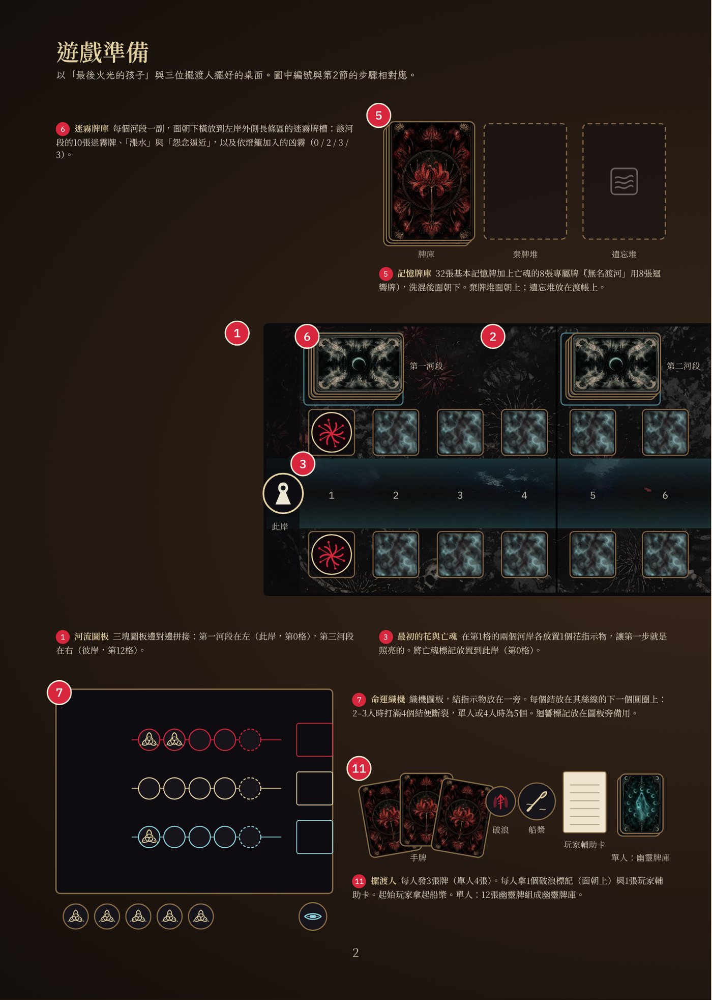

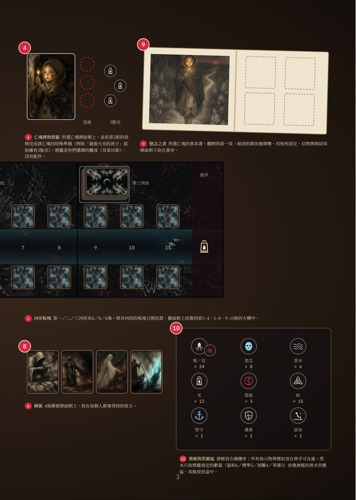

1.  **河流圖板。**依序拼接3塊圖板：第一河段在左（含此岸），第三河段在右（盡頭是彼岸）。每塊圖板的每個河岸各有1個放置河岸板塊的方槽，左岸外側的長條區有該河段的迷霧牌槽；河流在三塊圖板之間連成一線（見第5節）。
2.  **河岸板塊。**依霧面上的河段編號，將河岸板塊分成3疊：第一、二、三河段各6、8、6塊。將每疊分別洗混，**霧面朝上**放置到第2–4、5–8、9–11格的方槽中。不要翻看另一面（見第5節「河岸板塊」）。
3.  **最初的花與亡魂。**第1格沒有河岸板塊：在它的兩個河岸各放置1個**花指示物**（花面朝上）。將亡魂標記放置到此岸（第0格）。
4.  **亡魂與燈籠。**選擇1位亡魂：將它的亡魂牌面朝上放置在圖板旁，牌上的特色規則整局有效（見第10節）。再選擇1盞**燈籠**：燈籠決定遊戲難度，也就是黑水供應的數量、消散門檻，以及每個河段加入的凶霧牌數量（見第10節「燈籠」）。第一局建議使用溫和燈籠。最後依下方「各亡魂的特殊準備」表格，完成所選亡魂的特殊準備。
5.  **記憶牌庫。**將32張基本記憶牌與所選亡魂的8張專屬記憶牌（其中1張是關鍵記憶，見第9節）一起洗混；「*無名渡河*」改用8張迴響牌。面朝下放好，牌庫旁留出**棄牌堆**（面朝上）的位置。
6.  **迷霧牌庫。**每個河段各組一副：該河段的10張基本迷霧牌，加上1張「漲水」與1張「怨念逼近」，再隨機加入燈籠所規定數量的凶霧牌（溫和燈籠沒有）。將每副分別洗混，**面朝下**橫放到該河段的迷霧牌槽（左岸外側的長條區），並在牌槽旁留出該河段**迷霧棄牌堆**（面朝上）的位置。
7.  **命運織機。**擺出織機圖板與其三條絲線：執念、釋懷、忘卻，並將結放置在一旁。2–3人時絲線有4個結即為打滿；單人或4人時為5個。迴響標記放置在織機旁：第一張牌**正面打出**或**焚燒**時，再將它放到絲線上（見第6節）。
8.  **稱號。**四張稱號牌面朝上，放置在每個人都拿得到的地方（見第8節）。
9.  **憶念之書。**將所選亡魂的那本書翻到第一頁，並將相角準備在手邊（見第9節）。將該亡魂的9張**信物牌**依河段分開，每個河段的3張各自洗勻，面朝下在書旁疊成三疊（第一、二、三河段）。再將該亡魂的**結局牌**面朝下放在一旁，不要翻看。「*無名渡河*」沒有信物牌與結局牌。
10. **渡帳與供應區。**將渡帳圖板放置在織機旁：被**遺忘**的牌放置在它的編號軌上，裂痕放置在它的裂痕圓圈上。黑水標記只取燈籠規定的數量（溫和6個、標準5個、困難4個、英雄3個）放進它的黑水供應區，其餘放回盒中（見第7節）。根／花指示物、怨念指示物、光、裂痕、結，以及堅守標記、護盾標記與認命標記放置在伸手可及處，組成**供應區**。所選亡魂的起始光放入共用的**光池**（見下表）。
11. **擺渡人。**發給每位玩家手牌：單人4張，2–4人各3張。每人拿1個破浪標記，面朝上。起始玩家拿起船槳。單人模式中，將12張幽靈牌洗混成面朝下的幽靈牌庫，放置在你身旁（見第11節）。

### 各亡魂的特殊準備

| 亡魂             | 加入記憶牌庫（步驟5）     | 起始的光（步驟10） | 其他                                                                  |
|------------------|---------------------------|--------------------|-----------------------------------------------------------------------|
| *最後火光的孩子* | 專屬記憶牌8張             | 3點                | 組迷霧牌庫時不加入凶霧牌（任何燈籠都一樣）；消散門檻比燈籠規定多1張。 |
| *花環少女*       | 專屬記憶牌8張             | 0點                | —                                                                     |
| *渡船上的國王*   | 專屬記憶牌8張             | 0點                | —                                                                     |
| *留在冥府的新娘* | 專屬記憶牌8張             | 1點                | —                                                                     |
| *無名渡河*       | 迴響牌8張（沒有關鍵記憶） | 0點                | —                                                                     |

從此刻起適用隱憶之約（見第1節），由起始玩家進行第一個回合（見第3節）。

## 3. 你的回合

> **發生以下任一情況，你們立即落敗：**
>
> - **消散**：遺忘堆達到渡帳上你們燈籠的✕。
> - **破碎**：亡魂承受第3道裂痕（渡帳上最後一個裂痕圓圈）。
> - **滅頂**：必須放置黑水，但渡帳的黑水供應區已空。
>
> 亡魂抵達彼岸（第12格）時，**你們勝利**。

從拿著船槳的起始玩家開始，玩家依順時針輪流進行回合。輪到你時：

1.  **召喚稱號**（可選，須在第一個行動之前；見第8節）。
2.  **回應**（你的第一個行動）：打出1張牌（**正面打出**、**背面打出**或**焚燒**）、**喚回**或**奮力駛過**。
3.  **掌舵**（你的第二個行動）：打出1張牌或**奮力駛過**。每回合最多**焚燒**一次。
4.  **回合結束**：執行回合結束的步驟（見第4節）。

單人模式的手牌上限為4張；2–4人遊戲時為3張。

### 打出1張牌

從手牌打出1張牌，方式有三種：

- **正面打出**：執行卡牌效果，在織機上該牌的絲線加1個結，並將迴響移到該絲線。然後執念牌與釋懷牌放入棄牌堆（或**銘刻**進憶念之書，見第9節），忘卻牌放入遺忘堆。
- **背面打出**：放置1個根（見第5節），忽略卡牌上印的效果。不加結，迴響不移動。然後將這張牌面朝上放入棄牌堆。
- **焚燒**（每回合最多一次）：選擇另一位也握有該絲線牌的玩家。你們各將1張該絲線的牌面朝下放置在桌上，然後一起翻開。從兩張牌中選1張：執行它的效果**兩次**，在該絲線加1個結，並將迴響移到該絲線。然後**遺忘**這兩張牌，另一位玩家立即抽1張牌。若沒有其他玩家握有同一絲線的牌，便不能**焚燒**。*單人模式：*從手牌**焚燒**1張牌：執行效果兩次、加1個結、移動迴響，然後**遺忘**這張牌與牌庫頂的1張牌。

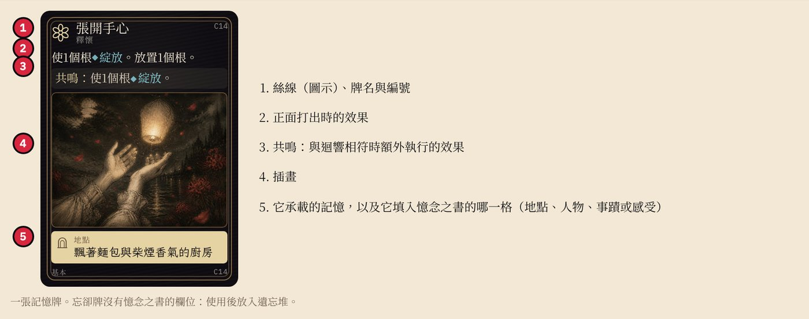

### 喚回與奮力駛過

**喚回**（僅限**回應**）：支付**3點光**，將遺忘堆中任一張牌移到棄牌堆，日後就能再被抽到。被**遺忘**的關鍵記憶也能被**喚回**。

**奮力駛過**（每位玩家**整局一次**）：只能在下一格的**兩個**河岸都有怨念指示物、且該格沒有黑水時使用。將兩個怨念指示物放回供應區，將亡魂移到該格（照常獲得光，見第8節），並將你的破浪標記翻到背面。接著亡魂承受**1道裂痕**，之前每有1個已翻到背面的破浪標記就再多承受1道，並**遺忘**牌庫頂的1張牌。因此第一次**奮力駛過**承受1道裂痕，第二次2道，第三次3道（即破碎）。你的回合照常繼續。

### 迴響與共鳴

**迴響**標記放置在任何玩家（或幽靈）最後一張**正面打出**或**焚燒**的牌所屬的絲線上。**背面打出**、**喚回**或**奮力駛過**都不會移動迴響。

若你的**回應**是1張**正面打出**或**焚燒**、且與迴響同一絲線的牌，它便**共鳴**：另外執行它的**共鳴**效果。部分忘卻牌的**共鳴**效果會取代一般效果（標示「改為」）。**共鳴**的牌可以**銘刻**進憶念之書（見第9節）。

**掌舵**永遠不會**共鳴**。若你的**回應**是**喚回**或**奮力駛過**，本回合便無法**共鳴**。**焚燒**時，**共鳴**的是你選來執行兩次效果的那張牌：它的效果執行兩次，但**共鳴效果只執行一次**（標示「改為」的牌例外：**共鳴**效果取代一般效果，因此執行兩次）。

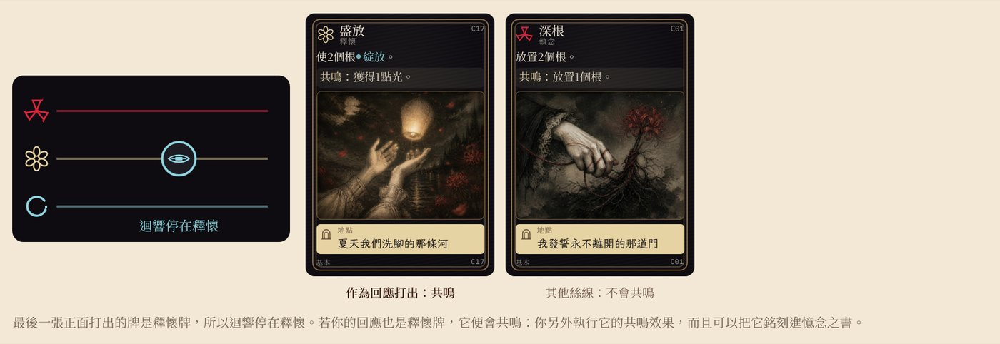

### 遺忘與兩個牌堆

**遺忘**1張牌：將它面朝上放置在渡帳遺忘軌的下一個數字上，壓住前1張牌的一部分。最新那張牌上方的數字，就是已**遺忘**的牌數。**遺忘牌庫頂的1張牌**：將記憶牌庫頂的1張牌直接放到遺忘軌上，不執行它。若有牌離開遺忘堆（**喚回**、章節祝福），將後面的牌往前移。

**棄牌堆**（在牌庫旁）與**遺忘堆**（在渡帳上）都面朝上，任何人都可以查看。兩者要分開：記憶牌庫用完時，棄牌堆的牌會重新洗入牌庫；遺忘堆的牌不會被重新洗入牌庫。需要抽牌或**遺忘**但記憶牌庫已空時，先將棄牌堆洗混成新的牌庫。

## 4. 回合結束

回合結束的步驟在**每位玩家的回合**之後都要執行，而不是每一輪一次。請依序執行：

1.  **引花人。**若當前玩家持有引花人稱號，可以免費將亡魂所在格或其前方的1個根指示物翻到花面（可選）。
2.  **亡魂行動。**依序檢查下列情境，並執行第一個符合的情境：
    1.  **亡魂旁有認命標記？**亡魂不移動。**遺忘**牌庫頂的1張牌（任何效果都無法阻止），然後移除標記。跳到*e*。
    2.  **亡魂所在的下一格已照亮（至少1個河岸有花指示物）且沒有黑水標記？**將亡魂移到該格。亡魂離開的那一格上每有1個花指示物，獲得1點光，然後將那一格上所有的根、花指示物與怨念指示物放回供應區。若亡魂移到了新河段的第一格，移除織機上所有的結（迴響留在原本的絲線上）。接著檢查*c*。
    3.  **額外移動。**依已**遺忘**的張數，亡魂可能再移動一格（每次額外移動同樣會獲得離開那一格的光；完成後跳到*e*）：
        - 若**遺忘**6張以上但未達9張（***輕如灰燼***）：亡魂再移動一格，但只限該格已照亮且沒有黑水。
        - 若**遺忘**9張或以上（***漂離***）：亡魂**一定**再移動一格。若那一格已照亮且沒有黑水，正常移動過去；否則仍然移動過去，並承受1道裂痕。例外：若有玩家持有守魂者稱號且尚未使用，將守魂者橫放，亡魂不進行這次額外移動，也不承受裂痕。「*最後火光的孩子*」永遠不會漂離（見第10節）。
    4.  **無法移動：亡魂徘徊**（留在原格）。依序檢查下列情境，並執行第一個符合的情境：
        1.  亡魂旁有堅守標記：不**遺忘**任何牌。
        2.  有玩家持有守魂者稱號且尚未使用：將守魂者橫放，不**遺忘**任何牌。
        3.  亡魂所在格已照亮：不**遺忘**任何牌。
        4.  亡魂為「*留在冥府的新娘*」且本局尚未使用其特色規則：將亡魂標記移回前一格，不**遺忘**任何牌（見第10節）。
        5.  以上皆非：**遺忘牌庫頂的1張牌**。
    5.  **怨念傷害。**若亡魂所在格的任一河岸有怨念指示物（1個或兩個），亡魂承受**1道裂痕**。無論亡魂這次是移動還是**徘徊**都會檢查。
3.  **迷霧。**翻開亡魂目前所在河段迷霧牌庫頂的1張牌，依序執行其指示。「亡魂前方」從亡魂所在格算起：前方第1格就是下一格。執行完畢後，將這張牌面朝上放到該河段迷霧牌槽旁的**迷霧棄牌堆**。若牌庫已空，先只將該河段的10張基本迷霧牌洗混成新的牌庫。附錄C列出所有迷霧牌。
4.  **整理。**
    - 有黑水、且**兩個**河岸都有根或花指示物的每一格：將該黑水標記移出遊戲（放回盒中）。
    - 每個怨念指示物，若它所在同一側河岸的正前一格**與**正後一格都有花指示物：將該怨念指示物放回供應區。
5.  **抽牌**，補回手牌上限。
6.  **單人模式：幽靈**（見第11節）。然後再執行一次整理。
7.  將船槳傳給左手邊的玩家。單人模式中，幽靈行動後船槳回到你手上。

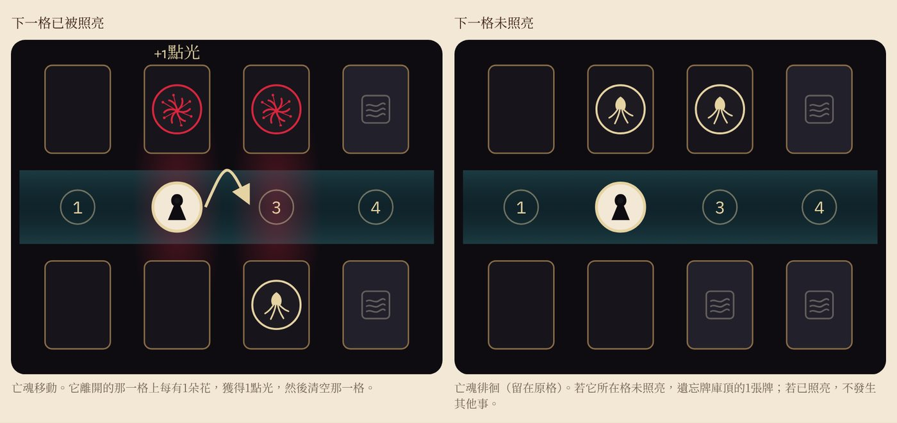

### 下一個回合開始時

- 若堅守標記在場，將它移除。
- 若你持有守魂者，在你自己的回合開始時將它轉正。
- 尚未抵銷裂痕的護盾標記，在其擁有者的下一個回合結束時移除。

### 立即生效的效果

絲線打滿時立即引發**反噬**（見第6節）。頁面獎勵與章節祝福在完成條件的那次**銘刻**時立即發生（見第9節）。記憶之地在河岸板塊翻開時立即給予信物（以「*無名渡河*」進行遊戲時改為給予2點光）。遊戲會在以下時刻立即結束：亡魂抵達彼岸（勝利）、遺忘堆達到燈籠的上限（消散）、亡魂承受第3道裂痕（破碎），或必須放置黑水但供應區已空（滅頂）。

**抵銷裂痕。**若亡魂旁有護盾標記，或亡魂為「*最後火光的孩子*」且其特色規則適用（每個河段的第一道裂痕），就免除亡魂應承受的那道裂痕：不放置裂痕，也不算承受。

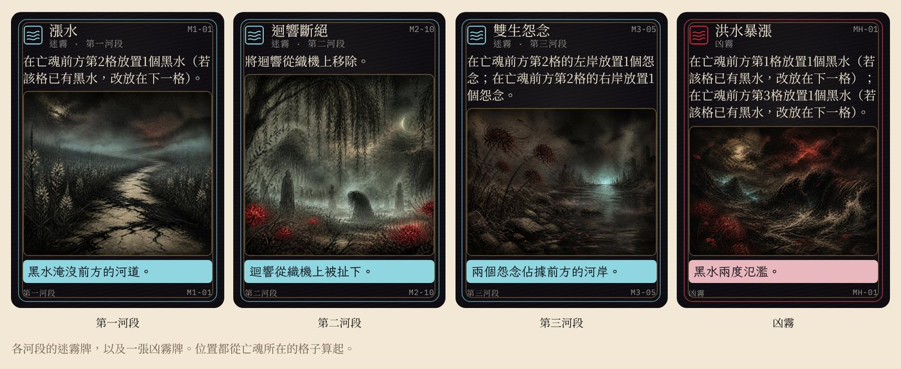

## 5. 河流、根與花

河流共有13格：此岸（0）、第1至11格，以及彼岸（12）。第1至11格的每一格都有**左岸**與**右岸**：以面向下游、望向彼岸的方向為準，河流的左側為左岸、右側為右岸。每個河岸最多放1個指示物（根、花或怨念）。「亡魂前方」指編號比亡魂所在格更大的格子；「下一格」指亡魂正前方的那一格。

河流分為三個河段：**第一河段・日光蘭之路**（第1–4格）、**第二河段・哀悼之野**（第5–8格）與**第三河段・忘川之岸**（第9–11格）。每個河段都有自己的迷霧牌庫，並在憶念之書中各佔一頁。

### 根、花與根網

彼岸花指示物是雙面的：**根指示物**是根面朝上的一面；**花指示物**是同一個指示物翻到花面朝上。只要一格中至少有1個河岸有花指示物，該格即為**照亮**。亡魂行動時只會移動到已照亮的格子，除非已**遺忘**9張或以上（***漂離***，見第4節「額外移動」）。

**放置根。**在亡魂所在格或其前方的空河岸（沒有任何指示物）放置1個根指示物。已經有怨念指示物的河岸不能**放置根**。該河岸必須**連接根網**，也就是至少符合以下一項：

- 位於亡魂所在格或下一格；或
- 同一格的另一個河岸已經有根或花指示物；或
- 正前一格或正後一格的同側河岸（左或右）有根或花指示物。

**綻放。**將亡魂所在格或其前方的1個根指示物翻到花面。**凋零。**將1個花指示物翻回根面；若該格因此兩個河岸都沒有花指示物，該格就不再被照亮。

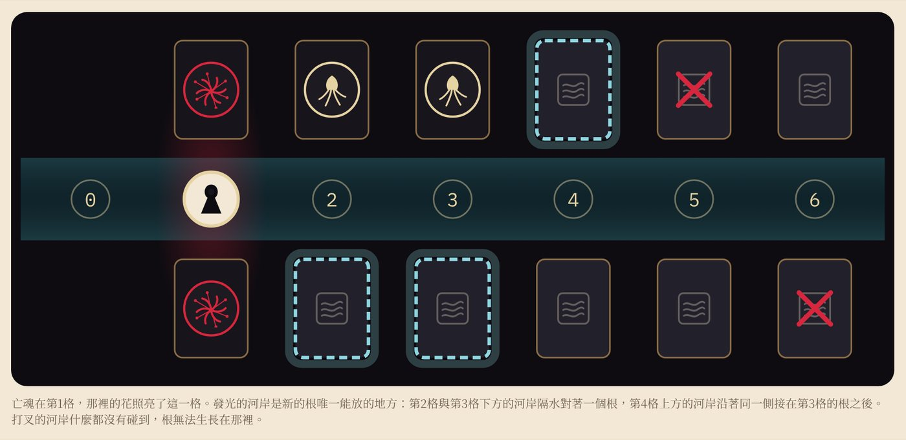

### 河岸板塊

在仍是霧面的河岸**放置根**時，先將該河岸板塊翻到正面。河岸板塊翻開後留在原處，並依其種類決定結果：

- **沃土**：**放置根**。
- **石地**：只有在卡牌效果寫著「即使在石地上也可以」或你持有織根者稱號時，才**放置根**。否則不**放置根**：將這個根指示物放回供應區。
- **記憶之地**：**放置根**，並找到1件**信物**：抽出這個河岸所在河段那一疊信物牌的頂牌，朗讀出來，面朝上放在憶念之書該河段那一頁旁。信物不影響遊戲進行，而是在遊戲結束時隨憶念之書朗讀（見第9節）。「*無名渡河*」沒有信物牌，改為獲得2點光；其他亡魂翻開記憶之地不獲得光。
- **墳墓**：不**放置根**。改在這個河岸放置1個怨念指示物。

沒有河岸板塊的河岸（第1格的兩岸，或墳墓板塊已被移除的河岸）視為沃土。已翻開的河岸板塊適用相同規則：沃土與記憶之地可以**放置根**；石地只能依上述方式放置；墳墓永遠不能**放置根**。第一河段有3塊沃土、1塊石地與2塊記憶之地；第二河段有3塊沃土、2塊石地、2塊記憶之地與1塊墳墓；第三河段有2塊沃土、1塊石地、2塊記憶之地與1塊墳墓。

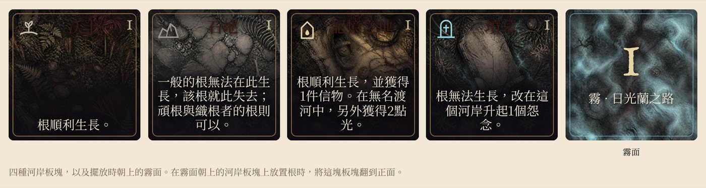

## 6. 命運織機與反噬

織機有三條絲線：執念、釋懷與忘卻。每張**正面打出**或**焚燒**的牌，都在其絲線上加1個結。2–3人遊戲時，絲線有4個結即為打滿；單人模式或4人遊戲時為5個。

絲線打滿時，移除這條絲線上所有的結，並依據絲線種類執行以下**反噬**效果：

- **執念・攫取**：在亡魂所在格放置1個怨念指示物。放置順序以左岸優先：若左岸已有怨念指示物，則放置於右岸。若兩岸都已有怨念指示物（或亡魂在此岸），改放置在下一格（同樣左岸優先）。若要放置的河岸上有根或花指示物，先將它放回供應區，再放上怨念指示物（見第7節）。
- **釋懷・認命**：將認命標記放置在亡魂旁。下一次亡魂行動中亡魂不移動，並**遺忘**牌庫頂的1張牌；然後移除標記。
- **忘卻・漲潮**：在下一格放置1個黑水標記（見第7節）。

當亡魂移動到新河段的第一格時，移除三條絲線上所有的結。迴響留在原位。

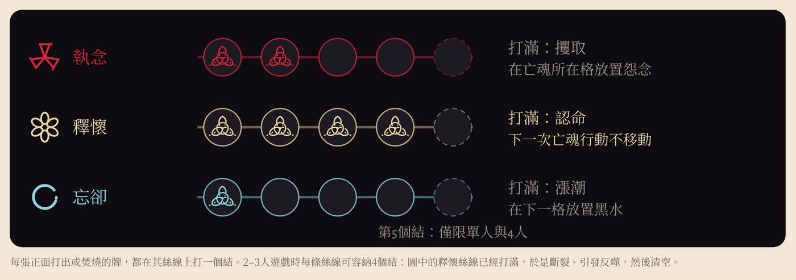

## 7. 黑水、怨念與裂痕

**放置黑水。**黑水只會放在亡魂前方的格子：永遠不會放置在亡魂所在格，或亡魂後方的格子。將黑水標記放置在指定的格子；若該格已有黑水，改放置在它前方（編號更大）第一個沒有黑水的格子；若它前方的格子都已有黑水，改放置在指定格與亡魂之間、離指定格最近且沒有黑水的格子。放置後，將該格上所有的花指示物翻回根面。亡魂不能移動到有黑水的格子。黑水一律從渡帳的黑水供應區拿取。若必須放置黑水但供應區已空，你們落敗（滅頂）。

**移除黑水。**整理時，若有黑水的格子兩個河岸都有根或花指示物，將該黑水標記移出遊戲。寫著「**排乾**」的牌也以相同方式移除黑水。被移除的黑水放回盒中，永遠不會回到供應區。

**放置怨念。**將怨念指示物放置在指定的河岸。若該河岸已有怨念指示物，改放同一格的另一個河岸；兩岸都有時，依序往前方的下一格放。若要放置的河岸上有根或花指示物，先將它放回供應區，再放上怨念指示物。已經有怨念指示物的河岸不能**放置根**。下一格兩岸都有怨念指示物時，亡魂無法移動過去，除非有玩家執行「**奮力駛過**」（見第3節）。

**移除怨念。**整理時，若某個怨念指示物同一側河岸的正前一格與正後一格都有花指示物，將它放回供應區。寫著「**驅散**」或「**沖走**」的牌也會將怨念指示物放回供應區。怨念指示物被移除後，它下方的河岸板塊仍維持原本的地形（例如石地仍是石地）。

**裂痕**來自怨念傷害、**奮力駛過**、漂離與凶霧牌「黑風」。每道裂痕都放置在渡帳的下一個裂痕圓圈上；**修補**時從最高的圓圈取下。累積3道裂痕時你們落敗（破碎）。卡牌*守住防線*給予護盾標記：它抵銷下一道裂痕後移除；若未使用，在其擁有者的下一個回合結束時移除。

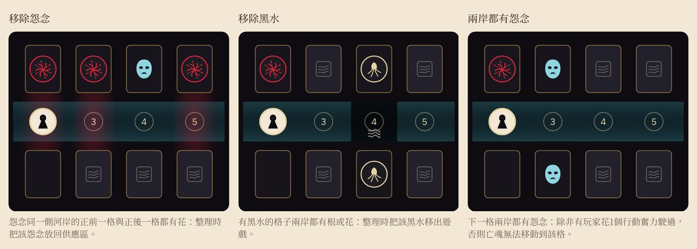

## 8. 光與稱號

**獲得光。**光屬於所有玩家共用的資源，放在共用的光池中。亡魂每次離開一格時，該格每有1個花指示物便獲得1點光（兩岸都有花則獲得2點）；之後那一格被清空，因此每朵花只提供一次光。只要亡魂移動就會獲得：包括亡魂行動、額外移動、使亡魂移動的卡牌效果，以及**奮力駛過**。光會保留在光池中，直到被花掉，或因凶霧牌「黑風」而失去。此外，以「*無名渡河*」進行遊戲時，每翻開1塊記憶之地另外獲得2點光；其他亡魂翻開記憶之地不會獲得光。

**花費光。**光有兩種用途：

- **喚回**（作為你的**回應**）：支付3點光，將遺忘堆中任一張牌移到棄牌堆（見第3節）。
- **召喚**稱號（在你的**回應**之前）：支付3點光（見下方）。

**召喚稱號**（在你的**回應**之前）：支付3點光（「*渡船上的國王*」為2點），並從手牌棄掉1張與該稱號同一絲線的牌（放入棄牌堆），拿取該稱號牌。2至4人遊戲時，每位玩家最多持有1個稱號，並持有到遊戲結束：稱號不可更換或放棄，但「*渡船上的國王*」有特殊規則（見第10節）。單人模式可以更換稱號（見第11節）。

| 稱號（絲線）       | 牌上的文字                                                    | 何時生效                                                                                                                                                                 | 必須或可選         |
|--------------------|---------------------------------------------------------------|--------------------------------------------------------------------------------------------------------------------------------------------------------------------------|--------------------|
| **織根者**（執念） | 你的根可以生長在石地上。你每回合的第一個根效果額外放置1個根。 | 持續生效。你的根指示物可以放在石地上。在你的回合中，你第一次執行「**放置根**」的效果時（包括**正面打出**牌上的**放置根**，以及**背面打出**時放置的1個根），多放置1個根。 | 自動生效           |
| **守魂者**（執念） | 每輪一次，阻止亡魂**徘徊**或漂離。                            | 亡魂行動中，亡魂將要**徘徊**（步驟d），或漂離時額外那一格未照亮或有黑水（步驟c）。見第4節。                                                                              | 尚未使用時自動生效 |
| **引花人**（釋懷） | 你的每個回合結束時，免費使1個根**綻放**。                     | 只在持有者自己回合的回合結束第1步「引花人」（見第4節）。                                                                                                                 | 可選               |
| **破霧者**（忘卻） | 你每回合打出的第一張忘卻牌改為棄掉，而非**遺忘**。            | 在你的回合中，你第一張**正面打出**的忘卻牌，執行完效果後放入棄牌堆，而不是遺忘堆。**焚燒**的牌仍會被**遺忘**。                                                           | 自動生效           |

**守魂者的「每輪一次」。**指從持有者的回合開始，到其下一個回合開始之間一次；它在其他玩家的回合也能使用。例如：小明持有守魂者。小華的回合結束時，亡魂將要**徘徊**，守魂者便生效：亡魂留在原格，不**遺忘**任何牌，小明將守魂者橫放；直到小明自己的回合開始時才轉正。用來阻止漂離時（僅限額外那一格未照亮或有黑水），亡魂不進行額外移動，也不承受裂痕。

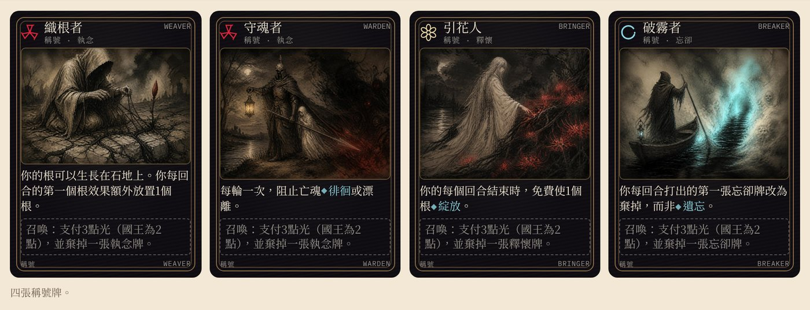

## 9. 憶念之書與結局

憶念之書每個河段各有一頁：第一頁《我曾是誰》（第一河段）、第二頁《我做過什麼》（第二河段）、第三頁《我所懷抱的》（第三河段）。每頁有四個欄位：**地點**、**人物**、**事蹟**與**感受**，填滿後便組成一句關於亡魂生平的話。

**銘刻。銘刻**是將1張牌永久放進憶念之書，讓它成為亡魂故事的一部分：用相角將這張牌貼進對應的欄位，而不是放入棄牌堆；它會留在那裡直到遊戲結束，不會再被抽到。**銘刻**是可選的：符合條件時，你可以選擇**銘刻**，也可以照常將牌放入棄牌堆。可以**銘刻**的時機：

- 當1張牌**共鳴**時，若牌上標示的欄位在亡魂目前所在河段的那一頁仍是空的，你可以**銘刻**它。
- **關鍵記憶**只要**正面打出**，無論是否**共鳴**都可以**銘刻**。
- 忘卻牌與**焚燒**的牌不能**銘刻**。

**頁面獎勵。**每一頁的每一組相鄰欄位都有1個小獎勵：**地點＋人物**、**人物＋事蹟**、**事蹟＋感受**。當一次**銘刻**填上某組的第二個欄位時，立即執行該組的獎勵。1張牌可能同時完成兩組（例如人物旁的地點與事蹟都已**銘刻**）：兩個獎勵都執行。每個獎勵每頁只發生一次；在書上勾選它的方框。獎勵印在每一頁上：

| 頁                       | 地點＋人物                           | 人物＋事蹟           | 事蹟＋感受                                    |
|--------------------------|--------------------------------------|----------------------|-----------------------------------------------|
| **第一頁《我曾是誰》**   | 放置1個根。                          | 使1個根**綻放**。    | 獲得2點光。                                   |
| **第二頁《我做過什麼》** | **驅散**最近的怨念。                 | **排乾**最近的黑水。 | 在最滿的絲線上解開1個結（若平手，由你選擇）。 |
| **第三頁《我所懷抱的》** | 將最新被**遺忘**的那張牌放回棄牌堆。 | **修補**1道裂痕。    | 若下一格已被照亮，亡魂立即前進一格。          |

**章節祝福。**當一頁的4個欄位全部填滿（「*花環少女*」為3個），該頁另外立即給予一次章節祝福（每頁僅一次）。祝福不能選擇。依序檢查，執行第一個可以執行的項目：

1.  若亡魂至少有1道裂痕：移除1道裂痕。
2.  否則，若任一格有黑水：將亡魂前方最近的黑水標記移出遊戲。
3.  否則，若遺忘堆有牌：將最新被**遺忘**的那張牌放入棄牌堆。
4.  否則不發生任何事。

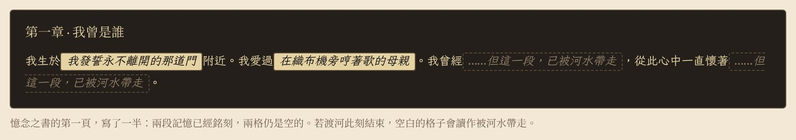

### 結局

遊戲結束時，隱憶之約解除：所有人都可以展示手牌、說出牌上的記憶。接著逐頁朗讀憶念之書，即使落敗也要朗讀。每一頁依欄位順序朗讀，空白的欄位讀作「……但這一段，已被河水帶走」。然後朗讀放在這一頁旁的信物：「……這個河段，只留下了：一面殘破的旌旗、一頂凹陷的頭盔。」

**結局牌。**如果你們獲勝，亡魂的故事會以它的一張結局牌作結（「*無名渡河*」沒有結局牌）。先查看亡魂的**關鍵記憶**牌在哪裡：

- **已銘刻於書中**：亡魂帶著最重要的記憶渡河。
- **在遺忘堆中**：亡魂沒有它而渡河，更輕盈，也更空洞。
- **在其他地方**（牌庫、手牌或棄牌堆）：它從未被說出（結局牌上寫作「未曾說出」），亡魂帶著這段未說出口的記憶渡河。

接著，先不要讀故事，只查看該亡魂每張結局牌上的「觸發條件」，找出符合關鍵記憶所在位置與**遺忘**張數的那一張。若**隱藏結局**的條件全部符合，就以它取代條件中寫明的結局。最後朗讀這張結局牌。

如果你們落敗，不朗讀結局牌：憶念之書與它的信物，就是亡魂留下的全部。

## 10. 亡魂與燈籠

*老擺渡人不肯載的四個亡魂，以及一個連名字都沒有的亡魂。*

每位具名亡魂都會加入自己專屬的8張記憶牌，其中包括1張**關鍵記憶**，以及一條特色規則；「*無名渡河*」則改為加入8張迴響牌。這些牌在遊戲準備的步驟5洗入記憶牌庫，各亡魂的特殊準備見第2節。以下先引用亡魂牌上的文字，再以遊戲用語說明。

### 最後火光的孩子

一年中最寒冷的那一夜，一個小小的孩子獨自蜷在門口，手裡握著一把要賣的小火光，一個也沒賣出去。為了取暖，她把它們一一點亮。每一朵火焰裡，她都看見了些什麼：一座暖爐、一桌盛宴；最後，是那個唯一曾經抱過她的人，前來帶她回家。

**特色規則：**「起始擁有3點光。每個河段的第一道裂痕會被忽略。永遠不會漂離。消散前可多**遺忘**1張牌。沒有凶霧。」

- **起始擁有3點光**：遊戲準備時，將3點光放入光池。
- **每個河段的第一道裂痕會被忽略**：亡魂在每個河段第一次要承受裂痕時，不放置裂痕。將亡魂牌橫放作為記號；亡魂移動到新河段的第一格時再轉正。
- **永遠不會漂離**：**遺忘**9張或以上時，仍然只適用***輕如灰燼***（**遺忘**6張或以上）的額外移動：只有在下一格已照亮且沒有黑水時，才再移動一格，也不會因此承受裂痕。
- **消散前可多遺忘1張牌**：消散門檻比燈籠規定多1張。例如使用標準燈籠時，**遺忘**11張才消散，而不是10張。
- **沒有凶霧**：組迷霧牌庫時不加入任何凶霧牌。

**關鍵記憶：***她離去前總是抱著我的那個人*。

### 花環少女

一位年輕女子，為她所愛的每一個人都編了一朵花。後來父親死了，那個許諾要娶她的男人變得冷酷，她便將花一朵一朵送了出去，然後仍輕聲唱著歌，滑入了溪水之中。她為自己留下了一朵花，卻從沒有人知道是哪一朵。

**特色規則：**「每一頁只需**銘刻**3段記憶，就能獲得章節祝福。」也就是說，憶念之書的一頁只要**銘刻**了3張牌（而不是4張），就立即獲得該頁的章節祝福（見第9節）。**關鍵記憶：***我唯一留給自己的那朵花*。

### 渡船上的國王

一位年邁的國王，贏下了每一場戰役，唯獨輸了最後一場。他最親近的摯友愛上了他的王后，他的同袍從此分崩離析，而他倒在一片親手造就的戰場上。彌留之際，他被安放在一艘黑色的渡船上。他借來的那柄寶劍，從未歸還給它所來自的那片湖水，因此他始終無法安息。

**特色規則：**「稱號花費2點光。造成裂痕的玩家會失去自己的稱號。」

- **稱號花費2點光**：**召喚**稱號只需支付2點光，而不是3點（見第8節）。
- **造成裂痕的玩家會失去自己的稱號**：在某位玩家的回合中（包括其回合結束的步驟），亡魂承受裂痕時，該玩家失去稱號：將稱號牌放回其他稱號旁，之後可以再被**召喚**。被護盾標記抵銷的裂痕不算承受。

**關鍵記憶：***從湖中伸出、贈我寶劍的那隻手*。

### 留在冥府的新娘

她死在自己的婚禮當天。她的丈夫走進黑暗深處，想把她帶回人間，卻有一個條件：在抵達光明之前，絕不能回頭。距離地面只剩一步時，他轉過了頭。從那以後，她便一直佇立在陰影裡，思量著該記住他的臉，還是放手讓它遠去。

**特色規則：**「起始擁有1點光。她第一次將在黑暗中**徘徊**時，不會**遺忘**，而是被拉回一格。」

- **起始擁有1點光**：遊戲準備時，將1點光放入光池。
- **她的隱藏結局**：她有一張結局牌，需要亡魂整局遊戲從未**徘徊**。亡魂第一次**徘徊**時，將她的亡魂牌上下顛倒，作為提醒。
- **被拉回一格**（整局一次）：亡魂行動中，亡魂**徘徊**、且原本要**遺忘**牌庫頂的1張牌時（亡魂所在格未照亮，也沒有堅守標記或守魂者阻止；見第4節步驟d的IV），改為將亡魂標記移回前一格（編號小1的格子），不**遺忘**任何牌，也不獲得光。之後將亡魂牌橫放，表示已經使用。亡魂在此岸（第0格）時不適用。

**關鍵記憶：***他回頭看我那一瞬間的臉*。

### 無名渡河

一個無名的亡魂。你們不會得知它的故事，而是要親手寫下它。

**特色規則：**「記憶之地給予+2點光。」也就是說，每翻開1塊記憶之地，獲得2點光；這個亡魂沒有信物牌（見第5節）。它沒有關鍵記憶，也沒有結局牌；憶念之書就是它的全部故事。

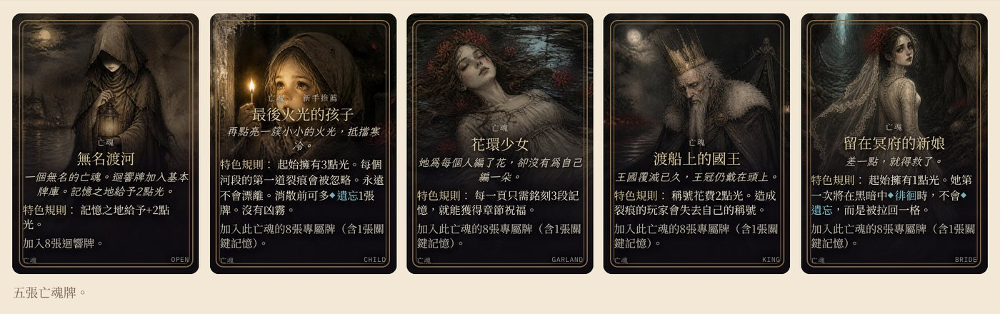

### 燈籠

燈籠決定遊戲難度，在遊戲準備的步驟4選擇（見第2節）。**標準**是一般的遊戲難度：有經驗的隊伍大約能贏下一半的對局。學習遊戲時使用**溫和**，想要更多挑戰時使用**困難**或**英雄**。

| 燈籠      | 黑水供應 | 消散門檻     | 每河段凶霧數 |
|-----------|----------|--------------|--------------|
| ◆◇◇◇ 溫和 | 6        | **遺忘**11張 | 0            |
| ◆◆◇◇ 標準 | 5        | **遺忘**10張 | 2            |
| ◆◆◆◇ 困難 | 4        | **遺忘**9張  | 3            |
| ◆◆◆◆ 英雄 | 3        | **遺忘**8張  | 3            |

> **你的第一局：**我們建議以溫和燈籠遊玩**最後火光的孩子**。在你們熟悉河流、織機與憶念之書的過程中，它的規則更能容許失誤。

## 11. 單人模式與幽靈

單人模式中，你的手牌為4張，織機的絲線有5個結才打滿。

**幽靈。**在你的每個回合之後（回合結束步驟6），翻開幽靈牌庫頂的1張牌並執行其行動，放置規則與玩家相同（見第5節）。然後在它的絲線上加1個結（絲線打滿便引發反噬），並將迴響移到該絲線，讓你的下一個**回應**可以與它**共鳴**。幽靈牌庫用盡時，將所有幽靈牌洗混成新的牌庫。

**更換稱號。**即使你已持有稱號，仍可**召喚**新的稱號。將原本的稱號牌翻到背面：它再也不能被**召喚**。每個稱號整局只能被**召喚**一次，且一局最多**召喚3**次。

| 幽靈牌 | ×   | 行動                               |
|--------|-----|------------------------------------|
| 執念   | 3   | 在最遠的空河岸扎根                 |
| 執念   | 2   | 在最近的空河岸扎根                 |
| 釋懷   | 2   | 使最近的根**綻放**                 |
| 釋懷   | 2   | 使最遠的根**綻放**                 |
| 忘卻   | 2   | **驅散**最近的怨念，或**排乾**黑水 |
| 忘卻   | 1   | 不採取行動                         |

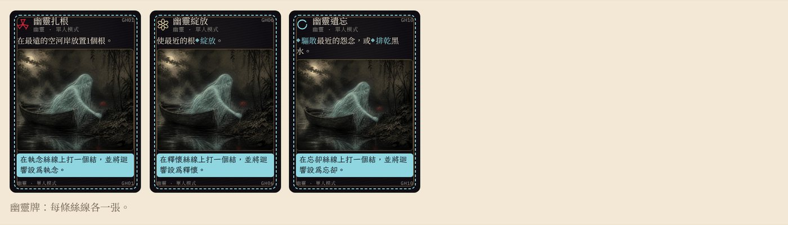

## 附錄A. 配件與圖示

每個配件在故事中代表什麼，以及它在遊戲中的作用。

| 配件                 | 在故事中                                                 | 在遊戲中                                                                   |
|----------------------|----------------------------------------------------------|----------------------------------------------------------------------------|
| **亡魂標記**         | 一位無錢的亡者，在此岸醒來，一生的記憶仍完整地留在心中。 | 從第0格移到第12格，只移動到已照亮且沒有黑水的格子（漂離時例外，見第4節）。 |
| **彼岸**             | 蒙著面紗的守岸人捧著**遺忘**之杯等候之處。               | 第12格。亡魂抵達此處，你們便獲勝。                                         |
| **河岸板塊（霧面）** | 遮蔽河岸的霧氣。                                         | 蓋住河岸，直到有人在該處**放置根**（見第5節）。                            |
| **沃土**             | 河岸上鬆軟的泥土。                                       | **放置根**。                                                               |
| **石地**             | 堅硬灰冷的石頭，幾乎寸草不生。                           | 只有允許石地的牌或織根者能在此**放置根**。                                 |
| **記憶之地**         | 亡魂曾經熟悉的地方，穿過霧氣浮現。                       | **放置根**並找到信物（*無名渡河*改為獲得2點光）。                          |
| **墳墓**             | 這裡埋著未了的事。                                       | 不**放置根**，改放1個怨念。                                                |
| **根指示物**         | 種在黑暗中的一顆彼岸花種子。                             | 延伸根網。不會照亮格子。                                                   |
| **花指示物**         | 1朵盛開、散發赤紅光芒的彼岸花。                          | 使所在格被照亮。                                                           |
| **光**               | 亡魂走過的花所留下的光芒。                               | 共用光池；用來**召喚**稱號與**喚回**。                                     |
| **執念絲線**         | 執著、積怨，以及亡魂無法放下的一切。                     | 多為**放置根**的牌。反噬：攫取。                                           |
| **釋懷絲線**         | 溫柔、原諒與平靜。                                       | 多為**綻放**與**修補**的牌。反噬：認命。                                   |
| **忘卻絲線**         | 刻意的**遺忘**。                                         | 強力的牌，使用後被**遺忘**。反噬：漲潮。                                   |
| **結**               | 命運三女神為亡魂編織的最後旅程。                         | 標示織機上絲線的進度。                                                     |
| **迴響標記**         | 織機的梭子。在無聲的世界裡，它就是你們的聲音。           | 標示**共鳴**所需的絲線。                                                   |
| **怨念指示物**       | 由亡魂未了的怨恨所化成的陰影。                           | 封鎖河岸；傷害身旁的亡魂。                                                 |
| **黑水**             | 上漲的河水，要將小徑吞沒。                               | 亡魂不能進入該格。                                                         |
| **裂痕**             | 亡魂對自我的認知所出現的1道裂縫。                        | 放置在渡帳的裂痕圓圈上。第3道：破碎。                                      |
| **船槳**             | 渡船的槳，一手傳過一手。                                 | 表示輪到誰。                                                               |
| **破浪標記**         | 擺渡人使盡全力的那一股勁。                               | 每人1個；使用後翻到背面。                                                  |
| **堅守標記**         | 放置在亡魂身旁的一只錨。                                 | 亡魂**徘徊**時不**遺忘**任何牌。                                           |
| **護盾標記**         | 擋在亡魂與傷害之間的擺渡人。                             | 抵銷下一道裂痕。                                                           |
| **認命標記**         | 在蘆葦間坐下的亡魂。                                     | 下一次亡魂行動中亡魂不移動。                                               |
| **憶念之書**         | 古老的墓文囑咐亡者莫飲忘川，而要去尋找的記憶之泉。       | 三頁，每頁四個欄位（見第9節）。                                            |
| **關鍵記憶**         | 對這個亡魂而言最重要的記憶。                             | 決定結局（見第9節）。                                                      |
| **渡帳**             | 河流替亡魂記下的失去之帳。                               | 放置遺忘堆（編號軌）、裂痕與黑水供應區：三種落敗方式都在這裡。             |
| **記憶牌**           | 亡魂的記憶。                                             | 你的手牌；每張都有效果、絲線，通常還有1個欄位。                            |
| **迷霧牌**           | 冥府本身：上漲的河水、寒冷的風、重返的霧氣。             | 每個河段一副；每回合翻開1張（見附錄C）。                                   |
| **稱號牌**           | 擺渡人在河上可以擔起的角色。                             | 以光換取的持續能力（見第8節）。                                            |
| **亡魂牌**           | 你們可以護送的五個亡魂。                                 | 每張都有特色規則（見第10節）。                                             |
| **信物牌**           | 亡魂生前的物件，在它曾走過的地方被找到。                 | 在記憶之地找到；遊戲結束時隨憶念之書朗讀（見第5、9節）。                   |
| **結局牌**           | 亡魂的故事在彼岸如何結束。                               | 獲勝時，最後朗讀其中一張（見第9節）。                                      |
| **幽靈牌（單人）**   | 一位與你同行的沉默擺渡人。                               | 在你的每個回合之後打出（見第11節）。                                       |

### 盒中內容

| 配件                           | 數量                                                             |
|--------------------------------|------------------------------------------------------------------|
| 記憶牌                         | 72：基本32張、迴響牌8張（*無名渡河*）、4套亡魂專屬牌各8張        |
| 迷霧牌                         | 42：每個河段基本10張、每個河段額外2張（漲水、怨念逼近）、凶霧6張 |
| 河岸板塊                       | 20：第一、二、三河段各6、8、6塊                                  |
| 信物牌／結局牌                 | 36（每位有名字的亡魂9張）／19（每位有名字的亡魂4或5張）          |
| 亡魂牌／稱號牌／幽靈牌         | 5／4／12                                                         |
| 圖板                           | 河流圖板3塊、命運織機1塊、渡帳1塊                                |
| 憶念之書                       | 5本，每位亡魂一本                                                |
| 根／花指示物（雙面）           | 24                                                               |
| 怨念指示物／黑水標記／裂痕     | 8／6／3                                                          |
| 光／結                         | 12／15                                                           |
| 迴響、船槳、亡魂（背面為幽靈） | 各1                                                              |
| 破浪／堅守／護盾／認命標記     | 4／1／1／1                                                       |

**用牌本身記錄使用。**守魂者使用後將牌橫放，持有者的回合開始時再轉正。亡魂牌上只能使用一次的規則用掉後，將亡魂牌橫放；以新娘進行遊戲時，亡魂第一次**徘徊**就將她的亡魂牌上下顛倒。單人模式中，被放棄的稱號牌翻到背面。

## 附錄B. 卡牌用語

卡牌上以這種樣式印出的字是遊戲用語。下表說明你確切要做什麼。

| 卡牌上的字                                    | 你要做的事                                                                                                                                                                                                             |
|-----------------------------------------------|------------------------------------------------------------------------------------------------------------------------------------------------------------------------------------------------------------------------|
| 放置N個根                                     | 將N個根指示物，一次一個，各放置在1個連接根網的空河岸上（見第5節）。*即使在石地上也可以*：也可以放置在石地上。                                                                                                          |
| 使N個根綻放                                   | 將亡魂所在格或其前方的N個根指示物翻到花面。                                                                                                                                                                            |
| 凋零                                          | 將花指示物翻回根面。若該格因此兩個河岸都沒有花指示物，該格就不再被照亮。                                                                                                                                               |
| 照亮                                          | 至少1個河岸有花指示物的格子。亡魂只會移動到被照亮的格子（漂離時例外）。                                                                                                                                                |
| 修補N道裂痕                                   | 從渡帳上取下N道裂痕（從最高的圓圈開始），放回供應區。                                                                                                                                                                  |
| 驅散最近的怨念                                | 將離亡魂最近的怨念（亡魂所在格或其前方）放回供應區。                                                                                                                                                                   |
| 沖走亡魂身旁的怨念                            | 將亡魂所在格的所有怨念放回供應區。                                                                                                                                                                                     |
| 排乾最近的黑水                                | 將亡魂前方最近的黑水標記移除，放回盒中。*排乾本河段的所有黑水*：對亡魂所在河段的每個黑水標記都這樣做。                                                                                                                 |
| 移除1個（由你選擇）：最近的怨念，或最近的黑水 | 從上面兩列擇一執行：**驅散**最近的怨念，或**排乾**最近的黑水。                                                                                                                                                         |
| 在最滿的絲線上解開N個結                       | 從結最多的絲線上移除N個結，不引發反噬。若平手，由你選擇。                                                                                                                                                              |
| 清空最滿的絲線                                | 移除結最多的絲線上所有的結，不引發反噬。若平手，由你選擇。                                                                                                                                                             |
| 打1個結                                       | 在指定的絲線上加結。若因此打滿，執行它的反噬。                                                                                                                                                                         |
| 反噬                                          | 絲線打滿時發生的事（見第6節）。執行後移除該絲線上的結。                                                                                                                                                                |
| 掀開本河段的所有霧氣；墳墓變為沃土            | 將亡魂所在河段所有霧面朝上的河岸板塊翻到正面，但不**放置根**。以此方式翻開的墳墓板塊從圖板上移除，該河岸視為沃土。以此方式翻開的板塊不會產生怨念、信物或光。                                                           |
| 亡魂立即前進一格                              | 若下一格已照亮且沒有黑水，立刻將亡魂移到下一格，並照常獲得光。                                                                                                                                                         |
| 本回合亡魂停留時不會**遺忘**                  | 將堅守標記放置在亡魂旁。若亡魂本回合**徘徊**，不**遺忘**任何牌。                                                                                                                                                       |
| 防止下一道裂痕                                | 拿取護盾標記（見第7節）。                                                                                                                                                                                              |
| 查看迷霧牌庫頂的3張牌                         | 查看當前河段迷霧牌庫頂的3張牌，再以任意順序放回牌庫頂。                                                                                                                                                                |
| 遺忘1張牌                                     | 將牌面朝上放置在渡帳遺忘軌的下一個數字上。                                                                                                                                                                             |
| 遺忘牌庫頂的1張牌                             | 將記憶牌庫頂的1張牌直接放到遺忘軌上，不執行它。                                                                                                                                                                        |
| 徘徊                                          | 亡魂在亡魂行動中不移動（見第4節步驟d）。                                                                                                                                                                               |
| 召喚稱號                                      | 在你的**回應**之前：支付3點光（「*渡船上的國王*」時為2點），並從手牌棄掉1張與該稱號同絲線的牌。拿取該稱號牌。                                                                                                          |
| **喚回**                                      | 作為你的**回應**：支付3點光，將遺忘堆中任一張牌移到棄牌堆。                                                                                                                                                            |
| **焚燒**                                      | 每回合一次，與另一位握有同一絲線的玩家一起：各翻開1張該絲線的牌，由你選1張；執行它的效果兩次、打1個結並將迴響移到那裡。**遺忘**兩張牌；另一位玩家抽1張。單人：**焚燒**1張牌，效果兩次，然後**遺忘**它與牌庫頂的1張牌。 |
| **共鳴**                                      | 你的**回應**是**正面打出**或**焚燒**、且與迴響同一絲線的牌：同時執行它的**共鳴**效果。*改為*：以**共鳴**效果取代一般效果。                                                                                             |
| **銘刻**                                      | 將**共鳴**的牌放進目前河段那一頁的對應欄位，而不是放入棄牌堆（見第9節）。                                                                                                                                              |
| 將迴響從織機上移除（迷霧牌）                  | 將迴響標記從絲線上拿下；直到再有牌**正面打出**或**焚燒**之前，沒有任何牌能**共鳴**。                                                                                                                                   |

## 附錄C. 迷霧牌

每張迷霧牌上印的指示。每個河段的牌庫還包含「漲水」與「怨念逼近」，以及除溫和燈籠外的凶霧牌。

| 迷霧牌       | 河段       | 指示                                                                                                                     |
|--------------|------------|--------------------------------------------------------------------------------------------------------------------------|
| **漲水**     | 一、二、三 | 在亡魂前方第2格放置1個黑水（若該格已有黑水，改放在下一格）。                                                             |
| **怨念**     | 一、二     | 在亡魂前方第1格的左岸放置1個怨念。                                                                                       |
| **怨念逼近** | 一、二、三 | 在亡魂所在格放置1個怨念（優先放左岸；兩岸都已有怨念時，改放在下一格的左岸）。                                            |
| **凋零**     | 一、二、三 | 亡魂前方最遠的2朵花**凋零**，翻回根面。                                                                                  |
| **霧氣重返** | 一、二     | 將亡魂前方最遠的1塊已翻開的空河岸板塊翻回霧面。                                                                          |
| **寒風**     | 一、二、三 | **遺忘**牌庫頂的1張牌。                                                                                                  |
| **迷霧散開** | 一         | 沒有任何效果。                                                                                                           |
| **迴響斷絕** | 二、三     | 將迴響從織機上移除。                                                                                                     |
| **暗流**     | 三         | 在亡魂前方第2格放置1個黑水（若該格已有黑水，改放在下一格）；亡魂前方第1格的花**凋零**為根。                              |
| **雙生怨念** | 三         | 在亡魂前方第2格的左岸放置1個怨念；在亡魂前方第2格的右岸放置1個怨念。                                                     |
| **大凋零**   | 三         | 亡魂前方最遠的3朵花**凋零**，翻回根面。                                                                                  |
| **刺骨寒風** | 三         | **遺忘**牌庫頂的2張牌。                                                                                                  |
| **洪水暴漲** | 凶霧       | 在亡魂前方第1格放置1個黑水（若該格已有黑水，改放在下一格）；在亡魂前方第3格放置1個黑水（若該格已有黑水，改放在下一格）。 |
| **怨念成群** | 凶霧       | 在亡魂前方第1格的左岸放置1個怨念；在亡魂前方第1格的右岸放置1個怨念。                                                     |
| **凋零風暴** | 凶霧       | 亡魂前方第2格以外的所有花**凋零**為根。                                                                                  |
| **深寒**     | 凶霧       | **遺忘**牌庫頂的2張牌。                                                                                                  |
| **業力湧現** | 凶霧       | 每條絲線各打1個結。                                                                                                      |
| **黑風**     | 凶霧       | 失去2點光；光不足2點時，改為承受1道裂痕。                                                                                |

## 附錄D. 卡牌參考

| 卡牌                      | 正面打出                                                     | 共鳴                                          |
|---------------------------|--------------------------------------------------------------|-----------------------------------------------|
| **深根**                  | 放置2個根。                                                  | 放置1個根。                                   |
| **迴響牌** 無名渡河       | 放置2個根。                                                  | 放置1個根。                                   |
| **迴響牌** 無名渡河       | 本回合若亡魂**徘徊**，不會**遺忘**任何牌。                   | 放置1個根。                                   |
| **迴響牌** 無名渡河       | 查看迷霧牌庫頂的3張牌，再以任意順序放回牌庫頂。              | 放置1個根。                                   |
| **堅守**                  | 本回合若亡魂**徘徊**，不會**遺忘**任何牌。                   | 放置1個根。                                   |
| **守住防線**              | 在你的下個回合之前，防止下一道裂痕。                         | 放置1個根。                                   |
| **舊誓**                  | 獲得2點光。                                                  | 獲得1點光。                                   |
| **貪求**                  | 放置3個根。額外在執念絲線上打1個結。                         | 使1個根**綻放**。                             |
| **頑根**                  | 放置1個根，即使在石地上也可以。                              | 放置1個根，即使在石地上也可以。               |
| **守夜**                  | 查看迷霧牌庫頂的3張牌，再以任意順序放回牌庫頂。              | 放置1個根。                                   |
| **迴響牌** 無名渡河       | 使1個根**綻放**。放置1個根。                                 | 使1個根**綻放**。                             |
| **迴響牌** 無名渡河       | 使2個根**綻放**。                                            | 獲得1點光。                                   |
| **迴響牌** 無名渡河       | **修補**1道裂痕。                                            | 使1個根**綻放**。                             |
| **盛放**                  | 使2個根**綻放**。                                            | 獲得1點光。                                   |
| **引路**                  | 若下一格已被照亮，亡魂立即前進一格。                         | 使1個根**綻放**。                             |
| **被擁抱** 關鍵記憶       | **修補**1道裂痕。                                            | 使1個根**綻放**。                             |
| **他的臉** 關鍵記憶       | 若下一格已被照亮，亡魂立即前進一格。                         | 使1個根**綻放**。                             |
| **放手**                  | 在最滿的絲線上解開2個結（若平手，由你選擇）。                | 在最滿的絲線上解開1個結（若平手，由你選擇）。 |
| **修補**                  | **修補**1道裂痕。                                            | 使1個根**綻放**。                             |
| **留給自己的花** 關鍵記憶 | 使1個根**綻放**。獲得1點光。                                 | 使1個根**綻放**。                             |
| **張開手心**              | 使1個根**綻放**。放置1個根。                                 | 使1個根**綻放**。                             |
| **重燃**                  | 使1個根**綻放**。獲得1點光。                                 | 使1個根**綻放**。                             |
| **湖中之禮** 關鍵記憶     | 使1個根**綻放**。放置1個根。                                 | 使1個根**綻放**。                             |
| **白霧**                  | 掀開本河段的所有霧氣；墳墓變為沃土。                         | 獲得2點光。                                   |
| **迴響牌** 無名渡河       | 選擇一項：**驅散**最近的怨念，或**排乾**最近的黑水。         | 改為：移除最近的1個怨念與最近的1個黑水。      |
| **迴響牌** 無名渡河       | 獲得3點光。                                                  | 使1個根**綻放**。                             |
| **忘川之禮**              | 獲得3點光。                                                  | 使1個根**綻放**。                             |
| **退潮**                  | **排乾**本河段的所有黑水。                                   | **驅散**最近的怨念。                          |
| **消解**                  | 清空最滿的絲線上所有的結，且不引發反噬（若平手，由你選擇）。 | 獲得1點光。                                   |
| **不復記憶**              | 選擇一項：**驅散**最近的怨念，或**排乾**最近的黑水。         | 改為：移除最近的1個怨念與最近的1個黑水。      |
| **沖刷**                  | **沖走**亡魂身旁的怨念。                                     | 獲得1點光。                                   |
