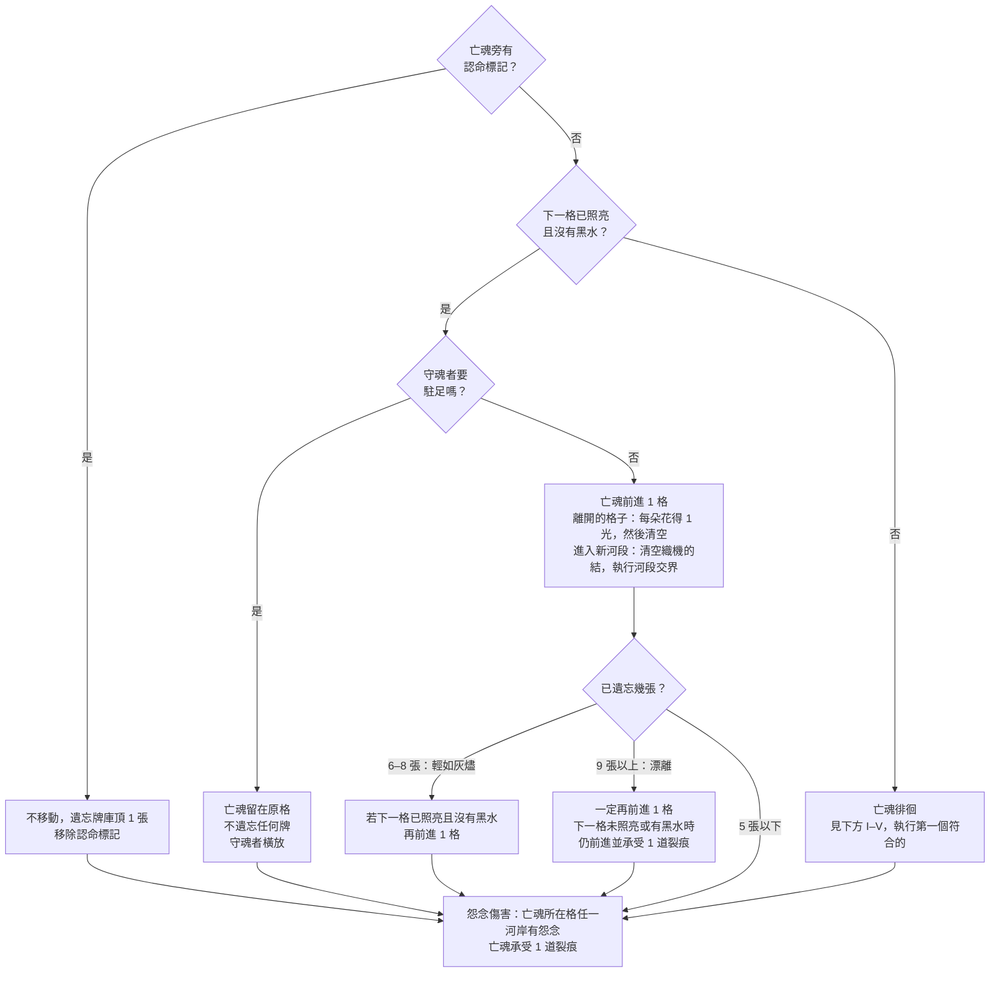

# 《彼岸花渡》Netherbloom — 規則書 V4.0

> V4.0 由 TPE01 試玩（2026-11-02）後的設計討論與模擬整理而成，取代 V3.2（`docs/rules/zh-TW/Rulebook.md`）。各項改動的理由與模擬數據見 `docs/design/V2-proposal.zh-TW.md` 與 `simulator/reports/v2_simulation.zh-TW.md`。V3.2 的插圖尚未更新，本版暫不附圖。

- [1. 故事與目標](#1-故事與目標)
- [2. 遊戲準備](#2-遊戲準備)
- [3. 你的回合](#3-你的回合)
- [4. 回合結束](#4-回合結束)
- [5. 河流、根與花](#5-河流根與花)
- [6. 命運織機與反噬](#6-命運織機與反噬)
- [7. 黑水、怨念與裂痕](#7-黑水怨念與裂痕)
- [8. 光與稱號](#8-光與稱號)
- [9. 憶念之書與託付](#9-憶念之書與託付)
- [10. 河段交界](#10-河段交界)
- [11. 彼岸、守岸人之問與結局](#11-彼岸守岸人之問與結局)
- [12. 亡魂與燈籠](#12-亡魂與燈籠)
- [13. 單人模式與幽靈](#13-單人模式與幽靈)
- [附錄A. 配件](#附錄a-配件)
- [附錄B. 卡牌用語](#附錄b-卡牌用語)
- [附錄C. 迷霧牌](#附錄c-迷霧牌)
- [附錄D. 卡牌參考](#附錄d-卡牌參考)
- [附錄E. 託付卡](#附錄e-託付卡)
- [附錄F. 從 V3.2 到 V4.0](#附錄f-從-v32-到-v40)

## 1. 故事與目標

*凡飲下忘川之水者，終將**遺忘**。*

在生者的世界之下，流淌著一條黑色的河。亡者必須渡過它，才能抵達**彼岸**；一位蒙著面紗的**守岸人**在那裡等候，手中捧著一杯河水。飲下它，一生的重量便悄然滑落。

一位老擺渡人載送亡者渡河，但只載那些下葬時帶著一枚銅錢作為船資的人。其餘的亡魂——**無錢的亡者**——只能獨自在**此岸**醒來，在河岸上遊蕩。霧氣滲入他們，他們開始**遺忘**：先是瑣碎的小事，接著是一張張面孔，最後是自己的名字。忘盡一切的亡魂，便就此消散於霧中。

你們是**擺渡人**：冥府的僕役，既非生者，也非亡魂。老擺渡人不肯載的無錢亡者，便交由你們護送。你們沒有船，卻擁有更為奇異的東西。忘川兩岸生長著**彼岸花**，一種花瓣細長捲曲的赤紅花朵，在光禿的花莖上**綻放**，不見一片葉子，因為*「花葉永不相見」*。它的光芒，是霧中迷途的亡魂唯一能追隨的光。你們在哪裡種下彼岸花，亡魂便能在河中朝彼岸前行。

古老的墓文囑咐亡者：莫飲忘川，要去尋找記憶之泉，並在守衛面前說出自己是誰。亡魂把它最想記住的事託付給你們。記憶只有被說出來，才能被記住；但它的力量屬於亡魂，不屬於你們。

### 遊戲目標

《彼岸花渡》是一款 1 至 4 人的合作遊戲。1 個亡魂從此岸（第 0 格）出發，所有玩家同勝同敗。

亡魂抵達彼岸（第 14 格）時，進行**守岸人之問**（見第 11 節）：你們亮出所有託付卡，若完成的張數達到設定表的要求，**你們獲勝**。

只要發生以下任一情況，你們便立即**落敗**：

- **消散**：遺忘堆的張數達到燈籠的消散門檻。
- **破碎**：亡魂累積 3 道裂痕。
- **滅頂**：必須放置黑水標記，但供應區已沒有黑水。
- **無名**：亡魂抵達彼岸，但完成的託付不足。亡魂答不出自己是誰，飲下了忘川之水。

**提示：遺忘**有利也有弊。許多強力的牌會將牌放進遺忘堆，而**遺忘** 6 張或以上（***輕如灰燼***）時，亡魂會移動得更快；**遺忘** 9 張或以上（***漂離***）時更是如此。但每多**遺忘** 1 張牌，你們就離消散更近一步。

### 隱憶之約

你們可以盡情討論計畫、版圖、織機、憶念之書，以及每個人接下來想怎麼做。

- **可以說**：自己握有哪些絲線、牌上的欄位（地點、人物、事蹟、感受）、牌上寫的記憶文字。例如：「我有一段釋懷的人物：『我的母親，在織布機旁哼著歌』。」
- **不能說**：牌名、效果、**共鳴**；也不能展示手牌。
- **託付卡**：完全秘密。不能說出、討論或暗示自己的託付卡。

## 2. 遊戲準備

先選擇亡魂與燈籠，再依**設定表**（第 12 節）查出第三河段的墳墓數量和要完成的託付張數。

1. **河流圖板。**依序拼接 3 塊圖板：第一河段（第 1–4 格，含此岸）、第二河段（第 5–8 格）、第三河段（第 9–13 格，盡頭是彼岸第 14 格）。每格的左右河岸各有 1 個放板塊的方槽；每個河段的左岸外側有迷霧牌槽與迷霧棄牌框。
2. **河岸板塊。**每個河段分別準備（第 1 格沒有板塊）：
   1. 拿出該河段的墳墓：第一河段 0 塊、第二河段 1 塊、第三河段依設定表 1 或 2 塊。
   2. 把該河段的其他板塊（板塊池，見第 5 節）面朝下洗勻，抽出剛好補滿河岸的數量。
   3. 把墳墓和抽出的板塊放在一起，面朝下洗勻，再隨機放到該河段的河岸上（霧面朝上）。
   4. 沒抽到的板塊不翻開，放回盒中。另外把**備用板塊**（花田 2、沃土 2、記憶之泉 2）面朝上放在一旁，供河段交界時替換（見第 10 節）。
3. **最初的花與亡魂。**在第 1 格兩岸各放 1 個**花指示物**。亡魂標記放在此岸（第 0 格）。
4. **亡魂與燈籠。**亡魂牌面朝上放在圖板旁，特色規則整局有效（見第 12 節）。燈籠決定消散門檻、黑水數量與凶霧數量。
5. **記憶牌庫。**32 張基本記憶牌加上所選亡魂的 8 張專屬記憶牌（「*無名渡河*」改用 8 張迴響牌）洗混，面朝下放在渡帳的牌庫框；旁邊是**棄牌堆**框。
6. **迷霧牌庫。**每個河段各組一副：該河段的基本迷霧牌（附錄 C，第一河段 11 張、第二河段 15 張、第三河段 13 張），加上 1 張「漲水」與 1 張「怨念逼近」，再隨機加入燈籠規定數量的凶霧牌。分別洗混，面朝下放進各河段的迷霧牌槽。剩下的凶霧牌面朝下放在一旁（河段交界時使用）。
7. **命運織機。**擺出織機與三條絲線：執念、釋懷、忘卻。2–3 人時絲線有 4 個結即為打滿；單人或 4 人時為 5 個。迴響標記放在織機的「沉默格」。
8. **稱號。**5 張稱號牌面朝上放在織機下方的稱號列（見第 8 節）。
9. **憶念之書。**將所選亡魂的書翻到第一頁，準備好相角。結局牌面朝下放在一旁，不要翻看（「*無名渡河*」沒有結局牌）。
10. **渡帳。**遺忘軌、裂痕圓圈、黑水供應區（依燈籠）、光池。所選亡魂的起始光放入光池。根／花指示物、怨念、結、裂痕，以及堅守、護盾、認命標記放在供應區。
11. **託付卡。**將所選亡魂的 8 張託付卡洗勻，每位玩家秘密抽 1 張，面朝下放在自己面前，自己可以看。其餘面朝下放在一旁，供重抽使用。
12. **擺渡人。**單人手牌 4 張，2–4 人各 3 張。每人拿 1 個破浪標記，面朝上。起始玩家拿起船槳。單人模式另外洗混 12 張幽靈牌（見第 13 節）。

從此刻起適用隱憶之約，由起始玩家進行第一個回合。

## 3. 你的回合

從拿著船槳的起始玩家開始，玩家依順時針輪流進行回合。輪到你時：

1. **回應之前**（都可選，不佔行動，順序自由）：
   - **召喚稱號**（見第 8 節）。
   - **點亮記憶**：每點亮書上 1 段記憶，支付 1 點光（見第 9 節）。可以點亮多段，也可以點亮之前頁面上的記憶。
   - **重抽託付**（整局一次）：把你的託付卡面朝下移出遊戲，重抽 1 張。
   - 使用收割者的能力，或花環少女的「送花」（見第 8、12 節）。
2. **回應**（你的第一個行動）：打出 1 張牌（**正面打出**、**背面打出**或**焚燒**）、**喚回**或**奮力駛過**。
3. **掌舵**（你的第二個行動）：打出 1 張牌或**奮力駛過**。每回合最多**焚燒**一次。
4. **回合結束**：見第 4 節。

### 打出 1 張牌

- **正面打出**：執行卡牌效果，在織機上該牌的絲線加 1 個結，並將迴響移到該絲線。執念牌與釋懷牌之後放入棄牌堆，或**銘刻**進憶念之書（見第 9 節）；忘卻牌放入遺忘堆。
- **背面打出**：放置 1 個根（見第 5 節），忽略卡牌上印的效果；**若沒有可以放根的位置，改為獲得 1 點光**。不加結，迴響不移動。這張牌面朝上放入棄牌堆。
- **焚燒**（每回合最多一次）：選擇另一位也握有該絲線牌的玩家。你們各將 1 張該絲線的牌面朝下放到桌上，一起翻開。選 1 張：執行它的效果**兩次**，在該絲線加 1 個結，並將迴響移到該絲線。被選中的那張**可以銘刻**（忘卻牌除外，見第 9 節），否則**遺忘**；另一張**遺忘**。另一位玩家立即抽 1 張牌。沒有其他玩家握有同一絲線的牌時，不能**焚燒**。*單人模式：*從手牌**焚燒** 1 張牌：效果兩次、加 1 個結、移動迴響；這張牌可以銘刻，否則**遺忘**；另外**遺忘**牌庫頂的 1 張牌。

### 喚回與奮力駛過

**喚回**（僅限**回應**）：支付 3 點光，將遺忘堆中任一張牌移到棄牌堆。被**遺忘**的關鍵記憶也能被**喚回**。

**奮力駛過**（每位玩家**整局一次**）：只能在下一格的**兩個**河岸都有怨念、且該格沒有黑水時使用。將兩個怨念放回供應區，將亡魂移到該格（照常獲得光），並將你的破浪標記翻到背面。接著亡魂承受 **1 道裂痕**。你的回合照常繼續。

### 迴響與共鳴

迴響放在任何玩家（或幽靈）最後一張**正面打出**或**焚燒**的牌所屬的絲線上。**背面打出**、**喚回**、**奮力駛過**都不會移動迴響。

若你的**回應**是 1 張**正面打出**或**焚燒**、且與迴響同一絲線的牌，它便**共鳴**：另外執行它的**共鳴**效果。標示「改為」的**共鳴**效果會取代一般效果。**掌舵**永遠不會**共鳴**；**回應**是**喚回**或**奮力駛過**時，本回合不會**共鳴**。**焚燒**時，共鳴的是被選來執行兩次的那張牌：效果兩次，**共鳴**效果一次（「改為」的牌例外，執行兩次）。

### 遺忘與兩個牌堆

**遺忘** 1 張牌：把它面朝上放在渡帳遺忘軌的下一個數字上。**遺忘牌庫頂的 1 張牌**：把記憶牌庫頂的 1 張牌直接放到遺忘軌上，不執行它。若有牌離開遺忘堆，將後面的牌往前移。

棄牌堆與遺忘堆都面朝上，任何人都可以查看。記憶牌庫用完時，只有棄牌堆的牌會重新洗入牌庫。

## 4. 回合結束

回合結束的步驟在**每位玩家的回合之後**都要執行。依序進行：

1. **引花人**：若當前玩家持有引花人，可以免費使 1 個根**綻放**。
2. **亡魂行動**：照下面的流程圖進行。
3. **迷霧**：翻開亡魂所在河段迷霧牌庫頂的 1 張牌並執行（破霧者可以先看，見第 8 節；遠方雷聲、困難燈籠的單人第三河段會多翻 1 張）。執行後放入該河段的迷霧棄牌框。牌庫空了時，只把該河段的基本迷霧牌洗混成新牌庫。
4. **整理**：
   - 有黑水、且**兩個**河岸都有根或花的每一格：將黑水移出遊戲（放回盒中）。
   - 若某個怨念同一側河岸的正前一格**與**正後一格都有花：將該怨念放回供應區。
5. **抽牌**，補回手牌上限。
6. **單人模式**：幽靈行動，然後再整理一次。
7. 將船槳傳給左手邊的玩家。

### 亡魂行動

- 每一步都照箭頭走，**只有徘徊（D）**是「依序檢查、執行第一個符合的」：
  - I. 亡魂旁有堅守標記：不**遺忘**。
  - II. 持有守魂者且本輪尚未使用：守魂者橫放，不**遺忘**。
  - III. 亡魂所在格已照亮：不**遺忘**。
  - IV. 亡魂為「*留在冥府的新娘*」且本局尚未使用特色規則：被拉回一格（見第 12 節），不**遺忘**。
  - V. 以上皆非：**遺忘牌庫頂的 1 張**。
- **怨念傷害（E）**每次都要檢查，不論亡魂這次是前進、駐足還是徘徊。
- **漂離（C2）**：守魂者尚未使用時，可以阻止這次額外移動（不移動、不受裂痕）。「*最後火光的孩子*」永遠不會漂離。

### 下一個回合開始時

- 若堅守標記在場，將它移除。
- 你持有的守魂者、破霧者，在你自己的回合開始時轉正。
- 尚未抵銷裂痕的護盾標記，在其擁有者的下一個回合結束時移除；擁有者把守住防線留在面前直到那時，作為提醒。

### 立即生效的效果

絲線打滿時立即引發**反噬**。遊戲在以下時刻立即結束：亡魂抵達彼岸（進行守岸人之問）、遺忘堆達到消散門檻、亡魂承受第 3 道裂痕，或必須放置黑水但供應區已空。

**抵銷裂痕。**亡魂旁有護盾標記，或「*最後火光的孩子*」的特色規則適用時，免除亡魂應承受的那道裂痕：不放置裂痕，也不算承受。

## 5. 河流、根與花

河流共有 15 格：此岸（0）、第 1 至 13 格，以及彼岸（14）。三個河段：**第一河段・日光蘭之路**（第 1–4 格）、**第二河段・哀悼之野**（第 5–8 格）、**第三河段・忘川之岸**（第 9–13 格）。每個河段有自己的迷霧牌庫，也在憶念之書中各佔一頁。

每格有左岸與右岸（面向彼岸的左、右）。每個河岸最多放 1 個指示物（根、花或怨念）。「亡魂前方」指編號比亡魂所在格大的格子；「下一格」指亡魂正前方那一格。

**亡魂永遠不會回到前一個河段。**任何讓亡魂後退的效果，最多退到本河段的第一格。被拉回不算「離開」一格：不得光，也不清空原本那一格。

### 根、花與根網

只要一格中至少有 1 個河岸有花，該格即為**照亮**。

**放置根。**在亡魂所在格或其前方的空河岸放 1 個根。已有怨念的河岸不能放根。該河岸必須**連接根網**，至少符合一項：位於亡魂所在格或下一格；同一格另一岸已有根或花；正前一格或正後一格的同側河岸有根或花。

**綻放。**將亡魂所在格或其前方的 1 個根翻成花。**凋零。**將 1 朵花翻回根；若該格因此沒有花，就不再被照亮。

### 河岸板塊

在霧面的河岸**放置根**時，先把板塊翻開，依種類處理。翻開後的板塊留在原處。

| 板塊 | 效果 |
|---|---|
| **沃土** | 放置根。 |
| **石地** | 只有寫著「即使在石地上也可以」的效果或織根者，才能放根；否則根放回供應區。 |
| **墳墓** | 不放根，改在這個河岸放 1 個怨念。之後也永遠不能在此放根。 |
| **記憶之泉** | 放置根，並可以不必共鳴，把你的 1 張手牌**銘刻**到當前頁面（見第 9 節）。 |
| **花田** | 放置根，並立即**綻放**。 |
| **寒霜** | 放置根。這個河岸的花不會被凋零或黑水翻回根。 |
| **餘燼** | 放置根，並獲得 1 點光。 |
| **迴聲之岩** | 放置根，並可以把迴響移到任一條絲線。 |

沒有板塊的河岸（第 1 格兩岸）視為沃土。

**板塊池**（每個河段抽出補滿河岸的數量，其餘放回盒中）：

| 河段 | 河岸數 | 墳墓 | 板塊池 |
|---|---|---|---|
| 第一 | 6 | 0 | 8 塊抽 6：沃土 4、石地 2、記憶之泉 1、花田 1 |
| 第二 | 8 | 1 | 9 塊抽 7：沃土 3、石地 2、記憶之泉 1、花田 1、寒霜 1、餘燼 1 |
| 第三 | 10 | 1 或 2 | 11 塊抽滿：沃土 4、石地 2、記憶之泉 1、餘燼 1、迴聲之岩 1、花田 1、寒霜 1 |

## 6. 命運織機與反噬

每張**正面打出**或**焚燒**的牌，都在其絲線上加 1 個結。2–3 人時 4 個結打滿；單人或 4 人時 5 個。

絲線打滿時，移除這條絲線的所有結，並執行**反噬**：

- **執念・攫取**：在亡魂所在格放 1 個怨念（左岸優先；兩岸都有或亡魂在此岸時，改放下一格，同樣左岸優先）。要放的河岸上有根或花時，先放回供應區。
- **釋懷・認命**：在亡魂旁放認命標記。下一次亡魂行動中亡魂不移動，並**遺忘**牌庫頂的 1 張；然後移除標記。
- **忘卻・漲潮**：在下一格放 1 個黑水。

亡魂進入新河段的第一格時，移除三條絲線上所有的結。迴響留在原位。

## 7. 黑水、怨念與裂痕

**放置黑水。**黑水只放在亡魂前方。若指定的格子已有黑水，改放它前方第一個沒有黑水的格子；前方都滿時，改放在指定格與亡魂之間、離指定格最近的空格。放置後，該格的花翻回根（寒霜上的花除外）。亡魂不能進入有黑水的格子。必須放黑水但供應區已空時，你們落敗（滅頂）。

**移除黑水。**整理時兩岸都有根或花的黑水格，或寫著「**排乾**」的效果，將黑水移出遊戲（放回盒中）。

**放置怨念。**放在指定的河岸；已有怨念時改放同格另一岸；兩岸都有時往前一格放。要放的河岸上有根或花時，先放回供應區。下一格兩岸都有怨念時，亡魂無法前進，除非有人**奮力駛過**或打出**無光之渡**。

**移除怨念。**整理時同側前後兩格都有花，或寫著「**驅散**」「**沖走**」的效果。

**裂痕**來自怨念傷害、**奮力駛過**、漂離、**無光之渡**走進黑暗，以及凶霧「黑風」。累積 3 道裂痕時你們落敗（破碎）。**守住防線**給予護盾標記，抵銷下一道裂痕。

## 8. 光與稱號

**獲得光。**光是共用資源，放在渡帳的光池。亡魂離開一格時，該格每有 1 朵花得 1 點光，之後那一格被清空。背面打出時無處放根、餘燼板塊、部分卡牌也會給光。

**花費光：**

| 用途 | 費用 | 時機 |
|---|---|---|
| 點亮 1 段記憶 | 1 | 回應之前 |
| 召喚稱號 | 3（國王：2），並棄 1 張同絲線的手牌 | 回應之前 |
| 喚回 | 3 | 作為回應 |

**召喚稱號。**拿取稱號列上的 1 張稱號牌。2–4 人遊戲時，每位玩家最多持有 1 個稱號，持有到遊戲結束（國王的特色規則例外）。單人模式可以更換稱號（見第 13 節）。

| 稱號（絲線） | 效果 | 何時 |
|---|---|---|
| **織根者**（執念） | 你的根可以長在石地上。你每回合第一個「放置根」的效果多放 1 個根。 | 持續 |
| **守魂者**（執念） | **駐足**：每輪一次，亡魂行動時，你可以讓亡魂留在原格，不遺忘任何牌。 | 亡魂行動；用後橫放，你的回合開始時轉正 |
| **引花人**（釋懷） | 你的每個回合結束時，可以免費使 1 個根**綻放**。 | 你的回合結束第 1 步 |
| **破霧者**（忘卻） | **看穿迷霧**：每輪一次，在迷霧步驟之前，查看當前河段迷霧牌庫頂的 1 張，可以放到牌庫底。迷霧牌不是記憶，你可以把看到的告訴大家。 | 迷霧步驟之前；用後橫放 |
| **收割者**（忘卻） | 在你的回合、回應之前，查看記憶牌庫頂的 2 張，可以用其中 0、1 或 2 張替換你的手牌。換下的牌與沒拿的牌，以任意順序放回牌庫頂或牌庫底。 | 你的回合，回應之前 |

- **守魂者的「每輪一次」**：從持有者的回合開始，到其下一個回合開始之間一次；在別人的回合也能使用。駐足可以用在亡魂將要前進時（讓它留下），也可以用在亡魂將要**徘徊**時（不遺忘），或用來阻止漂離的額外移動。

## 9. 憶念之書與託付

憶念之書每個河段一頁：第一頁《我曾是誰》、第二頁《我做過什麼》、第三頁《我所懷抱的》。每頁有四個欄位：**地點**、**人物**、**事蹟**、**感受**。

### 銘刻

**銘刻**是把 1 張牌放進憶念之書對應欄位，而不是放入棄牌堆。銘刻只能寫到亡魂**目前所在河段**那一頁，忘卻牌永遠不能銘刻。可以銘刻的時機：

1. 你**正面打出**的牌**共鳴**時（關鍵記憶只要正面打出就可以）。
2. **焚燒**時被選來執行兩次的那張牌。
3. 在**記憶之泉**放置根時，從手牌選 1 張。

**銘刻時立即朗讀**那張牌上的記憶。新銘刻的記憶是**未點亮**的：用相角斜貼或橫放。

**更換。**欄位已有一段**未點亮**的記憶時，新的記憶可以取代它；被取代的那張**遺忘**。已點亮的記憶與關鍵記憶不能被取代。

### 點亮

在你的回應之前，每支付 1 點光，點亮書上 1 段記憶（轉正）。任何一頁都可以點亮。

- 只有**點亮**的記憶算進託付。
- 點亮的記憶不能被更換，也不會被「記憶剝落」「河水漫過書頁」拿走。

### 託付卡

每張託付卡上半部是亡魂託付給你的一句話，下半部是條件（附錄 E）。條件只用**頁面**、**絲線**、**欄位**，或「**她的專屬記憶**」（該亡魂的 8 張專屬記憶牌）來判斷。

- 你的託付卡是秘密，不能說出、討論或暗示。
- 書上有一段符合條件、而且**已點亮**的記憶，這張託付就完成了。每段點亮的記憶只能完成 1 張託付。
- **重抽**：整局一次，在你的回合、回應之前。
- 指定頁面的託付，只能在那個河段完成（亡魂不會回到前一個河段）。

## 10. 河段交界

亡魂進入新河段的第一格時（清空織機的結之後），依序執行：

**一、看上一頁已銘刻記憶的絲線多數：**

| 上一頁 | 下一河段的板塊 | 下一河段的迷霧 |
|---|---|---|
| 執念較多 | 1 塊石地換成沃土 | 洗入 1 張「怨念」 |
| 釋懷較多 | 1 塊沃土換成花田 | 洗入 1 張「寒風」 |
| 一樣多 | 1 塊板塊換成記憶之泉 | 不變 |
| 沒有記憶 | 不變 | 不變（見下方數量規則） |

**二、看上一頁已銘刻的段數：**

| 段數 | 效果 |
|---|---|
| 0 段 | 洗入 1 張「暗潮回湧」和 1 張一旁的凶霧 |
| 1 段 | 洗入 1 張一旁的凶霧 |
| 2 段 | 不變 |
| 3 段以上 | 1 塊板塊換成記憶之泉 |

- **換哪一塊**：只換**還沒翻開**的板塊。從新河段離亡魂最近的那一格開始找，第一塊符合種類的板塊；同一格左岸優先。換上的板塊從備用板塊拿，**面朝上**放入。找不到符合的就不換。
- 洗入迷霧時，把那張牌和新河段的迷霧牌庫一起洗勻。
- 第三頁沒有「下一段」，由守岸人之問承接。

## 11. 彼岸、守岸人之問與結局

亡魂抵達彼岸（第 14 格）時，遊戲結束：

1. **守岸人之問**：所有人亮出託付卡。依設定表，完成的張數達到要求，**你們獲勝**；否則**落敗（無名）**。
2. **隱憶之約解除**：所有人可以展示手牌、說出牌上的一切。
3. **朗讀憶念之書**：逐頁把四個欄位串成一句話朗讀。空白的欄位讀作「……但這一段，已被河水帶走」。即使落敗也要朗讀。
4. **結局牌**（只在獲勝時）：先看**關鍵記憶**在哪裡：已銘刻於書中、在遺忘堆中，或在其他地方（未曾說出）。再依結局牌上的觸發條件（關鍵記憶的位置與遺忘張數）找出那一張；隱藏結局的條件全部符合時改讀它。

## 12. 亡魂與燈籠

### 燈籠與設定表

| 燈籠 | 消散門檻 | 黑水 | 每河段凶霧 |
|---|---|---|---|
| ◆◇◇ 溫和 | 遺忘 16 張 | 6 | 0 |
| ◆◆◇ 標準 | 遺忘 14 張 | 5 | 2 |
| ◆◆◆ 困難 | 遺忘 12 張 | 4 | 3 |

**設定表**（第三河段的墳墓・要完成的託付）：

| 燈籠 | 1 人 | 2 人 | 3 人 | 4 人 |
|---|---|---|---|---|
| 溫和 | 墳墓 1・託付 1 | 墳墓 1・託付 1 | 墳墓 1・託付 2 | 墳墓 1・託付 3 |
| 標準 | 墳墓 2・託付 1 | 墳墓 1・託付 2 | 墳墓 2・託付 2 | 墳墓 2・託付 3 |
| 困難 | 墳墓 2・託付 1，第三河段每回合翻 2 張迷霧 | 墳墓 2・託付 2 | 墳墓 2・託付 2 | 墳墓 2・託付 3 |

> **你的第一局：**建議以溫和燈籠遊玩**最後火光的孩子**。

### 最後火光的孩子

一年中最寒冷的那一夜，一個小小的孩子獨自蜷在門口，手裡握著一把要賣的小火光，一個也沒賣出去。為了取暖，她把它們一一點亮。每一朵火焰裡，她都看見了些什麼：一座暖爐、一桌盛宴；最後，是那個唯一曾經抱過她的人，前來帶她回家。

**特色規則：**「起始擁有 3 點光。整局遊戲中，第一道裂痕會被忽略。永遠不會漂離。」

- 第一道裂痕被忽略後，將亡魂牌橫放作為記號。
- 永遠不會漂離：遺忘 9 張以上時，仍只適用輕如灰燼。

**關鍵記憶：***她離去前總是抱著我的那個人*。

### 花環少女

一位年輕女子，為她所愛的每一個人都編了一朵花。後來父親死了，那個許諾要娶她的男人變得冷酷，她便將花一朵一朵送了出去，然後仍輕聲唱著歌，滑入了溪水之中。她為自己留下了一朵花，卻從沒有人知道是哪一朵。

**特色規則：**「**送花**：每個河段一次，一位玩家可以在自己的回合、回應之前，把 1 張手牌面朝下交給另一位玩家。」

- 送的人可以說出那張牌的記憶文字，但不能說效果。收的人不另外抽牌；送的人在回合結束時照常補牌。
- 單人模式中沒有作用。

**關鍵記憶：***我唯一留給自己的那朵花*。

### 渡船上的國王

一位年邁的國王，贏下了每一場戰役，唯獨輸了最後一場。他最親近的摯友愛上了他的王后，他的同袍從此分崩離析，而他倒在一片親手造就的戰場上。彌留之際，他被安放在一艘黑色的渡船上。他借來的那柄寶劍，從未歸還給它所來自的那片湖水，因此他始終無法安息。

**特色規則：**「稱號花費 2 點光。造成裂痕的玩家會失去自己的稱號。」

- 在某位玩家的回合中（包括其回合結束的步驟）亡魂承受裂痕時，該玩家失去稱號，稱號放回稱號列，之後可以再被召喚。被護盾抵銷的裂痕不算。

**關鍵記憶：***從湖中伸出、贈我寶劍的那隻手*。

### 留在冥府的新娘

她死在自己的婚禮當天。她的丈夫走進黑暗深處，想把她帶回人間，卻有一個條件：在抵達光明之前，絕不能回頭。距離地面只剩一步時，他轉過了頭。從那以後，她便一直佇立在陰影裡，思量著該記住他的臉，還是放手讓它遠去。

**特色規則：**「起始擁有 1 點光。她第一次將在黑暗中徘徊時，不會遺忘，而是被拉回一格。」

- 只在徘徊步驟 V（原本要遺忘）時觸發，整局一次；使用後將亡魂牌橫放。
- 亡魂在本河段第一格時不能被拉回：照常遺忘，特色規則留到之後再用。
- 隱藏結局需要亡魂整局從未徘徊；第一次徘徊時，將亡魂牌上下顛倒作為提醒。

**關鍵記憶：***他回頭看我那一瞬間的臉*。

### 無名渡河

一個無名的亡魂。你們不會得知它的故事，而是要親手寫下它。

**特色規則：**「起始擁有 2 點光。」它使用 8 張迴響牌，沒有關鍵記憶，也沒有結局牌；託付卡是一組問句，憶念之書就是它的全部故事。

## 13. 單人模式與幽靈

單人模式中，你的手牌為 4 張，織機的絲線有 5 個結才打滿，你持有 1 張託付卡。

**幽靈。**在你的每個回合之後（回合結束步驟 6），翻開幽靈牌庫頂的 1 張並執行，然後在它的絲線上加 1 個結，並把迴響移到該絲線。幽靈牌庫用盡時重新洗混。

**更換稱號。**即使已持有稱號，仍可**召喚**新的稱號；原本的稱號牌翻到背面，再也不能被召喚。每個稱號整局只能被召喚一次，一局最多召喚 3 次。

| 幽靈牌 | × | 行動 |
|---|---|---|
| 執念 | 3 | 在最遠的空河岸扎根 |
| 執念 | 2 | 在最近的空河岸扎根 |
| 釋懷 | 2 | 使最近的根綻放 |
| 釋懷 | 2 | 使最遠的根綻放 |
| 忘卻 | 2 | 驅散最近的怨念，或排乾黑水 |
| 忘卻 | 1 | 不採取行動 |

## 附錄A. 配件

| 配件 | 數量 |
|---|---|
| 記憶牌 | 72：基本 32 張、迴響牌 8 張（無名渡河）、4 套亡魂專屬牌各 8 張 |
| 託付卡 | 40：每位亡魂 8 張 |
| 迷霧牌 | 基本 39 張（第一河段 11、第二河段 15、第三河段 13）、漲水 3、怨念逼近 3、凶霧 11，另加河段交界用的怨念、寒風、暗潮回湧各 1 |
| 河岸板塊 | 34：板塊池 28（含 3 塊墳墓）、備用 6（花田 2、沃土 2、記憶之泉 2） |
| 結局牌 | 19 |
| 亡魂牌／稱號牌／幽靈牌 | 5／5／12 |
| 圖板 | 河流圖板 3 塊（4/4/5）、命運織機 1 塊、渡帳 1 塊（含光池、牌庫與棄牌框、持續效果列） |
| 憶念之書 | 5 本，每位亡魂一本 |
| 根／花指示物（雙面） | 24 |
| 怨念指示物／黑水標記／裂痕 | 8／6／3 |
| 光／結 | 12／15 |
| 迴響、船槳、亡魂（背面為幽靈） | 各 1 |
| 破浪／堅守／護盾／認命標記 | 4／1／1／1 |

（V3.2 的信物牌已移除。）

**桌面配置**：河流圖板放中間；渡帳、織機（下方是稱號列）、憶念之書排在圖板下方；每位玩家面前放手牌、託付卡（面朝下）、破浪標記、稱號與持續中的牌（例如守住防線）。持續效果（堅守、護盾、認命、熄燈、沉默之霧、濃霧蔽眼）放在渡帳的持續效果列。

## 附錄B. 卡牌用語

V3.2 的用語都沿用（放置根、綻放、凋零、照亮、修補、驅散、沖走、排乾、解開結、清空絲線、打結、反噬、亡魂立即前進一格、堅守、護盾、遺忘、遺忘牌庫頂的 1 張、徘徊、召喚稱號、喚回、焚燒、共鳴）。V4.0 新增：

| 用語 | 你要做的事 |
|---|---|
| **銘刻** | 把牌放進目前河段那一頁的對應欄位，並朗讀它的記憶（見第 9 節）。 |
| **點亮** | 支付 1 點光，把書上一段記憶轉正。只有點亮的記憶算進託付。 |
| **未點亮** | 書上斜放或橫放的記憶。可以被更換、記憶剝落、河水漫過書頁拿走。 |
| **託付** | 每位玩家秘密持有的條件卡，亡魂抵達彼岸時檢查。 |
| **駐足** | 守魂者的能力：亡魂留在原格，不遺忘。 |
| **看穿迷霧** | 破霧者的能力：查看迷霧牌庫頂 1 張，可放到底。 |
| **送花** | 花環少女的特色規則：把 1 張手牌面朝下交給另一位玩家。 |
| **進入黑暗** | 無光之渡讓亡魂走進未照亮的格子：承受 1 道裂痕，不得光。 |

## 附錄C. 迷霧牌

**基本迷霧牌**（V3.2 沿用，加上 V4.0 新牌）：

| 迷霧牌 | 河段 | 指示 |
|---|---|---|
| 漲水 | 一、二、三 | 在亡魂前方第 2 格放 1 個黑水（已有黑水時改放下一格）。 |
| 怨念 | 一、二 | 在亡魂前方第 1 格的左岸放 1 個怨念。 |
| 怨念逼近 | 一、二、三 | 在亡魂所在格放 1 個怨念（左岸優先；兩岸都有時改放下一格左岸）。 |
| 凋零 | 一、二、三 | 亡魂前方最遠的 2 朵花凋零。 |
| 霧氣重返 | 一、二 | 將亡魂前方最遠的 1 塊已翻開的空河岸板塊翻回霧面。 |
| 寒風 | 一、二、三 | 遺忘牌庫頂的 1 張。 |
| 迷霧散開 | 一 | 沒有任何效果。 |
| 迴響斷絕 | 二、三 | 將迴響放回織機的沉默格。 |
| 暗流 | 三 | 在亡魂前方第 2 格放 1 個黑水；亡魂前方第 1 格的花凋零。 |
| 雙生怨念 | 三 | 在亡魂前方第 2 格的左岸與右岸各放 1 個怨念。 |
| 大凋零 | 三 | 亡魂前方最遠的 3 朵花凋零。 |
| 刺骨寒風 | 三 | 遺忘牌庫頂的 2 張。 |
| **崩岸**（新） | 一、二 | 亡魂前方最近的 1 個根被沖走，放回供應區。 |
| **暗潮回湧**（新） | 二、三 | 亡魂退回前一格（不退過河段邊界）；已在本河段第一格時，遺忘牌庫頂的 1 張。 |
| **記憶剝落**（新） | 二、三 | 當前頁面最新銘刻、未點亮的記憶移到遺忘堆。 |
| **熄燈**（新） | 二、三 | 直到下一次迷霧前，不能點亮記憶。 |
| **沉默之霧**（新） | 二 | 直到下一次迷霧前，所有人不能說出任何關於手牌的事。 |

**凶霧**（依燈籠加入；其餘放在一旁供河段交界使用）：

| 凶霧 | 指示 |
|---|---|
| 洪水暴漲 | 在亡魂前方第 1 格與第 3 格各放 1 個黑水。 |
| 怨念成群 | 在亡魂前方第 1 格的左岸與右岸各放 1 個怨念。 |
| 凋零風暴 | 亡魂前方第 2 格以外的所有花凋零。 |
| 業力湧現 | 每條絲線各打 1 個結。 |
| 黑風 | 失去 2 點光；光不足 2 點時，改為承受 1 道裂痕。 |
| **河水漫過書頁**（新） | 當前頁面所有未點亮的記憶移到遺忘堆。 |
| **守岸人的凝視**（新） | 下一次河段交界時，數量規則視為少 1 段；在第三河段時，要完成的託付 +1（不超過託付卡張數）。 |
| **濃霧蔽眼**（新） | 直到下一次迷霧前，所有稱號失效。 |
| **寒夜**（新） | 直到你的下一個回合結束前，所有人的手牌上限 −1。 |
| **遠方雷聲**（新） | 這張先放一旁。下一次迷霧翻 2 張並全部執行。 |
| **黑水回流**（新） | 從盒中拿 1 個已移除的黑水放回供應區。 |

（V3.2 的凶霧「深寒」與刺骨寒風重複，已移除。）

## 附錄D. 卡牌參考

V3.2 的卡牌沿用，以下三處改動：

| 卡牌 | 正面打出 | 共鳴 | 改動 |
|---|---|---|---|
| **不復記憶** | 選擇一項：驅散最近的怨念，或排乾最近的黑水。 | 改為：移除最近的 1 個怨念與最近的 1 個黑水。 | 基本牌庫由 3 張減為 2 張 |
| **無光之渡**（新，忘卻） | 亡魂立即前進一格，即使該格未照亮，或兩岸都有怨念（有黑水的格子不行）。不得光；若進入未照亮的格子，亡魂承受 1 道裂痕。 | 獲得 1 點光。 | 取代第 3 張不復記憶 |
| **守夜**（及同效果的迴響牌、花環少女的牌） | 點亮 1 段記憶，不必支付光。 | 放置 1 個根。 | 原效果（查看迷霧牌庫頂 3 張）與破霧者重複 |

## 附錄E. 託付卡

每位具名亡魂 8 張、無名渡河 8 張。條件後的數字是 40 張牌庫中符合的可銘刻牌數（每張至少 5 張）。

**最後火光的孩子**

| 託付的話 | 條件 | 符合 |
|---|---|---|
| 「幫我記得那一夜有多冷。」 | 第一頁有一段點亮的執念記憶 | 16 |
| 「我想記得火光裡看見的人。」 | 一段點亮的人物 | 7 |
| 「告訴我，我是在哪裡睡著的。」 | 第一頁有一段點亮的地點 | 8 |
| 「我點亮的那些小小火光，照見了什麼？」 | 一段點亮的「她的專屬記憶」 | 6 |
| 「那扇結霜的窗後面，是誰的家？」 | 一段點亮的地點 | 8 |
| 「我想知道，我曾經多麼餓。」 | 一段點亮的感受 | 8 |
| 「我做過的事裡，有沒有一件是溫暖的？」 | 第二頁有一段點亮的釋懷記憶 | 14 |
| 「最後，我懷抱著什麼離開？」 | 第三頁有一段點亮的感受 | 8 |

**花環少女**

| 託付的話 | 條件 | 符合 |
|---|---|---|
| 「告訴我，我把花送給了誰。」 | 一段點亮的人物 | 8 |
| 「我曾經唱過的那首歌，還在嗎？」 | 第三頁有一段點亮的感受 | 8 |
| 「那棵垂柳下的溪水，是在哪裡？」 | 一段點亮的地點 | 7 |
| 「我為什麼會恨他？」 | 一段點亮的執念記憶 | 16 |
| 「我編過的花，你還記得幾朵？」 | 一段點亮的「她的專屬記憶」 | 6 |
| 「父親教我認識的那些草藥。」 | 第一頁有一段點亮的釋懷記憶 | 14 |
| 「我做過最傻的一件事。」 | 一段點亮的事蹟 | 7 |
| 「我想帶著一點平靜離開。」 | 第三頁有一段點亮的釋懷記憶 | 14 |

**渡船上的國王**

| 託付的話 | 條件 | 符合 |
|---|---|---|
| 「我最後一場戰役在哪裡？」 | 第二頁有一段點亮的地點 | 7 |
| 「我原諒他們了嗎？」 | 一段點亮的釋懷記憶 | 14 |
| 「那頂王冠有多重？」 | 一段點亮的感受 | 7 |
| 「告訴我，誰曾經真心待我。」 | 一段點亮的釋懷人物 | 5 |
| 「我借來的那把劍……」 | 一段點亮的「他的專屬記憶」 | 6 |
| 「我守住過什麼？」 | 一段點亮的事蹟 | 8 |
| 「我年輕時是什麼樣的人？」 | 第一頁有一段點亮的記憶 | 30 |
| 「最後，我放下了嗎？」 | 第三頁有一段點亮的釋懷記憶 | 14 |

**留在冥府的新娘**

| 託付的話 | 條件 | 符合 |
|---|---|---|
| 「讓我記住他的臉。」 | 一段點亮的人物 | 7 |
| 「讓我放手。」 | 第三頁有一段點亮的釋懷記憶 | 14 |
| 「我們在哪裡成婚？」 | 一段點亮的釋懷記憶 | 14 |
| 「那一道窄窄的階梯。」 | 一段點亮的執念地點 | 5 |
| 「我氣他嗎？」 | 一段點亮的執念記憶 | 16 |
| 「他的手最後的溫度。」 | 一段點亮的「她的專屬記憶」 | 6 |
| 「我跟著他走過的那條路。」 | 第二頁有一段點亮的執念記憶 | 16 |
| 「在婚禮之前，我是誰？」 | 第一頁有一段點亮的記憶 | 30 |

**無名渡河**

| 託付的話 | 條件 | 符合 |
|---|---|---|
| 「他曾經愛過誰？」 | 一段點亮的人物 | 8 |
| 「他最後放不下的是什麼？」 | 第三頁有一段點亮的執念記憶 | 16 |
| 「他從哪裡來？」 | 第一頁有一段點亮的地點 | 8 |
| 「他做過什麼讓自己驕傲的事？」 | 一段點亮的事蹟 | 7 |
| 「他害怕什麼？」 | 一段點亮的感受 | 7 |
| 「他在哪裡找到過平靜？」 | 一段點亮的地點 | 8 |
| 「他後悔過嗎？」 | 第二頁有一段點亮的執念記憶 | 16 |
| 「他帶著什麼渡河？」 | 第三頁有一段點亮的釋懷記憶 | 14 |

## 附錄F. 從 V3.2 到 V4.0

| 項目 | V3.2 | V4.0 |
|---|---|---|
| 河流 | 4/4/3，彼岸第 12 格 | 4/4/5，彼岸第 14 格 |
| 獲勝 | 抵達彼岸 | 抵達彼岸並通過守岸人之問（託付） |
| 落敗 | 消散、破碎、滅頂 | 另加「無名」 |
| 憶念之書 | 共鳴時銘刻；頁面獎勵、章節祝福 | 三種銘刻方式；銘刻時朗讀；點亮（1 光）；可更換未點亮的記憶；無頁面獎勵與章節祝福 |
| 信物 | 記憶之地找到信物 | 移除；記憶之地改為記憶之泉 |
| 隱憶之約 | 只能說絲線 | 可說絲線、欄位、記憶文字；託付完全秘密 |
| 焚燒 | 兩張都遺忘 | 被選中的那張可以銘刻 |
| 背面打出 | 放 1 個根 | 無處放根時改為得 1 光 |
| 奮力駛過 | 裂痕遞增，並遺忘 1 張 | 每次固定 1 道裂痕 |
| 河岸板塊 | 20 塊固定組成 | 板塊池隨機抽取；新增記憶之泉、花田、寒霜、餘燼、迴聲之岩 |
| 河段交界 | 只清空織機 | 依上一頁的絲線與段數改變下一河段 |
| 迷霧 | — | 新增 5 張一般迷霧與 6 張凶霧；移除深寒 |
| 稱號 | 4 個 | 5 個：守魂者改為駐足、破霧者改為看穿迷霧、新增收割者 |
| 燈籠 | 4 級 | 3 級，配合設定表 |
| 孩子 | 每河段第一道裂痕忽略、無凶霧、多遺忘 1 張 | 整局第一道裂痕忽略；有凶霧；無多遺忘 |
| 花環少女 | 3 段就有章節祝福 | 送花 |
| 新娘 | 被拉回一格 | 不會被拉回前一個河段 |
| 無名渡河 | 記憶之地 +2 光 | 起始 2 點光 |
| 卡牌 | 不復記憶 ×3、守夜看迷霧 | 不復記憶 ×2、新增無光之渡、守夜改為免費點亮 |
| 後退 | 無統一規則 | 亡魂永遠不會回到前一個河段 |
