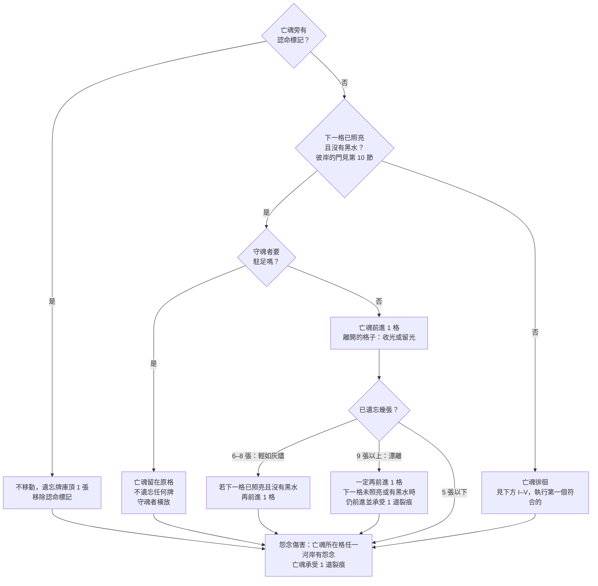

# 《彼岸花渡》Netherbloom — 規則書 V5

> V5 取代 V4.0（`docs/rules/zh-TW/V4.0/Rulebook.md`）。設計理由與模擬數據見 `docs/design/V5-proposal.zh-TW.md`、各亡魂的路線與文字見 `docs/design/V5-storybooks.zh-TW.md`，數值依 `simulator/reports/v5_chapters_simulation.zh-TW.md` §6.9 的最終模擬。本版暫不附圖。

- [1. 故事與目標](#1-故事與目標)
- [2. 遊戲準備](#2-遊戲準備)
- [3. 你的回合](#3-你的回合)
- [4. 回合結束](#4-回合結束)
- [5. 河流：根、花與霧](#5-河流根花與霧)
- [6. 命運織機與反噬](#6-命運織機與反噬)
- [7. 黑水、怨念與裂痕](#7-黑水怨念與裂痕)
- [8. 光與稱號](#8-光與稱號)
- [9. 憶念之書：三章路線](#9-憶念之書三章路線)
- [10. 轉折與翻頁](#10-轉折與翻頁)
- [11. 託付、彼岸與結局](#11-託付彼岸與結局)
- [12. 難度與亡魂](#12-難度與亡魂)
- [13. 單人模式與幽靈](#13-單人模式與幽靈)
- [附錄A. 配件](#附錄a-配件)
- [附錄B. 卡牌用語](#附錄b-卡牌用語)
- [附錄C. 迷霧牌](#附錄c-迷霧牌)
- [附錄D. 卡牌參考](#附錄d-卡牌參考)
- [附錄E. 託付卡](#附錄e-託付卡)
- [附錄F. 從 V4.0 到 V5](#附錄f-從-v40-到-v5)

## 1. 故事與目標

*凡飲下忘川之水者，終將**遺忘**。*

在生者的世界之下，流淌著一條黑色的河。亡者必須渡過它，才能抵達**彼岸**；一位蒙著面紗的**守岸人**在那裡等候，手中捧著一杯河水。飲下它，一生的重量便悄然滑落。

一位老擺渡人載送亡者渡河，但只載那些下葬時帶著一枚銅錢作為船資的人。其餘的亡魂——**無錢的亡者**——只能獨自在**此岸**醒來，在河岸上遊蕩。霧氣滲入他們，他們開始**遺忘**：先是瑣碎的小事，接著是一張張面孔，最後是自己的名字。

你們是**擺渡人**：冥府的僕役，既非生者，也非亡魂。忘川兩岸生長著**彼岸花**，它的光芒是霧中迷途的亡魂唯一能追隨的光。你們在哪裡種下彼岸花，亡魂便能朝彼岸前行。

亡魂一停下，霧就從身後吞掉她走過的路。而她的一生，寫在一本**憶念之書**裡：你們說出的記憶，決定她的故事走向哪裡；故事每翻過一章，河就變得更兇。

### 遊戲目標

《彼岸花渡》是一款 1 至 4 人的合作遊戲。你們同時玩兩個盤面：

- 在**河流**上合作佔住河岸、照亮前路，擋住身後的霧。
- 在**憶念之書**裡，沿著三章的路線寫下亡魂的故事。

亡魂抵達彼岸（第 14 格）時，進行**守岸人之問**（見第 11 節）：完成的託付達到設定表的要求，**你們獲勝**。

只要發生以下任一情況，你們立即**落敗**：

- **消散**：遺忘堆達到消散門檻（見第 12 節）。
- **破碎**：亡魂累積的裂痕達到破碎門檻（溫和 5 道，標準與困難 3 道；見第 12 節）。
- **滅頂**：必須放置黑水，但供應區已沒有黑水。
- **無名**：亡魂抵達彼岸，但完成的託付不足。

**彼岸只在故事說完之後出現：**憶念之書的第三章寫完之前，亡魂不能進入彼岸（見第 10 節「彼岸的門」）。

### 隱憶之約

你們可以盡情討論計畫、河流、織機、憶念之書，以及每個人接下來想怎麼做。

- **可以說**：自己握有哪些絲線、牌上的欄位（地點、人物、事蹟、感受）、牌上寫的記憶文字。
- **不能說**：牌名、效果、**共鳴**；也不能展示手牌。
- **託付卡**：完全秘密。完成並翻開之前，不能說出、討論或暗示。

## 2. 遊戲準備

先選擇亡魂與難度，再依**設定表**（第 12 節）查出第三河段的墳墓數量和要完成的託付張數。

1. **河流圖板。**依序拼接 3 塊圖板：第一河段・日光蘭之路（第 1–4 格，含此岸第 0 格）、第二河段・哀悼之野（第 5–8 格）、第三河段・忘川之岸（第 9–13 格，盡頭是彼岸第 14 格）。第 5 格印著「故事應該寫到第二章」，第 9 格印著「故事應該寫到第三章」：只是提示，沒有規則效果。
2. **河岸板塊。**每個河段分別準備（第 1 格沒有板塊）：
   1. 拿出該河段的墳墓：第一河段 0 塊、第二河段 1 塊、第三河段依設定表 1 或 2 塊。
   2. 把該河段的其他板塊（板塊池，見第 5 節）面朝下洗勻，抽出剛好補滿河岸的數量。
   3. 把墳墓和抽出的板塊一起面朝下洗勻，隨機放到該河段的河岸上（**霧面朝上**）。
   4. 沒抽到的板塊不翻開，放回盒中。**備用板塊**（花田 2、沃土 2、記憶之泉 2）面朝上放在一旁，供命運之霧與迷霧牌替換板塊使用。
3. **最初的花與亡魂。**在第 1 格兩岸各放 1 個**花指示物**。亡魂標記放在此岸（第 0 格）。霧線在第 0 格之後：此時還沒有任何河岸被霧吞沒。
4. **亡魂牌。**亡魂牌面朝上放在圖板旁，特色規則整局有效（見第 12 節）。
5. **記憶牌庫。**32 張基本記憶牌加上所選亡魂的 8 張專屬記憶牌（「*無名渡河*」改用 8 張迴響牌）洗混，面朝下放在渡帳的牌庫框；旁邊是**棄牌堆**框。
6. **迷霧牌庫。**迷霧依章節分三副（附錄 C）：**淺霧**（第一章）、**濃霧**（第二章）、**深霧**（第三章）。每副加入 1 張「漲水」與 1 張「怨念逼近」，再隨機加入 2 張凶霧。分別洗混，面朝下放在一旁。把**淺霧**放進迷霧槽，**翻開頂牌**面朝上放在槽前：這張是「**前方的霧**」，所有人都看得到它的內容；牌庫頂下一張的牌背也看得到（絲線與霧勢）。剩下的凶霧牌放回盒中。
7. **命運織機。**擺出織機，三條絲線：執念、釋懷、忘卻。每條絲線的結軌放 1 個結標記在 0（困難難度放在 1），傷疤軌放 1 個標記在 0。迴響標記放在織機的「沉默格」。
8. **稱號。**5 張稱號牌面朝上放在織機下方的稱號列（見第 8 節）。
9. **憶念之書。**將所選亡魂的書翻到第一章，準備好相角。把該亡魂的 12 張**命運之霧**依章節分成三組（每章 4 張：2 張河流條件、2 張書上條件），從第一章的河流條件與書上條件中各隨機抽 1 張，**條件面朝上**放在書旁；其餘面朝下放在一旁。結局牌面朝下放在一旁，不要翻看（「*無名渡河*」沒有結局牌）。
10. **渡帳。**遺忘軌、裂痕圓圈、黑水供應區（溫和 7 個，標準與困難 6 個）、裂痕圓圈（溫和 5 個，標準與困難 3 個）、光軌（0–12）。所選亡魂的起始光放在光軌上。根／花指示物、怨念、裂痕，以及堅守、護盾、認命標記放在供應區。
11. **託付卡。**將所選亡魂的 8 張託付卡洗勻，每位玩家秘密抽 1 張，面朝下放在自己面前，自己可以看。其餘面朝下放在一旁，供重抽使用。
12. **擺渡人。**手牌：單人 5 張，2–4 人各 3 張。每人拿 1 個破浪標記，面朝上。起始玩家拿起船槳。單人模式另外洗混 12 張幽靈牌（見第 13 節）。

從此刻起適用隱憶之約，由起始玩家進行第一個回合。

## 3. 你的回合

從拿著船槳的起始玩家開始，玩家依順時針輪流進行回合。輪到你時：

1. **引發共鳴之前**（都可選，不佔行動，順序自由）：
   - **召喚稱號**（見第 8 節）。
   - **重抽託付**（整局一次）：把你的託付卡面朝下移出遊戲，重抽 1 張。
   - 使用收割者的能力（見第 8 節）。
2. **引發共鳴**（你的第一個行動）：打出 1 張牌（**正面打出**、**背面打出**或**換牌**），或**喚回**。
3. **製造迴響**（你的第二個行動）：打出 1 張牌（**正面打出**、**背面打出**或**換牌**），或**喚回**。兩個行動合計，每回合最多換牌一次、喚回一次。
4. **點亮與託付**（都可選，在兩個行動之後）：
   - **點亮記憶**：每點亮書上 1 段記憶，支付 1 點光，數量不限。任何一頁都可以，包括這回合剛銘刻的記憶（見第 9 節）。
   - **翻開已完成的託付**（見第 11 節）。
5. **回合結束**：見第 4 節。

任何時候，你都可以使用自由行動**奮力駛過**（見下方）。

### 正面打出

依序執行：

1. 執行卡牌效果。
2. 在這張牌的絲線上加 1 個結（見第 6 節）。
3. 看這張牌打出**之前**，迴響在哪條絲線上：
   - **共鳴**：這是「引發共鳴」行動，而且迴響在同一條絲線上，就另外執行它的**共鳴**效果。標示「改為」的共鳴效果取代一般效果。
   - **迴響銘刻**：不論是哪一個行動，只要迴響在同一條絲線上，你就可以把這張牌**銘刻**到當前路線上欄位相符的空記憶格（見第 9 節），並朗讀它的記憶。
4. 把迴響移到這張牌的絲線。
5. 沒有銘刻的話，執念牌與釋懷牌放入棄牌堆，忘卻牌放入遺忘堆。

**關鍵記憶**只要正面打出，不論迴響在哪裡，都可以銘刻。

> **例子：**迴響在釋懷。你用「引發共鳴」打出一張執念牌：不共鳴、不能迴響銘刻，迴響移到執念。接著用「製造迴響」再打出一張執念牌：迴響已經在執念，所以這張可以銘刻，但它不共鳴（共鳴只屬於「引發共鳴」行動）。

### 背面打出

放置 1 個根（見第 5 節），忽略卡牌上印的效果，並在**這張牌的絲線**上加 1 個結。若沒有可以放根的位置，改為獲得 1 點光（仍要加結）。迴響不移動。這張牌面朝上放入棄牌堆。

### 換牌

用你的 1 張手牌和另一位玩家交換 1 張，並立即**正面打出**換來的牌（照上方步驟執行，包括共鳴與迴響銘刻）。

- 兩張牌不需要同一條絲線。由對方決定給你哪一張；你可以依隱憶之約描述你需要什麼（例如「我需要一段人物」）。
- 每回合最多換牌一次。
- *單人模式：*把 1 張手牌放到記憶牌庫底，翻開牌庫頂的 1 張並立即正面打出。

### 喚回

佔用一個行動，每回合最多一次。支付 **3 點光**，從遺忘堆選 1 張執念或釋懷牌，把它**銘刻**到當前路線上欄位相符的空記憶格，並朗讀它的記憶。這段記憶未點亮。

- 不能寫進還沒走到的格子、關閉的岔路，或之前的章節；沒有相符的空格時不能喚回那張牌。
- 忘卻牌不能喚回。被遺忘的關鍵記憶也可以這樣找回來。
- 喚回不移動迴響，也不加結。

### 奮力駛過（自由行動）

- 不佔用行動：用完之後你仍然有兩個行動。
- 時機：下一格的**兩個**河岸都有怨念，而且該格沒有黑水。
- 效果：將那兩個怨念放回供應區，亡魂移到該格（離開原格時照常選擇收光或留光，見第 4 節），並將你的破浪標記翻到背面。接著亡魂承受 **1 道裂痕**。
- 每位玩家整局一次。不移動迴響。

### 遺忘與兩個牌堆

**遺忘** 1 張牌：把它面朝上放在渡帳遺忘軌的下一個數字上。**遺忘牌庫頂的 1 張**：把記憶牌庫頂的 1 張牌直接放到遺忘軌上，不執行它。有牌離開遺忘堆時，將後面的牌往前移。

棄牌堆與遺忘堆都面朝上，任何人都可以查看。記憶牌庫用完時，只有棄牌堆的牌會重新洗入牌庫。

**輕如灰燼與漂離：**遺忘 6 張或以上時，亡魂會移動得更快；9 張或以上時更是如此（見第 4 節）。但每多遺忘 1 張，就離消散更近一步；遺忘堆也會觸發「忘川的拉力」（見第 10 節）。

## 4. 回合結束

回合結束的步驟在**每位玩家的回合之後**都要執行。依序進行：

1. **引花人**：若當前玩家持有引花人，可以免費使 1 個根**綻放**。
2. **亡魂行動**：照下方的流程圖進行。
3. **怨念推進織機**：亡魂所在格上的每個怨念，依它所在的河岸加 1 個結：
   - 左岸 → 執念
   - 右岸 → 釋懷
   - 霧面河岸上（霧中的怨念）→ 忘卻
4. **迷霧**：
   1. 執行「前方的霧」上的指示。「亡魂前方」從亡魂所在格算起：前方第 1 格就是下一格。
   2. **霧推進**：只在亡魂**這回合沒有前進**時（徘徊、駐足、被認命或被拉回）。推進的格數是這張迷霧牌的**霧勢**，加上難度的加值（見第 12 節）。見第 5 節「霧」。
   3. **檢查籠罩**：亡魂所在格兩岸都是霧面時，亡魂**被迷霧籠罩**：剛執行的迷霧牌不放入棄牌框，而是放上書上的路線，成為**霧痕**（見第 9 節）。困難難度另外承受 1 道裂痕。
   4. 沒有成為霧痕的迷霧牌，放入迷霧棄牌框。翻開迷霧牌庫頂的 1 張，成為新的「前方的霧」。牌庫空了時，把本章那一副的基本迷霧牌（不含凶霧）洗混成新牌庫。
5. **分岔與翻頁**（見第 10 節）：
   - 路線停在轉折前、而且命運之霧已經在 ◆ 上時，現在決定走哪一條路。
   - 路線走到出口時，現在翻頁。
6. **整理**：
   - 有黑水、且**兩個**河岸都有根或花的每一格：將黑水移出遊戲（放回盒中）。
   - 若某個怨念（霧中的怨念除外）同一側河岸的正前一格**與**正後一格都有花：將該怨念放回供應區。
7. **抽牌**，補回手牌上限。
8. **單人模式**：幽靈行動，然後再整理一次。
9. 將船槳傳給左手邊的玩家。

### 亡魂行動

- **離開一格時二選一**（每次亡魂離開一格都要選，包括額外移動、卡牌效果與奮力駛過）：
  - **收光**：那一格每有 1 朵花，得 1 點光；這些花凋零成根。
  - **留光**：不得光，花留在原地。兩岸都是花的格子就是**光牆**（見第 5 節）。
  - 不論哪一種，那一格的根、花與怨念都留在原地，直到被霧吞沒或被移除。
- 只有**徘徊（D）**是「依序檢查、執行第一個符合的」：
  - I. 亡魂旁有堅守標記：不遺忘。
  - II. 持有守魂者且本輪尚未使用：守魂者橫放，不遺忘。
  - III. 亡魂所在格已照亮：不遺忘。
  - IV. 亡魂為「*留在冥府的新娘*」且本局尚未使用特色規則：被拉回一格（見第 12 節），不遺忘。
  - V. 以上皆非：**遺忘牌庫頂的 1 張**。
- **怨念傷害（E）**每次都要檢查，不論亡魂這次是前進、駐足還是徘徊。
- **漂離（C2）**：守魂者尚未使用時，可以阻止這次額外移動（不移動、不受裂痕）。「*最後火光的孩子*」永遠不會漂離。
- **這回合沒有前進**：亡魂這一次亡魂行動沒有前進任何一格時（認命、駐足、徘徊、被拉回），迷霧步驟的霧會推進。

### 下一個回合開始時

- 若堅守標記在場，將它移除。
- 你持有的守魂者、破霧者，在你自己的回合開始時轉正。
- 尚未抵銷裂痕的護盾標記，在其擁有者的下一個回合結束時移除。

### 立即生效的效果

絲線打滿時立即引發**反噬**。命運之霧的條件達成時立即翻開（見第 10 節）。遊戲在以下時刻立即結束：亡魂抵達彼岸（進行守岸人之問）、遺忘堆達到消散門檻、亡魂的裂痕達到破碎門檻，或必須放置黑水但供應區已空。

**抵銷裂痕。**亡魂旁有護盾標記，或「*最後火光的孩子*」的特色規則適用時，免除亡魂應承受的那道裂痕：不放置裂痕，也不算承受。

## 5. 河流：根、花與霧

河流共有 15 格：此岸（0）、第 1 至 13 格，以及彼岸（14）。三個河段只用於準備板塊與名稱：**河段交界沒有任何效果**。

每格有左岸與右岸（面向彼岸的左、右）。每個河岸最多放 1 個指示物（根、花或怨念）。「亡魂前方」指編號比亡魂所在格大的格子；「下一格」指亡魂正前方那一格。

**後退：**任何讓亡魂後退的效果，亡魂永遠不會退回第 1 格之前，也不會退進兩岸都是霧面的格子。被拉回不算「離開」一格：不收光、不留光。

### 根、花與根網

只要一格中至少有 1 個河岸有花，該格即為**照亮**。

**放置根。**在亡魂所在格或其前方的空河岸放 1 個根。已有怨念的河岸不能放根。該河岸必須**連接根網**，至少符合一項：位於亡魂所在格或下一格；同一格另一岸已有根或花；正前一格或正後一格的同側河岸有根或花。

**綻放。**將亡魂所在格或其前方的 1 個根翻成花。只有與亡魂所在格**相連**的根才能綻放（**斷根**：根網被霧或怨念切斷的那一段，不能綻放）。

**凋零。**將 1 朵花翻回根；若該格因此沒有花，就不再被照亮。

**根網就是射程：**驅散、排乾、綻放等效果的目標，要緊鄰一個與亡魂相連的根或花。

### 光牆

同一格兩岸都是花，就是**光牆**：霧不能越過它。

- 霧推進碰到光牆時，剩下的每 1 點霧勢，讓光牆的 1 朵花凋零成根。兩朵都凋零後，光牆就破了，下一點霧勢照常吞沒河岸。
- 光牆不會擋住亡魂，也不擋怨念或黑水。

### 霧

霧是忘川的遺忘本身：亡魂一停下，它就從身後吞掉走過的路。

- **霧線**：遊戲開始時在第 0 格之後。霧從霧線開始，也就是**離亡魂最遠、還沒被霧吞沒的河岸**，一個河岸一個河岸往亡魂的方向推進，同一格**左岸優先**。霧一路追到彼岸，不在河段交界重來。
- **霧推進 N**：依上述順序，把 N 個河岸翻回霧面：
  - 有板塊的河岸：把板塊翻回霧面。沒有板塊的河岸（第 1 格）：放 1 張霧標記（或把該河岸視為霧面，用迷霧牌背作記號）。
  - 河岸上的根、花：放回供應區。
  - 河岸上的怨念：留下，成為**霧中的怨念**：照常推進織機（忘卻），但不能被驅散、沖走或在整理時移除。
  - 黑水在河道上，不受霧影響。
  - 遇到光牆：見上方。
- **奪回**：在霧面的河岸放根（照放置根的規則），照常翻開板塊並依種類處理。霧中的怨念所在的河岸不能放根。
- **霧已逼近**：亡魂所在格有一岸是霧面。這是警告，也是一些命運之霧的條件。
- **被迷霧籠罩**：亡魂所在格兩岸都是霧面（見第 4 節迷霧步驟 3）。

### 河岸板塊

在霧面的河岸**放置根**時，先把板塊翻開，依種類處理。翻開後的板塊留在原處，直到被霧翻回霧面。

| 板塊 | 效果 |
|---|---|
| **沃土** | 放置根。 |
| **石地** | 只有寫著「即使在石地上也可以」的效果或織根者，才能放根；否則根放回供應區。 |
| **墳墓** | 不放根，改在這個河岸放 1 個怨念。之後也永遠不能在此放根。 |
| **記憶之泉** | 放置根，並可以把你的 1 張執念或釋懷手牌**銘刻**到當前路線上欄位相符的空記憶格（不必共鳴）。 |
| **花田** | 放置根，並立即**綻放**。 |
| **寒霜** | 放置根。這個河岸的花不會被凋零或黑水翻回根（霧照常吞沒它）。 |
| **餘燼** | 放置根，並獲得 1 點光。 |
| **迴聲之岩** | 放置根，並可以把迴響移到任一條絲線。 |

沒有板塊的河岸（第 1 格兩岸）視為沃土。被霧翻回霧面、再被奪回的板塊，照種類重新處理（墳墓會再放 1 個怨念）。

**板塊池**（每個河段抽出補滿河岸的數量，其餘放回盒中）：

| 河段 | 河岸數 | 墳墓 | 板塊池 |
|---|---|---|---|
| 第一 | 6 | 0 | 8 塊抽 6：沃土 4、石地 2、記憶之泉 1、花田 1 |
| 第二 | 8 | 1 | 9 塊抽 7：沃土 3、石地 2、記憶之泉 1、花田 1、寒霜 1、餘燼 1 |
| 第三 | 10 | 1 或 2 | 11 塊抽滿：沃土 4、石地 2、記憶之泉 1、餘燼 1、迴聲之岩 1、花田 1、寒霜 1 |

霧面印有符號（魂火、岩紋、土紋），河段圖板印出各符號的組成。

## 6. 命運織機與反噬

### 加結

| 來源 | 加在哪條絲線 |
|---|---|
| 正面打出（包括換牌換來的牌） | 那張牌的絲線 |
| 背面打出 | 那張牌的絲線 |
| 怨念（回合結束步驟 3） | 亡魂所在格的怨念：左岸執念、右岸釋懷、霧面河岸忘卻 |
| 命運之霧 | 卡上寫的絲線 |
| 凶霧「業力湧現」 | 每條絲線各 1 個 |

迷霧牌本身不加結；牌背的絲線只決定霧痕屬於哪條絲線。

### 門檻與傷疤

結軌上的標記到達**門檻**時，那條絲線打滿：立即執行反噬，然後把傷疤標記前進 1 格（最多 2 道），結標記回到 0。

門檻依人數而定，三種難度相同（印在織機上；單人比 2–4 人多 3）：

| 這條絲線的傷疤 | 2–4 人 | 單人 | 打滿時執行 |
|---|---|---|---|
| 0 道 | 7 | 10 | 第一級反噬 |
| 1 道 | 6 | 9 | 第二級反噬 |
| 2 道（上限） | 5 | 8 | 第三級反噬 |

傷疤一旦留下就不會消失。

### 三級反噬

| 絲線 | 第一級 | 第二級 | 第三級 |
|---|---|---|---|
| **執念・攫取** | 亡魂所在格放 1 個怨念 | 前方第 1 格兩岸各放 1 個怨念 | 同第二級，再承受 1 道裂痕 |
| **釋懷・認命** | 認命：在亡魂旁放認命標記。下一次亡魂行動不動，遺忘牌庫頂的 1 張 | 認命，那次共遺忘牌庫頂的 2 張 | 認命，那次共遺忘牌庫頂的 3 張；現在霧推進 2 |
| **忘卻・漲潮** | 下一格放 1 個黑水 | 下一格與前方第 3 格各放 1 個黑水 | 同第二級，再遺忘牌庫頂的 1 張 |

- 第一級執念的怨念：左岸優先；兩岸都有或亡魂在此岸時，改放下一格，同樣左岸優先。要放的河岸上有根或花時，先放回供應區。
- **霧痕升級**：當前這一章的路線上有某條絲線的霧痕時，那條絲線的反噬升一級（最多第三級；同一條絲線有幾張霧痕都只升一級）。霧痕留在書上期間一直有效；翻頁後新的一章重新計算。

### 看得到的時鐘

桌上隨時看得到：三條絲線的結數、門檻與傷疤；下一次反噬是第幾級（含霧痕）；前方的霧的內容與下一張的牌背；這一章兩張命運之霧的條件。請在每個回合開始前，把這些大聲說一遍。

## 7. 黑水、怨念與裂痕

**放置黑水。**黑水只放在亡魂前方。若指定的格子已有黑水，改放它前方第一個沒有黑水的格子；前方都滿時，改放在指定格與亡魂之間、離指定格最近的空格。放置後，該格的花翻回根（寒霜上的花除外）。亡魂不能進入有黑水的格子。必須放黑水但供應區已空時，你們落敗（滅頂）。

**移除黑水。**整理時兩岸都有根或花的黑水格，或寫著「**排乾**」的效果，將黑水移出遊戲（放回盒中）。

**怨念從哪裡來：**墳墓翻開時；執念反噬時；迷霧牌或命運之霧放置時。迷霧牌與命運之霧放的怨念，一律放在**亡魂前方第 1 格**，左岸優先（牌上另有寫明的除外）。

**放置怨念。**放在指定的河岸；已有怨念時改放同格另一岸；兩岸都有時往前一格放。要放的河岸上有根或花時，先放回供應區。怨念不移動，留在原地直到被移除。下一格兩岸都有怨念時，亡魂無法前進，除非有人**奮力駛過**或打出**無光之渡**。

**移除怨念。**整理時同側前後兩格都有花，或寫著「**驅散**」「**沖走**」的效果。霧中的怨念不能被移除。

**裂痕**來自怨念傷害、**奮力駛過**、漂離、**無光之渡**走進黑暗、第三級執念反噬、困難難度的籠罩，以及凶霧「黑風」。裂痕達到破碎門檻時你們落敗（破碎）：溫和 5 道，標準與困難 3 道。**守住防線**給予護盾標記，抵銷下一道裂痕。

## 8. 光與稱號

**獲得光。**光是共用資源，記在渡帳的光軌上（最多 12）。亡魂離開一格時選擇收光，該格每有 1 朵花得 1 點光。背面打出時無處放根、餘燼板塊、部分卡牌與命運之霧也會給光。

**花費光：**

| 用途 | 費用 | 時機 |
|---|---|---|
| 點亮 1 段記憶 | 1 | 點亮與託付（兩個行動之後） |
| 召喚稱號 | 3（國王：2），並棄 1 張同絲線的手牌 | 引發共鳴之前 |
| 喚回 | 3 | 作為一個行動 |

**召喚稱號。**拿取稱號列上的 1 張稱號牌。2–4 人遊戲時，每位玩家最多持有 1 個稱號，持有到遊戲結束（國王的特色規則例外）。單人模式可以更換稱號（見第 13 節）。

| 稱號（絲線） | 效果 | 何時 |
|---|---|---|
| **織根者**（執念） | 你的根可以長在石地上。你每回合第一個「放置根」的效果多放 1 個根。 | 持續 |
| **守魂者**（執念） | **駐足**：每輪一次，亡魂行動時，你可以讓亡魂留在原格，不遺忘任何牌。 | 亡魂行動；用後橫放，你的回合開始時轉正 |
| **引花人**（釋懷） | 你的每個回合結束時，可以免費使 1 個根**綻放**。 | 你的回合結束第 1 步 |
| **破霧者**（忘卻） | **看穿迷霧**：每輪一次，在迷霧步驟之前，查看迷霧牌庫頂的 1 張，可以放到牌庫底。 | 迷霧步驟之前；用後橫放 |
| **收割者**（忘卻） | 在你的回合、引發共鳴之前，查看記憶牌庫頂的 2 張，可以用其中 0、1 或 2 張替換你的手牌。換下的牌與沒拿的牌，以任意順序放回牌庫頂或牌庫底。 | 你的回合，引發共鳴之前 |

駐足用在亡魂將要前進時，亡魂這回合就沒有前進：霧會推進。

## 9. 憶念之書：三章路線

憶念之書有三章。每一頁是一張**路線圖**：格子用箭頭相連，從入口走到出口。各亡魂的路線與文字見故事書。

### 書頁上的符號

| 符號 | 名稱 | 放什麼 | 印了什麼 |
|---|---|---|---|
| ▭ | **記憶格** | 銘刻的記憶牌 | 欄位（地點、人物、事蹟、感受），和一句亡魂用「我」說的話，空白處由記憶牌的文字填入 |
| ▭ | **關口** | 銘刻的記憶牌 | 同記憶格。它是轉折前的最後一個記憶格，可以改變轉折的方向 |
| ⬡ | **迷霧格** | 霧痕（迷霧牌） | 一句旁白 |
| ◇ | **岔路** | 不放東西 | 一個問題；後面每條路第一格的欄位都不同 |
| ◆ | **轉折** | 命運之霧 | 三條箭頭：執念、釋懷、忘卻；旁邊印著本章「忘川的拉力」的門檻 |
| ⬭ | **入口／出口** | — | 一句旁白。入口依上一章走的絲線，三句選一句讀 |

**路線**：從入口開始，經過已填滿的記憶格、迷霧格與已決定的岔路、轉折，一直走到第一個還沒填的記憶格、還沒決定的岔路或轉折，或出口。這一段叫做**當前路線**。

### 銘刻

**銘刻**是把 1 張執念或釋懷牌放進書頁上的記憶格，而不是放入棄牌堆。

- 只能寫進**當前路線上、欄位相符的空記憶格**；不能跳到還沒走到的格子、關閉的路，或之前的章節。
- 當前路線上有兩格以上可以寫時，順序不限。
- **銘刻時立即朗讀**：把格子上的句子連同記憶牌的文字讀出來。
- 新銘刻的記憶是**未點亮**的：用相角斜貼或橫放。
- 忘卻牌永遠不能銘刻。
- **更換**：路線上一段**未點亮**的記憶可以被新的記憶取代（欄位相符）；被取代的那張遺忘。已點亮的記憶與關鍵記憶不能被取代。

可以銘刻的時機：正面打出時的迴響銘刻、關鍵記憶正面打出、喚回、記憶之泉，以及卡牌或命運之霧寫明的效果。

### 岔路 ◇：寫什麼，就走哪條路

- 走到岔路時，路線停在岔路前。
- **第一段寫進岔路後任一格的記憶，決定走哪條路**；其他的路關閉，留白不讀。
- 所以你們是用「寫哪一種記憶」來選故事的方向。手上沒有合適的記憶時，路就停在岔路前，直到有人寫下去（可以換牌、收割或喚回去找）。

### 點亮

在「點亮與託付」步驟，每支付 1 點光，點亮書上 1 段記憶（轉正）。任何一頁都可以。

- 只有**點亮**的記憶算進託付。
- 點亮的記憶不能被更換，也不會被霧痕、「記憶剝落」「河水漫過書頁」拿走。
- 翻頁時，剛結束那一頁點亮了幾段，決定能解開多少結（見第 10 節）。

### 霧痕

亡魂被迷霧籠罩時，剛執行的迷霧牌成為**霧痕**：

- **放在哪裡**：當前路線前方第一個空的迷霧格，並朗讀格子上的旁白和迷霧牌下方的故事句。
  - 前方是還沒決定的岔路時，由當前玩家選一條路放，這也決定了那條路。
  - 前方沒有空的迷霧格時，改為蓋住前方第一個空的記憶格：那一格被霧吞沒，算已填滿。
  - 也沒有空的記憶格時，蓋住一段未點亮的記憶（那張記憶牌遺忘）。
  - 都沒有時，亡魂承受 1 道裂痕。
- **效果**：只要這張霧痕還在本章的路線上，它的絲線（看迷霧牌背，附錄 C）的反噬升一級（見第 6 節）。
- 翻開託付時可以移除一張霧痕（見第 11 節）；被蓋住的記憶格恢復成空格。

## 10. 轉折與翻頁

### 命運之霧

每位亡魂有 12 張命運之霧，每章 4 張：2 張**河流條件**、2 張**書上條件**。每張的正面寫著條件與預兆，背面寫著事件、效果與它指向的絲線。

- **開始一章時**：從該章的河流條件與書上條件中各隨機抽 1 張，**條件面朝上**放在書旁。兩張的條件所有人都看得到：你們可以主動去完成。
- **轉折**：兩張中**先達成條件的那一張**立即翻開，朗讀事件並執行效果，然後放到路線上的 ◆。另一張放回盒中。同時達成時，由當前玩家選一張。
  - 路線還沒走到 ◆ 也可以觸發：牌先放在 ◆ 上等著。
  - 路線走到 ◆ 時命運之霧還沒觸發，路就停在 ◆ 前，直到觸發。
  - 條件裡的「本章」從翻開這一章的入口算起；「本頁」指這一章的書頁。

### 分岔：命運，加上她清楚記得的事

路線走到 ◆、而且命運之霧已經在上面時，**在那一回合的回合結束步驟 5** 決定走哪一條路。這樣你們可以在同一回合的「點亮與託付」先點亮關口。

1. **忘川的拉力**：遺忘堆已經達到本章的門檻（第一章 3 張、第二章 5 張、第三章 7 張）時，她走**忘卻**的路，不看命運之霧，關口點亮的記憶也拉不回來。
   - 河水同時帶走遺忘堆裡的 **2 張牌，永遠移出遊戲**（放回盒中，不回棄牌堆，不會再回到記憶牌庫）。由你們選哪 2 張。**關鍵記憶永遠不會被帶走**：它最接近亡魂的本質。
   - 這次分岔算順命，不算違抗。
2. 否則看關口：

| 關口的狀態 | 走哪一條路 |
|---|---|
| 空著，或記憶未點亮 | 命運之霧的絲線 |
| 有**點亮**的記憶，絲線和命運之霧不同 | 二選一：命運之霧的絲線，或關口那段記憶的絲線 |
| 有點亮的記憶，絲線相同 | 那條絲線 |

- 忘卻牌不能銘刻，所以關口只能把路改成執念或釋懷；忘卻只能由命運之霧或忘川的拉力帶來。
- 命運之霧留在 ◆ 上。實際走的路和它的絲線不同時，她就**違抗了一次命運**（見第 11 節）。
- 新娘第三章的轉折沒有關口：只看命運之霧（和忘川的拉力）。

### 彼岸的門

- 第三章寫完之前，亡魂不能進入彼岸：第 13 格的下一格（彼岸）視為**未照亮**。
- **在門前徘徊**（亡魂在第 13 格徘徊時）：
  - 本章的轉折還沒發生：立即強制轉折，從兩張命運之霧中選一張翻開執行。
  - 已經轉折：本章直接結束，路線上剩下的空格留白，在這個回合結束時翻頁。
- 河流圖板第 5、9 格的提示：亡魂越過提示格、書還落後時，就該先推進故事。

### 翻頁

路線走到出口的那個回合（出口前最後一個記憶格被填滿或被霧蓋住），在回合結束步驟 5 依序執行：

1. **朗讀這一章**：入口 → 路線上的每一格 → 出口。
2. **依點亮數解結**：看剛結束那一頁點亮了幾段記憶，解開對應數量的結，由你們自由分配到任何絲線。解不完的結帶進下一章；傷疤不會治療。

   | 本頁點亮 | 0 段 | 1 段 | 2 段 | 3 段 |
   |---|---|---|---|---|
   | 解開的結 | 0 | 3 | 6 | 9 |

3. **加深迷霧**：把迷霧槽裡剩下的牌庫換成下一章的那一副，洗勻。已經翻開的「前方的霧」不換。
4. **根網特性**：看剛結束那一頁的點亮記憶，下一章整章有效：
   - 執念較多：**根深**。霧翻回霧面時，根留在原地。
   - 釋懷較多：**花開蔓延**。每回合第一次綻放時，可以讓一個相鄰的根也綻放。
   - 一樣多，或沒有點亮記憶：沒有特性。
5. **準備下一章的轉折**：從下一章的河流條件與書上條件各抽 1 張，條件面朝上。
6. **翻到下一章**，朗讀依上一章實際走的絲線的入口句。

**第三章**寫完時沒有下一頁：朗讀第三章，然後**彼岸出現**（第 13 格的下一格恢復正常）。

## 11. 託付、彼岸與結局

### 託付卡

每張託付卡上半部是亡魂託付給你的一句話，下半部是條件（附錄 E）。條件只用**頁面**（章節）、**絲線**、**欄位**，或「**她的專屬記憶**」（該亡魂的 8 張專屬記憶牌）來判斷。

- 書上有一段符合條件、而且**已點亮**的記憶，這張託付就完成了。每段點亮的記憶只能完成 1 張託付。
- 指定頁面的託付，只能在那一章完成。
- **提前翻開**：託付完成後，你可以在自己回合的「點亮與託付」步驟翻開它，朗讀亡魂的那句話，再選一項：
  - 解開織機上 2 個結（任選絲線）；
  - 移除路線上 1 張霧痕；
  - **改寫分岔**：本章的轉折，可以改走任一條絲線。改走的路和命運之霧不同時，仍算違抗。
- 那段記憶之後不能再完成別的託付。翻開前仍然要保密。

### 守岸人之問

亡魂抵達彼岸（第 14 格）時，遊戲結束：

1. **守岸人之問**：所有人亮出託付卡。已翻開的託付直接算完成。依設定表，完成的張數達到要求，**你們獲勝**；否則**落敗（無名）**。
2. **隱憶之約解除**：所有人可以展示手牌、說出牌上的一切。
3. **朗讀憶念之書**：從第一章的入口讀到第三章的出口。空的記憶格讀作「……但這一段，已經被河水帶走了。」迷霧格只在有霧痕時才讀。關閉的路不讀。即使落敗也要朗讀。
4. **結局**（只在獲勝時）。

### 結局

依序朗讀（「*無名渡河*」只讀第 1、2 段的通用句，見故事書）：

1. **結局**：看三章實際走的路。兩章以上同一條絲線，讀那條絲線的結局（**執念**、**釋懷**、**忘卻**）；三章都不同，讀**交織**結局。
2. **順命或逆命**：數一數 ◆ 上的命運之霧和實際走的路不同的章數。從未違抗讀「順命」那一句；違抗 1 次以上讀「逆命」那一句。
3. **關鍵記憶的結尾**：關鍵記憶銘刻在書上、在遺忘堆中，或在其他地方（未曾說出），三選一。被河水帶走的不算，因為關鍵記憶永遠不會被帶走。
4. **隱藏結局**：每位亡魂一個，條件印在結局牌背面。條件全部符合時，改讀它。

## 12. 難度與亡魂

### 難度

| 難度 | 霧推進時霧勢 | 被迷霧籠罩 | 起始結 | 消散門檻 | 破碎 | 黑水 | 模擬勝率 |
|---|---|---|---|---|---|---|---|
| ◆◇◇ 溫和 | +0 | 只留霧痕 | 0 | 遺忘 14 張 | 5 道裂痕 | 7 | 55% |
| ◆◆◇ 標準 | +1 | 只留霧痕 | 0 | 遺忘 12 張 | 4 道裂痕 | 6 | 48% |
| ◆◆◆ 困難 | +1 | 留霧痕，並承受 1 道裂痕 | 每條絲線 1 結 | 遺忘 12 張 | 3 道裂痕 | 6 | 38% |

三種難度都用：織機門檻 7 結（單人 10 結，見第 6 節）、每副迷霧加 2 張凶霧。模擬勝率依人數約為：溫和 45／50／63／63%、標準 39／43／55／56%、困難 32／30／42／47%（單人／2／3／4 人）。每局約反噬 2 次。

**設定表**（第三河段的墳墓・要完成的託付，三種難度相同）：

| 1 人 | 2 人 | 3 人 | 4 人 |
|---|---|---|---|
| 墳墓 2・託付 1 | 墳墓 1・託付 2 | 墳墓 2・託付 2 | 墳墓 2・託付 3 |

> **你的第一局：**建議以溫和難度遊玩**最後火光的孩子**。

### 最後火光的孩子

一年中最寒冷的那一夜，一個小小的孩子獨自蜷在門口，手裡握著一把要賣的小火光，一個也沒賣出去。為了取暖，她把它們一一點亮。每一朵火焰裡，她都看見了些什麼：一座暖爐、一桌盛宴；最後，是那個唯一曾經抱過她的人，前來帶她回家。

**特色規則：**「起始擁有 3 點光。整局遊戲中，第一道裂痕會被忽略。永遠不會漂離。」

- 第一道裂痕被忽略後，將亡魂牌橫放作為記號。
- 永遠不會漂離：遺忘 9 張以上時，仍只適用輕如灰燼。

**關鍵記憶：***她離去前總是抱著我的那個人*（釋懷・人物）。

### 花環少女

一位年輕女子，為她所愛的每一個人都編了一朵花。後來父親死了，那個許諾要娶她的男人變得冷酷，她便將花一朵一朵送了出去，然後仍輕聲唱著歌，滑入了溪水之中。她為自己留下了一朵花，卻從沒有人知道是哪一朵。

**特色規則：散花。**「亡魂離開一格時，那一格只要有 1 朵花，就可以留成光牆；只有一朵花的光牆只擋 1 點霧勢。」

- 留光時，只有一朵花的格子也算光牆。霧碰到它時，第 1 點霧勢讓那朵花凋零，光牆就破了。
- 故事：她一路走，一路把花送出去。

**關鍵記憶：***我唯一留給自己的那朵花*（釋懷・感受）。

### 渡船上的國王

一位年邁的國王，贏下了每一場戰役，唯獨輸了最後一場。他最親近的摯友愛上了他的王后，他的同袍從此分崩離析，而他倒在一片親手造就的戰場上。彌留之際，他被安放在一艘黑色的渡船上。他借來的那柄寶劍，從未歸還給它所來自的那片湖水，因此他始終無法安息。

**特色規則：**「稱號花費 2 點光。造成裂痕的玩家會失去自己的稱號。」

- 在某位玩家的回合中（包括其回合結束的步驟）亡魂承受裂痕時，該玩家失去稱號，稱號放回稱號列，之後可以再被召喚。被護盾抵銷的裂痕不算。

**關鍵記憶：***從湖中伸出、贈我寶劍的那隻手*（釋懷・人物）。

### 留在冥府的新娘

她死在自己的婚禮當天。她的丈夫走進黑暗深處，想把她帶回人間，卻有一個條件：在抵達光明之前，絕不能回頭。距離地面只剩一步時，他轉過了頭。從那以後，她便一直佇立在陰影裡，思量著該記住他的臉，還是放手讓它遠去。

**特色規則：**「起始擁有 1 點光。她第一次將在黑暗中徘徊時，不會遺忘，而是被拉回一格。」

- 只在徘徊步驟 V（原本要遺忘）時觸發，整局一次；使用後將亡魂牌橫放。
- 被拉回也算「這回合沒有前進」，所以霧會推進：她被拉回黑暗。
- 亡魂在第 1 格，或前一格兩岸都是霧面時，不能被拉回：照常遺忘，特色規則留到之後再用。
- 她的隱藏結局需要整局沒有因為徘徊而遺忘任何一張牌；第一次因徘徊而遺忘時，將亡魂牌上下顛倒作為提醒。

**關鍵記憶：***他回頭看我那一瞬間的臉*（釋懷・人物）。

### 無名渡河

一個無名的亡魂。你們不會得知它的故事，而是要親手寫下它。

**特色規則：**「起始擁有 2 點光。」它使用 8 張迴響牌，沒有關鍵記憶，也沒有結局牌；託付卡是一組問句，憶念之書就是它的全部故事。

## 13. 單人模式與幽靈

單人模式中，你的手牌為 **5 張**，織機的門檻比 2–4 人多 3（10，每道傷疤 −1），你持有 1 張託付卡。換牌改為與記憶牌庫交換（見第 3 節）。

**幽靈。**在你的每個回合之後（回合結束步驟 8），翻開幽靈牌庫頂的 1 張並執行，然後在它的絲線上加 1 個結，並把迴響移到該絲線。幽靈牌庫用盡時重新洗混。

**更換稱號。**即使已持有稱號，仍可召喚新的稱號；原本的稱號牌翻到背面，再也不能被召喚。每個稱號整局只能被召喚一次，一局最多召喚 3 次。

| 幽靈牌 | × | 行動 |
|---|---|---|
| 執念 | 3 | 在最遠的空河岸扎根 |
| 執念 | 2 | 在最近的空河岸扎根 |
| 釋懷 | 2 | 使最近的根綻放 |
| 釋懷 | 2 | 使最遠的根綻放 |
| 忘卻 | 2 | 驅散最近的怨念，或排乾黑水 |
| 忘卻 | 1 | 不採取行動 |

## 附錄A. 配件

| 配件 | 數量 |
|---|---|
| 記憶牌 | 72：基本 32 張、迴響牌 8 張（無名渡河）、4 套亡魂專屬牌各 8 張 |
| 命運之霧 | 60：每位亡魂 12 張（每章河流條件 2、書上條件 2） |
| 託付卡 | 40：每位亡魂 8 張 |
| 迷霧牌 | 淺霧 11、濃霧 15、深霧 13、漲水 3、怨念逼近 3、凶霧 11 |
| 河岸板塊 | 34：板塊池 28（含 3 塊墳墓）、備用 6（花田 2、沃土 2、記憶之泉 2） |
| 結局牌 | 每位具名亡魂：執念、釋懷、忘卻、交織、隱藏結局各 1 張 |
| 亡魂牌／稱號牌／幽靈牌 | 5／5／12 |
| 圖板 | 河流圖板 3 塊（4/4/5）、命運織機 1 塊（結軌、傷疤軌、反噬表）、渡帳 1 塊（遺忘軌、裂痕圓圈、黑水供應區、光軌 0–12、牌庫與棄牌框） |
| 憶念之書 | 5 本，每位亡魂一本，每本三章路線圖 |
| 根／花指示物（雙面） | 24 |
| 怨念指示物／黑水標記／裂痕 | 8／7／5 |
| 結標記／傷疤標記／光標記 | 3／3／1 |
| 迴響、船槳、亡魂（背面為幽靈） | 各 1 |
| 破浪／堅守／護盾／認命標記 | 4／1／1／1 |

模擬中，河上同時最多 24 個根／花指示物，95% 的局不超過 20 個。

**桌面配置**：河流圖板放中間；渡帳、織機（下方是稱號列）、憶念之書與兩張命運之霧排在圖板下方；迷霧槽在河流圖板旁。每位玩家面前放手牌、託付卡（面朝下）、破浪標記、稱號與持續中的牌。

## 附錄B. 卡牌用語

V4.0 的用語都沿用（放置根、綻放、凋零、照亮、修補、驅散、沖走、排乾、解開結、打結、反噬、亡魂立即前進一格、堅守、護盾、遺忘、遺忘牌庫頂的 1 張、徘徊、召喚稱號、喚回、共鳴、銘刻、點亮、未點亮、託付、駐足、看穿迷霧、進入黑暗）。V5 新增或改變：

| 用語 | 你要做的事 |
|---|---|
| **引發共鳴／製造迴響** | 你的第一個與第二個行動（取代回應與掌舵）。 |
| **換牌** | 和另一位玩家交換 1 張手牌，立即正面打出換來的牌（取代焚燒）。 |
| **迴響銘刻** | 正面打出時迴響已在同一條絲線上：可以銘刻這張牌。 |
| **收光／留光** | 亡魂離開一格時二選一：拿走花的光，或把花留下。 |
| **光牆** | 兩岸都是花的格子，擋住霧；每擋 1 點霧勢凋零 1 朵花。 |
| **霧推進 N** | 從霧線開始，把 N 個河岸翻回霧面（見第 5 節）。 |
| **霧勢** | 迷霧牌正面與牌背印的數字：霧推進時推進幾個河岸。 |
| **霧已逼近／被迷霧籠罩** | 亡魂所在格有一岸／兩岸是霧面。 |
| **霧痕** | 被籠罩時放上路線的迷霧牌；它的絲線下一次反噬升一級。 |
| **傷疤** | 絲線打滿後留下；每道讓門檻 −1，反噬升一級。 |
| **轉折／命運之霧** | 每章一次，決定故事走哪條絲線。 |
| **忘川的拉力** | 分岔時遺忘堆達到門檻：走忘卻，河水帶走 2 張遺忘的牌。 |
| **違抗命運** | 實際走的路和 ◆ 上命運之霧的絲線不同。 |
| **翻頁** | 路線走到出口：解結、加深迷霧、根網特性、新的轉折。 |
| **彼岸的門** | 第三章寫完之前，彼岸視為未照亮。 |

## 附錄C. 迷霧牌

每張迷霧牌的正面與牌背都印著**絲線**（霧痕屬於哪條絲線）與**霧勢**（霧推進幾個河岸）。牌庫頂的牌背所有人都看得到。

| 迷霧牌 | 淺霧 | 濃霧 | 深霧 | 絲線 | 霧勢 | 指示 |
|---|---|---|---|---|---|---|
| 漲水 | 3 | 3 | 3 | 忘卻 | 1 | 在亡魂前方第 2 格放 1 個黑水。 |
| 怨念 | 2 | 2 | — | 執念 | 1 | 在亡魂前方第 1 格放 1 個怨念。 |
| 怨念逼近 | 2 | 2 | 2 | 執念 | 1 | 在亡魂所在格放 1 個怨念（左岸優先；兩岸都有時改放下一格）。 |
| 凋零 | 1 | 2 | 1 | 釋懷 | 1 | 亡魂前方最遠的 2 朵花凋零。 |
| 霧氣重返 | 1 | 1 | — | 忘卻 | 2 | 將亡魂前方最遠的 1 塊已翻開的空河岸板塊翻回霧面。 |
| 寒風 | 1 | 1 | 1 | 忘卻 | 1 | 遺忘牌庫頂的 1 張。 |
| 迷霧散開 | 2 | — | — | 釋懷 | 0 | 沒有任何效果。 |
| 崩岸 | 1 | 1 | — | 執念 | 1 | 亡魂前方最近的 1 個根被沖走，放回供應區。 |
| 迴響斷絕 | — | 1 | 1 | 釋懷 | 1 | 將迴響放回織機的沉默格。 |
| 暗潮回湧 | — | 1 | 1 | 忘卻 | 2 | 亡魂退回前一格（見第 5 節「後退」）；不能後退時，遺忘牌庫頂的 1 張。 |
| 記憶剝落 | — | 1 | 1 | 釋懷 | 1 | 當前頁面最新銘刻、未點亮的記憶移到遺忘堆。 |
| 熄燈 | — | 1 | 1 | 釋懷 | 1 | 直到下一次迷霧前，不能點亮記憶。 |
| 沉默之霧 | — | 1 | — | 釋懷 | 1 | 直到下一次迷霧前，所有人不能說出任何關於手牌的事。 |
| 暗流 | — | — | 1 | 忘卻 | 1 | 在亡魂前方第 2 格放 1 個黑水；亡魂前方第 1 格的花凋零。 |
| 雙生怨念 | — | — | 1 | 執念 | 1 | 在亡魂前方第 2 格的左岸與右岸各放 1 個怨念。 |
| 大凋零 | — | — | 1 | 釋懷 | 1 | 亡魂前方最遠的 3 朵花凋零。 |
| 刺骨寒風 | — | — | 1 | 忘卻 | 1 | 遺忘牌庫頂的 2 張。 |
| **張數** | **13** | **17** | **15** | | | 含準備時加入的漲水與怨念逼近各 1；另加 2 張凶霧。 |

**凶霧**（每副隨機加入 2 張，其餘放回盒中）：

| 凶霧 | 絲線 | 霧勢 | 指示 |
|---|---|---|---|
| 洪水暴漲 | 忘卻 | 1 | 在亡魂前方第 1 格與第 3 格各放 1 個黑水。 |
| 怨念成群 | 執念 | 1 | 在亡魂前方第 1 格的左岸與右岸各放 1 個怨念。 |
| 凋零風暴 | 釋懷 | 2 | 亡魂前方第 2 格以外的所有花凋零。 |
| 業力湧現 | — | 2 | 每條絲線各打 1 個結。成為霧痕時算忘卻。 |
| 黑風 | 執念 | 2 | 失去 2 點光；光不足 2 點時，改為承受 1 道裂痕。 |
| 河水漫過書頁 | 釋懷 | 2 | 當前頁面所有未點亮的記憶移到遺忘堆。 |
| 守岸人的凝視 | 執念 | 1 | 下一次翻頁時，本頁點亮數視為少 1 段；在第三章時，要完成的託付 +1（不超過託付卡張數）。 |
| 濃霧蔽眼 | 執念 | 2 | 直到下一次迷霧前，所有稱號失效。 |
| 寒夜 | 釋懷 | 1 | 直到你的下一個回合結束前，所有人的手牌上限 −1。 |
| 遠方雷聲 | 忘卻 | 2 | 這張先放一旁。下一次迷霧翻 2 張並全部執行（霧勢取較大的一張）。 |
| 黑水回流 | 忘卻 | 1 | 從盒中拿 1 個已移除的黑水放回供應區。 |

## 附錄D. 卡牌參考

V4.0 的卡牌沿用。V5 改變的是打出方式（背面打出加結、換牌取代焚燒、迴響銘刻），卡牌文字不變。提醒：

| 卡牌 | 正面打出 | 共鳴 |
|---|---|---|
| **不復記憶** | 選擇一項：驅散最近的怨念，或排乾最近的黑水。 | 改為：移除最近的 1 個怨念與最近的 1 個黑水。 |
| **無光之渡**（忘卻） | 亡魂立即前進一格，即使該格未照亮，或兩岸都有怨念（有黑水的格子不行）。不得光；若進入未照亮的格子，亡魂承受 1 道裂痕。 | 獲得 1 點光。 |
| **守夜** | 點亮 1 段記憶，不必支付光。 | 放置 1 個根。 |

卡牌上「最近的」怨念、黑水或根，只算根網所及的目標（見第 5 節）。

## 附錄E. 託付卡

同 V4.0 附錄 E（每位亡魂 8 張）。「第一頁、第二頁、第三頁」即第一、二、三章。

## 附錄F. 從 V4.0 到 V5

| 項目 | V4.0 | V5 |
|---|---|---|
| 難度如何前進 | 跟著位置（河段） | 跟著故事（章節）；河段交界沒有效果 |
| 迷霧 | 依河段三副，翻開就執行 | 依章節分淺霧、濃霧、深霧；前方的霧面朝上，下一張看得到牌背 |
| 霧 | 只是迷霧牌 | 亡魂沒有前進時從身後吞掉河岸，追上就籠罩 |
| 離開一格 | 收光並清空 | 收光或留光；兩岸都是花就是光牆 |
| 根網 | 效果指定「最近的」 | 根網所及、斷根、光牆、根網特性 |
| 怨念 | 迷霧隨機放置 | 放在前方第 1 格，不移動，依所在河岸推進不同絲線 |
| 織機 | 4／5 結打滿，交界時清空 | 7 結打滿（單人 10）；傷疤與三級反噬；翻頁時依點亮數解 3／6／9 結 |
| 行動 | 回應、掌舵 | 引發共鳴、製造迴響；點亮在兩個行動之後 |
| 銘刻 | 共鳴的牌 | 共鳴或迴響銘刻；只能寫進當前路線上的格子 |
| 背面打出 | 不加結 | 加 1 個結 |
| 焚燒 | 兩人各出 1 張同絲線的牌 | 換牌 |
| 喚回 | 3 光把遺忘的牌移回棄牌堆 | 3 光把遺忘的牌銘刻回路線上 |
| 奮力駛過 | 佔用一個行動 | 自由行動 |
| 憶念之書 | 每頁四欄 | 三章路線圖：岔路、轉折、迷霧格 |
| 亡魂專屬事件 | 無 | 每章一個轉折（命運之霧） |
| 忘卻 | — | 忘川的拉力：遺忘 3／5／7 張時分岔走忘卻，河水帶走 2 張 |
| 結局 | 依關鍵記憶與遺忘張數 | 依三章走的路（含交織）、順命或逆命、關鍵記憶 |
| 託付 | 抵達彼岸時檢查 | 可以提前翻開，換解結、移除霧痕或改寫分岔 |
| 彼岸 | 隨時可抵達 | 第三章寫完才出現 |
| 單人 | 手牌 4 張 | 手牌 5 張；換牌改為與牌庫交換 |
| 燈籠 | 三級，調消散、黑水、凶霧 | 三種難度，調霧勢、籠罩裂痕、起始結、消散、破碎與黑水；織機門檻都是 7（單人 10） |
| 花環少女 | 送花 | 散花 |
