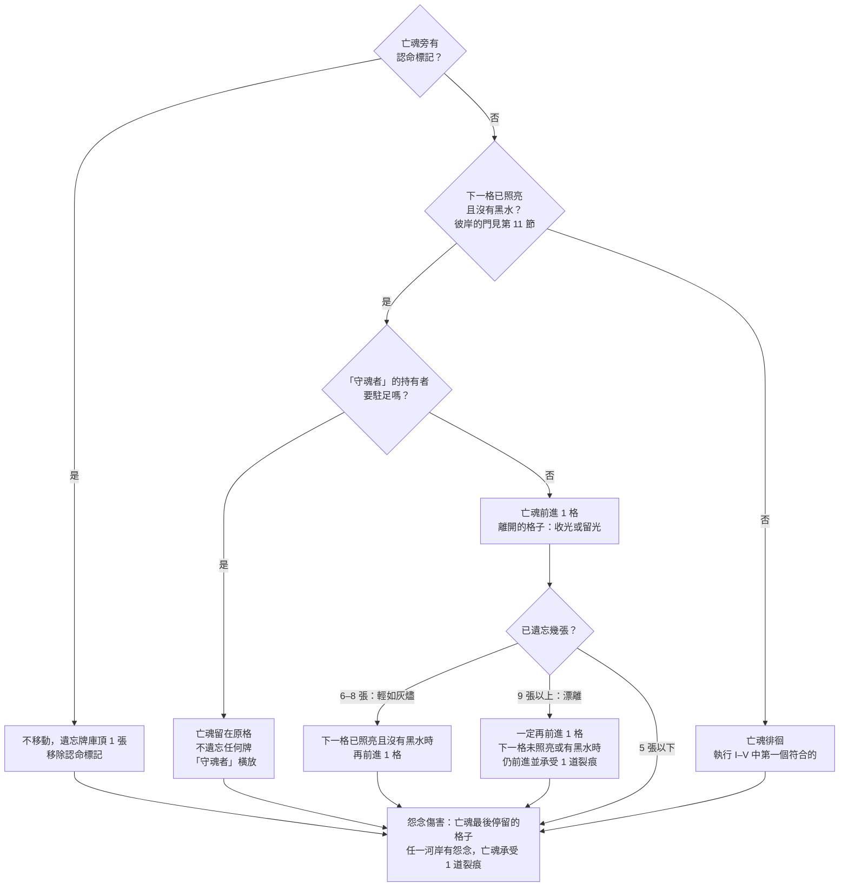

# 《彼岸花渡》Netherbloom — 規則書 V5

> 設計理由見 `docs/design/V5-proposal.zh-TW.md`，各亡魂的路線與文字見 `docs/design/V5-storybooks.zh-TW.md`。文字風格見 `docs/rules/zh-TW/Style-Guide.md`。寫法依 TPE02 盲測的規則書建議（`docs/design/TPE02-arkham-study.zh-TW.md` 附錄）：先講目標，再列用語，然後是準備、回合流程與細節，單人模式放最後；印在配件上的文字，規則書只寫時機。

- [1. 故事與目標](#1-故事與目標)
- [2. 用語表](#2-用語表)
- [3. 遊戲準備](#3-遊戲準備)
- [4. 你的回合](#4-你的回合)
- [5. 回合結束](#5-回合結束)
- [6. 河流：根、花與霧](#6-河流根花與霧)
- [7. 命運織機與反噬](#7-命運織機與反噬)
- [8. 黑水、怨念與裂痕](#8-黑水怨念與裂痕)
- [9. 光與稱號](#9-光與稱號)
- [10. 憶念之書：三章路線](#10-憶念之書三章路線)
- [11. 轉折與翻頁](#11-轉折與翻頁)
- [12. 託付、彼岸與結局](#12-託付彼岸與結局)
- [13. 五位亡魂](#13-五位亡魂)
- [附錄A. 配件](#附錄a-配件)
- [附錄B. 印在配件上的文字](#附錄b-印在配件上的文字)
- [附錄C. 迷霧牌](#附錄c-迷霧牌)
- [附錄D. 卡牌參考](#附錄d-卡牌參考)
- [附錄E. 託付卡](#附錄e-託付卡)

## 1. 故事與目標

*凡飲下忘川之水者，終將遺忘。*

*亡者的世界流淌著一條黑色的河，名為「忘川」。無數亡魂徘徊、或遊蕩、或癱坐在其兩岸，唯有渡忘川者始能抵達彼岸。彼岸之沿，守岸人佇立等候到來的亡魂，手中捧著一杯忘川水。只需飲下，一生的重量便悄然滑落。*

*忘川上由一位蓑衣老者載送亡者渡河，然僅有少數亡魂能用下葬時舌下含著的那枚銅幣，支付這最後一程。其餘的亡魂，那些身無分文的亡者，只能獨自在此岸遊蕩、任憑冥界的霧氣滲入他們，便開始遺忘：先是瑣碎的小事，接著是一張張熟識的人的面孔，最後是自己的名字，而靈魂也終將消散無蹤。*

*你們是擺渡人，冥府的僕役，既非生者，亦非亡魂。忘川兩岸生長著彼岸花，透著陰鬱的微光，成為霧中迷途的亡魂唯一能追隨的指引。亡魂但凡停下腳步，霧氣將從身後吞噬曾經走過的路。而你們能做的，除了導引，便是拼湊祂的一生，寫進屬於祂的憶念之書。*

### 遊戲目標

《彼岸花渡》是一款 1 至 4 人的合作遊戲。玩家將同時遊玩兩塊版面，協助亡魂抵達彼岸並且完成託付的憶念：

- **河流版圖**：在左右河岸種下根與花，照亮亡魂前方的路，擋住身後的霧，帶祂從此岸（第 0 格）走到彼岸（第 14 格）。
- **憶念之書**：總共有三個章節，打出、銘刻記憶牌並點亮祂的記憶。被點亮的記憶將決定最終故事的走向。

本規則書說明 2 至 4 人的遊戲方式；單人遊玩時，請搭配《單人模式規則書》。

**獲勝**：亡魂抵達彼岸時，完成的託付達到設定表的要求（見第 3 節）。彼岸只在第三章寫完之後出現。

**落敗**：只要發生以下任一情況，你們立即落敗。

| **落敗** | **發生的時候**                   |
|----------|----------------------------------|
| **消散** | 遺忘堆的張數達到消散門檻。       |
| **破碎** | 亡魂的裂痕達到破碎門檻。         |
| **滅頂** | 必須放置黑水，但供應區沒有黑水。 |
| **失落** | 亡魂抵達彼岸，但完成的託付不足。 |

三個門檻依難度而定，見第 3 節的難度表。

### 故事與河流如何一起進行

河流與憶念之書，是同一趟旅程的兩面：亡魂在河上走的每一步，都會在書上留下痕跡；書上寫下的每一段記憶，也決定祂還能走多遠。

**從記憶走向河流**：你們打出的每一張記憶牌，都是亡魂想起的一件事。想起的事化為根與花，在河岸上替祂照亮前路；寫進憶念之書的記憶，則讓祂慢慢記起自己是誰。書上的故事走向哪一條絲線，也會反過來改變河流：執念讓根扎得更深，釋懷讓花開得更快。

**從河流回到記憶**：亡魂走過花開的河岸時帶走的光，能點亮書上的記憶；只有被點亮的記憶，最後才會被守岸人承認。可是亡魂一旦停下，霧就會從身後追上來：被霧吞沒的路，會在書上留下霧痕；徘徊時遺忘的記憶，也很難再寫回書裡。

**一起抵達彼岸**：彼岸只為寫完故事的亡魂敞開。河流走得太快，亡魂只能在門前等待、一點一點遺忘；故事寫得太慢，霧便會先一步吞沒來時的路。你們要讓祂的腳步與祂的記憶，一起抵達彼岸。

### 隱憶之約

你們可以盡情討論策略、河流、織機、憶念之書，以及每位玩家接下來執行的行動。

- **可以分享**：自己握有哪些絲線、牌上的欄位（地點、人物、事蹟、感受）、牌上寫的記憶文字。
- **不能分享**：牌名、效果、共鳴；也不能展示手牌。
- **託付卡完全保密**：完成並翻開之前，不能說出、討論或暗示。

## 2. 用語表

遊戲卡牌、配件和規則書中所有專有名詞請見以下解釋。

### 河流板塊上的位置

| **用語**           | **意思**                                                                                                                                                                                 |
|--------------------|------------------------------------------------------------------------------------------------------------------------------------------------------------------------------------------|
| **亡魂**  | 亡魂標記，簡稱亡魂。                                                                                                                                                                     |
| **格**             | 河流上的一個位置。共 15 格：此岸（第 0 格）、第 1–13 格、彼岸（第 14 格）。                                                                                                              |
| **河段**           | 第 1–4 格是第一河段，第 5–8 格第二河段，第 9–13 格第三河段，亡魂跨越交界時不會觸發任何效果。                                                                                             |
| **左岸、右岸**     | 每一格的兩個河岸。面向彼岸時在左手邊的是左岸。                                                                                                                                           |
| **亡魂所在格**     | 亡魂標記所在的格子。                                                                                                                                                                     |
| **下一格**         | 亡魂所在格的正前方一格，也就是**前方第 1 格**。**前方第 2 格**是前方第1格的下一格，依此類推。                                                                                            |
| **亡魂前方**       | 編號比亡魂所在格大的所有格子。                                                                                                                                                           |
| **最近的、最遠的** | 只看亡魂所在格與亡魂前方，從亡魂往彼岸的方向數：離亡魂最近或最遠的那一格。執行效果時，同一格的兩岸，以左岸優先執行、再執行右岸。卡牌上「最近的」怨念、黑水或根，只算**根網所及**的目標。 |
| **空河岸**         | 河岸上的板塊不論是霧面或是翻開，只要上面沒有根、花或怨念，就算空河岸。                                                                                                                   |
| **霧面**           | 河岸板塊面朝下時即是霧面。板塊是霧面的河岸，稱為被霧吞沒的河岸。第 1 格沒有板塊，被吞沒時放 1 個霧標記。                                                                                 |

### 河流板塊上的指示物與行動

| **用語**           | **意思**                                                                                                 |
|--------------------|----------------------------------------------------------------------------------------------------------|
| **根**、**花** | 同一個雙面指示物。根的另一面即是花。每個河岸最多放 1 個指示物：根、花或怨念。                            |
| **照亮**           | 一格中至少有 1 個河岸有花，這一格就是照亮的。亡魂只走進照亮的格子，除非受其他效果影響（如漂離）。        |
| **放置根**         | 在亡魂所在格或前方的 1 個空河岸，且該河岸連接根網（見第 6 節），放 1 個根。                              |
| **綻放**           | 把 1 個根指示物翻面成花。                                                                                |
| **凋零**           | 把 1 朵花指示物翻回根。那一格因此而沒有花時，就不再照亮。                                                |
| **根網、根網所及** | 從亡魂所在格出發、彼此相鄰的根與花。緊鄰根網的河岸或格子，就是根網所及。                                 |
| **斷根**           | 和亡魂所在格的根網斷開的根。斷根無法綻放。                                                               |
| **光牆**           | 兩岸都是花的格子。霧不能越過光牆。                                                                       |
| **收光、留光**     | 亡魂離開一格時執行二選一。收光：那一格每有 1 朵花得 1 點光，並使這些花凋零。留光：不得光，但花維持綻放。 |
| **怨念**  | 黑色指示物，放在河岸上。不會移動，但會推進織機上的絲線結標記；亡魂所在格有怨念時，亡魂承受裂痕。         |
| **霧中的怨念**     | 所在河岸被霧吞沒的怨念。它推進忘卻，不能被移除。                                                         |
| **驅散、沖走**     | 把 1 個怨念放回供應區。沖走也適用於將根放回供應區。                                                      |
| **黑水**  | 放在格子上的標記。亡魂不能進入有黑水的格子。                                                             |
| **排乾**           | 把 1 個黑水移出遊戲，放回盒中。                                                                          |
| **霧推進 N**       | 依霧的順序，把 N 個河岸翻回霧面（見第 6 節）。                                                           |
| **奪回**           | 在霧面的河岸放置根，把板塊重新翻開。                                                                     |
| **霧已逼近**       | 亡魂所在格有一岸是霧面。                                                                                 |
| **被迷霧籠罩**     | 亡魂所在格兩岸都是霧面。                                                                                 |
| **霧標記**  | 第 1 格沒有河岸板塊；第 1 格的河岸被霧吞沒時，放 1 個霧標記代替霧面。 |

### 亡魂的行動與狀態

| **用語**           | **意思**                                                                       |
|--------------------|--------------------------------------------------------------------------------|
| **前進**           | 亡魂移到下一格。卡牌寫「亡魂立即前進一格」時，立即移動。                       |
| **徘徊**           | 亡魂行動時無法前進。徘徊時通常要遺忘記憶牌牌庫頂的 1 張記憶牌（見第 5 節）。   |
| **駐足**           | 「守魂者」讓亡魂留在原格，但不遺忘任何牌。                                         |
| **認命**  | 亡魂旁有認命標記時，下一次亡魂行動時不移動，並遺忘記憶牌牌庫頂的牌。           |
| **後退、被拉回**   | 亡魂退回前一格。這不算離開一格：不收光，也不留光。                             |
| **這回合沒有前進** | 這一次亡魂行動，亡魂沒有前進任何一格：認命、駐足、徘徊或被拉回。這時霧會推進。 |
| **輕如灰燼、漂離** | 遺忘 6–8 張是輕如灰燼，9 張以上是漂離。亡魂前進後會再多走一步（見第 5 節）。   |
| **裂痕**  | 亡魂受到的傷，以裂痕標記記在渡帳的裂痕軌上。達到破碎門檻時你們落敗。                                         |
| **抵銷裂痕**       | 護盾標記或孩子的特色規則免除一道裂痕：不放置，也不算承受。                     |
| **堅守**、**護盾** | 卡牌給予的標記。堅守：亡魂這次徘徊時不遺忘。護盾：抵銷下一道裂痕。                 |

### 牌、牌庫與牌堆

| **用語**               | **意思**                                                                                                                                     |
|------------------------|----------------------------------------------------------------------------------------------------------------------------------------------|
| **記憶牌**             | 玩家的手牌。每張屬於一條絲線，執念、釋懷或忘卻，有些另外有欄位：地點、人物、事蹟或感受。                                                     |
| **牌庫**               | 記憶牌牌庫，簡稱牌庫。                                                                                                                       |
| **正面打出、背面打出** | 打牌的兩種方式（見第 4 節的打牌方式表）。                                                                                                    |
| **換牌**               | 和另一位玩家交換 1 張手牌，並立即正面打出換來的牌。                                                                                          |
| **喚回**               | 支付 3 點光，把遺忘堆的 1 張執念或釋懷牌銘刻回書上。遺忘軌退 1 格。                                                                          |
| **迴響**  | 織機上的迴響標記，停在上一張正面打出的牌的絲線上。                                                                                           |
| **共鳴**               | 第一個行動正面打出的牌，若該牌的絲線和迴響相同時，額外執行的效果。                                                                           |
| **迴響銘刻** | 正面打出一張執念或釋懷牌時，若打出之前迴響標記就在這張牌的絲線上，可以把它銘刻到當前路線上欄位相符的空記憶格。第一或第二個行動都可以迴響銘刻（見第 4-1 節）。 |
| **銘刻**               | 把 1 張執念或釋懷牌放進憶念之書的記憶格，而非放入棄牌堆。                                                                                    |
| **遺忘 1 張牌**        | 把那張記憶牌面朝上放到渡帳的遺忘堆，並移動遺忘軌上的遺忘標記到下一個數字上。當N張牌離開遺忘堆時（喚回、忘川的拉力），遺忘軌標記退回相同N的格數。 |
| **遺忘牌庫頂的 1 張**  | 把記憶牌庫頂的 1 張直接放到遺忘堆，並移動遺忘軌上的標記到下一個數字上，不執行牌上的任何效果。                                                |
| **遺忘堆、棄牌堆**     | 面朝上擺放，任何人都可以查看。記憶牌庫用完時，只將棄牌堆重新洗成牌庫。                                                                       |
| **遺忘標記**、**遺忘軌** | 遺忘軌印在渡帳上，以遺忘標記記錄遺忘堆的張數，免得每次都要數牌。牌進入遺忘堆時前進，離開時後退；由玩家手動移動。 |
| **關鍵記憶**           | 每位具名亡魂的一張專屬記憶牌，對祂最重要。                                                                                                   |
| **專屬記憶**           | 所選亡魂的 8 張記憶牌。亡魂為「無名渡河」時改用 8 張迴響牌。                                                                                 |

### 織機、書與結局

| **用語**             | **意思**                                                                                                   |
|----------------------|------------------------------------------------------------------------------------------------------------|
| **絲線**             | 執念、釋懷、忘卻。牌、怨念、迷霧與故事都屬於其中一條。                                                     |
| **結**、**打結、解開結** | 織機結軌上的進度。打結：結標記前進 1 格。解開結：結標記後退 1 格。                                         |
| **門檻、打滿**       | 門檻是傷疤標記在結軌上所在的格子。結標記追上傷疤標記時，代表那條絲線已打滿，立即反噬。                     |
| **反噬**             | 絲線打滿時發生的負面效果，分三級（效果請見命運織機圖板）。                                                 |
| **傷疤**  | 絲線打滿後留下的記號：傷疤標記在結軌上往小的數字移一格。每道讓門檻 −1、反噬升一級，且無法清除。            |
| **霧痕**             | 亡魂被迷霧籠罩時，放上書頁路線的迷霧牌稱為霧痕。將使同種絲線的反噬升一級。                                 |
| **當前路線**         | 書頁上從入口走到第一個還沒填的記憶格、還沒決定的岔路或轉折的那一段。                                       |
| **點亮、未點亮**     | 新銘刻的記憶未點亮，橫放記憶牌。支付 1 點光點亮它，轉正記憶牌。只有點亮的記憶才能算進託付。                |
| **命運之霧**         | 每章兩張，條件面朝上。先達成條件的那一張決定本章的轉折指向哪條絲線。                                       |
| **轉折、分岔**       | 書頁上的 ◆。路線走到這裡時，故事選定一條絲線。                                                             |
| **違抗命運**         | 實際走的路和 ◆ 上命運之霧的絲線不同。                                                                      |
| **忘川的拉力**       | 分岔時遺忘堆已達本章門檻：故事走忘卻，河水帶走 2 張遺忘堆裡的牌（將牌移出遊戲，放回盒中），遺忘軌退 2 格。 |
| **翻頁**             | 路線走到出口時，進入下一章。                                                                               |
| **彼岸的門**         | 第三章寫完之前，彼岸視為未照亮。                                                                           |
| **託付**             | 每位玩家秘密持有的條件卡。完成的張數決定勝負。                                                             |
| **根網特性標記** | 雙面標記，一面是根深、一面是花開蔓延。翻頁時放上，記錄本章有效的根網特性；放在迷霧渡口上、本章命運之霧旁的根網特性格（見第 11 節）。 |

### 其他

| **用語**     | **意思**                                                 |
|--------------|----------------------------------------------------------|
| **光**  | 公用資源，以光標記記在渡帳的光軌上，最多 12 點。                 |
| **稱號**     | 召喚後持有的能力牌，共 5 張。                            |
| **前方的霧** | 迷霧槽前面朝上的那張迷霧牌，所有人都看得到內容。         |
| **霧勢**     | 迷霧牌正面與牌背印的數字：推進霧時，所需推進的河岸數量。 |
| **凶霧**     | 效果較強的迷霧牌，每副迷霧隨機加入 2 張。                |
| **難度**     | 溫和、標準、困難三種（見第 3 節）。                      |
| **船槳**  | 標示本回合玩家的標記。遊戲開始時由起始玩家拿著，每個回合結束時傳給左手邊的玩家。 |
| **奮力駛過、破浪標記**  | 每位玩家整局一次的自由行動（見第 4-5 節）。破浪標記藍色面朝上表示還沒使用，使用後翻到背面。 |
| **局** | 一場完整的遊戲：從遊戲準備開始，到獲勝或落敗為止。 |
| **回合** | 一位玩家的回合：從第一個行動之前開始，到回合結束的步驟全部執行完為止（見第 4、5 節）。亡魂每個回合行動一次。「本回合」指正在進行的這個回合；「本回合玩家」指拿著船槳、正在進行回合的玩家。 |
| **輪** | 每位玩家各進行 1 個回合。稱號上的「每輪一次」指：從持有者自己的回合開始，到持有者的下一個回合開始之前，只能使用一次。 |

## 3. 遊戲準備

### 選擇亡魂與難度

先選一位亡魂（見第 13 節），再選擇以下一種難度。

| **難度** | ◆◇◇ 溫和 | ◆◆◇ 標準 | ◆◆◆ 困難 |
|---|---|---|---|
| **霧推進時霧勢** | +0 | +1 | +1 |
| **被迷霧籠罩時** | 只留霧痕 | 只留霧痕 | 留霧痕，並承受 1 道裂痕 |
| **起始結** | 0 | 0 | 每條絲線 1 結 |
| **消散門檻** | 遺忘 14 張 | 遺忘 12 張 | 遺忘 12 張 |
| **破碎門檻** | 5 道裂痕 | 4 道裂痕 | 3 道裂痕 |
| **黑水** | 7 個 | 6 個 | 6 個 |

**設定表**：依人數查出第三河段的墳墓數量、要完成的託付張數，與每人的手牌張數。

|  | **2 人** | **3 人** | **4 人** |
|---|---|---|---|
| 第三河段的墳墓 | 1 | 2 | 2 |
| 要完成的託付 | 2 | 2 | 3 |
| 每人手牌（暨上限） | 4 | 3 | 3 |

**新手的第一局**：建議以溫和難度遊玩**最後火光的孩子**。

### 準備步驟

1. **河流圖板**：依序拼接 3 塊河流圖板：第一河段・日光蘭之路（此岸第 0 格與第 1–4 格）、第二河段・哀悼之野（第 5–8 格）、第三河段・忘川之岸（第 9–13 格，盡頭是彼岸第 14 格）。
2. **河岸板塊**：三個河段分別準備。第 1 格沒有板塊。
    1. 拿出每個河段所需的墳墓數量，擺在河段板塊池旁：第一河段 0 塊，第二河段 1 塊，第三河段依設定表。
    2. 將河段板塊池的板塊（見附錄 A）面朝下洗勻，抽出每個河岸所需的數量：第一河段 6 塊，第二河段 7 塊，第三河段 10 塊減去設定表指定之墳墓數。
    3. 把每個河段的墳墓和抽出的板塊一起面朝下洗勻，霧面朝上隨機放到各個河段的河岸上。
    4. 沒抽到的板塊不翻開，放回盒中。
    5. 備用板塊（花田 2、沃土 2、記憶之泉 2）面朝上放在一旁。命運之霧與迷霧牌替換板塊時使用。
3. **最初的花與亡魂**：在第 1 格的左岸與右岸各放 1 個指示物，花面朝上。亡魂標記放在此岸（第 0 格）。霧從第 0 格之後開始，此時還沒有任何河岸被霧吞沒。
4. **亡魂牌**：所選亡魂的亡魂牌面朝上放在圖板旁。它的特色規則整局有效。
5. **記憶牌庫**：把 32 張基本記憶牌和所選亡魂的 8 張專屬記憶牌洗混，面朝下放在渡帳的牌庫框。亡魂為「無名渡河」時改用 8 張迴響牌。
6. **迷霧牌庫**：迷霧分成三副（附錄 C）：淺霧用於第一章、濃霧用於第二章、深霧用於第三章。
    1. 每副加入 1 張「漲水」與 1 張「怨念逼近」，再隨機加入 2 張凶霧。剩下的凶霧放回盒中。
    2. 三副分別洗混，面朝下放在一旁。
    3. 把淺霧牌庫放進迷霧槽，翻開淺霧牌庫頂的 1 張，面朝上放在迷霧槽前：這張是**前方的霧**。淺霧牌庫頂下一張的牌背也看得到：它印著絲線與霧勢。
7. **命運織機**：擺放織機於河流圖板旁。三條絲線各放 1 個結標記在結軌的 0；若選擇困難難度，則放在 1。再各放 1 個傷疤標記在同一條結軌的 7（淡紅色的「傷疤 0」格）。迴響標記放在織機的沉默格。
8. **稱號**：5 張稱號牌面朝上排在供應區上方的稱號列。
9. **憶念之書**：把所選亡魂的書翻到第一章，再把該亡魂的 12 張命運之霧依章節分成三組，每章 4 張：2 張河流條件、2 張書上條件。從第一章的河流條件與書上條件中各隨機抽 1 張，條件面朝上放在書旁；其餘面朝下放在一旁。結局牌面朝下放在一旁，不要翻看。亡魂「無名渡河」沒有結局牌。
10. **渡帳**：黑水標記依難度放在黑水供應區：溫和 7 個，標準和困難 6 個。光標記放在光軌上所選亡魂的起始光（見第 13 節，若無指定即是 0）。裂痕標記放在裂痕軌的 0。根／花指示物、怨念、霧標記，以及堅守、護盾、認命標記與根網特性標記分別放在供應區。
11. **託付卡**：把所選亡魂的 8 張託付卡洗勻，每位玩家秘密抽 1 張，面朝下放在自己面前，自己可以看。其餘面朝下放在一旁，供重抽使用。
12. **擺渡人**：依設定表發給每人手牌。每人拿 1 個破浪標記，藍色面朝上。起始玩家拿船槳。

從此刻起適用隱憶之約，由起始玩家進行第一個回合。

### 第一局準備範例：2 人，最後火光的孩子，溫和

- 設定表（2 人）：第三河段放 1 塊墳墓，加上從 11 塊板塊池抽出的 9 塊；要完成 2 張託付；每人 4 張手牌。
- 難度（溫和）：黑水供應區放 7 個；破碎門檻 5 道裂痕；消散門檻遺忘 14 張；霧推進時霧勢 +0；結標記都放在 0。
- 亡魂（最後火光的孩子）：光標記放在 3。
- 第一章：從孩子第一章的 2 張河流條件與 2 張書上條件中，各抽 1 張放在書旁。

<svg viewBox="0 0 720 470" width="100%" style="max-width:720px" role="img" aria-label="兩人局的桌面配置"><g fill="none" stroke="currentColor" stroke-opacity=".55" stroke-width="1.5"><rect x="250" y="20" width="440" height="110" rx="8"/><rect x="20" y="20" width="210" height="110" rx="8"/><rect x="250" y="150" width="300" height="190" rx="8"/><rect x="570" y="150" width="120" height="190" rx="8"/><rect x="20" y="150" width="210" height="90" rx="8"/><rect x="20" y="250" width="210" height="90" rx="8"/><rect x="20" y="350" width="210" height="100" rx="8"/><rect x="250" y="390" width="200" height="60" rx="8"/><rect x="470" y="390" width="220" height="60" rx="8"/></g><g fill="currentColor" font-size="15" text-anchor="middle"><text x="470" y="62">憶念之書（第一章）</text><text x="470" y="88" font-size="12" fill-opacity=".75">路線圖：記憶格、岔路、轉折 ◆、出口</text><text x="125" y="58">迷霧渡口</text><text x="125" y="82" font-size="12" fill-opacity=".75">亡魂牌・命運之霧（條件朝上）・根網特性</text><text x="125" y="104" font-size="12" fill-opacity=".75">託付卡・結局牌・迷霧牌庫・前方的霧</text><text x="400" y="190">河流（第 0–14 格）</text><text x="400" y="214" font-size="12" fill-opacity=".75">第 1 格兩岸各 1 朵花</text><text x="400" y="234" font-size="12" fill-opacity=".75">亡魂在此岸（第 0 格）</text><text x="400" y="254" font-size="12" fill-opacity=".75">板塊霧面朝上，第 1 格沒有板塊</text><text x="630" y="230">出牌區</text><text x="630" y="252" font-size="12" fill-opacity=".75">打出的牌</text><text x="125" y="186">命運織機</text><text x="125" y="208" font-size="12" fill-opacity=".75">結 0・傷疤 0・迴響在沉默格</text><text x="125" y="226" font-size="12" fill-opacity=".75">門檻 7（2 人）</text><text x="125" y="286">渡帳</text><text x="125" y="308" font-size="12" fill-opacity=".75">光 3・黑水 7・裂痕 0／5</text><text x="125" y="326" font-size="12" fill-opacity=".75">牌庫・棄牌堆・遺忘軌</text><text x="125" y="384">供應區</text><text x="125" y="406" font-size="12" fill-opacity=".75">稱號列</text><text x="125" y="424" font-size="12" fill-opacity=".75">指示物與標記</text><text x="350" y="418">擺渡人 1</text><text x="350" y="438" font-size="12" fill-opacity=".75">4 張手牌・託付・破浪・船槳</text><text x="580" y="418">擺渡人 2</text><text x="580" y="438" font-size="12" fill-opacity=".75">4 張手牌・託付・破浪</text></g></svg>

## 4. 你的回合

從拿著船槳的起始玩家開始，玩家依順時針輪流進行回合。輪到你時，依序：

1. **第一個行動之前**，可執行以下多項，且不佔行動、順序自由：
    - **召喚稱號**：支付光，並**棄 1 張與稱號同絲線的手牌**（見第 9 節）。
    - **重抽託付**，整局一次：把你的託付卡面朝下移出遊戲，重抽 1 張。
    - 擁有「收割者」稱號者，執行其能力。
2. **第一個行動（可共鳴）**：正面打出（見第 4-1 節）、背面打出（見第 4-2 節）或換牌 1 張牌（見第 4-3 節），或喚回（見第 4-4 節）。
3. **第二個行動（不可共鳴）**：正面打出、背面打出或換牌 1 張牌，或喚回。
4. **點亮與託付**，都可選：
    - **點亮記憶**：每支付 1 點光，點亮書上 1 段記憶，每回合點亮數量不限（見第 10 節）。
    - **翻開已完成的託付**（見第 12 節）。
5. **回合結束**（見第 5 節）。

兩個行動合計，每回合最多換牌一次、喚回一次。任何時候都可以使用自由行動**奮力駛過**（見第 4-5 節）。

### 打牌方式

|  | **正面打出** | **背面打出** | **換牌** | **喚回** |
|---|---|---|---|---|
| **效果** | 卡牌效果 | 放置 1 個根；無處可放時改得 1 點光 | 正面打出換來的牌 | 支付 3 光，把遺忘堆的 1 張執念或釋懷牌銘刻回書上 |
| **加結** | 這張牌的絲線 +1 | 這張牌的絲線 +1 | 同正面打出 | 不加 |
| **迴響** | 移到這張牌的絲線（第一或第二個行動皆然） | 不動 | 同正面打出 | 不動 |
| **共鳴** | 只有第一個行動可共鳴，且須迴響標記原本就在這張牌的絲線上 | 不會 | 同正面打出 | 不會 |
| **可以銘刻** | 迴響原本就在這張牌的絲線上；關鍵記憶隨時可以 | 不行 | 同正面打出 | 一定銘刻 |
| **如何擺放這張牌** | 銘刻進書；否則執念、釋懷進棄牌堆，忘卻進遺忘堆 | 面朝上進棄牌堆 | 同正面打出 | 書上，未點亮 |

### 4-1. 正面打出

依序執行：

1. 執行卡牌效果。
2. 將命運織機上與卡牌絲線相同的結軌上打 1 個結。絲線打滿時，**先立即反噬**，再繼續下一步（見第 7 節）。
3. 檢查打出這張牌**之前**迴響標記在哪條絲線上。如果與這張牌的絲線相同：
    - 且這是第一個行動時，執行卡牌的**共鳴**效果。標示「改為」的共鳴效果取代一般效果。
    - 且這是第二個行動時，不能執行卡牌的共鳴效果。
    - 不論是哪一個行動，玩家可以**銘刻**此牌到憶念之書當前路線上欄位相符的空記憶格，並朗讀它的記憶。這叫做**迴響銘刻**。
4. 將織機上的迴響標記移動到這張牌的絲線上。
5. 當此牌沒有被銘刻，若為執念牌與釋懷牌則放入棄牌堆，忘卻牌則放入遺忘堆。

含有**關鍵記憶**的卡牌只要被正面打出，不論迴響在哪條絲線，都可以銘刻該牌的記憶。

> **例子**：迴響在釋懷。你用第一個行動打出一張執念牌：迴響不在執念，所以不共鳴，也不能迴響銘刻；迴響移到執念。接著用第二個行動再打出一張執念牌：迴響已經在執念，所以這張可以銘刻。它不共鳴，因為共鳴只屬於第一個行動。

### 4-2. 背面打出

忽略卡牌上印的效果，改為放置 1 個根（見第 6 節）。沒有可以放根的空河岸時，改為獲得 1 點光。不論放置根、或獲得光，都在這張牌的絲線上打 1 個結。迴響標記不移動，並將這張牌面朝上放入棄牌堆。

### 4-3. 換牌

用你的 1 張手牌和你指定的另一位玩家交換 1 張，並立即正面打出換來的牌，照上方的步驟執行，包括共鳴與迴響銘刻。

- 兩張牌不需要同一條絲線。由對方決定給你哪一張；你可以依隱憶之約描述你需要什麼，例如「我需要一段人物的記憶」。
- 每回合最多換牌一次。

### 4-4. 喚回

佔用一個行動，每回合最多使用一次。支付 3 點光，從遺忘堆選 1 張執念或釋懷牌，把它銘刻到當前路線上欄位相符的空記憶格，並朗讀它的記憶。這段記憶未點亮。

- 只能寫進當前路線上的空記憶格。還沒走到的格子、關閉的岔路與之前的章節都不行；沒有相符的空格時，不能喚回那張牌。
- 忘卻牌不能喚回。
- 可換回被遺忘的關鍵記憶。
- 喚回不移動迴響標記，也不打結。
- 遺忘堆少了 1 張：將遺忘標記在遺忘軌上退 1 格。

### 4-5. 奮力駛過（自由行動）

- **使用時機**：任何時候，且下一格的**兩個**河岸都有怨念，並且下一格沒有黑水。
- **效果**：把那兩個怨念放回供應區，亡魂移到下一格。離開原來那一格時，照常選擇收光或留光。把你的破浪標記翻到背面。接著亡魂承受 1 道裂痕。
- 不佔用行動，也不移動迴響標記。每位玩家整局一次。

## 5. 回合結束

每位玩家的回合之後，都要依序執行這些步驟：

1. **引花人**：當本回合玩家持有「引花人」稱號時，可以免費使 1 個根綻放。
2. **亡魂行動**：依照下方流程執行（見第 5-1 節）。
3. **怨念推進織機**：亡魂所在格的每個怨念，在織機上打 1 個結：左岸則打在執念，右岸則打在釋懷，霧中的怨念則打在忘卻。
4. **迷霧**：
    1. 執行前方的霧上的指示。
    2. **霧推進**：只在亡魂這回合沒有前進時執行。推進的河岸數是這張迷霧牌的霧勢，加上難度的加值（見第 6 節）。
    3. **檢查籠罩**：亡魂所在格兩岸都是霧面時，亡魂被迷霧籠罩：剛執行的迷霧牌成為霧痕（見第 10 節）。遊戲難度為困難時，另外承受 1 道裂痕。
    4. 沒有成為霧痕的迷霧牌放入迷霧棄牌堆。翻開迷霧牌庫頂的 1 張，成為新的前方的霧。牌庫空了時，從迷霧棄牌堆取出本章那一副的迷霧牌（淺霧、濃霧或深霧），洗混成新的迷霧牌庫；棄牌堆中的凶霧，以及準備時加入的那 1 張「漲水」與 1 張「怨念逼近」（任選同名的 1 張），放回盒中，本章不再使用。已成為霧痕的迷霧牌留在書上。
5. **分岔與翻頁**（見第 11 節）：
    - 路線停在轉折前、而且命運之霧已經在 ◆ 上：立即分岔。
    - 路線走到出口：立即翻頁。
6. **整理**，逐格檢查河流：
    - **黑水**：每一個有黑水、而且**兩個**河岸都有根或花的格子，把黑水移出遊戲，放回盒中。
    - **怨念**：每個不在霧中的怨念，同側河岸的正前一格**與**正後一格都有花時，放回供應區。
7. **抽牌**，補回手牌上限。
8. 把船槳傳給左手邊的玩家。

### 5-1. 亡魂行動

1. **認命**：亡魂旁有認命標記時，亡魂不移動，遺忘牌庫頂的 1 張，移除認命標記。跳到第 5 步。
2. **判定能否前進**：下一格已照亮、而且沒有黑水時，亡魂前進 1 格；持有「守魂者」稱號的玩家（不必是本回合玩家）可以讓亡魂駐足。憶念之書第三章寫完之前，彼岸視為未照亮（見第 11 節）。
3. **離開一格時**：亡魂每次離開一格都要選擇收光或留光，包括額外移動、卡牌效果與奮力駛過。收光時，那一格的花凋零成根；留光時，花維持綻放。不論哪一種，那一格的指示物都不會被移走：根、凋零後的根與怨念都留在原河岸，繼續連接根網、阻擋霧或推進織機。
4. **判定額外移動**：若亡魂本回合有前進，查看遺忘堆的張數：
    - 6–8 張，輕如灰燼：下一格已照亮且沒有黑水時，再前進 1 格。
    - 9 張以上，漂離：再前進 1 格。即使下一格未照亮或有黑水時，仍然前進，並承受 1 道裂痕。持有「守魂者」稱號、且本輪尚未使用能力的玩家（不必是本回合玩家），可以阻止這次額外移動：亡魂不移動，也不承受裂痕。
5. **怨念傷害**：亡魂完成本回合所有移動（包括額外移動）之後，檢查亡魂最後停留的那一格：任一河岸有怨念時，亡魂承受 1 道裂痕。途中經過的格子不算。不論這次是前進、駐足、認命還是徘徊，都要檢查。

**徘徊**：亡魂無法前進時，從 I 開始依序檢查，只執行第一個符合的：

- I. 亡魂旁有堅守標記：不遺忘。
- II. 有玩家持有「守魂者」稱號且本輪尚未使用（不必是本回合玩家）：橫放「守魂者」，不遺忘。
- III. 亡魂所在格已照亮：不遺忘。
- IV. 亡魂是留在冥府的新娘，而且本局還沒用過特色規則：被拉回一格，不遺忘（見第 13 節）。
- V. 以上皆非：遺忘牌庫頂的 1 張。

### 5-2. 下一個回合開始時

- 堅守標記在場時，移除它。
- 你持有的「守魂者」稱號、「破霧者」稱號，在你自己的回合開始時轉正。
- 還沒抵銷裂痕的護盾標記，在擁有者的下一個回合結束時移除。

### 5-3. 立即生效的效果

- 絲線打滿時立即反噬，再繼續原本的步驟。
- 命運之霧的條件達成時立即翻開（見第 11 節）。
- 以下情況立即結束遊戲：亡魂抵達彼岸，進行守岸人之問；遺忘堆達到消散門檻；裂痕達到破碎門檻；必須放置黑水但供應區已空。

## 6. 河流：根、花與霧

### 根、花與根網

**放置根**：在亡魂所在格或亡魂前方的 1 個空河岸放 1 個根。該河岸必須**連接根網**，至少符合以下其中一項：

- 它在亡魂所在格或下一格。
- 同一格另一岸已有根或花。
- 正前一格或正後一格的同側河岸有根或花。

已有怨念的河岸不能放根。

**綻放**：把亡魂所在格或亡魂前方的 1 個根翻成花。只有與亡魂所在格的根網相連的根才能綻放；斷根不能綻放。

**根網所及就是射程**：驅散、排乾、綻放等效果的目標，要緊鄰一個與亡魂所在格相連的根或花。

### 光牆

同一格兩岸都是花，就是光牆：霧不能越過它。

- 霧推進碰到光牆時，剩下的每 1 點霧勢讓光牆的 1 朵花凋零成根。兩朵都凋零後，光牆就破了，下一點霧勢照常吞沒河岸。
- 光牆不擋亡魂，也不擋怨念或黑水。

### 霧

*霧是忘川的遺忘本身：亡魂一停下，它就從身後吞掉走過的路。*

- **霧的順序**：遊戲開始時，霧在第 0 格之後。霧推進時，從**離亡魂最遠、還沒被霧吞沒的河岸**開始，一個河岸一個河岸往亡魂的方向推進；同一格先吞左岸，再吞右岸。霧一路追到彼岸，不受河段交界影響。
- **霧推進 N**：依上述順序，把 N 個河岸翻回霧面：
  - 有板塊的河岸，把板塊翻回霧面。第 1 格沒有板塊，放 1 個霧標記。
  - 河岸上的根、花放回供應區。
  - 河岸上的怨念留下，成為霧中的怨念。
  - 黑水在河道上，不受霧影響。
  - 碰到光牆時，見上方光牆規則。
- **奪回**：在霧面的河岸放置根，照放置根的規則。照常翻開板塊並依種類處理。霧中的怨念所在的河岸不能放根。
- **霧已逼近**：亡魂所在格有一岸是霧面。這是警告，也是一些命運之霧的條件。
- **被迷霧籠罩**：亡魂所在格兩岸都是霧面（見第 5 節迷霧步驟）。

### 後退

讓亡魂後退的效果，永遠不會讓亡魂退回第 1 格之前，也不會讓祂退進兩岸都是霧面的格子。

### 河岸板塊

在霧面的河岸放置根時，先把板塊翻開，依板塊上印的文字處理（附錄 B）。翻開後的板塊留在原處，直到被霧翻回霧面。

- 第 1 格兩岸沒有板塊，視為沃土。
- 被霧翻回霧面、再被奪回的板塊，照種類重新處理：墳墓會再放 1 個怨念。
- 霧面印有符號（魂火、岩紋、土紋），河段圖板印出各符號的組成。

## 7. 命運織機與反噬

### 打結的來源

| 來源 | 打在哪條絲線 |
|---|---|
| 正面打出，包括換牌換來的牌 | 該牌的絲線 |
| 背面打出 | 該牌的絲線 |
| 怨念（回合結束步驟 3） | 亡魂所在格的怨念：左岸則打在執念，右岸則打在釋懷，霧中的怨念則打在忘卻 |
| 命運之霧 | 卡牌上指定的絲線 |
| 凶霧「業力湧現」 | 每條絲線各打 1 個結 |

迷霧牌本身不會打結；迷霧牌背的絲線只決定霧痕屬於哪條絲線。

### 門檻與傷疤

結標記到達門檻時，代表那條絲線已打滿。例如：一條沒有傷疤的絲線門檻是 7；打上第 7 個結、結標記移到 7 的那一刻，就立即反噬。依序執行：

1. 立即執行反噬。反噬的級數，看這條絲線的傷疤數，再加上霧痕的升級。
2. 將傷疤標記在結軌上往小的數字移 1 格，成為新的門檻，每條絲線最多 2 道傷疤。
3. 將結標記移回結軌的 0。

每條絲線只有一條結軌（0–10）。傷疤標記放在結軌上，它所在的格子即是門檻：從 7 開始，每道傷疤往小的數字移一格。結標記追上傷疤標記時，代表那條絲線已打滿。結軌上 7／6／5 三格是淡紅色，印著「傷疤 0／1／2」；另一組淡藍綠色的 10／9／8 供單人模式使用。三種難度皆相同。傷疤一旦留下，即無法清除。

| 這條絲線的傷疤 | 門檻 | 打滿時執行 |
|---|---|---|
| 0 道 | 7 | 第一級反噬 |
| 1 道 | 6 | 第二級反噬 |
| 2 道 | 5 | 第三級反噬 |

### 反噬的時機與擺放

三級反噬的效果請見命運織機圖板（附錄 B）。以下為補充規則：

- **使用時機**：絲線打滿時立即反噬，再繼續原本的步驟。例如正面打出時：先執行卡牌效果，再打結；若打滿則立即反噬；之後才檢查共鳴與銘刻。
- **第一級執念反噬的怨念**：放在亡魂所在格，以左岸優先；若兩岸都已有怨念，或亡魂在此岸時，則改放下一格，同樣以左岸優先。若要放置的河岸上有根或花，先將該根或花放回供應區。
- **霧痕升級**：當前章節的路線上有某條絲線的霧痕時，那條絲線的反噬升一級，最多升到第三級。同一條絲線不論有幾張霧痕，都只升一級。霧痕留在書上期間持續有效；翻頁後，只看新的一章路線上的霧痕。例如：第一章的路線上有一張執念霧痕，此時執念絲線打滿，原本的第一級反噬升為第二級；翻到第二章之後，第一章的那張霧痕不再計算，執念絲線打滿時回到第一級，除非第二章的路線上又出現執念霧痕。

## 8. 黑水、怨念與裂痕

### 黑水

- **放置**：黑水標記只放在亡魂前方。若指定的格子已有黑水，則改放在它前方第一個沒有黑水的格子；若前方都已有黑水，則改放在指定格與亡魂之間、離指定格最近且沒有黑水的格子。放置後，那一格的花翻回根，但寒霜板塊上的花除外。
- 亡魂不能進入有黑水的格子。
- 必須放置黑水，但供應區已沒有黑水時，你們立即落敗（滅頂）。
- **移除**：整理時兩岸都有根或花的黑水格，或執行寫著「排乾」的效果。移除的黑水標記移出遊戲，放回盒中。

### 怨念

- **來源**：墳墓板塊翻開時、執念反噬時、迷霧牌或命運之霧。迷霧牌與命運之霧放置的怨念，一律放在亡魂前方第 1 格，以左岸優先，除非牌上另有指定。
- **放置**：放在指定的河岸。若那個河岸已有怨念，則改放同一格的另一岸；若兩岸都已有怨念，則往前一格放置。若要放置的河岸上有根或花，先將該根或花放回供應區。
- 怨念不會移動，留在原地直到被移除。下一格兩岸都有怨念時，亡魂無法前進，除非有玩家使用奮力駛過或打出「無光之渡」。
- **移除**：整理時同側河岸的前後兩格都有花，或執行寫著「驅散」「沖走」的效果。霧中的怨念無法被移除。

### 堅守、護盾與認命標記

- **堅守標記**：打出卡牌「堅守」時，把堅守標記放在亡魂標記旁（亡魂所在格的河道上，隨亡魂移動）。亡魂這次徘徊時不遺忘。下一個回合開始時，移除堅守標記。
- **護盾標記**：打出卡牌「守住防線」時，把護盾標記放在打出者自己面前。亡魂下一次承受裂痕時，改為移除護盾標記，抵銷那道裂痕。若到打出者的下一個回合結束時都沒有用到，也將護盾標記放回供應區。
- **認命標記**：迷霧或反噬要求放認命標記時，把它放在亡魂標記旁。下一次亡魂行動時，亡魂不移動、遺忘牌庫頂的 1 張，然後移除認命標記。

### 裂痕

裂痕來自怨念傷害、奮力駛過、漂離、「無光之渡」走進未照亮的格子、第三級執念反噬、困難難度的被迷霧籠罩，以及凶霧「黑風」。每承受 1 道裂痕，將裂痕標記在裂痕軌上前進 1 格。裂痕達到破碎門檻時，你們立即落敗（破碎）：溫和 5 道，標準 4 道，困難 3 道。卡牌「守住防線」給予護盾標記，抵銷下一道裂痕。

## 9. 光與稱號

### 光

光是公用資源，以光標記記在渡帳的光軌上，最多 12 點。已有 12 點光時再獲得光，超出的光不保留。

**獲得光**：亡魂離開一格時選擇收光，那一格每有 1 朵花得 1 點光。背面打出時無處放根、餘燼板塊、部分卡牌與命運之霧也會給光。

**花費光**：

| 用途 | 費用 | 時機 |
|---|---|---|
| 點亮 1 段記憶 | 1 | 點亮與託付步驟，在兩個行動之後 |
| 召喚稱號 | 印在稱號牌上：3，亡魂為渡船上的國王時為 2；並棄 1 張同絲線的手牌 | 第一個行動之前 |
| 喚回 | 3 | 佔用一個行動 |

### 稱號

稱號的效果與使用時機印在稱號牌上（附錄 B）。以下為補充規則：

- **召喚**：在第一個行動之前，支付光，**並棄 1 張與該稱號同絲線的手牌**，拿取稱號列上的 1 張稱號牌，放在自己面前。
- 每位玩家最多持有 1 個稱號，並持有到遊戲結束；亡魂為渡船上的國王時例外（見第 13 節）。
- 稱號的能力屬於持有者：標明「亡魂行動」的能力，在任何一位玩家的回合結束時都可以使用，由持有者決定，不必是本回合玩家。
- 標明「用後橫放」的稱號，使用後橫放，並在持有者自己的回合開始時轉正。轉正後，才能再次使用能力。
- **駐足**用在亡魂將要前進時。使用後，亡魂本回合即算沒有前進，因此霧會推進。

## 10. 憶念之書：三章路線

憶念之書共有三章。每一頁是一張**路線圖**：格子以箭頭相連，從入口走到出口。各亡魂的路線與文字，印在該亡魂的憶念之書上。

### 書頁上的符號

| 符號 | 名稱 | 放什麼 | 印了什麼 |
|---|---|---|---|
| ▭ | **記憶格** | 銘刻的記憶牌 | 欄位（地點、人物、事蹟、感受），以及一句亡魂以「我」說的話；空白處由記憶牌的文字填入 |
| ▭ | **關口** | 銘刻的記憶牌 | 同記憶格。它是轉折前的最後一個記憶格，可以改變轉折的方向 |
| ⬡ | **迷霧格** | 霧痕 | 一句旁白 |
| ◇ | **岔路** | 不放東西 | 一個問題；後面每條路第一格的欄位都不同 |
| ◆ | **轉折** | 命運之霧 | 三條箭頭：執念、釋懷、忘卻；旁邊印著本章「忘川的拉力」的門檻 |
| ⬭ | **入口、出口** | 不放東西 | 一句旁白。入口有三句，依上一章走的絲線朗讀其中一句 |

**當前路線**：從入口開始，經過已填滿的記憶格、迷霧格與已決定的岔路、轉折，一直走到第一個還沒填的記憶格、還沒決定的岔路或轉折，或是出口。

### 銘刻

銘刻是把 1 張執念或釋懷牌放進書頁上的記憶格，而非放入棄牌堆。

- 只能銘刻到當前路線上、欄位相符的空記憶格。還沒走到的格子、已關閉的路與之前的章節都不能銘刻。
- 當前路線上有兩格以上可以銘刻時，順序不限。
- 銘刻時立即朗讀：把格子上的句子連同記憶牌的文字一起讀出來。
- 新銘刻的記憶未點亮：將記憶牌橫放在記憶格上。
- 忘卻牌永遠不能銘刻。
- **更換**：路線上一段未點亮的記憶，可以被欄位相符的新記憶取代；將被取代的那張記憶牌遺忘，放進遺忘堆，並移動遺忘軌上的遺忘標記。已點亮的記憶與關鍵記憶不能被取代。

可以銘刻的時機：正面打出時的迴響銘刻、正面打出關鍵記憶、喚回、記憶之泉，以及卡牌或命運之霧上指定的效果。

### 岔路 ◇：下一格銘刻的記憶，決定故事走向

- 走到岔路時，路線停在岔路前。
- 第一段銘刻到岔路後任一格的記憶，決定走哪條路；其他的路則關閉，留白不讀。
- 玩家用「銘刻哪一種記憶」來選擇故事的方向。手上沒有合適的記憶時，路就停在岔路前，直到有人銘刻為止。換牌、「收割者」或喚回都會協助找到所需的記憶。

### 點亮

在點亮與託付步驟，每支付 1 點光，點亮書上 1 段記憶，把記憶牌轉正。任何一章的未點亮記憶都可以點亮，包括本回合剛銘刻的記憶，以及已經翻頁的前面章節。不過翻頁時解開多少結，只看翻頁當下那一章點亮了幾段；之後再點亮前一章的記憶，不會補解結，但可以用來完成託付。

- 只有點亮的記憶才能算進託付。
- 點亮的記憶不能被更換，也不會被霧痕、迷霧牌「記憶剝落」或「河水漫過書頁」移除。
- 翻頁時，剛結束的那一頁點亮了幾段記憶，決定能解開多少結（見第 11 節）。

### 霧痕

亡魂被迷霧籠罩時，剛執行的迷霧牌成為霧痕。

- **放置**：當前路線前方第一個空的迷霧格，並朗讀格子上的旁白和迷霧牌下方的故事句。
    - 若前方是還沒決定的岔路，由本回合玩家選一條路放置，這也決定了走那條路。
    - 若前方沒有空的迷霧格，則改為蓋住前方第一個空的記憶格：那一格被霧吞沒，算已填滿。
    - 若也沒有空的記憶格，則蓋住一段未點亮的記憶，將那張記憶牌遺忘，放入遺忘堆並推進遺忘標記。
    - 若都沒有，則亡魂承受 1 道裂痕。
- **效果**：只要這張霧痕還在本章的路線上，它所屬絲線的反噬就升一級（見第 7 節）。霧痕的絲線請見迷霧牌背（附錄 C）。
- 翻開託付時可以移除一張霧痕（見第 12 節）；被蓋住的記憶格恢復成空格。

## 11. 轉折與翻頁

### 命運之霧

每位亡魂有 12 張命運之霧，每章 4 張：2 張河流條件、2 張書上條件。每張的正面寫著條件與預兆，背面寫著事件、效果與它指向的絲線。

- **開始新的一章時**：從這一章的河流條件與書上條件中各隨機抽 1 張，條件面朝上放在書旁。命運之霧的條件所有玩家都看得到，並可以主動去完成。
- **觸發**：兩張中先達成條件的那一張立即翻開，朗讀事件並執行效果，然後放到路線上的 ◆。另一張放回盒中。兩張同時達成時，由本回合玩家選擇一張。
    - 路線還沒走到 ◆ 也可以觸發：先將牌放在 ◆ 上等待。
    - 路線走到 ◆ 時命運之霧還沒觸發，路線就停在 ◆ 前，直到觸發為止。
    - 條件裡的「本章」從翻開這一章的入口算起；「本頁」指這一章的書頁。

### 分岔：命運，加上祂清楚記得的事

路線走到 ◆、而且命運之霧已經在上面時，在那一回合的**回合結束步驟 5** 決定走哪一條路。因此你們可以在同一回合的點亮與託付步驟，先點亮關口。

1. **忘川的拉力**：遺忘堆已經達到本章的門檻（第一章 3 張、第二章 5 張、第三章 7 張）時，祂一律走忘卻的路：命運之霧指向哪裡、關口有沒有點亮的記憶，都不影響結果。
    - 河水同時帶走遺忘堆裡的 2 張牌，永遠移出遊戲：放回盒中，不回棄牌堆，也不會再回到記憶牌庫。由你們選擇哪 2 張。**關鍵記憶永遠不會被帶走**：它最接近亡魂的本質。
    - 遺忘堆少了 2 張：將遺忘標記在遺忘軌上退 2 格。消散門檻與之後章節的拉力門檻，都從新的張數往上數。
    - 這次分岔算順命，不算違抗。
2. 否則看關口：

| 關口的狀態 | 走哪一條路 |
|---|---|
| 空著，或記憶未點亮 | 命運之霧的絲線 |
| 有點亮的記憶，絲線和命運之霧不同 | 二選一：命運之霧的絲線，或關口那段記憶的絲線 |
| 有點亮的記憶，絲線相同 | 那條絲線 |

- 忘卻牌不能銘刻，所以關口只能把路改成執念或釋懷。忘卻只能由命運之霧或忘川的拉力帶來。
- 命運之霧留在 ◆ 上。實際走的路和它的絲線不同時，祂就違抗了一次命運（見第 12 節）。
- 亡魂為留在冥府的新娘時，第三章的轉折沒有關口：只看命運之霧與忘川的拉力。

### 彼岸的門

- 第三章寫完之前，亡魂不能進入彼岸：第 13 格的下一格視為未照亮。
- **在門前徘徊**：亡魂在第 13 格徘徊時：
    - 若本章的轉折還沒發生：立即強制轉折，從兩張命運之霧中選一張翻開並執行。
    - 若已經轉折：本章直接結束，路線上剩下的空格留白，在本回合結束時翻頁。
- **節奏建議**：亡魂走到第 5 格前，書最好已經翻到第二章；走到第 9 格前，最好已經翻到第三章。若書寫得太慢，亡魂到了第 13 格只能在門前徘徊，這時應優先銘刻記憶、推進故事（見第 1 節）。

### 翻頁

路線走到出口的那個回合，也就是出口前最後一個記憶格被填滿或被霧蓋住的那個回合，在回合結束步驟 5 依序執行：

1. **朗讀這一章**：入口、路線上的每一格、出口。
2. **依點亮數解結**：看剛結束的那一章點亮了幾段記憶，解開對應數量的結，由玩家自由決定要解開哪些絲線上的結。例如：本章點亮了 2 段記憶，可以解開共 6 個結，玩家決定解開執念 2 個、釋懷 3 個、忘卻 1 個。解不完的結帶進下一章；傷疤不會清除。

    | 本章點亮 | 0 段 | 1 段 | 2 段 | 3 段 |
    |---|---|---|---|---|
    | 解開的結 | 0 | 3 | 6 | 9 |

3. **加深迷霧**：把迷霧槽裡剩下的牌庫換成下一章的那一副，洗勻。已經翻開的前方的霧不換。
4. **根網特性**：看剛結束那一章的點亮記憶。特性在下一章整章有效，以根網特性標記記錄：把它放在迷霧渡口上、本章命運之霧旁的根網特性格，翻到對應的一面（不放在憶念之書上，因為書常被拿起來翻閱）；沒有特性時，把標記放回供應區。
    - 執念較多：**根深**。霧把河岸翻回霧面時，根留在原地。
    - 釋懷較多：**花開蔓延**。每回合第一次綻放時，可以讓一個相鄰的根也綻放。
    - 一樣多，或沒有點亮的記憶：沒有特性。
5. **準備下一章的轉折**：從下一章的河流條件與書上條件各隨機抽 1 張，條件面朝上放在書旁。
6. **翻到下一章**，依上一章實際走的絲線，朗讀入口句。

**第三章**寫完時：朗讀第三章，接著彼岸出現，第 13 格的下一格恢復正常判定。

## 12. 託付、彼岸與結局

### 託付卡

每張託付卡上半部是亡魂託付給你的一句話，下半部是條件（附錄 E）。條件只用頁面（章節）、絲線、欄位，或「祂的專屬記憶」來判斷。

- 書上有一段符合條件、而且已點亮的記憶，這張託付就完成了。每段點亮的記憶只能完成 1 張託付。
- 指定章節的託付，只能由那一章書頁上的記憶完成。
- **提前翻開**：託付完成後，你可以在自己回合的點亮與託付步驟翻開它，朗讀亡魂的那句話，再選擇以下一項：
    - 解開織機上 2 個結，絲線任選；
    - 移除路線上 1 張霧痕；
    - **改寫分岔**：本章的轉折可以改走任一條絲線。改走的路和命運之霧不同時，仍算違抗。
- 那段記憶之後不能再完成別的託付。翻開前仍然要保密。

### 守岸人之問

亡魂抵達彼岸（第 14 格）時，遊戲立即結束：

1. **守岸人之問**：所有玩家亮出託付卡，已翻開的託付直接算完成。完成的張數達到設定表的要求，你們獲勝；否則落敗（失落）。
2. **隱憶之約解除**：所有玩家可以展示手牌、說出牌上的一切。
3. **朗讀憶念之書**：從第一章的入口讀到第三章的出口。空的記憶格讀作「……但這一段，已經被河水帶走了。」迷霧格只在有霧痕時才讀。已關閉的路不讀。即使落敗也要朗讀。
4. **結局**：只在獲勝時朗讀。

### 結局

依序朗讀。亡魂「無名渡河」只讀第 1、2 段的通用句，印在祂的憶念之書上。

1. **結局**：看三章實際走的路。兩章以上走同一條絲線時，朗讀那條絲線的結局：執念、釋懷或忘卻。三章都不同時，朗讀交織結局。
2. **順命或逆命**：數一數 ◆ 上的命運之霧和實際走的路不同的章數。從未違抗則朗讀順命那一句；違抗 1 次以上則朗讀逆命那一句。
3. **關鍵記憶的結尾**：三選一。關鍵記憶銘刻在書上、在遺忘堆中，或在其他地方（未曾說出）。關鍵記憶永遠不會被河水帶走。
4. **隱藏結局**：每位亡魂一個，條件印在結局牌背面。條件全部符合時，改為朗讀隱藏結局。

## 13. 五位亡魂

### 最後火光的孩子

*一年中最寒冷的那一夜，一個小小的孩子獨自蜷在門口，手裡握著一把要賣的小火光，一個也沒賣出去。為了取暖，她把它們一一點亮。每一朵火焰裡，她都看見了些什麼：一座暖爐、一桌盛宴；最後，是那個唯一曾經抱過她的人，前來帶她回家。*

**特色規則**：「起始擁有 3 點光。整局遊戲中，第一道裂痕會被忽略。永遠不會漂離。」

- 第一道裂痕被忽略後，把亡魂牌橫放作為記號。
- 永遠不會漂離：遺忘 9 張以上時，仍只適用輕如灰燼。

**關鍵記憶**：*她離去前總是抱著我的那個人*，釋懷・人物。

### 花環少女

*一位年輕女子，為她所愛的每一個人都編了一朵花。後來父親死了，那個許諾要娶她的男人變得冷酷，她便將花一朵一朵送了出去，然後仍輕聲唱著歌，滑入了溪水之中。她為自己留下了一朵花，卻從沒有人知道是哪一朵。*

**特色規則：散花**。「亡魂離開一格時，那一格只要有 1 朵花，就可以留成光牆；只有一朵花的光牆只擋 1 點霧勢。」

- 留光時，只有一朵花的格子也算光牆。霧碰到它時，第 1 點霧勢讓那朵花凋零，光牆就破了。

**關鍵記憶**：*我唯一留給自己的那朵花*，釋懷・感受。

### 渡船上的國王

*一位年邁的國王，贏下了每一場戰役，唯獨輸了最後一場。他最親近的摯友愛上了他的王后，他的同袍從此分崩離析，而他倒在一片親手造就的戰場上。彌留之際，他被安放在一艘黑色的渡船上。他借來的那柄寶劍，從未歸還給它所來自的那片湖水，因此祂始終無法安息。*

**特色規則**：「稱號花費 2 點光。造成裂痕的玩家會失去自己的稱號。」

- 在某位玩家的回合中（包括那個回合的回合結束步驟），亡魂承受裂痕時，那位玩家失去稱號。稱號放回稱號列，之後可以再被召喚。被抵銷的裂痕不算。

**關鍵記憶**：*從湖中伸出、贈我寶劍的那隻手*，釋懷・人物。

### 留在冥府的新娘

*她死在自己的婚禮當天。祂的丈夫走進黑暗深處，想把祂帶回人間，卻有一個條件：在抵達光明之前，絕不能回頭。距離地面只剩一步時，他轉過了頭。從那以後，祂便一直佇立在陰影裡，思量著該記住他的臉，還是放手讓它遠去。*

**特色規則**：「起始擁有 1 點光。祂第一次將在黑暗中徘徊時，不會遺忘，而是被拉回一格。」

- 只在徘徊的第 V 項，也就是原本要遺忘時觸發，整局一次。使用後把亡魂牌橫放。
- 被拉回也算本回合沒有前進，因此霧會推進：祂被拉回黑暗。
- 亡魂在第 1 格，或前一格兩岸都是霧面時，不能被拉回：照常遺忘，特色規則留到之後再使用。
- 祂的隱藏結局需要整局沒有因為徘徊而遺忘任何一張牌。第一次因徘徊而遺忘時，把亡魂牌上下顛倒作為提醒。

**關鍵記憶**：*他回頭看我那一瞬間的臉*，釋懷・人物。

### 無名渡河

*一個無名的亡魂。你們不會得知祂的故事，而是要親手寫下它。*

**特色規則**：「起始擁有 2 點光。」祂使用 8 張迴響牌，沒有關鍵記憶，也沒有結局牌；託付卡是一組問句，憶念之書就是祂的全部故事。

## 附錄A. 配件

| 配件 | 數量 |
|---|---|
| 記憶牌 | 72：基本 32 張、迴響牌 8 張（亡魂「無名渡河」專屬）、4 套亡魂專屬牌各 8 張 |
| 命運之霧 | 60：每位亡魂 12 張，每章河流條件 2、書上條件 2 |
| 託付卡 | 40：每位亡魂 8 張 |
| 迷霧牌 | 淺霧 11、濃霧 15、深霧 13、「漲水」3、「怨念逼近」3、凶霧 11 |
| 河岸板塊 | 34：板塊池 28（含 3 塊墳墓）、備用 6（花田 2、沃土 2、記憶之泉 2） |
| 結局牌 | 每位具名亡魂：執念、釋懷、忘卻、交織、隱藏結局各 1 張 |
| 亡魂牌、稱號牌、幽靈牌（單人模式用） | 5、5、12 |
| 圖板 | 河流圖板 3 塊（4／4／5 格）、命運織機 1 塊（三條結軌 0–10，傷疤標記放在結軌上標出門檻；反噬表）、渡帳 1 塊（遺忘軌 0–14、裂痕軌、黑水供應區、光軌 0–12、牌庫與棄牌框） |
| 憶念之書 | 5 本，每位亡魂一本，每本三章路線圖 |
| 根／花指示物（雙面）   | 24 |
| 怨念指示物 、黑水標記  | 8、7 |
| 結標記   、傷疤標記 、光標記 、裂痕標記 、遺忘標記  | 3、3、1、1、1 |
| 霧標記  | 2 |
| 迴響標記 、船槳 、亡魂標記（背面為幽靈）  | 各 1 |
| 破浪標記 、堅守標記 、護盾標記 、認命標記  | 4、1、1、1 |
| 根網特性標記（雙面：根深／花開蔓延）  | 1 |

**板塊池**：每個河段抽出補滿河岸的數量，其餘放回盒中。

| 河段 | 河岸數 | 墳墓 | 板塊池 |
|---|---|---|---|
| 第一 | 6 | 0 | 8 塊抽 6：沃土 4、石地 2、記憶之泉 1、花田 1 |
| 第二 | 8 | 1 | 9 塊抽 7：沃土 3、石地 2、記憶之泉 1、花田 1、寒霜 1、餘燼 1 |
| 第三 | 10 | 依設定表 1 或 2 | 11 塊抽滿：沃土 4、石地 2、記憶之泉 1、餘燼 1、迴聲之岩 1、花田 1、寒霜 1 |

**桌面配置**：遊戲桌面由六個區域組成。河流圖板放中間，憶念之書放在河流上方。**迷霧渡口**放在書的一側：上半部放亡魂牌、本章的兩張命運之霧、本章根網特性、託付卡與結局牌；下半部放三副迷霧牌庫、前方的霧與迷霧棄牌堆。命運織機與渡帳放在河流的另一側；**供應區**的上方是稱號列，下方放各種指示物與標記。每位玩家面前放手牌、託付卡（面朝下）、破浪標記、稱號與持續中的牌。見第 3 節的範例圖。

## 附錄B. 印在配件上的文字

這些文字印在配件上，這裡列出來方便查閱。使用的時機與擺放規則見正文。

### 命運織機：三級反噬

| 絲線 | 第一級 | 第二級 | 第三級 |
|---|---|---|---|
| **執念・攫取** | 亡魂所在格放 1 個怨念 | 前方第 1 格兩岸各放 1 個怨念 | 同第二級，再承受 1 道裂痕 |
| **釋懷・認命** | 在亡魂旁放認命標記：下一次亡魂行動不動，遺忘牌庫頂的 1 張 | 認命，那次共遺忘牌庫頂的 2 張 | 認命，那次共遺忘牌庫頂的 3 張；現在霧推進 2 |
| **忘卻・漲潮** | 下一格放 1 個黑水 | 下一格與前方第 3 格各放 1 個黑水 | 同第二級，再遺忘牌庫頂的 1 張 |

### 稱號牌

| 稱號（絲線） | 效果 | 何時 |
|---|---|---|
| **織根者**（執念） | 你的根可以長在石地上。你每回合第一個「放置根」的效果多放 1 個根。 | 持續 |
| **守魂者**（執念） | 駐足：每輪一次，亡魂行動時，你可以讓亡魂留在原格，不遺忘任何牌。 | 亡魂行動；用後橫放 |
| **引花人**（釋懷） | 你的每個回合結束時，可以免費使 1 個根綻放。 | 回合結束步驟 1 |
| **破霧者**（忘卻） | 看穿迷霧：每輪一次，在迷霧步驟之前，查看迷霧牌庫頂的 1 張，可以放到牌庫底。 | 迷霧步驟之前；用後橫放 |
| **收割者**（忘卻） | 查看記憶牌庫頂的 2 張，可以用其中 0、1 或 2 張替換你的手牌。換下的牌與沒拿的牌，以任意順序放回牌庫頂或牌庫底。 | 你的回合，第一個行動之前 |

召喚費用印在每張稱號牌上：3 點光（國王的局 2 點），並棄 1 張同絲線的手牌。

### 河岸板塊

| 板塊 | 翻開時 |
|---|---|
| **沃土** | 放置根。 |
| **石地** | 只有寫著「即使在石地上也可以」的效果或織根者，才能放根；否則根放回供應區。 |
| **墳墓** | 不放根，改在這個河岸放 1 個怨念。之後也永遠不能在此放根。 |
| **記憶之泉** | 放置根，並可以把你的 1 張執念或釋懷手牌銘刻到當前路線上欄位相符的空記憶格，不必共鳴。 |
| **花田** | 放置根，並立即綻放。 |
| **寒霜** | 放置根。這個河岸的花不會被凋零或黑水翻回根，霧照常吞沒它。 |
| **餘燼** | 放置根，並獲得 1 點光。 |
| **迴聲之岩** | 放置根，並可以把迴響移到任一條絲線。 |

## 附錄C. 迷霧牌

每張迷霧牌的正面與牌背都印著**絲線**（霧痕屬於哪條絲線）與**霧勢**（霧推進 N 個河岸）。牌庫頂的牌背所有人都看得到。

| 迷霧牌 | 張數（淺／濃／深） | 絲線 | 霧勢 | 指示 |
|---|---|---|---|---|
| 漲水 | 3／3／3 | 忘卻 | 1 | 在亡魂前方第 2 格放 1 個黑水。 |
| 怨念 | 2／2／— | 執念 | 1 | 在亡魂前方第 1 格放 1 個怨念。 |
| 怨念逼近 | 2／2／2 | 執念 | 1 | 在亡魂所在格放 1 個怨念，左岸優先；兩岸都有時改放下一格。 |
| 凋零 | 1／2／1 | 釋懷 | 1 | 亡魂前方最遠的 2 朵花凋零。 |
| 霧氣重返 | 1／1／— | 忘卻 | 2 | 把亡魂前方最遠的 1 塊已翻開、上面沒有指示物的板塊翻回霧面。 |
| 寒風 | 1／1／1 | 忘卻 | 1 | 遺忘牌庫頂的 1 張。 |
| 迷霧散開 | 2／—／— | 釋懷 | 0 | 沒有任何效果。 |
| 崩岸 | 1／1／— | 執念 | 1 | 亡魂前方最近的 1 個根被沖走，放回供應區。 |
| 迴響斷絕 | —／1／1 | 釋懷 | 1 | 把迴響放回織機的沉默格。 |
| 暗潮回湧 | —／1／1 | 忘卻 | 2 | 亡魂退回前一格（見第 6 節「後退」）；不能後退時，遺忘牌庫頂的 1 張。 |
| 記憶剝落 | —／1／1 | 釋懷 | 1 | 當前頁面最新銘刻、未點亮的記憶移到遺忘堆。 |
| 熄燈 | —／1／1 | 釋懷 | 1 | 直到下一次迷霧前，不能點亮記憶。 |
| 沉默之霧 | —／1／— | 釋懷 | 1 | 直到下一次迷霧前，所有人不能說出任何關於手牌的事。 |
| 暗流 | —／—／1 | 忘卻 | 1 | 在亡魂前方第 2 格放 1 個黑水；亡魂前方第 1 格的花凋零。 |
| 雙生怨念 | —／—／1 | 執念 | 1 | 在亡魂前方第 2 格的左岸與右岸各放 1 個怨念。 |
| 大凋零 | —／—／1 | 釋懷 | 1 | 亡魂前方最遠的 3 朵花凋零。 |
| 刺骨寒風 | —／—／1 | 忘卻 | 1 | 遺忘牌庫頂的 2 張。 |
| **張數** | **13**／**17**／**15** |  |  | 含準備時加入的漲水與怨念逼近各 1；另加 2 張凶霧。 |

**凶霧**：每副隨機加入 2 張，其餘放回盒中。

| 凶霧 | 絲線 | 霧勢 | 指示 |
|---|---|---|---|
| 洪水暴漲 | 忘卻 | 1 | 在亡魂前方第 1 格與第 3 格各放 1 個黑水。 |
| 怨念成群 | 執念 | 1 | 在亡魂前方第 1 格的左岸與右岸各放 1 個怨念。 |
| 凋零風暴 | 釋懷 | 2 | 亡魂前方第 2 格以外的所有花凋零。 |
| 業力湧現 | — | 2 | 每條絲線各打 1 個結。成為霧痕時算忘卻。 |
| 黑風 | 執念 | 2 | 失去 2 點光；光不足 2 點時，改為承受 1 道裂痕。 |
| 河水漫過書頁 | 釋懷 | 2 | 當前頁面所有未點亮的記憶移到遺忘堆。 |
| 守岸人的凝視 | 執念 | 1 | 下一次翻頁時，本頁點亮數視為少 1 段；在第三章時，要完成的託付 +1，不超過託付卡張數。 |
| 濃霧蔽眼 | 執念 | 2 | 直到下一次迷霧前，所有稱號失效。 |
| 寒夜 | 釋懷 | 1 | 直到你的下一個回合結束前，所有人的手牌上限 −1。 |
| 遠方雷聲 | 忘卻 | 2 | 這張先放一旁。下一次迷霧翻 2 張並全部執行，霧勢取較大的一張。 |
| 黑水回流 | 忘卻 | 1 | 從盒中拿 1 個已移除的黑水放回供應區。 |

## 附錄D. 卡牌參考

每局的記憶牌庫是 40 張：32 張基本記憶牌，加上所選亡魂的 8 張專屬記憶牌（亡魂為「無名渡河」時改用 8 張迴響牌）。執念牌與釋懷牌印著欄位與一段記憶；忘卻牌兩者都沒有，所以永遠不能銘刻。背面打出時，忽略這裡印的效果（見第 4 節）。

卡牌上「最近的」怨念、黑水或根，只算根網所及的目標（見第 2 節）。

### 基本記憶牌（32 張）

| 卡牌（絲線・欄位） | 記憶 | 正面打出 | 共鳴 |
|---|---|---|---|
| **深根** 執念・地點 | *我發誓永不離開的那道門* | 放置 2 個根。 | 放置 1 個根。 |
| **深根** 執念・地點 | *我埋葬怒氣的那座山丘* | 放置 2 個根。 | 放置 1 個根。 |
| **深根** 執念・人物 | *出賣我名字的朋友* | 放置 2 個根。 | 放置 1 個根。 |
| **頑根** 執念・地點 | *我走過上千遍的那條路* | 放置 1 個根，即使在石地上也可以。 | 放置 1 個根，即使在石地上也可以。 |
| **頑根** 執念・事蹟 | *在承諾早已無關緊要之後仍守著它* | 放置 1 個根，即使在石地上也可以。 | 放置 1 個根，即使在石地上也可以。 |
| **堅守** 執念・感受 | *我發誓要償還的一筆債* | 本回合若亡魂徘徊，不會遺忘任何牌。 | 放置 1 個根。 |
| **堅守** 執念・事蹟 | *在低頭便能得救時拒絕低頭* | 本回合若亡魂徘徊，不會遺忘任何牌。 | 放置 1 個根。 |
| **貪求** 執念・地點 | *本該屬於我的那棟房子* | 放置 3 個根。額外在執念絲線上打 1 個結。 | 使 1 個根綻放。 |
| **貪求** 執念・感受 | *一隻從未鬆開的拳頭* | 放置 3 個根。額外在執念絲線上打 1 個結。 | 使 1 個根綻放。 |
| **守夜** 執念・人物 | *我始終無法原諒的對手* | 點亮 1 段記憶，不必支付光。 | 放置 1 個根。 |
| **守住防線** 執念・人物 | *我一心想討好的老師* | 在你的下個回合之前，防止下一道裂痕。 | 放置 1 個根。 |
| **守住防線** 執念・事蹟 | *算清每一枚別人欠我的錢* | 在你的下個回合之前，防止下一道裂痕。 | 放置 1 個根。 |
| **舊誓** 執念・感受 | *我在黑暗中反覆唸著的名字* | 獲得 2 點光。 | 獲得 1 點光。 |
| **張開手心** 釋懷・地點 | *飄著麵包與柴煙香氣的廚房* | 使 1 個根綻放。放置 1 個根。 | 使 1 個根綻放。 |
| **張開手心** 釋懷・人物 | *在織布機前哼著歌的母親* | 使 1 個根綻放。放置 1 個根。 | 使 1 個根綻放。 |
| **張開手心** 釋懷・感受 | *無事可做的傍晚那份溫暖* | 使 1 個根綻放。放置 1 個根。 | 使 1 個根綻放。 |
| **盛放** 釋懷・地點 | *夏天我們洗腳的那條河* | 使 2 個根綻放。 | 獲得 1 點光。 |
| **盛放** 釋懷・人物 | *與我分享斗笠的陌生人* | 使 2 個根綻放。 | 獲得 1 點光。 |
| **修補** 釋懷・事蹟 | *在渡口原諒了我的兄弟* | 修補 1 道裂痕。 | 使 1 個根綻放。 |
| **修補** 釋懷・感受 | *我終於不再害怕的寂靜* | 修補 1 道裂痕。 | 使 1 個根綻放。 |
| **放手** 釋懷・事蹟 | *任蘋果花飄落，不再細數* | 在最滿的絲線上解開 2 個結（若平手，由你選擇）。 | 在最滿的絲線上解開 1 個結（若平手，由你選擇）。 |
| **引路** 釋懷・人物 | *叫錯我名字的孩子* | 若下一格已被照亮，亡魂立即前進一格。 | 使 1 個根綻放。 |
| **引路** 釋懷・事蹟 | *種下一棵我知道自己永遠無法在樹下乘涼的樹* | 若下一格已被照亮，亡魂立即前進一格。 | 使 1 個根綻放。 |
| **重燃** 釋懷・感受 | *春天第一個溫暖的傍晚* | 使 1 個根綻放。獲得 1 點光。 | 使 1 個根綻放。 |
| **不復記憶** ×2 忘卻 | — | 選擇一項：驅散最近的怨念，或排乾最近的黑水。 | 改為：移除最近的 1 個怨念與最近的 1 個黑水。 |
| **白霧** 忘卻 | — | 掀開本河段的所有霧氣；墳墓變為沃土。 | 獲得 2 點光。 |
| **消解** 忘卻 | — | 清空最滿的絲線上所有的結，且不引發反噬（若平手，由你選擇）。 | 獲得 1 點光。 |
| **沖刷** 忘卻 | — | 沖走亡魂身旁的怨念。 | 獲得 1 點光。 |
| **退潮** 忘卻 | — | 排乾本河段的所有黑水。 | 驅散最近的怨念。 |
| **忘川之禮** 忘卻 | — | 獲得 3 點光。 | 使 1 個根綻放。 |
| **無光之渡** 忘卻 | — | 亡魂立即前進一格，即使該格未照亮，或兩岸都有怨念；有黑水的格子不行。不得光；進入未照亮的格子時，亡魂承受 1 道裂痕。 | 獲得 1 點光。 |

### 最後火光的孩子（8 張）

| 卡牌（絲線・欄位） | 記憶 | 正面打出 | 共鳴 |
|---|---|---|---|
| **最冷的門口** 執念・地點 | *一年中最冷那夜的門口* | 放置 2 個根。 | 放置 1 個根。 |
| **飢餓** 執念・感受 | *讓我無法入睡的飢餓* | 本回合若亡魂徘徊，不會遺忘任何牌。 | 放置 1 個根。 |
| **再一點火光** 執念・事蹟 | *又點亮一簇小小的火光，然後再一簇* | 放置 1 個根，即使在石地上也可以。 | 放置 1 個根，即使在石地上也可以。 |
| **被擁抱**（關鍵記憶） 釋懷・人物 | *她離去前總是抱著我的那個人* | 修補 1 道裂痕。 | 使 1 個根綻放。 |
| **結霜的窗** 釋懷・地點 | *隔著結霜窗戶瞥見的溫暖廚房* | 使 2 個根綻放。 | 獲得 1 點光。 |
| **烤蘋果** 釋懷・感受 | *從別人家飄來的烤蘋果香* | 使 1 個根綻放。放置 1 個根。 | 使 1 個根綻放。 |
| **不復記憶** 忘卻 | — | 選擇一項：驅散最近的怨念，或排乾最近的黑水。 | 改為：移除最近的 1 個怨念與最近的 1 個黑水。 |
| **忘川之禮** 忘卻 | — | 獲得 3 點光。 | 使 1 個根綻放。 |

### 花環少女（8 張）

| 卡牌（絲線・欄位） | 記憶 | 正面打出 | 共鳴 |
|---|---|---|---|
| **佯裝陌路** 執念・人物 | *許下承諾、卻又裝作不認識我的男人* | 放置 2 個根。 | 放置 1 個根。 |
| **那首歌** 執念・感受 | *一首我停不下來的歌* | 點亮 1 段記憶，不必支付光。 | 放置 1 個根。 |
| **每一朵花** 執念・事蹟 | *為我愛過的每一個人編一朵花* | 放置 1 個根，即使在石地上也可以。 | 放置 1 個根，即使在石地上也可以。 |
| **留給自己的花**（關鍵記憶） 釋懷・感受 | *我唯一留給自己的那朵花* | 使 1 個根綻放。獲得 1 點光。 | 使 1 個根綻放。 |
| **垂柳** 釋懷・地點 | *斜倚在溪上的那棵垂柳* | 使 2 個根綻放。 | 獲得 1 點光。 |
| **草藥之名** 釋懷・人物 | *教我認識草藥名字的父親* | 使 1 個根綻放。放置 1 個根。 | 使 1 個根綻放。 |
| **退潮** 忘卻 | — | 排乾本河段的所有黑水。 | 驅散最近的怨念。 |
| **不復記憶** 忘卻 | — | 選擇一項：驅散最近的怨念，或排乾最近的黑水。 | 改為：移除最近的 1 個怨念與最近的 1 個黑水。 |

### 渡船上的國王（8 張）

| 卡牌（絲線・欄位） | 記憶 | 正面打出 | 共鳴 |
|---|---|---|---|
| **最後的軍隊** 執念・地點 | *我最後一支軍隊倒下的戰場* | 放置 2 個根。 | 放置 1 個根。 |
| **防線** 執念・事蹟 | *在防線早已失守後仍堅守陣地* | 本回合若亡魂徘徊，不會遺忘任何牌。 | 放置 1 個根。 |
| **沉重王冠** 執念・感受 | *一年比一年沉重的王冠* | 放置 3 個根。額外在執念絲線上打 1 個結。 | 使 1 個根綻放。 |
| **湖中之禮**（關鍵記憶） 釋懷・人物 | *從湖中伸出、贈我寶劍的那隻手* | 使 1 個根綻放。放置 1 個根。 | 使 1 個根綻放。 |
| **真摯之愛** 釋懷・人物 | *比我更真誠地愛著王后的那位朋友* | 使 2 個根綻放。 | 獲得 1 點光。 |
| **為時已晚** 釋懷・事蹟 | *原諒了他們兩人，卻已來不及告訴他們* | 若下一格已被照亮，亡魂立即前進一格。 | 使 1 個根綻放。 |
| **不復記憶** 忘卻 | — | 選擇一項：驅散最近的怨念，或排乾最近的黑水。 | 改為：移除最近的 1 個怨念與最近的 1 個黑水。 |
| **沖刷** 忘卻 | — | 沖走亡魂身旁的怨念。 | 獲得 1 點光。 |

### 留在冥府的新娘（8 張）

| 卡牌（絲線・欄位） | 記憶 | 正面打出 | 共鳴 |
|---|---|---|---|
| **一語不發** 執念・事蹟 | *一語不發地循著他的腳步穿過黑暗向上走* | 本回合若亡魂徘徊，不會遺忘任何牌。 | 放置 1 個根。 |
| **窄梯** 執念・地點 | *生者與亡者之間的那道窄梯* | 放置 1 個根，即使在石地上也可以。 | 放置 1 個根，即使在石地上也可以。 |
| **差點得救** 執念・感受 | *差點得救的憤怒* | 放置 2 個根。 | 放置 1 個根。 |
| **他的臉**（關鍵記憶） 釋懷・人物 | *他回頭看我那一瞬間的臉* | 若下一格已被照亮，亡魂立即前進一格。 | 使 1 個根綻放。 |
| **正午草原** 釋懷・地點 | *我們在正午成婚的那片草原* | 使 1 個根綻放。放置 1 個根。 | 使 1 個根綻放。 |
| **他的手** 釋懷・感受 | *他鬆手前那一刻掌心的溫度* | 使 2 個根綻放。 | 獲得 1 點光。 |
| **不復記憶** 忘卻 | — | 選擇一項：驅散最近的怨念，或排乾最近的黑水。 | 改為：移除最近的 1 個怨念與最近的 1 個黑水。 |
| **消解** 忘卻 | — | 清空最滿的絲線上所有的結，且不引發反噬（若平手，由你選擇）。 | 獲得 1 點光。 |

### 迴響牌：亡魂「無名渡河」（8 張）

| 卡牌（絲線・欄位） | 記憶 | 正面打出 | 共鳴 |
|---|---|---|---|
| **迴響** 執念・地點 | *窗邊一盞未熄的燈* | 放置 2 個根。 | 放置 1 個根。 |
| **迴響** 執念・感受 | *被我誤當成力量的憤怒* | 本回合若亡魂徘徊，不會遺忘任何牌。 | 放置 1 個根。 |
| **迴響** 執念・人物 | *不肯收我銅錢的擺渡人* | 點亮 1 段記憶，不必支付光。 | 放置 1 個根。 |
| **迴響** 釋懷・事蹟 | *替一個我從未道謝的人挑水* | 使 1 個根綻放。放置 1 個根。 | 使 1 個根綻放。 |
| **迴響** 釋懷・人物 | *雪中賣栗子的老婦人* | 使 2 個根綻放。 | 獲得 1 點光。 |
| **迴響** 釋懷・地點 | *我每天早晨走過的那座橋* | 修補 1 道裂痕。 | 使 1 個根綻放。 |
| **迴響** ×2 忘卻 | — | 選擇一項：驅散最近的怨念，或排乾最近的黑水。 | 改為：移除最近的 1 個怨念與最近的 1 個黑水。 |

## 附錄E. 託付卡

每位具名亡魂 8 張，亡魂「無名渡河」8 張。上方是亡魂託付的話，下方是條件：亡魂抵達彼岸時檢查，只有點亮的記憶算數。

**最後火光的孩子**

| 託付的話 | 條件 |
|---|---|
| 「幫我記得那一夜有多冷。」 | 第一章有一段點亮的執念記憶 |
| 「我想記得火光裡看見的人。」 | 一段點亮的人物 |
| 「告訴我，我是在哪裡睡著的。」 | 第一章有一段點亮的地點 |
| 「我點亮的那些小小火光，照見了什麼？」 | 一段點亮的「專屬記憶」 |
| 「那扇結霜的窗後面，是誰的家？」 | 一段點亮的地點 |
| 「我想知道，我曾經多麼餓。」 | 一段點亮的感受 |
| 「我做過的事裡，有沒有一件是溫暖的？」 | 第二章有一段點亮的釋懷記憶 |
| 「最後，我懷抱著什麼離開？」 | 第三章有一段點亮的感受 |

**花環少女**

| 託付的話 | 條件 |
|---|---|
| 「告訴我，我把花送給了誰。」 | 一段點亮的人物 |
| 「我曾經唱過的那首歌，還在嗎？」 | 第三章有一段點亮的感受 |
| 「那棵垂柳下的溪水，是在哪裡？」 | 一段點亮的地點 |
| 「我為什麼會恨他？」 | 一段點亮的執念記憶 |
| 「我編過的花，你還記得幾朵？」 | 一段點亮的「專屬記憶」 |
| 「父親教我認識的那些草藥。」 | 第一章有一段點亮的釋懷記憶 |
| 「我做過最傻的一件事。」 | 一段點亮的事蹟 |
| 「我想帶著一點平靜離開。」 | 第三章有一段點亮的釋懷記憶 |

**渡船上的國王**

| 託付的話 | 條件 |
|---|---|
| 「我最後一場戰役在哪裡？」 | 第二章有一段點亮的地點 |
| 「我原諒他們了嗎？」 | 一段點亮的釋懷記憶 |
| 「那頂王冠有多重？」 | 一段點亮的感受 |
| 「告訴我，誰曾經真心待我。」 | 一段點亮的釋懷人物 |
| 「我借來的那把劍……」 | 一段點亮的「專屬記憶」 |
| 「我守住過什麼？」 | 一段點亮的事蹟 |
| 「我年輕時是什麼樣的人？」 | 第一章有一段點亮的記憶 |
| 「最後，我放下了嗎？」 | 第三章有一段點亮的釋懷記憶 |

**留在冥府的新娘**

| 託付的話 | 條件 |
|---|---|
| 「讓我記住他的臉。」 | 一段點亮的人物 |
| 「讓我放手。」 | 第三章有一段點亮的釋懷記憶 |
| 「我們在哪裡成婚？」 | 一段點亮的釋懷記憶 |
| 「那一道窄窄的階梯。」 | 一段點亮的執念地點 |
| 「我氣他嗎？」 | 一段點亮的執念記憶 |
| 「他的手最後的溫度。」 | 一段點亮的「專屬記憶」 |
| 「我跟著他走過的那條路。」 | 第二章有一段點亮的執念記憶 |
| 「在婚禮之前，我是誰？」 | 第一章有一段點亮的記憶 |

**無名渡河**

| 託付的話 | 條件 |
|---|---|
| 「他曾經愛過誰？」 | 一段點亮的人物 |
| 「他最後放不下的是什麼？」 | 第三章有一段點亮的執念記憶 |
| 「他從哪裡來？」 | 第一章有一段點亮的地點 |
| 「他做過什麼讓自己驕傲的事？」 | 一段點亮的事蹟 |
| 「他害怕什麼？」 | 一段點亮的感受 |
| 「他在哪裡找到過平靜？」 | 一段點亮的地點 |
| 「他後悔過嗎？」 | 第二章有一段點亮的執念記憶 |
| 「他帶著什麼渡河？」 | 第三章有一段點亮的釋懷記憶 |
