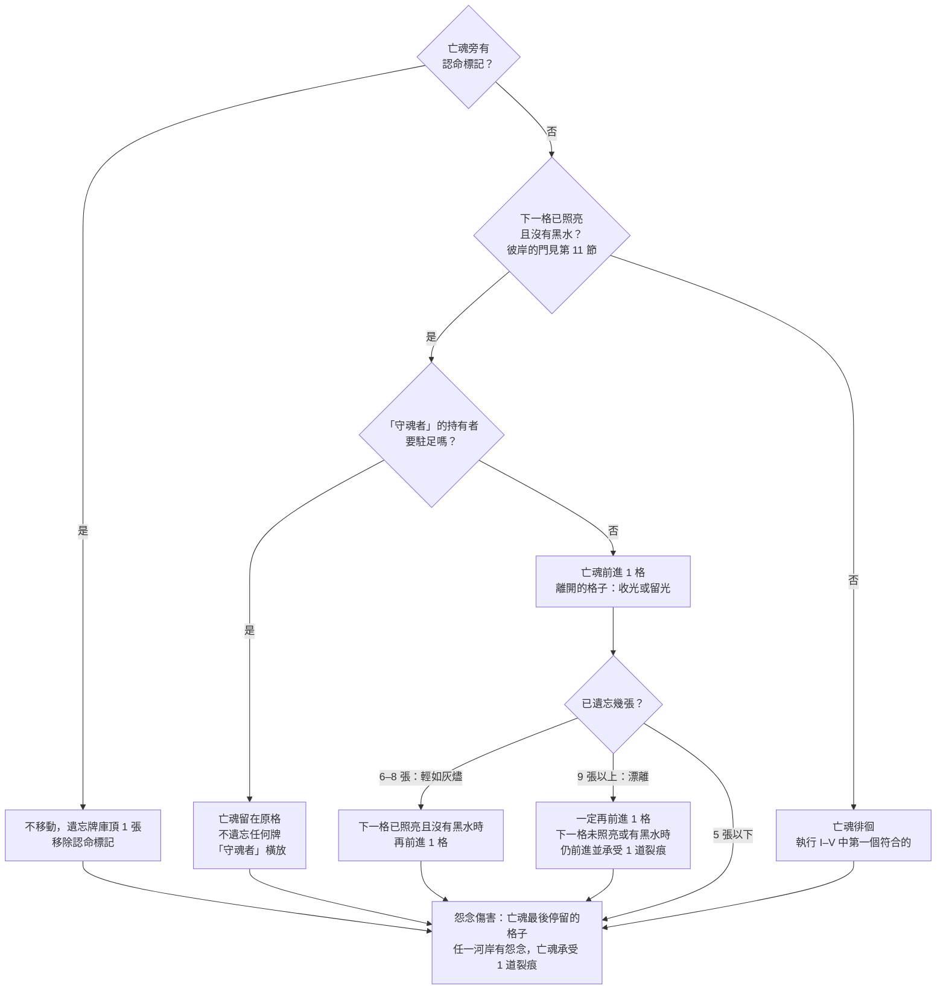

# 《彼岸花渡》Netherbloom — 單人模式規則書 V5

> 單人模式的完整流程：遊戲準備、你的回合與回合結束都寫在本書，照著做就能開始遊玩。用語、配件、河流、命運織機、憶念之書、卡牌與亡魂的說明，請在需要時翻閱《規則書》的對應章節。本書由 web/tools/build_solo_rulebook.py 依《規則書》產生。

- [1. 單人模式怎麼玩](#1-單人模式怎麼玩)
- [2. 需要的配件](#2-需要的配件)
- [3. 遊戲準備](#3-遊戲準備)
- [4. 你的回合](#4-你的回合)
- [5. 回合結束](#5-回合結束)
- [6. 命運織機的門檻](#6-命運織機的門檻)
- [7. 稱號](#7-稱號)
- [8. 幽靈牌](#8-幽靈牌)

## 1. 單人模式怎麼玩

你獨自擔任擺渡人，帶亡魂渡過忘川，並寫下祂的憶念之書。勝負條件與《規則書》第 1 節相同：亡魂抵達彼岸時，完成你的 1 張託付即獲勝；消散、破碎、滅頂或失落則落敗。

**幽靈**是一位看不見的同伴：它沒有手牌，在你的每個回合結束時翻開一張幽靈牌，替你照料河流，也會在織機上打結、移動迴響標記。

單人模式中沒有其他玩家，所以隱憶之約不適用；用語表的「輪」即是你的 1 個回合。

## 2. 需要的配件

使用遊戲盒中的全部配件（見《規則書》附錄 A），另外加上 12 張**幽靈牌**（見第 8 節）。

## 3. 遊戲準備

### 選擇亡魂與難度

先選一位亡魂（見《規則書》第 13 節），再選擇以下一種難度。

| **難度** | ◆◇◇ 溫和 | ◆◆◇ 標準 | ◆◆◆ 困難 |
|---|---|---|---|
| **霧推進時霧勢** | +0 | +1 | +1 |
| **被迷霧籠罩時** | 只留霧痕 | 只留霧痕 | 留霧痕，並承受 1 道裂痕 |
| **起始結** | 0 | 0 | 每條絲線 1 結 |
| **消散門檻** | 遺忘 14 張 | 遺忘 12 張 | 遺忘 12 張 |
| **破碎門檻** | 5 道裂痕 | 4 道裂痕 | 3 道裂痕 |
| **黑水** | 7 個 | 6 個 | 6 個 |

**單人模式的設定**：

| 項目 | 單人模式 |
|---|---|
| 第三河段的墳墓 | 2 塊 |
| 要完成的託付 | 1 張 |
| 手牌（暨上限） | 6 張 |

**新手的第一局**：建議以溫和難度遊玩**最後火光的孩子**。

### 準備步驟

1. **河流圖板**：依序拼接 3 塊河流圖板：第一河段・日光蘭之路（此岸第 0 格與第 1–4 格）、第二河段・哀悼之野（第 5–8 格）、第三河段・忘川之岸（第 9–13 格，盡頭是彼岸第 14 格）。
2. **河岸板塊**：三個河段分別準備。第 1 格沒有板塊。
    1. 拿出每個河段所需的墳墓數量，擺在河段板塊池旁：第一河段 0 塊，第二河段 1 塊，第三河段 2 塊。
    2. 將河段板塊池的板塊（見《規則書》附錄 A）面朝下洗勻，抽出每個河岸所需的數量：第一河段 6 塊，第二河段 7 塊，第三河段 8 塊（10 塊減去 2 塊墳墓）。
    3. 把每個河段的墳墓和抽出的板塊一起面朝下洗勻，霧面朝上隨機放到各個河段的河岸上。
    4. 沒抽到的板塊不翻開，放回盒中。
    5. 備用板塊（花田 2、沃土 2、記憶之泉 2）面朝上放在一旁。命運之霧與迷霧牌替換板塊時使用。
3. **最初的花與亡魂**：在第 1 格的左岸與右岸各放 1 個指示物，花面朝上。亡魂標記放在此岸（第 0 格）。霧從第 0 格之後開始，此時還沒有任何河岸被霧吞沒。
4. **亡魂牌**：所選亡魂的亡魂牌面朝上放在圖板旁。它的特色規則整局有效。
5. **記憶牌庫**：把 32 張基本記憶牌和所選亡魂的 8 張專屬記憶牌洗混，面朝下放在渡帳的牌庫框。亡魂為「無名渡河」時改用 8 張迴響牌。
6. **迷霧牌庫**：迷霧分成三副（《規則書》附錄 C）：淺霧用於第一章、濃霧用於第二章、深霧用於第三章。
    1. 每副加入 1 張「漲水」與 1 張「怨念逼近」，再隨機加入 2 張凶霧。剩下的凶霧放回盒中。
    2. 三副分別洗混，面朝下放在一旁。
    3. 把淺霧牌庫放進迷霧槽，翻開淺霧牌庫頂的 1 張，面朝上放在迷霧槽前：這張是**前方的霧**。淺霧牌庫頂下一張的牌背也看得到：它印著絲線與霧勢。
7. **命運織機**：擺放織機於河流圖板旁。三條絲線各放 1 個結標記在結軌的 0；若選擇困難難度，則放在 1。再各放 1 個傷疤標記在同一條結軌的 10（淡藍綠色的「傷疤 0」格，單人模式的門檻，見第 6 節）。迴響標記放在織機的沉默格。
8. **稱號**：5 張稱號牌面朝上排在供應區上方的稱號列。
9. **憶念之書**：把所選亡魂的書翻到第一章，再把該亡魂的 12 張命運之霧依章節分成三組，每章 4 張：2 張河流條件、2 張書上條件。從第一章的河流條件與書上條件中各隨機抽 1 張，條件面朝上放在書旁；其餘面朝下放在一旁。結局牌面朝下放在一旁，不要翻看。亡魂「無名渡河」沒有結局牌。
10. **渡帳**：黑水標記依難度放在黑水供應區：溫和 7 個，標準和困難 6 個。光標記放在光軌上所選亡魂的起始光（見《規則書》第 13 節，若無指定即是 0）。裂痕標記放在裂痕軌的 0。根／花指示物、怨念、霧標記，以及堅守、護盾、認命標記與根網特性標記分別放在供應區。
11. **託付卡**：把所選亡魂的 8 張託付卡洗勻，抽 1 張面朝下放在自己面前，自己可以看。其餘面朝下放在一旁，供重抽使用。你需要完成這 1 張。
12. **擺渡人**：抽 6 張手牌。拿 1 個破浪標記，藍色面朝上。船槳整局放在你面前。
13. **幽靈牌庫**：洗混 12 張幽靈牌，面朝下放在一旁（見本書第 8 節）。

準備完成後，開始你的第一個回合。

## 4. 你的回合

你獨自進行每一個回合，每個回合依序執行：

1. **第一個行動之前**，可執行以下多項，且不佔行動、順序自由：
    - **召喚稱號**：支付光，並**棄 1 張與稱號同絲線的手牌**（見《規則書》第 9 節）。
    - **重抽託付**，整局一次：把你的託付卡面朝下移出遊戲，重抽 1 張。
    - 擁有「收割者」稱號者，執行其能力。
2. **第一個行動（可共鳴）**：正面打出（見第 4-1 節）、背面打出（見第 4-2 節）或換牌 1 張牌（見第 4-3 節），或喚回（見第 4-4 節）。
3. **第二個行動（不可共鳴）**：正面打出、背面打出或換牌 1 張牌，或喚回。
4. **點亮與託付**，都可選：
    - **點亮記憶**：每支付 1 點光，點亮書上 1 段記憶，每回合點亮數量不限（見《規則書》第 10 節）。
    - **翻開已完成的託付**（見《規則書》第 12 節）。
5. **回合結束**（見第 5 節）。

兩個行動合計，每回合最多換牌一次、喚回一次。任何時候都可以使用自由行動**奮力駛過**（見第 4-5 節）。

### 打牌方式

|  | **正面打出** | **背面打出** | **換牌** | **喚回** |
|---|---|---|---|---|
| **效果** | 卡牌效果 | 放置 1 個根；無處可放時改得 1 點光 | 正面打出換來的牌 | 支付 3 光，把遺忘堆的 1 張執念或釋懷牌銘刻回書上 |
| **加結** | 這張牌的絲線 +1 | 這張牌的絲線 +1 | 同正面打出 | 不加 |
| **迴響** | 移到這張牌的絲線（第一或第二個行動皆然） | 不動 | 同正面打出 | 不動 |
| **共鳴** | 只有第一個行動可共鳴，且須迴響標記原本就在這張牌的絲線上 | 不會 | 同正面打出 | 不會 |
| **可以銘刻** | 迴響原本就在這張牌的絲線上；關鍵記憶隨時可以 | 不行 | 同正面打出 | 一定銘刻 |
| **如何擺放這張牌** | 銘刻進書；否則執念、釋懷進棄牌堆，忘卻進遺忘堆 | 面朝上進棄牌堆 | 同正面打出 | 書上，未點亮 |

### 4-1. 正面打出

依序執行：

1. 執行卡牌效果。
2. 將命運織機上與卡牌絲線相同的結軌上打 1 個結。絲線打滿時，**先立即反噬**，再繼續下一步（見《規則書》第 7 節）。
3. 檢查打出這張牌**之前**迴響標記在哪條絲線上。如果與這張牌的絲線相同：
    - 且這是第一個行動時，執行卡牌的**共鳴**效果。標示「改為」的共鳴效果取代一般效果。
    - 且這是第二個行動時，不能執行卡牌的共鳴效果。
    - 不論是哪一個行動，玩家可以**銘刻**此牌到憶念之書當前路線上欄位相符的空記憶格，並朗讀它的記憶。這叫做**迴響銘刻**。
4. 將織機上的迴響標記移動到這張牌的絲線上。
5. 當此牌沒有被銘刻，若為執念牌與釋懷牌則放入棄牌堆，忘卻牌則放入遺忘堆。

含有**關鍵記憶**的卡牌只要被正面打出，不論迴響在哪條絲線，都可以銘刻該牌的記憶。

> **例子**：迴響在釋懷。你用第一個行動打出一張執念牌：迴響不在執念，所以不共鳴，也不能迴響銘刻；迴響移到執念。接著用第二個行動再打出一張執念牌：迴響已經在執念，所以這張可以銘刻。它不共鳴，因為共鳴只屬於第一個行動。

### 4-2. 背面打出

忽略卡牌上印的效果，改為放置 1 個根（見《規則書》第 6 節）。沒有可以放根的空河岸時，改為獲得 1 點光。不論放置根、或獲得光，都在這張牌的絲線上打 1 個結。迴響標記不移動，並將這張牌面朝上放入棄牌堆。

### 4-3. 換牌（單人模式）

把 1 張手牌放到記憶牌庫底，翻開記憶牌庫頂的 1 張，並立即正面打出，照上方的步驟執行，包括共鳴與迴響銘刻。

- 每回合最多換牌一次。

### 4-4. 喚回

佔用一個行動，每回合最多使用一次。支付 3 點光，從遺忘堆選 1 張執念或釋懷牌，把它銘刻到當前路線上欄位相符的空記憶格，並朗讀它的記憶。這段記憶未點亮。

- 只能寫進當前路線上的空記憶格。還沒走到的格子、關閉的岔路與之前的章節都不行；沒有相符的空格時，不能喚回那張牌。
- 忘卻牌不能喚回。
- 可換回被遺忘的關鍵記憶。
- 喚回不移動迴響標記，也不打結。
- 遺忘堆少了 1 張：將遺忘標記在遺忘軌上退 1 格。

### 4-5. 奮力駛過（自由行動）

- **使用時機**：任何時候，且下一格的**兩個**河岸都有怨念，並且下一格沒有黑水。
- **效果**：把那兩個怨念放回供應區，亡魂移到下一格。離開原來那一格時，照常選擇收光或留光。把你的破浪標記翻到背面。接著亡魂承受 1 道裂痕。
- 不佔用行動，也不移動迴響標記。整局一次。

## 5. 回合結束

你的每一個回合之後，都要依序執行這些步驟：

1. **引花人**：你持有「引花人」稱號時，可以免費使 1 個根綻放。
2. **亡魂行動**：依照下方流程執行（見第 5-1 節）。
3. **怨念推進織機**：亡魂所在格的每個怨念，在織機上打 1 個結：左岸則打在執念，右岸則打在釋懷，霧中的怨念則打在忘卻。
4. **迷霧**：
    1. 執行前方的霧上的指示。
    2. **霧推進**：只在亡魂這回合沒有前進時執行。推進的河岸數是這張迷霧牌的霧勢，加上難度的加值（見《規則書》第 6 節）。
    3. **檢查籠罩**：亡魂所在格兩岸都是霧面時，亡魂被迷霧籠罩：剛執行的迷霧牌成為霧痕（見《規則書》第 10 節）。遊戲難度為困難時，另外承受 1 道裂痕。
    4. 沒有成為霧痕的迷霧牌放入迷霧棄牌堆。翻開迷霧牌庫頂的 1 張，成為新的前方的霧。牌庫空了時，從迷霧棄牌堆取出本章那一副的迷霧牌（淺霧、濃霧或深霧），洗混成新的迷霧牌庫；棄牌堆中的凶霧，以及準備時加入的那 1 張「漲水」與 1 張「怨念逼近」（任選同名的 1 張），放回盒中，本章不再使用。已成為霧痕的迷霧牌留在書上。
5. **分岔與翻頁**（見《規則書》第 11 節）：
    - 路線停在轉折前、而且命運之霧已經在 ◆ 上：立即分岔。
    - 路線走到出口：立即翻頁。
6. **整理**，逐格檢查河流：
    - **黑水**：每一個有黑水、而且**兩個**河岸都有根或花的格子，把黑水移出遊戲，放回盒中。
    - **怨念**：每個不在霧中的怨念，同側河岸的正前一格**與**正後一格都有花時，放回供應區。
7. **抽牌**，補回手牌上限。
8. **幽靈行動**：翻開幽靈牌庫頂的 1 張並執行（見第 5-4 節）。

### 5-1. 亡魂行動

1. **認命**：亡魂旁有認命標記時，亡魂不移動，遺忘牌庫頂的 1 張，移除認命標記。跳到第 5 步。
2. **判定能否前進**：下一格已照亮、而且沒有黑水時，亡魂前進 1 格；你持有「守魂者」稱號時，可以讓亡魂駐足。憶念之書第三章寫完之前，彼岸視為未照亮（見《規則書》第 11 節）。
3. **離開一格時**：亡魂每次離開一格都要選擇收光或留光，包括額外移動、卡牌效果與奮力駛過。收光時，那一格的花凋零成根；留光時，花維持綻放。不論哪一種，那一格的指示物都不會被移走：根、凋零後的根與怨念都留在原河岸，繼續連接根網、阻擋霧或推進織機。
4. **判定額外移動**：若亡魂本回合有前進，查看遺忘堆的張數：
    - 6–8 張，輕如灰燼：下一格已照亮且沒有黑水時，再前進 1 格。
    - 9 張以上，漂離：再前進 1 格。即使下一格未照亮或有黑水時，仍然前進，並承受 1 道裂痕。你持有「守魂者」稱號、且「守魂者」尚未橫放時，可以阻止這次額外移動：亡魂不移動，也不承受裂痕。
5. **怨念傷害**：亡魂完成本回合所有移動（包括額外移動）之後，檢查亡魂最後停留的那一格：任一河岸有怨念時，亡魂承受 1 道裂痕。途中經過的格子不算。不論這次是前進、駐足、認命還是徘徊，都要檢查。

**徘徊**：亡魂無法前進時，從 I 開始依序檢查，只執行第一個符合的：

- I. 亡魂旁有堅守標記：不遺忘。
- II. 你持有「守魂者」稱號，且「守魂者」尚未橫放：橫放「守魂者」，不遺忘。
- III. 亡魂所在格已照亮：不遺忘。
- IV. 亡魂是留在冥府的新娘，而且本局還沒用過特色規則：被拉回一格，不遺忘（見《規則書》第 13 節）。
- V. 以上皆非：遺忘牌庫頂的 1 張。

### 5-2. 下一個回合開始時

- 堅守標記在場時，移除它。
- 你持有的「守魂者」稱號、「破霧者」稱號，在你自己的回合開始時轉正。
- 還沒抵銷裂痕的護盾標記，在你的下一個回合結束時移除。

### 5-3. 立即生效的效果

- 絲線打滿時立即反噬，再繼續原本的步驟。
- 命運之霧的條件達成時立即翻開（見《規則書》第 11 節）。
- 以下情況立即結束遊戲：亡魂抵達彼岸，進行守岸人之問；遺忘堆達到消散門檻；裂痕達到破碎門檻；必須放置黑水但供應區已空。

### 5-4. 幽靈行動

1. 翻開幽靈牌庫頂的 1 張，執行牌上的行動（見本書第 8 節）。
2. 在這張幽靈牌的絲線上打 1 個結。絲線打滿時，立即反噬。
3. 將迴響標記移到這張幽靈牌的絲線上。
4. 再整理一次河流（回合結束步驟 6）。
5. 幽靈牌放入幽靈棄牌堆。幽靈牌庫用盡時，把棄牌堆洗混成新的幽靈牌庫。

## 6. 命運織機的門檻

單人模式的門檻較高：傷疤標記從結軌的 10 開始，每道傷疤往小的數字移一格。結軌上淡藍綠色的 10／9／8 三格，就是單人模式的門檻格。反噬的效果與時機，見《規則書》第 7 節。

| 這條絲線的傷疤 | 門檻 | 打滿時執行 |
|---|---|---|
| 0 道 | 10 | 第一級反噬 |
| 1 道 | 9 | 第二級反噬 |
| 2 道 | 8 | 第三級反噬 |

## 7. 稱號

單人模式可以更換稱號（其他規則見《規則書》第 9 節）：

- 即使已持有稱號，仍可召喚新的稱號；原本的稱號牌翻到背面，之後不能再被召喚。
- 每個稱號整局只能被召喚一次，一局最多召喚 3 次。
- 召喚仍要支付光，並棄 1 張與該稱號同絲線的手牌。

## 8. 幽靈牌

| 幽靈牌 | 張數 | 行動 |
|---|---|---|
| 執念 | 3 | 在亡魂前方最遠的空河岸放置根 |
| 執念 | 2 | 在亡魂前方最近的空河岸放置根 |
| 釋懷 | 2 | 使最近的根綻放 |
| 釋懷 | 2 | 使最遠的根綻放 |
| 忘卻 | 2 | 驅散最近的怨念，或排乾最近的黑水 |
| 忘卻 | 1 | 不採取行動 |

幽靈放置根時，照放置根的規則：那個河岸必須連接根網。「最近的」「最遠的」照《規則書》用語表的定義。
